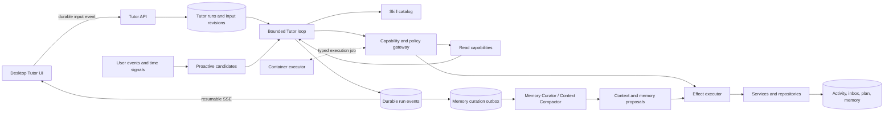

# Skill-Native Tutor Harness Design

## Status and Scope

This is a planning artifact. It defines the target architecture for the first
Skill-Native Tutor Harness release and must be reviewed with `prd.md` and
`implement.md` before implementation begins.

The target is one learner-facing Tutor Agent with an autonomous but bounded
execution loop. It replaces product-stage graphs and rule-selected specialist
handoffs. It does not grant arbitrary filesystem, shell, network, database, or
cross-user access.

## Documentation Authority Freeze

### Purpose and Precedence

The documents indexed by `docs/README.md` describe the released stage-Graph
product. They remain migration evidence, but cannot silently define the new
Harness target. Before approval, this parent is only a proposed target and does
not change runtime behavior or the published source-of-truth set.

1. Current code, tests, schema, route registration, configuration, and runtime
   smoke results are factual current-state authority.
2. Current source documents are legacy/current baseline authority: they create a
   compatibility or retirement obligation only after repository confirmation.
3. After user approval, the parent target artifacts govern the new Harness and
   Phase 0 publishes `docs/architecture/tutor-harness-transition.md` as the
   narrow, linked target contract until final documentation catches up.
4. A child must record and resolve any current-code/legacy-doc/target mismatch
   in the transition delta matrix before it uses a new field, endpoint, event,
   data operation, or UI state. It must not choose the legacy behavior by
   default.

### Documentation Delta Ownership

| Surface | Legacy/current baseline | Earliest target gate | Final owner |
| --- | --- | --- | --- |
| Routing/index | `docs/README.md` | Phase 0 publishes and links the transition contract | Child 08 |
| Product and desktop UX | user-flow and frontend specs | Child 05 freezes data semantics; Child 06 freezes interaction/adapters | Child 06/08 |
| API, SSE, and data | API/database specs | Child 00 run contract; Child 02 event/schema; Child 06 compatibility matrix | Child 02/06/08 |
| Graph/runtime/providers | LangGraph spec and current audit | Child 00/01 define replacement; Child 07 proves retirement | Child 00/01/07/08 |
| Sandbox, workers, QA, ops | setup, runner, worker, QA docs | Child 03 executor and Child 04 policy before enablement | Child 03/04/08 |
| Cutover/reset | user-flow, database, and reset baseline | Child 07 freezes deletion/preservation and verification | Child 07/08 |

Phase 0 does not broadly rewrite old documents. It creates the small transition
contract, authority labels, and compatibility/delta matrix; Child 08 completes
source-of-truth updates and archives only material proven obsolete.
## Terms

| Term | Meaning |
| --- | --- |
| Tutor | The only learner-facing conversational decision-maker. |
| Skill | Developer-owned, Git-versioned, evaluated instruction/resource bundle selected at runtime. |
| Capability | Typed Aearn command exposed through a policy gateway. It returns facts or proposes an effect. |
| Effect | Durable or externally observable action that must pass policy and revision validation before commit. |
| Run | A finite, durable Tutor execution lease. It is not a permanent autonomous process. |
| Input revision | Monotonic revision of ordered learner inputs accepted by a run. |
| Activity | Learner-safe explanation of a meaningful Tutor action/outcome. |
| Trace | Redacted engineering diagnostics, separate from conversation and long-term memory. |

## Architecture Boundary

This is not a teaching workflow graph with renamed nodes. The runtime has only
lifecycle controls: queueing, leasing, bounded model/tool iterations, safe
checkpoints, effect validation, and terminal outcomes. It does not encode an
onboarding -> learning -> review curriculum path. Tutor selects the next Skill
and permitted action from current facts, learner input, and policy.



### Non-Negotiable Invariants

- Tutor decisions never write domain tables directly. Repositories own SQL,
  transactions, and idempotency; services own use-case validation and effect
  application.
- Runner services remain the authority for execution facts. Evaluation and
  FSRS remain the authority for learning outcomes and review scheduling.
- Model output is advisory until typed capability and effect validation pass.
- Skills are product configuration, not model-generated memory. Only reviewed,
  Git-versioned Skills enter the catalog.
- Every run has model, tool, execution, token/cost, iteration, and wall-clock
  budgets. A proactive candidate may intentionally take no action.
- Memory stores evidence-backed learning facts/conclusions only. It excludes
  raw prompts, full provider payloads, hidden tests, secrets, and traces.
- `TutorContextBuilder` is the only path that composes model context. It has a
  fixed budget and selects scoped state; durable retention never implies that
  all retained conversation or traces can be rehydrated into a prompt.
- Memory Curator / Context Compactor is an internal, non-conversational worker.
  It consumes only redacted durable inputs and creates typed proposals; no model
  worker may directly write memory, plans, FSRS/review state, attempts, messages,
  activity, inbox, or another domain table.
- Code execution is allowed only in an active interactive turn whose current
  intent explicitly asks to run, test, debug, or explain code. Proactive work
  never executes learner code.

## Current-to-Target Migration Map

| Current surface | Target disposition | Target owner |
| --- | --- | --- |
| `app/agents/graphs/router.py` keyword/stage routing | Remove from learner runtime. Replace with catalog-constrained skill selection. | `agents/harness` |
| `onboarding_graph.py`, `learning_graph.py`, `review_graph.py` | Retire as product orchestration after equivalent behavior is migrated. Preserve reusable bounded/redaction and typed-intent ideas only. | harness and domain services |
| Stage write tools in `app/agents/tooling/tools.py` | Replace with capability declarations and effect proposals. The model cannot choose a user, connect to DB, or persist an attempt/profile directly. | capabilities/services |
| `tools_web.py` Exa search and arbitrary TOC fetch | Remove from Tutor. Use registry-bound grounding backed by `grounding_sources.py` and indexed content only. | grounding service |
| Current conversation services | Extract reusable safe-context, guardrail, public-output, and domain command adapters from fixed stage control. | `services/tutor` |
| LangGraph checkpoint configuration | Do not use as new product state. Retire legacy checkpoint/store data during cutover. | tutor repositories |
| Request-scoped `SSEWriter` streams | Keep current event vocabulary during migration, backed by durable run events and replay cursors. | streaming service |
| Subprocess Python sandbox | Replace with a container executor service and execution lifecycle records. | runners/worker/infra |
| Opaque `learner_profiles` | Replace with learner-inspectable evidence-backed memory entries. | tutor memory repository |
| Reset preserving profile/preferences | Add a one-time cutover reset that removes legacy learning and Agent-derived data, including legacy profile, while preserving identity, provider configuration, and UI settings. | cutover service |
| Review-only worker tasks | Retain review domain work; add generic candidate scheduling and bounded proactive Tutor work. | worker |

Old Graph code remains only behind a tested legacy adapter during transition.
After the final cutover release has no caller, remove Graph/checkpointer/SDK
production dependencies that are no longer required by retained code.

## Tutor Runtime

### Finite Run Loop

Each `TutorRun` is leased by exactly one worker. The worker re-enters the loop
only while its lease and policy budgets are valid. The loop is a runtime safety
mechanism, not a product teaching flow:

1. Load a budgeted `TutorContext`: latest input revision, active plan revision,
   review/FSRS snapshot, recent relevant messages, bounded working summary,
   selected learner-visible memory, relevant activity/execution facts, policy,
   Skill descriptors, and allowed capabilities.
2. Resolve catalog entries whose compatibility predicates match the user, goal,
   session facts, and policy. Never load a Skill from a model-provided path.
3. Ask the configured primary model for selected Skills and a next action from
   supplied catalog/capability schemas.
4. Validate decision schema, Skill ids/versions, capability arguments, and
   policy preconditions. Reject unknown Skills, capabilities, or effect types.
5. Execute a bounded read capability or create a pending effect, then append
   redacted trace and event records.
6. At every safe checkpoint, check latest input, lease expiry, budgets,
   cancellation, policy changes, and circuit-breaker state.
7. Commit an effect only if `expected_input_revision` still equals current run
   revision. Otherwise mark it `stale_rejected` and continue from fresh
   context; already committed safe facts remain visible.
8. Publish learner-safe events/activity and finish with `completed`,
   `waiting_for_learner`, `model_unavailable`, `blocked_policy`,
   `budget_exhausted`, or `failed`.

Server policy supplies hard limits for loop iterations, model/tool calls,
concurrent runs per user, execution attempts, deadline, tokens, and proactive
daily cost. Every run records the effective policy snapshot; the model cannot
relax it.

### Context Builder and Curator Handoff

`TutorContextBuilder` is a deterministic service boundary, not an implicit
prompt append. It applies explicit token and item budgets in this order:
system/Skill/policy material, active plan revision, review/FSRS snapshot, recent
conversation, prior bounded working summary, selected learner memory, relevant
activity/execution facts, and capability schemas. It records only source ids,
hashes, and selected-budget metadata in checkpoints/traces; raw provider
prompts and full hidden context never become durable diagnostics.

At a run terminal state, a safe checkpoint, an evaluation/review result, an
accepted plan change, or a configured context high-water mark, the lifecycle
service may request compaction. It never requests curation for every generated
token or streamed event. Child 00 owns the typed request and checkpoint reason;
Child 02 persists a redacted, ordered transactional outbox record; Child 04
leases it with low-priority worker/budget/retry controls; and Child 05 supplies
the guarded Curator plus proposal semantics.

The request is anchored to a user/conversation/run and a closed event or input
sequence range. It includes only redacted structured facts, references, hashes,
and the current policy/memory-setting version. Re-delivery is safe because the
outbox key and each resulting proposal are idempotent. A newer input or policy
does not allow an old proposal to overwrite current state.

### Safe Input-Merge Protocol

New learner messages work like Codex steering, not a cancel/continue modal.

1. The desktop posts to `POST /api/tutor/runs/{run_id}/inputs`, or to a
   conversation input endpoint that returns the compatible active run id.
2. The server persists a `TutorMessage` plus ordered `TutorRunInputEvent` in
   one transaction, increments `current_input_revision`, and emits an input
   acknowledgement.
3. An in-flight model/tool call is not interrupted at an unsafe point. The UI
   may show a non-blocking "Tutor is incorporating your new message" state.
4. Before another model call, before capability dispatch, after a capability
   result, and before effect commit, the worker reloads current revision.
5. Stale final drafts, plan changes, note proposals, or other uncommitted
   effects are not published/committed. Tutor rebuilds bounded context and
   decides whether to continue, redirect, or stop naturally.
6. A container run already underway may finish as a bounded audited fact or be
   cancelled only by executor-safe cancellation. Its result alone cannot alter
   a plan or FSRS state.
7. The UI retains committed learner messages and safe facts. It never asks the
   learner to choose what to interrupt.

Sequencing is server-owned. A client retry includes a stable client message id
and replays the same event; it must not create a second input revision.

### Run States and Leases

`queued`, `leased`, `running`, `waiting_for_input`,
`waiting_for_capability`, `awaiting_effect_commit`, `completed`,
`model_unavailable`, `blocked_policy`, `budget_exhausted`, `cancelled`, and
`failed` are runtime lifecycle states. They are never exposed as a curriculum
or stage machine. Leases have expiry/heartbeat; a worker crash returns a run to
a safe resumable state under bounded retry policy. A run never executes two
effects concurrently.

## Skill Catalog

### Published Skill Shape

Skills live under a developer-owned source root such as
`aearn/services/api/app/agents/skills/<skill_id>/<semantic_version>/`. A build
step validates each manifest and compiles an immutable catalog snapshot used by
deployed runtimes.

```yaml
id: tutor.diagnose-code-error
version: 1.0.0
kind: tutoring
summary: Diagnose a learner-visible failure without exposing hidden tests.
instruction_file: instructions.md
resource_refs:
  - grounding/python-tutorial
requires_capabilities:
  - context.read_attempt
  - grounding.retrieve
  - runner.execute
allowed_effect_types:
  - activity.record
policy_tags:
  - interactive_only_for_execution
input_contract: tutor.skill-input.v1
output_contract: tutor.skill-decision.v1
evaluation_suite: tests/skills/tutor.diagnose-code-error
```

Every manifest contains stable id, semantic version, ownership,
instruction/resource hashes, capability requirements, policy tags, structured
input/output contracts, an evaluation suite, and deprecation/replacement data
when relevant. The compiler rejects a Skill whose capability does not exist,
resource is outside the registry, contract is invalid, or evaluation coverage
is missing.

### Selection and Loading

- Runtime supplies a bounded set of policy-eligible catalog summaries. Tutor
  may select only entries in that set.
- Runtime resolves the exact versioned instruction/resources after selection
  validates. Skill text is prompt/resource data, not code executed by Tutor.
- The selected skill versions and manifest hashes are stored in `TutorRun` so
  behavior can be evaluated and replayed against the release catalog.
- Tutor can propose a teaching strategy but cannot write, install, or persist
  an executable Skill. Developer review and Git publication are the only path.
- Learners always talk to "Tutor", not hidden specialist agents. Activity may
  explain a meaningful action without showing a handoff topology.

## Capability and Effect Gateway

Capabilities use Aearn-owned Pydantic/JSON schemas that are MCP-compatible at
the boundary. In-process calls stay typed Python commands. MCP transport is
reserved for separately deployed/external capabilities, such as the container
executor, and is not required for every internal domain call.

| Capability family | Mode | Required policy |
| --- | --- | --- |
| `context.read_*` | read | Current user scope and bounded/redacted fields only. |
| `context.propose_summary` | internal effect proposal | Curator origin only; closed redacted segment, retention, and current policy/memory-setting version. |
| `grounding.retrieve` | read | Registered source/language/topic scope and indexed allowlisted content only. |
| `plan.propose_revision` | effect proposal | Active plan plus evidence and learner-safe diff. |
| `plan.activate_revision` / `plan.rollback_revision` | effect | Valid revision lineage, idempotency, current input revision. |
| `practice.create` | effect proposal | Runtime/language capability and exercise contract validate. |
| `runner.execute` | effect | Interactive explicit execution intent, current scope, image/runtime allowlist. |
| `evaluation.read` / `review.prepare` | read or bounded effect | Model never owns FSRS decision. |
| `memory.propose_entry` / `memory.correct` / `memory.delete` | effect | Evidence, confidence, user setting, inspectable result. |
| `note.propose` | effect proposal | User-owned knowledge point scope and redacted content. |
| `activity.record` | effect | Learner-safe reason/outcome/source refs only. |

Gateway input includes current user/run/origin/input revision, capability
descriptor, consent facts, budget state, and policy snapshot. It returns a
typed result, policy denial, or pending effect. It never accepts an arbitrary
function name, URL, shell command, SQL fragment, filesystem path, or image
name from the model.

### Effect Commit Rules

1. Model/capability creates a typed proposal with evidence, learner-safe
   reason, idempotency key, and `expected_input_revision`.
2. Service validates schema, ownership, policy, and domain preconditions.
3. Repository commits transactionally only if run current revision still
   matches and idempotency record is compatible.
4. A success creates learner-safe activity. A denied/stale effect only creates
   a redacted trace record and is never presented as completed work.

Curator-originated output follows the same proposal path but has no direct
commit capability: it may produce a `context_summary` or `memory_entry`
proposal only. Policy/service/repository validation checks origin, evidence,
confidence, provenance, user setting, staleness/retention, user ownership, and
idempotency before any durable projection is applied.

This retains the useful existing typed-intent boundary while making durable
actions explicit and safe under mid-run steering.

## Provider Gateway

Harness introduces an Aearn-owned provider interface for structured decisions
and streamed learner text. DeepSeek Chat Completions and the existing
OpenAI-compatible Responses provider implement the same contract.

- Deployment selects one configured primary provider/model. Provider/model
  fingerprint is recorded in redacted run trace.
- Curator jobs use that same selected primary provider/model, never a hidden
  specialist or fallback model. Their policy has a lower per-job token, call,
  frequency, wall-clock, and retry budget than interactive Tutor runs.
- Transient failures retry only that primary provider with bounded backoff.
- Retry exhaustion, invalid structured output, configuration failure, or unsafe
  public output results in stable `MODEL_UNAVAILABLE` with redacted diagnostic.
- First release has no automatic cross-provider fallback and no dynamic model
  routing by task, price, or quality. A future fallback is a separate product
  policy/evaluation change.
- Adapters never expose raw payloads, API keys, internal prompts, or provider
  error bodies to events, activity, memory, exports, or normal UI.

## Durable Data Model

New state is Aearn-owned product data, not a repurposed LangGraph checkpoint
store. Exact SQL names may change, but these entities/invariants are required.

| Entity | Required invariant |
| --- | --- |
| `tutor_conversations`, `tutor_messages` | User-scoped visible history. Raw learner text lives here only, not in memory/traces. Stable client ids and ordered sequence. |
| `tutor_runs` | User/conversation scope, origin (`interactive`/`proactive`), status, catalog/policy snapshots, current input revision, budgets, lease, terminal code/timestamps. |
| `tutor_run_input_events` | Monotonic sequence/revision, message id, source, accepted timestamp, idempotency. Unique `(run_id, revision)`. |
| `tutor_run_checkpoints` | Redacted resumable state references, revision, loop iteration, context hashes, checkpoint reason. No raw prompt/provider payload. |
| `tutor_run_events` | Durable ordered redacted SSE payloads. Unique `(run_id, event_sequence)`. |
| `tutor_memory_curation_outbox` | Transactional redacted compaction request, closed source range, policy/memory-setting version, dedupe/idempotency key, priority, retry/no-action status. |
| `tutor_capability_invocations` | Capability/version, input/output hash, policy decision, timing, expected revision, redacted diagnostic. |
| `tutor_effects` | Proposed/validated/committed/stale_rejected/failed state, evidence, expected revision, idempotency, domain result reference. |
| `tutor_activity_events`, `tutor_inbox_items` | Learner-safe reason/result/sources, linked run/effect, unread state. Normal success never injects chat or desktop notification. |
| `tutor_memory_entries`, `tutor_memory_evidence` | Visible fact/inference, evidence, confidence, provenance, edit/delete/disable support. No raw prompt/provider/secret fields. |
| `tutor_context_summaries`, `tutor_memory_proposals` | Bounded redacted segment summary or learner-memory proposal, source range/evidence, confidence/provenance, staleness/retention, validation status, and idempotency. A proposal is not a committed memory entry. |
| `tutor_proactive_signals`, `tutor_candidate_runs` | Signal, dedupe key, cooldown/budget/policy decision, queued run, no-action reason. |
| `learning_plan_revisions` | Immutable revision, reason/evidence/diff, source run, activation and rollback lineage. |
| `sandbox_execution_records` | User/run/effect linkage, image/runtime, limits, lifecycle, bounded result reference, no host-path leak. |
| `harness_cutovers` | User-scoped gate status, deletion-summary hash, confirmation/execution/verification result, Harness schema version. |

### Conversation, Trace, and Memory Separation

Conversation history is visible product content and follows normal reset/delete
rules. It is not silently copied into long-term memory. Traces are bounded and
redacted operational data. Memory is a third store with explicit evidence,
confidence, user visibility, correction, deletion, and global disable control.

A `tutor_context_summary` is a bounded, redacted checkpoint-like artifact scoped
to its conversation/run source range. It is not a learner fact, cannot be shown
as one, and cannot by itself justify a learner-memory entry. Its retention and
deletion follow the conversation/checkpoint contract; it may only enter a future
`TutorContext` through the same Context Builder budget and scope rules.

### Memory Curator / Context Compactor

The Curator is a background infrastructure lane, not a second Tutor or a
proactive teaching candidate. It reads only eligible rows from
`tutor_memory_curation_outbox`; it does not read arbitrary conversation rows,
raw prompts, provider payloads, hidden tests, or trace bodies. It can return
only two typed outputs:

1. a scoped `context_summary` proposal for bounded continuation/recovery; or
2. a learner-inspectable `memory_entry` proposal with evidence references,
   confidence, provenance, source scope, and staleness/retention metadata.

The Curator has no capability to emit learner text, activity/inbox items, code
execution, plan actions, review actions, FSRS changes, or direct SQL/repository
writes. It cannot turn a summary into a learner conclusion without a separate
validated memory-entry proposal. Objective execution/evaluation/review facts
continue to be written by their authoritative services and may be referenced as
evidence, never inferred as a replacement.

The learner memory setting rejects new inferred `memory_entry` proposals and
excludes disabled entries from future context; it does not rewrite authoritative
runner/evaluation/review facts or visible conversation history. A hard background
pause blocks Curator leasing. Provider failure leaves an outbox request pending,
skipped, or safely failed with a redacted trace and never triggers a different
provider/model.

### Versioned Learning Plans

`learning_plans` stays the stable learner-facing identity and gains an active
revision pointer. A proposal creates an immutable revision with normalized
snapshot or revision-owned module/knowledge-point records, structured diff,
evidence ids, and learner-safe reason. Activation switches the active pointer
transactionally. Rollback switches to a valid predecessor and records an
activity event.

Sessions, attempts, review state, and activity carry the revision that
produced their facts. A plan revision alone never changes FSRS. The plan domain
service validates curriculum/scheduling invariants before activation.

## API and Event Contract

### New API Surface

Harness uses durable run endpoints instead of a POST request whose HTTP
connection owns the entire Tutor turn.

| Endpoint | Purpose |
| --- | --- |
| `POST /api/tutor/conversations` | Create or resume a user-scoped Tutor conversation. |
| `POST /api/tutor/conversations/{conversation_id}/inputs` | Persist learner input; starts a run or merges into compatible active run; returns run id/revision. |
| `POST /api/tutor/runs/{run_id}/inputs` | Explicit active-run input merge endpoint. |
| `GET /api/tutor/runs/{run_id}` | Learner-safe run state and terminal outcome. |
| `GET /api/tutor/runs/{run_id}/events` | Resumable SSE using per-run event sequence and `Last-Event-ID`. |
| `GET /api/tutor/activity`, `POST /api/tutor/inbox/{id}/read` | Activity timeline and inbox read state. |
| `GET/PATCH/DELETE /api/tutor/memory/*` | Inspect, correct, delete, and globally disable memory. |
| `GET /api/plans/{plan_id}/revisions`, `POST .../rollback` | View revision diffs and one-action rollback. |
| `GET/PATCH /api/tutor/preferences` | Proactive global enable/pause and learner-visible policy controls. |
| `POST /api/harness/cutover/confirm` | Execute explicit clean-slate transition after summary confirmation. |

Mutations require client idempotency. Add stable error codes including
`MODEL_UNAVAILABLE`, `RUN_NOT_ACTIVE`, `RUN_INPUT_CONFLICT`,
`STALE_EFFECT_REJECTED`, `CAPABILITY_DENIED`, `CUTOVER_REQUIRED`, and
`CUTOVER_VERIFICATION_FAILED` to the API contract.

Memory inspection returns learner-safe entry type, evidence references,
confidence, provenance, retention/staleness state, and correction/delete/disable
controls. It never returns a Curator prompt, raw source segment, model rationale,
or provider payload.

### SSE Compatibility and Evolution

Keep these current event types valid during migration: `agent_message`,
`tool_status`, `tool_call`, `runner_result`, `evaluation_result`, `done`, and
`error`. Harness adds versioned optional events such as `run_state`,
`input_accepted`, and `activity`. Legacy desktop code ignores unknown events;
new code parses all events as discriminated unions.

Every event has a durable run-local sequence/id. Reconnection resumes from a
cursor without duplicating tool cards or losing terminal state. Existing
onboarding/learning/review message endpoints remain short-lived adapters only:
they create/continue a Tutor run and translate public events to the old shape.
After desktop migration and cutover, remove adapters and fixed Graph routes
instead of retaining two production decision systems.

## Learner Flows

### First Harness Entry and Cutover

1. Bootstrap checks `harness_cutovers` and a server-computed legacy-data
   summary before opening either runtime.
2. Legacy data without verified cutover shows a blocking one-time screen with
   exact deleted and retained categories. Startup/deployment never auto-deletes.
3. Confirmation runs extended reset, removes legacy checkpoints and
   Agent-derived profile data, invalidates stale idempotency/bootstrap state,
   verifies counts, and writes verified cutover state.
4. UI clears user-scoped cached plan/session state while retaining local
   identity, provider/model configuration, and UI settings. It opens a guided,
   free-text Tutor goal conversation.
5. Tutor may teach immediately or activate a labelled provisional plan
   revision. It asks a follow-up only when that changes the next useful action.

### Interactive Conversation

1. Learner sends free text; UI appends user bubble, persists input, and
   follows/reuses returned run event stream.
2. Tutor dynamically selects Skills, grounding, and domain capabilities.
   Learner-safe status/activity copy explains meaningful work without
   chain-of-thought or internal policy.
3. Learner can send another message while Tutor runs. Composer stays enabled;
   input is merged without cancel/continue modal.
4. Tutor refreshes context at safe checkpoint. Stale uncommitted effects never
   apply.
5. Completed actions appear in activity timeline. Detailed traces remain
   diagnostics-only.

### Code Execution

1. Learner explicitly asks to run, test, debug, or explain current code.
2. Gateway validates intent, user/session scope, runtime availability, budget,
   and container policy.
3. Executor runs scoped code in allowlisted no-network container.
4. Runner facts use current compatible result contract and appear as activity.
   Tutor may explain or select the next action.
5. Execution facts cannot independently activate a plan revision or update
   FSRS; each requires its own validated domain effect.

### Proactive Work

1. A user event or policy-defined time signal creates a deduplicated candidate.
2. Scheduler checks global pause, user concurrency, cooldown, budget, circuit
   breaker, source scope, and capability allowlist before leasing it.
3. Tutor can prepare review, retrieve registered-source material, refine plan,
   or decide no work is worthwhile. It cannot execute learner code or access
   arbitrary web URLs.
4. Meaningful output creates activity and unread in-app inbox state, never an
   unsolicited active-chat message or normal-success desktop notification.
5. Memory Curator is not a proactive Tutor candidate. Its low-priority curation
   job may create only a validated summary/memory projection and never creates
   chat, inbox, notification, plan/review/FSRS, or execution output.

## Grounding Boundary

`grounding_sources.py` is the developer-governed registry for all Tutor
grounding. Retrieval accepts source/language/topic scope, queries indexed
registry content, and returns bounded citations. It has no arbitrary
`web_search` or URL fetch. Registry changes are reviewed, domain/trust
validated, indexed through a controlled pipeline, and evaluated per language.

## Container-Grade Sandbox

API process never receives Docker daemon privileges. A separate executor
worker/service accepts authenticated typed jobs and launches ephemeral
allowlisted runtime images by immutable digest.

Required isolation:

- default `network=none`; no DNS or host-network path;
- no host bind mounts and no user-selected image/command; scoped temp storage;
- read-only root filesystem, explicit writable tmpfs/work area, dropped Linux
  capabilities, `no-new-privileges`, bounded PID/CPU/memory/output/wall clock;
- mandatory cleanup and audit of container id/image digest/lifecycle; bounded
  public result/error projection;
- language/runtime allowlists tested against network, filesystem, limits,
  timeout, output, and cleanup negative cases.

Docker Desktop may back local development, but executor queue and image registry
are a separate security boundary. The current subprocess runner can exist only
as disabled legacy-adapter fallback during migration; it is removed before
Harness execution is enabled for learners.

## Proactive Scheduler and Policy

Scheduler is event-driven, not a continuous self-running Tutor loop. Signals
include learner activity, review-due changes, plan context changes, source
refresh policy, and bounded time signals. Each has a stable dedupe key and
records why it was accepted, skipped, or rate-limited.

Proactive Tutor is enabled by default after cutover. A user can disable or
hard-pause it. Server policy always enforces daily/run budgets, timeouts,
retry caps, circuit breakers, per-user concurrency, source limits, and
capability restrictions. User settings cannot weaken those safety controls.

Curator jobs reuse the durable worker safety primitives without becoming
proactive Tutor candidates. They have an independently lower curation budget,
cooldown, retry cap, and concurrency class; the hard background pause and the
learner's inferred-memory setting are both enforced before a provider call.

## Observability and Evaluation

Each run records selected Skills, capability invocations, policy decisions,
input revisions, effect lifecycle, provider result, budget consumption, and
redacted diagnostics. Learners see only action reasons, sources, plan diffs,
execution outcomes, and recovery/rollback controls.

Required evaluation suites cover catalog/capability compatibility; citation and
source scope; leakage prevention; concurrent input merge/stale-effect rejection;
finite budgets/retries/`MODEL_UNAVAILABLE`; plan diff/activation/rollback;
memory evidence/edit/delete/disable; proactive dedupe/pause/budget/no-execution;
container isolation; Curator outbox ordering/idempotency/redaction/no-direct-
domain-write/disable/pause/budget behavior; and API/SSE reconnect/desktop
rendering. Use fake providers and deterministic capabilities for normal test
coverage.

## Clean-Slate Cutover and Rollback

Cutover is intentionally destructive because legacy history is not a
compatibility target. The deletion summary lists plans, modules, knowledge
points, exercises, sessions, attempts, review state/logs, notes,
onboarding/learning/review messages, legacy profile/preferences, Agent
artifacts, idempotency records, and LangGraph checkpoint/store data. It also
lists preserved local user identity, provider/model configuration, and UI
settings.

Reset executes transactionally where possible and only succeeds after
post-delete verification confirms no specified legacy user-owned rows or
checkpoints remain. A verification failure leaves cutover blocked with
`CUTOVER_VERIFICATION_FAILED`; neither runtime opens. No deployment hook may
invoke this operation.

Before confirmation, code rollback is feature-flag based and legacy flow is
available. After confirmed clean-slate deletion, a prior application version
can be restored but intentionally deleted history cannot. The cutover screen
must state this irreversible boundary before confirmation. Harness data has
its own migration/version rollback path and never depends on legacy Graph
checkpoints.

## Documentation Impact

Implementation updates the source-of-truth documents listed by `docs/README.md`:
`product/user-flows.md`, `product/frontend-interaction-spec.md`,
`architecture/api-contract.md`, `architecture/database-schema.md`, the current
Agent/runtime architecture replacing `langgraph-state-machine.md`, evaluation
and FSRS references, `qa/acceptance-test-plan.md`, and
`setup/development-environment.md`. LangGraph documents become historical
baseline only after the Harness contract is authoritative and linked in the
documentation index.

