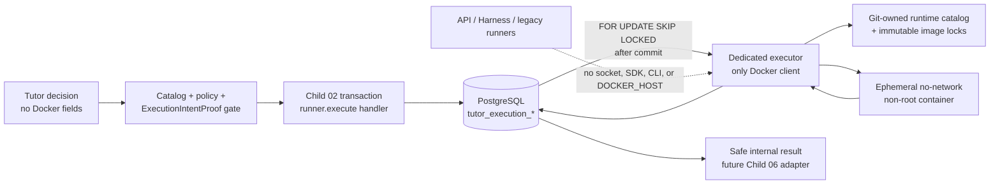
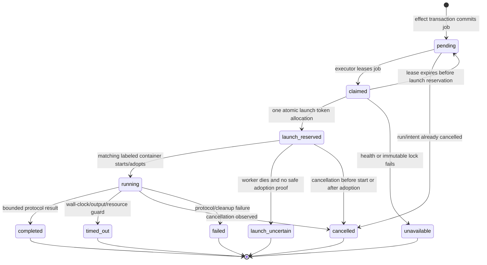

# Container Sandbox Executor Design

## 1. Scope and Security Boundary

Child 03 introduces a feature-disabled execution foundation. It creates a
strict boundary between the unprivileged Tutor/API surface and the only process
allowed to communicate with Docker. The parent contract requires a separate
executor; the existing general Celery worker and API service must not gain
Docker capability as a convenience shortcut.

The target is internal only. No route, public SSE frame, Desktop component, or
legacy runner composition reads the new executor state in this child.

## 2. Process, Package, and Data Ownership

### 2.1 New Package Boundaries

| Location | Ownership | Explicit restriction |
| --- | --- | --- |
| `aearn/packages/shared/` | Pure versioned execution wire contracts, runtime catalog/lock validation, result envelopes, and fixture helpers used by both API and executor. | No Docker SDK, DB client, environment read, subprocess, or legacy runner import. |
| `aearn/services/api/app/services/tutor/` | Intent/job persistence adapter, `runner.execute` effect handler, policy/health reader, and pure result adapter. | No Docker SDK/CLI/socket/`DOCKER_HOST`; handler only creates durable records. |
| `aearn/services/executor/` | Standalone `aearn_executor` process, PostgreSQL job store/input resolver, Docker runtime client, health loop, launch cleanup, and internal audit writer. | The only service package allowed to depend on a Docker client. It exposes no public HTTP route. |
| `aearn/infra/executor/` | Dockerfile/harness sources, runtime-catalog metadata, image-lock validation/build helpers, and opt-in conformance fixtures. | No mutable image tag may be used as a runtime lock or job target. |

`services/executor` is justified rather than putting the code in
`services/worker`: it is a separately operated high-privilege process with its
own dependency graph and environment. The existing worker remains without
Docker socket or Docker package access. A future broker/Celery notification may
wake an executor, but the executor still claims its own durable PostgreSQL job.

### 2.2 Shared Contracts

The shared package owns closed, `extra="forbid"`, versioned contracts:

- `ExecutionIntentProofV1`: opaque proof id; interactive origin; user,
  conversation, run, current revision, source-message/exercise references;
  one allowed action; expiry; policy/budget/catalog fingerprints; no raw code
  or test body.
- `ExecutionJobV1` and `ExecutionJobClaimV1`: opaque job/effect/intent ids,
  selected runtime id, lock fingerprint, lease/launch generation, and safe
  lifecycle facts. They contain no image string, command, path, mount, code,
  hidden test, or container id.
- `RuntimeImageLockV1`: exact runtime id, protocol version, non-root fixed
  entrypoint metadata, limits, and one immutable `repository@sha256:<64-hex>`
  reference. Validation rejects tags, local IDs, placeholders, and unknown
  fields.
- `SandboxInputV1` / `SandboxResultV1`: bounded stdin/stdout protocol. The
  executor may transiently supply raw code and hidden test material to an
  in-image harness, but these fields are never persisted as job, trace, event,
  audit, or public-result content.
- `SafeExecutionResultV1`: status, bounded stdout/stderr/public test feedback,
  counters, timing, and stable safe diagnostic code. The API-side adapter maps
  it to the current `RuntimeExecutionResult` without importing a legacy runner.

These are transport/domain contracts, not a generic remote shell API. No
contract accepts an image, command, URL, host path, SQL fragment, mount,
network option, device, or arbitrary environment variable from the model or
learner.

## 3. Durable Intent, Job, and Audit Model

Append an additive, idempotent `tutor_execution_*` block to the existing
`app/db/schema.sql`; `bootstrap_database()` remains the only schema applier.
All rows use UUID/timestamptz, scoped foreign keys, explicit JSONB names,
checks, and stable indexes. No legacy learner table is changed.

| Table | Responsibility and invariants |
| --- | --- |
| `tutor_execution_intents` | Durable server-issued `ExecutionIntentProofV1`. It binds user/run/conversation/message/exercise scope, interactive origin, revision, explicit action, expiry, policy/budget/catalog evidence, and consumed/cancelled status. It stores references/hashes only, never code/tests/images. |
| `tutor_execution_jobs` | Durable source-of-truth queue record linked one-to-one to the Child 02 effect record and one intent. It stores selected runtime id, image-lock fingerprint, state, job lease, one immutable launch token, safe result reference/payload, cancellation/terminal timestamps, and no container command/path/id. Unique effect/intent relationships prevent duplicate jobs. |
| `tutor_execution_attempts` | Append-only internal lifecycle/audit facts for claims, preflight, launch reservation, execution, cleanup, and terminal projection. It stores safe counters, executor id, lease/launch generation, lock fingerprint, and diagnostic code. Raw Docker errors and raw container ids never enter the Tutor safe projection/export surface. |
| `tutor_executor_health` | Executor heartbeat and quarantine state: executor id/version, registry fingerprint, verified runtime ids, daemon/profile validation result, last heartbeat, and safe availability code. API reads this state only; it does not contact Docker. |

The effect handler runs after Child 02 has atomically reserved the
`tutor_effects` record. In the same transaction it:

1. resolves the opaque proof id from the proposal and locks it;
2. verifies exact Skill/effect evidence, interactive origin, user/run/
   conversation scope, current input revision, active Tutor lease, expiry,
   cancellation, budget, executor health, and runtime/image-lock availability;
3. derives runtime exclusively from trusted exercise/source state, not from the
   proposal; and
4. creates or replays one job, marks the proof consumed, and returns the job id
   as the safe effect commit id.

A failed validation returns Child 02's typed denial/stale result and creates no
execution job. The handler never invokes Docker or publishes an untracked
message.

## 4. Job State Machine and At-Most-Once Launch

### 4.1 States

`pending` may be reclaimed only before a launch token is consumed. The atomic
`claimed -> launch_reserved` transition writes a stable launch token and a
deterministic internal container name/label derived from `(job_id, token)`.
That is the sole point permitted to create/start a container.

After reservation, a replacement executor first searches Docker by the fixed
name/labels and validates the lock fingerprint before it may adopt, stop, or
cleanup the existing container. If a worker crashed after reservation and the
executor cannot prove the container state safely, it writes
`launch_uncertain`/a safe diagnostic and does **not** launch another container.
This intentionally favors at-most-once launch over automatic retry of an
ambiguous external side effect.

Cancellation is represented by the scoped Tutor run/intent/job state and is
checked before claim, before reservation, after container start, and during
bounded wait. Terminal cancellation is idempotent. A new learner action creates
a new proof/effect/job; it never resurrects a terminal job.

### 4.2 Claiming and Queue Ownership

The executor repeatedly performs a short transaction that selects eligible
`pending` jobs using `FOR UPDATE SKIP LOCKED`, validates health and
cancellation, and writes an executor lease generation. The job table—not
Celery/Redis—is the durable queue. Any future wake-up publication must be
idempotent and is allowed to fail without losing the row.

This child owns only the minimal execution-job claim/lease necessary to protect
the Docker boundary. It does not create a general cross-domain scheduler or
retry framework; Child 04 may later reuse or generalize the safe primitive.

## 5. Executor Isolation and Docker Launch Profile

`ContainerRuntimeClient` is implemented only in `services/executor`. It accepts
a validated `RuntimeImageLockV1` and internal trusted input; no higher layer
can pass arbitrary Docker options. Its immutable launch builder enforces:

| Concern | Required profile |
| --- | --- |
| Image / command | Exact digest lock only; fixed in-image entrypoint and fixed argument vector; no image pull, tag, local image id, shell override, or user command. |
| Network / host | `network=none`; no host network/DNS override; no bind mounts, named volumes, devices, privileged mode, host PID/IPC, extra hosts, or Docker socket exposure to learner containers. |
| Filesystem | Read-only root; only named explicit tmpfs work and temporary directories needed by the fixed harness. Compiled runtimes use an executable tmpfs work area, not an unsafe host mount. |
| Identity / kernel | Fixed non-root UID/GID, `cap_drop=ALL`, `no-new-privileges`, no added capabilities, no setuid escalation path. |
| Resources | Runtime-owned CPU, memory, PID, file-descriptor, wall-clock, and output ceilings. The executor kills and records a safe timeout/output-limit result when a ceiling is exceeded. |
| I/O / cleanup | Bounded structured stdin, bounded single-result stdout parsing, capped diagnostic capture, deterministic labels/name, stop/kill grace policy, remove in `finally`, and safe cleanup audit. |

The executor uses the Docker client API rather than host `subprocess` calls.
It never calls a legacy runner and never treats the local Docker daemon as a
production-security guarantee. A failed cleanup quarantines the executor health
until a later safe probe verifies the process can continue; it does not expose
Docker error text to a learner-facing result.

## 6. Runtime Catalog, Image Locks, and the Seven Harnesses

Two Git-owned artifacts separate expected coverage from enablement:

1. a **runtime catalog** contains all seven confirmed runtime IDs, protocol
   versions, Dockerfile/harness locations, non-root user, fixed entrypoint, and
   limit profile; and
2. an **image-lock registry** contains only reviewed real immutable digest
   entries. It may omit a runtime until its real published digest is available;
   omission means unavailable, never a tag/placeholder fallback.

The registry validator rejects a lock unless its runtime is known, its
reference matches the full digest form, its protocol/entrypoint/profile match
the catalog, and its runtime is enabled only by a compatible healthy executor.
Jobs use the registry fingerprint, not a model-provided image reference.

| Runtime ID | In-image protocol responsibility | Runtime-specific prohibitions |
| --- | --- | --- |
| `python-stdout-v1` | Run the bounded Python function/stdout test harness. | No pip/venv/install/network/filesystem/API access. |
| `browser-preview-v1` | Run reviewed JS and HTML/CSS browser-preview/DOM assertion harness in a prebuilt headless-browser image. | No URL navigation/downloads/extensions/user browser flags. |
| `node-typescript-v1` | Compile/run one TypeScript submission plus generated function harness using preinstalled tooling. | No npm/yarn/pnpm/package registry/project workspace. |
| `sqlite-query-v1` | Execute existing read-only teaching SQL against an image-local ephemeral SQLite database. | No app PostgreSQL, attach/extension, DDL/DML. |
| `java-managed-v1` | Compile/run one Java source + fixed teaching harness using a prebuilt JDK. | No Maven/Gradle/external dependency/arbitrary project. |
| `go-managed-v1` | Compile/run one package + fixed harness with module download disabled. | No `go get`, module download/external dependency/arbitrary project. |
| `dotnet-managed-v1` | Compile/run one C# source + fixed harness using pinned SDK/runtime. | No NuGet restore/workload/solution/arbitrary project. |

Rust and C++ have neither runtime-catalog execution entries nor image locks.
They retain the existing unsupported `compiled_sandbox_later` behavior.

## 7. Catalog, Effect, and Availability Policy

Child 03 adds a developer-owned `runner.execute` effect descriptor and a
feature-disabled exact Skill bundle whose manifest explicitly lists that effect.
The bundle's reviewed instruction may use only a server-issued intent reference;
it must not invent command/image/runtime/request fields. Existing Skills remain
unchanged unless explicitly allowed by their own reviewed manifest.

The policy/gateway path gains a narrow execution availability resolver:

- origin must be `interactive`;
- selected Skill/effect descriptor must be exact and policy-eligible;
- the proof/action/revision/lease/user/conversation/run/message/exercise scope
  must match current trusted state;
- policy effects/capability budget and explicit execution budget must remain;
- executor heartbeat must be recent and compatible with the registry fingerprint;
- the derived runtime must have a valid reviewed lock and pass local health;
- `TUTOR_EXECUTOR_ENABLED` defaults false and is separate from
  `REAL_EXECUTION_ENABLED`; `TUTOR_HARNESS_ENABLED` still gates all Harness
  composition later.

Proactive origin, a missing proof, stale evidence, unavailable Docker/image,
or any unrecognized payload field produces a typed denied/unavailable outcome.
No API/SSE/Desktop call is added in this child, so the proof issuer is an
internal port with deterministic tests; Child 06 later supplies the public
intent-extraction adapter.

## 8. Raw-Data, Result, Audit, and Redaction Boundary

The database job/attempt/event/trace/export surfaces contain only opaque IDs,
hashes, enums, counters, timestamps, runtime IDs, lock fingerprints, and
bounded safe output facts. They do not contain:

- raw learner code or full source messages;
- hidden tests, expected values, solution/reference content;
- image digests/registry host values in public projection;
- Docker/container error text, container id/name, commands, mounts, host or
  container paths, sockets, or credentials.

The executor's trusted input resolver loads source and exercise/test facts only
after it has claimed a valid job. It passes them transiently to the in-image
protocol and converts the response to `SafeExecutionResultV1`. The API-side
pure adapter preserves the current runner's output caps and hidden-test
messages when producing `RuntimeExecutionResult`; future Child 06 determines
when/how a learner sees it.

Internal operations can correlate a job to deterministic container labels while
the process is live. Database audit stores only safe correlation/fingerprint
facts needed for status, cleanup, and incident handling. Both write-time and
read/export-time safe projection are mandatory.

## 9. Health, Development Wiring, Compatibility, and Rollback

The executor maintains a database heartbeat only after it verifies its own
Docker client access, Linux daemon/profile prerequisites, registry fingerprint,
and every enabled lock it reports. It does not automatically pull missing
images. API availability reads the heartbeat and fails closed if it is stale,
quarantined, or mismatched.

Local development uses a separately started executor process with its own
service-local dependency environment and a verified PID command pattern. It is
not silently added to the existing API/worker process and no API or worker
container gets the Docker socket. Development wiring may provide an explicit
opt-in executor command/status field; default startup remains feature-disabled.

Rollback before enablement removes the isolated composition/effect wiring or
keeps `TUTOR_EXECUTOR_ENABLED=false`; legacy product behavior remains
unchanged. Additive `tutor_execution_*` rows are retained rather than dropped.
For a lock rotation, disable the affected runtime, publish/verify the next real
digest, observe compatible executor health, then re-enable only through the
later approved rollout path. An unresolved or cleanup/launch-uncertain job is
contained as an internal safe terminal state, never replayed into a new
container.

## 10. Test and Review Matrix

| Concern | Required proof |
| --- | --- |
| Contract/registry validation | Unknown fields, tags/local IDs/placeholders, unapproved runtime/profile/entrypoint, and model-selected Docker fields are rejected. |
| Privilege boundary | Static imports/config scans prove API/Harness/routes/legacy runners/workers have no Docker SDK/CLI/socket/`DOCKER_HOST`; only executor may own Docker client imports. |
| Effect/job transaction | Exact Skill/effect/proof/lease/revision/budget/health checks; same effect/intent replays one job; denial creates no job. PostgreSQL tests run serially. |
| Claim/launch lifecycle | `SKIP LOCKED`, cancellation races, lease expiry, deterministic adoption, duplicate wake-up, terminal replay, cleanup failure, and uncertain launch never produce two starts. |
| Common Docker profile | Captured launch spec and opt-in real Docker tests verify no network/mounts/privilege, root read-only/tmpfs, UID/caps, limits, output/wall clock, fixed command, and cleanup. |
| Runtime harnesses | One protocol/result/redaction conformance family for each of the seven runtime IDs, including browser navigation, SQL read-only, and dependency-download prohibitions. |
| Result boundary | Hidden-test/code/path/docker-error marker corpus cannot appear in safe result, job/attempt audit, event/trace/export, or `RuntimeExecutionResult` projection. |
| Feature-off compatibility | Disabled/unhealthy executor reports unavailable/denied without a Docker call, legacy subprocess fallback, public route/SSE/UI change, or Rust/C++ promotion. |
| Quality gates | Focused API/executor tests, serial bootstrap suite, Ruff, Mypy, Compose/config checks, task validation, and `git diff --check`. |
