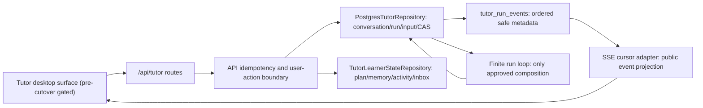

# Tutor API, SSE, and Desktop Design

## Status and Scope

Child 06 adapts the completed target-only Tutor persistence and learner-state
layers into a versioned public API/SSE contract plus pre-cutover desktop code.
It is the first child allowed to read the `tutor_*` target records from a route
or desktop adapter. It does **not** execute a clean-slate reset, remove legacy
Graph code, migrate learner history, enable `TUTOR_HARNESS_ENABLED`, or make
the Harness the default product flow; Child 07 owns those decisions.

The default production posture remains fail-closed. When the server feature
gate is off, all new Tutor route mutations and target-state reads return the
stable `CUTOVER_REQUIRED` envelope before opening a target-domain transaction.
The desktop keeps existing legacy routing as the default until a later
server-authoritative cutover response authorizes the Harness surface.

## Authority and Compatibility Matrix

`docs/architecture/tutor-harness-transition.md` is the target-contract source
for this child. `docs/architecture/api-contract.md`, the existing Graph routes,
and `aearn/apps/desktop/src/` are legacy compatibility evidence. The matrix
below is frozen before route or UI implementation; Child 08 later reconciles
the broad source-of-truth documents after cutover evidence exists.

| Surface | Status in Child 06 | Consumer behavior | Removal gate |
| --- | --- | --- | --- |
| Existing `/api/learning-sessions/*`, onboarding, review, notes routes | `legacy` | Keep current Graph/SSE behavior unchanged. | Child 07 cutover plus empty caller search. |
| Existing event names `agent_message`, `tool_status`, `tool_call`, `runner_result`, `evaluation_result`, `done`, `error` | `legacy` | Continue to parse exactly as today. | Child 08 only after replacement proof. |
| `POST /api/tutor/conversations`, input/run/activity/memory/preference routes | `new` | Typed client helpers use target-only records; feature gate returns `CUTOVER_REQUIRED` when unavailable. | No removal planned in this child. |
| `GET /api/tutor/runs/{run_id}/events` | `new` | Converts durable run-local sequences to public SSE ids and accepts `Last-Event-ID`. | No removal planned in this child. |
| Legacy endpoints translated to Tutor run operations | `adapter` design only | No implicit reroute in Child 06; any adapter is explicit, versioned, and separately tested. | Remove only after Child 07/08 evidence. |
| Legacy Graph/router/checkpointer/dependencies | `legacy` | Not modified or deleted. | Child 07 retirement gate. |
| Tutor desktop components | `new`, cutover-gated | Compile and retain typed interaction state without becoming the default app entry. | Child 07 decides activation. |

## Public Data Flow and Boundary Ownership

- Route/Pydantic models validate request shape, client idempotency identity, and
  public page-size/cursor bounds. They return stable error envelopes and never
  serialize database rows directly.
- `PostgresTutorRepository` remains the only owner of message acceptance,
  revision allocation, leases, ordered events, and effect CAS. A second input
  targets a single non-terminal interactive run; no route cancels an active run
  to make room for a follow-up message.
- `TutorLearnerStateRepository` remains the only owner of plan/memory/activity
  semantics. The route layer may invoke explicit learner-control methods but
  may not manufacture an Agent effect, select a rollback target, mutate an
  immutable revision, or write legacy plans/profiles/review/FSRS records.
- The SSE adapter only maps already durable, learner-safe facts. It neither
  invokes the provider nor writes state while a client is connected. Raw
  `tutor_messages`, traces, Curator prompts/source segments/rationale, provider
  payloads, hidden tests, code, paths, and diagnostics are never SSE payloads.

## API Contract

All writes require a client idempotency key: `Idempotency-Key` takes precedence;
otherwise a bounded body `client_action_id` is required. The target API stores
only operation, key, request hash, and learner-safe response projection in a
new target-only idempotency receipt. A replay returns the original response;
the same identity with a different body returns `IDEMPOTENCY_CONFLICT`.

| Endpoint | Purpose | Success shape / boundary |
| --- | --- | --- |
| `POST /api/tutor/conversations` | Create or resume a learner-visible Tutor conversation. | `conversation_id`, `created`, no legacy session mutation. |
| `POST /api/tutor/conversations/{conversation_id}/inputs` | Create an interactive run if none is reusable, then persist one input. | `run_id`, `input_revision`, `message_id`, `merged`, replay flag, event cursor. |
| `POST /api/tutor/runs/{run_id}/inputs` | Merge input into the specified active run only. | Same acknowledgement; terminal/mismatched run -> `RUN_NOT_ACTIVE`. |
| `GET /api/tutor/runs/{run_id}` | Learner-safe state/counter/terminal-code summary. | No trace, provider, policy fingerprint, or raw messages. |
| `GET /api/tutor/runs/{run_id}/events` | SSE durable suffix with `Last-Event-ID` cursor. | Per-run numeric SSE id; ordered, deduplicated event projection. |
| `GET /api/tutor/activity`, `GET /api/tutor/inbox` | Timeline and inbox projections. | User-scoped safe category/reason/message/state only. |
| `POST /api/tutor/inbox/{id}/read`, `POST /api/tutor/inbox/{id}/dismiss` | Inbox controls. | Idempotent learner-safe resulting state. |
| `GET/PATCH/DELETE /api/tutor/memory/*` | List, correct, delete entries, and change inferred-memory preference. | Entry kind/confidence/provenance/retention/staleness/source references; no Curator internals. |
| `GET /api/tutor/plans/revisions`, `POST /api/tutor/plans/rollback` | Active-plan lineage/diff and one-action rollback. | Rollback accepts no target id and can only return to the recorded predecessor. |
| `GET/PATCH /api/tutor/preferences` | Read/update proactive pause and inferred-memory control. | Only learner-visible policy controls; never scoring, FSRS, provider, or hidden-runtime settings. |

Stable new error codes include `CUTOVER_REQUIRED`, `TUTOR_CONVERSATION_NOT_FOUND`,
`TUTOR_RUN_NOT_FOUND`, `RUN_NOT_ACTIVE`, `RUN_INPUT_CONFLICT`,
`SSE_CURSOR_INVALID`, `PLAN_ROLLBACK_UNAVAILABLE`, `MEMORY_ENTRY_NOT_FOUND`,
`MEMORY_ENTRY_NOT_ACTIVE`, and `MEMORY_SETTING_VERSION_CONFLICT`. Existing
`MODEL_UNAVAILABLE`, `STALE_EFFECT_REJECTED`, `CAPABILITY_DENIED`,
`IDEMPOTENCY_CONFLICT`, and `VALIDATION_ERROR` retain their established meaning.

## Durable Input and SSE Replay

1. The conversation-input endpoint locks the target conversation, reuses at
   most one non-terminal interactive run, or creates one persisted catalog/run
   snapshot. It then calls existing `accept_input()` with the client idempotency
   key. The durable `input_accepted` event is the acknowledgement source.
2. The explicit run-input endpoint validates user/conversation scope and rejects
   a terminal or incompatible run with `RUN_NOT_ACTIVE`; it never opens a
   competing stream or aborts an existing run.
3. The SSE endpoint parses `Last-Event-ID` as a non-negative decimal cursor for
   that one run. It replays `events_after(cursor)` in sequence order, sends each
   durable sequence as SSE `id`, and advances its in-memory polling cursor only
   after framing that sequence. Invalid/foreign/non-numeric cursors return
   `SSE_CURSOR_INVALID` rather than silently replaying from zero.
4. Mapping retains legacy event types when a durable safe event represents the
   same learner-visible fact: compatible tool/execution outcomes map to
   `tool_status`, `tool_call`, or `runner_result`; terminal outcomes map to
   `done` or `error`. New `input_accepted`, `run_state`, and `activity` events
   carry only bounded public fields. New desktop code parses a discriminated
   union and ignores no event silently; legacy clients remain isolated on their
   original endpoint routes.
5. A terminal public message is persisted as a learner-safe assistant message
   linked by a durable terminal-event message id. The SSE adapter retrieves that
   scoped public message only after verifying run/conversation/user ownership;
   it never replays raw learner content or provider envelopes.

## Learner Controls and User-Action Semantics

- Plan revisions remain immutable. The list API returns title, outline, diff,
  learner reason, predecessor relation, evidence identifiers, and timestamps.
  User rollback writes one append-only action with a user-control reason and
  idempotency receipt. It cannot accept a caller-selected target and does not
  mutate an old revision or legacy/FSRS data.
- Memory list/detail returns only its documented learner-safe fields, including
  `objective_fact` versus `inference`, confidence, provenance label, retention
  and staleness facts, and safe source identifiers. Correction appends a linked
  learner-control replacement; delete remains a guarded lifecycle transition.
- Preferences combine inferred-memory enablement with an explicit proactive
  pause surface backed by Child 04 preference records. The API never enables
  background work, raises budgets, turns off hard pause, or exposes provider
  configuration. A user can only pause/resume their own already-policy-gated
  proactive eligibility.
- Activity/inbox read models are user-scoped, capped, and never trigger chat,
  desktop notifications, Curator processing, or background execution.

## Desktop Adaptation

Desktop code is split into typed API helpers, durable-SSE parsing/deduplication,
and focused Tutor components instead of expanding legacy Graph pages with a
second orchestration state machine. A future cutover gate supplies the selected
surface; until then the normal app route stays legacy.

- `useTutorSSE` tracks a run-local numeric cursor, deduplicates repeated event
  ids, reuses the same assistant/tool timeline, and reconnects after an
  incomplete stream without locally inventing terminal state.
- `TutorWorkspacePage` owns guided free-text goal entry, conversation timeline,
  enabled composer during a running run, merge acknowledgement, visible retry
  state, activity/inbox, plan revision/rollback, and learner-memory controls.
- `TutorPreferencesPanel` exposes inferred-memory and proactive pause only.
  Diagnostics remain separate and never show raw trace/Curator/provider data.
- Existing `LearningWorkspacePage`, `ReviewPage`, and legacy SSE hooks remain
  untouched except for shared type/helper extraction that is explicitly tested.
- The UI uses backend response facts for run status, input revision, inbox state,
  memory provenance, and rollback availability. It never calculates effects,
  FSRS, cutover status, or event ordering locally.

## Rollback and Non-Goals

Code/config rollback consists of restoring the route/UI feature gate before a
future confirmed cutover. It does not delete target rows and never claims to
restore data that Child 07 may later deliberately delete. This child does not
modify the protected historical design prototype, legacy Graph routing,
production provider settings, worker enablement, or deployment state.