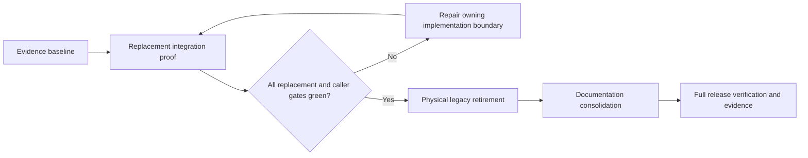

# Tutor Integration QA and Documentation Design

## Status, Authority, and Boundary

This design plans the final integration child of
`07-22-agent-harness-rearchitecture`. It does not claim that the archived
Children 00--07 have already physically removed the legacy runtime. The final
implementation target is the verified replacement boundary: a learner who has
completed the server-authoritative clean-slate cutover receives the public
Tutor surface, while an unverified learner cannot use either the legacy or
Tutor runtime.

Authority order for every decision is:

1. Current code, schema, tests, route registration, and configuration.
2. The upstream child contracts and their completed verification evidence.
3. `docs/README.md` and retained source-of-truth documents.
4. This child planning design until final documents are published.

The task is in Codex inline mode. It does not use sub-agent manifests as a
planning/implementation readiness signal; the implementation session instead
loads `trellis-before-dev` before touching backend, frontend, or operations
files.

## Completion Model

The work has three strict gates, in this order:

- **Evidence baseline** records the current revision, test environment,
  fixture-user policy, target/legacy inventory, and exact documentation delta.
- **Replacement integration proof** validates the target behavior before
  deleting a legacy fallback.
- **Physical retirement** is forbidden until the source/test caller audit is
  clean. It is a small, separately verifiable edit series, not part of the
  destructive cutover transaction.
- **Documentation consolidation** reflects verified code only. It cannot make
  a failing system look complete.

## Integration Evidence Ledger

During implementation, add `docs/qa/tutor-harness-release-readiness.md` as
the canonical final evidence record. Each row must include:

| Field | Required content |
| --- | --- |
| Gate | A named provider, loop, persistence, sandbox, scheduler, API/SSE, Desktop, cutover, retirement, or documentation gate. |
| Contract | Exact expected behavior and the unsafe behavior rejected. |
| Evidence | Test name, smoke procedure, static audit, or health command. |
| Environment | Fixture-only assumptions, feature flags, database/bootstrap posture, and no-live-provider/executor guarantee. |
| Result | Pass/fail/skipped with date, commit/revision, warning, and follow-up owner. |
| Residual risk | A concrete risk statement; `none` is allowed only after a check proves it. |

The ledger is a release artifact, not a log dump. It must never contain raw
learner content, source code submitted by a learner, hidden tests, provider
secrets/error bodies, checkpoint payloads, or internal prompts.

## Required Cross-Layer Matrices

### Runtime and durable-state matrix

| Area | Required proof | Primary implementation surface |
| --- | --- | --- |
| Provider | Primary-only retry; stable `MODEL_UNAVAILABLE`; no fallback call. | `app/services/tutor/provider_gateway.py`, provider tests. |
| Tutor loop | Finite budget; lease/lost-worker recovery; selected-Skill validation; durable input revision merge; stale-effect rejection. | `app/services/tutor/run_loop.py`, `app/agents/harness/`, durable run tests. |
| Effects and traces | Repository authority; idempotency/CAS; redacted immutable events and replay ordering. | tutor repository/persistence/eval tests. |
| Grounding | Registry-only sources, valid citations, no URL/search/crawler capability. | skill/capability and grounding tests. |
| Plans and memory | Immutable plan revisions, user-scoped controls, evidence-backed memory, proposal-only Curator, redacted ordered outbox. | learner-state and curation tests. |

### Operations and learner-experience matrix

| Area | Required proof | Safety boundary |
| --- | --- | --- |
| Sandbox | Network deny by default, immutable-image/allowlist/limit/cleanup checks, no proactive execution. | Never fall back to the legacy subprocess runner. |
| Scheduler | Deduplication, cooldown, pause, budget/circuit breaker, inbox-only output. | No provider/executor bypass or direct learner-domain write. |
| API/SSE | Cutover gating, durable cursor replay, stable envelopes, terminal ordering. | Streaming never invokes a provider and never exposes internal trace data. |
| Desktop | Cutover-first bootstrap, fresh Tutor entry, composer, activity/inbox, diagnostics separation, narrow viewport. | Client routing cannot override a server decision or restore legacy bootstrap state. |
| Cutover | Exact server summary/nonce/version confirmation, atomic deletion verification, retained identity/settings. | Pre-cutover code rollback is possible; post-confirmation data recovery is not claimed. |

## Documentation Architecture

### Current contract and historical record split

Keep the transition document as evidence of how the repository moved between
runtime families. Do not overload it as the only current architecture source.
After all replacement gates pass:

1. Add `docs/architecture/tutor-harness-runtime.md` as the current
   runtime/orchestration source of truth. It must cover the bounded Tutor run
   loop, skills/capabilities, provider boundary, durable state, effects,
   grounding, sandbox, scheduler/curator, API/SSE, Desktop, and cutover state.
2. Update `docs/README.md` so the current runtime entry points to the new
   document and the transition contract is explicitly labelled migration
   evidence rather than the normal product runtime.
3. Retain `docs/architecture/tutor-harness-transition.md` for the contract and
   clean-slate history; update its status/link section only as needed so it
   cannot contradict the final runtime document.
4. Archive `docs/architecture/langgraph-state-machine.md` only after source,
   test, package, and consumer audits prove the Graph runtime is gone. The
   archive needs a dated header/redirect rather than a silent deletion.
5. Archive `docs/qa/sdk-agent-release-readiness.md` only after the OpenAI
   Agents SDK is no longer a retained production dependency. It remains a
   historical release record, not an active release gate.

### Delta ownership matrix

| Surface | Final action | Evidence needed before action |
| --- | --- | --- |
| `docs/README.md` | Route current runtime, API, environment, and QA readers to Tutor documents; label transition/history correctly. | All target docs exist and cross-links resolve. |
| `docs/product/user-flows.md` | Replace Graph-stage flow ownership with cutover-aware Tutor entry, conversation, activity/inbox, plan/memory controls, and recovery flow. | Fixture-user Desktop/API smoke. |
| `docs/product/frontend-interaction-spec.md` | Replace legacy Graph/SSE rendering assumptions with typed Tutor API/SSE, cutover page, diagnostics, and responsive behavior. | Desktop build and narrow-viewport smoke. |
| `docs/architecture/api-contract.md` | Publish public Tutor and cutover routes, envelopes, cursor replay, terminal ordering, and privacy/redaction rules. | Route and SSE contract tests. |
| `docs/architecture/database-schema.md` | Document `tutor_*` and `harness_cutovers` authority, clean-slate deletion/preservation, and no legacy migration. | Schema/bootstrap and cutover tests. |
| `docs/setup/development-environment.md` and sandbox setup | Document supported flags, provider posture, executor health/checks, worker safety, and legacy dependency removal. | Config, worker-import, executor health evidence. |
| `docs/qa/acceptance-test-plan.md` | Add cross-layer Harness acceptance matrix and removal evidence requirements. | Full sequential verification results. |
| `docs/qa/tutor-harness-release-readiness.md` | New final evidence ledger and residual-risk record. | Completed matrix results. |
| Graph/SDK historical docs | Move to dated archive with a redirect note only after physical code/package retirement. | Empty scoped caller/dependency audit. |

No documentation action may change the authoritative source for `Attempt`,
FSRS, hidden-test protection, model failure mapping, or source attribution
unless an owning replacement contract and regression tests explicitly change
it.

## Legacy Retirement Protocol

The current codebase still imports LangGraph and the OpenAI Agents SDK. The
retirement audit must distinguish four categories before deletion:

1. **Production caller:** an active backend, worker, Desktop, or public route
   dependency. It blocks retirement until migrated or deleted with coverage.
2. **Test-only compatibility caller:** a test exercising a still-supported
   contract. Replace it with target behavior before deleting it.
3. **Build/package-only residue:** an unused pin, lock entry, flag, fixture, or
   stale documentation reference. Remove after the production/test search is
   clean and rerun dependency/install checks.
4. **Historical reference:** an archived task or dated document that explains
   the migration. Preserve it with a visible historical label and no current
   index link.

The scoped audit starts with the legacy Graph modules, Graph event stream,
legacy specialist router/tools/runtime, `LANGGRAPH_ENABLED`, and package names
`langchain`, `langchain-openai`, `langgraph`,
`langgraph-checkpoint-postgres`, and `openai-agents`. It must not treat the
new `app/agents/harness/` namespace as a legacy match merely because it
contains the word `agents`.

If the audit cannot become clean without a new user-visible compatibility
decision, do not archive this child as complete. Return to planning with the
actual caller and a narrowly scoped alternative.

## Rollback and Operational Rules

- Validation uses disposable fixture users, fake/deterministic provider
  adapters, and controlled executor/worker modes. No test may operate on a
  real learner account or require a live provider call.
- Before an explicit cutover confirmation, configuration/code rollback may
  restore the legacy path only while legacy data remains. After a confirmed
  clean-slate deletion, rollback can restore code only; it never restores
  legacy learner history or creates a shadow migration.
- Documentation changes are reversible through Git. Historical files move to
  a dated archive instead of being deleted without traceability.
- A failed bootstrap, migration, health check, browser smoke, or static caller
  audit blocks the corresponding release/docs claim and is recorded in the
  evidence ledger.