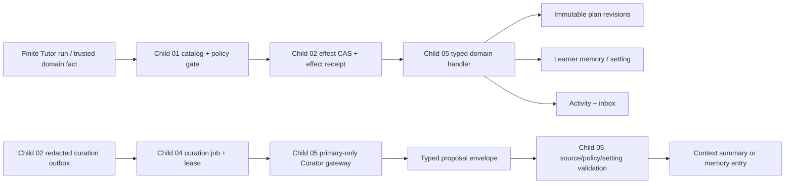

# Tutor Plans, Memory, Activity, and User Controls Design

## Status and Scope

Child 05 implements the feature-disabled target-domain projections consumed by
the future Tutor Harness. It owns immutable Tutor plan revisions, governed
learner memory, Curator proposal validation, and learner-safe activity/inbox
state. It deliberately does **not** expose HTTP/SSE/Desktop behavior; Child 06
owns public contracts and rendering. It does not reset or delete legacy data;
Child 07 owns cutover and retirement.

The existing Child 01 catalog/policy gate, Child 02 durable run/effect CAS and
redacted outbox, and Child 04 low-priority curation queue stay authoritative.
This child extends them only through typed, in-transaction target handlers and
an injected primary-only Curator gateway. Defaults stay fail-closed, so no
provider or product behavior changes merely because these modules exist.

## Ownership and Non-Goals

| Area | Owner in this child | Explicitly not owned here |
| --- | --- | --- |
| Plan revisions | target immutable lineage, active pointer, activation/rollback evidence | legacy `learning_plans`, FSRS/review changes, public routes |
| Learner memory | evidence-backed target entries, correction/delete/disable controls | raw conversation/prompt retention, legacy profile migration |
| Curator | redacted-outbox validation, primary-only typed proposal generation, projection commit | per-token calls, provider fallback, chat/activity/inbox direct writes |
| Activity/inbox | target repositories and learner-safe evidence records | API/SSE/Desktop delivery, OS notifications |
| Effects | exact catalog descriptors and typed repository handlers | policy inference from model output, direct database writes from the model |

## Data Flow and Boundary Checks

Every write is scoped by `user_id`; run-bound writes additionally require the
current run, lease, and input revision through
`PostgresTutorRepository.commit_effect_if_current()`. The Curator reads only
the redacted envelope/outbox facts, never canonical `tutor_messages`, raw
traces, provider payloads, code, hidden tests, or legacy learner tables.

## Target Persistence Model

All DDL is additive, repeatable, UUID/timestamptz based, and uses checked text
states plus composite scope constraints where a row refers to a run/outbox or
proposal.

### Plans

- `tutor_plan_revisions`: immutable learner-safe revision body, structured diff,
  evidence ids/hashes, source run/effect, predecessor id, creation timestamp,
  and a bounded policy/version fingerprint. Its body is never overwritten.
- `tutor_active_plans`: one mutable pointer per user to the selected immutable
  revision. It is the only plan row updated during activation/rollback.
- `tutor_plan_revision_actions`: append-only `activate` or `rollback` audit
  action with current/target/predecessor revision ids, safe reason/evidence, and
  optional run/effect references.

Activation inserts a new revision, moves the active pointer atomically, and
records an action. Rollback moves the pointer only to the current revision's
recorded predecessor and writes an action; it never mutates old revision data
or changes legacy plan/FSRS tables.

### Memory and Context

- `tutor_memory_preferences`: per-user inferred-memory enable state and exact
  setting version. A disabled or changed version invalidates a queued Curator
  projection before any model call or memory write.
- `tutor_memory_entries`: learner-scoped `objective_fact` or `inference`
  entries. Inferences require confidence, source evidence, policy/setting
  versions, retention/staleness, and Curator provenance. Corrections create a
  new entry linked to the replaced entry; deletion is a learner-controlled
  state transition plus audit, not a raw-data rewrite.
- `tutor_context_summaries`: bounded safe summaries keyed by their source
  outbox/proposal identity. They are not chat messages and carry no raw source
  segment or provider reasoning.
- `tutor_curation_projection_receipts`: exactly-one projection receipt per
  curation proposal/outbox. It records `committed`, `no_action`, `stale`, or
  `failed` and target identity without making the generic outbox/proposal rows
  contain product-domain state.

### Activity and Inbox

- `tutor_activity_records`: append-only learner-safe event rows with category,
  short reason, evidence references/hashes, optional run/effect ids, and no
  trace/provider/prompt fields.
- `tutor_inbox_items`: one optional inbox projection per activity row with
  unread/read/dismissed state. It points at activity rather than duplicating
  private diagnostic data.

## Effect Contracts and Catalog Integration

Child 05 publishes reviewed `EffectDescriptor` contracts for:

1. `tutor.plan.activate`
2. `tutor.plan.rollback`
3. `tutor.memory.record`
4. `tutor.activity.record`

Their Pydantic payload models accept only bounded learner-safe fields,
stable evidence identifiers, and exact optimistic-concurrency facts. A new
reviewed Skill bundle declares these effects; the catalog compiler still
requires exact version/hash identity. A policy must explicitly grant both the
selected Skill and the matching effect descriptor. Default policy composition
continues to deny all effects.

`TutorLearnerStateEffectCommitter` is composed with the existing repository
handler map. It never bypasses `commit_effect_if_current()`, so a newer input,
cancelled/terminal run, stale lease, unselected Skill, non-policy effect, or
idempotency mismatch produces the existing safe denial/stale receipt without a
domain write.

For proactive runs, Child 05 may allow only reviewed plan/activity effect types
when composition/policy explicitly opt in; `runner.execute`, memory inference,
and arbitrary domain writes remain forbidden. No feature flag activates that
composition for product traffic in this child.

## Curator Protocol

1. Child 04 leases a job only from a Child 02 `pending` outbox.
2. The Child 05 processor loads the matching redacted envelope, checks the
   source range, policy version, memory setting version, retention/staleness,
   per-user inferred-memory preference, and lease identity.
3. `PrimaryCurationGateway` receives only the bounded safe envelope and calls
   the configured `OpenAICompatibleClient` once with the selected configured
   provider/model. It supplies no fallback provider/model and enforces a
   separate bounded output-token limit.
4. The result validates to either one `context_summary` or one `memory_entry`
   proposal. Invalid/unavailable output returns a typed retryable/no-action
   outcome; it never creates a partial projection.
5. `PostgresTutorRepository.record_curation_proposal()` persists/replays the
   generic evidence envelope. The Child 05 domain repository then validates and
   commits the appropriate summary or memory entry plus a one-to-one projection
   receipt in the same transaction.

A Curator never produces chat, activity, inbox, plan revision, review/FSRS,
attempt, executor, file, shell, or direct legacy-table writes. Trusted domain
services may record objective memory facts separately through the same
repository validation path.

## User Controls and Compatibility

The service layer exposes typed operations for plan rollback, memory correction,
memory deletion, and inferred-memory enable/disable. Child 06 later maps them
to public API/SSE/Desktop interactions. Until then, no route or current product
flow reads these tables.

Legacy plans, profile/preferences, notes, reviews, FSRS, attempts, Graph
checkpoints, and current desktop state remain untouched. Rollback before
cutover is to leave the new feature flags disabled and stop composing the new
effect/Curator handlers; diagnostic/projection evidence stays available for
investigation. Code rollback is not represented as recovery of any later
explicitly deleted legacy learner data.