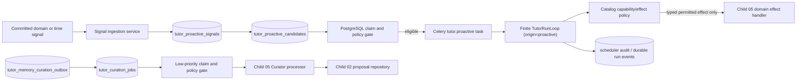

# Tutor Proactive Scheduler Design

## Status and Scope

This is a planning artifact for Child 04. The task remains `planning`; it does
not authorize `task.py start`, source edits, feature activation, deployment, or
legacy worker changes. The implementation must follow the parent target
contract and preserve the current feature-disabled Harness boundary.

Child 04 owns durable signal/candidate scheduling, generic queue leasing,
budget and circuit-breaker policy, and recovery mechanics. Child 05 owns
plan/memory/activity semantics and the Curator's proposal validation. Child 06
owns public routes, SSE delivery, and desktop surfaces. A worker may invoke the
same finite Tutor loop, but it never becomes a continuously running Tutor.

## Authority and Current Evidence

1. `docs/architecture/tutor-harness-transition.md` is the narrow target
   contract; current code and tests establish facts, while legacy Graph and
   review-worker documents establish compatibility obligations only.
2. Child 00 supplies the bounded loop and lease lifecycle. Child 01 supplies
   catalog-constrained capabilities and a policy context with allowed origins.
   Child 02 supplies target-only PostgreSQL runs, durable event ordering,
   redaction, and the curation outbox.
3. `tutor_runs.origin` already persists `interactive` or `proactive`, but
   `_snapshot_from_row()` currently drops it before `TutorRunSnapshot` reaches
   the policy gateway. The design closes that typed-contract gap rather than
   inferring origin from a worker name or request shape.
4. `tutor_memory_curation_outbox` already has a stable idempotency key and
   `pending`/`no_action`/`stale`/`failed` semantic states. It deliberately has
   no queue lease, retry counter, or provider invocation; Child 04 adds those
   mechanics without allowing a worker to mutate plan, memory, activity, inbox,
   review, FSRS, messages, or legacy state directly.
5. The existing Celery app only owns `health.ping` and legacy review jobs.
   Proactive work receives separate task names and queues; it must not reuse a
   legacy review task as a hidden Tutor wake-up path.

## Preconditions and Blocking Baseline

The current focused Harness regression suite has one failure: its fake-only
eval fixture pins the full catalog digest before Child 03 added the reviewed
`tutor.runner-execution@1.0.0` Skill. The Skill hashes for
`tutor.registry-grounding@1.0.0` are unchanged, while the complete catalog
digest changed. The pre-start corrective action is to regenerate only the
fixture's catalog digest through `compile_published_skill_catalog()` and retain
the strict full-snapshot assertion. It is not a request to weaken or remove the
catalog-identity test. Scheduler source work must not begin until that test is
green again.

## Architecture and Ownership

### Service Boundaries

- `app/services/tutor/proactive.py` contains deterministic signal, policy,
  claim, retry, and scheduling services. It owns no Celery decorators and has
  no public HTTP/SSE/Desktop dependency.
- `app/services/tutor/proactive_repository.py` owns PostgreSQL transactions,
  leases, dedupe, counters, audit records, and queue state. Broker delivery is
  only a wake-up optimization; PostgreSQL is the source of truth.
- `aearn_worker` receives narrow task wrappers such as
  `tutor.proactive.scan_due_signals`, `tutor.proactive.drain_candidates`, and
  `tutor.curation.drain`. Wrappers load configuration and call the API service;
  they do not contain ad-hoc SQL, legacy review mutations, or model logic.
- `TutorRunSnapshot` gains a validated `origin` field copied from the row.
  Policy resolution uses that field, and missing/unknown origin returns a
  default-deny result. Existing interactive tests remain explicit about
  `origin="interactive"`.
- Child 05 supplies concrete permitted activity/inbox, plan, and Curator
  proposal processors later. Until that contract is registered, background
  runs resolve to typed no-action/denial rather than creating an informal
  side effect.

## Durable Data Model

All schema changes are additive and applied through the existing repeatable
bootstrap path. No legacy learning table, Graph checkpoint, or user history is
read or mutated by this task.

| Entity | Key fields and invariants |
| --- | --- |
| `tutor_proactive_preferences` | User scope; `enabled`, `hard_paused`, policy/setting version, timestamps. Resolver defaults to disabled until a later verified cutover permits the target default. A user preference cannot override server hard pause or safety budgets. |
| `tutor_proactive_signals` | User scope, exact signal kind, source type/id/hash, occurred time, dedupe key/window, safe payload reference, policy version, disposition. One producer event has a stable idempotency identity. Raw learner text, prompts, and trace bodies are forbidden. |
| `tutor_proactive_candidates` | User/signal scope, candidate kind, dedupe window/key, policy snapshot/fingerprint, state, no-action reason, `not_before`, bounded retry/attempt fields, lease owner/generation/expiry, optional `tutor_runs` id, timestamps. A partial unique constraint prevents multiple non-terminal candidates for the same dedupe identity. |
| `tutor_scheduler_audit` | Candidate or curation-job reference, policy decision, code, safe counters/timestamps, retry/lease facts. It excludes raw prompts, provider payloads, code, hidden tests, and outcome reasoning. |
| `tutor_curation_jobs` | Exactly one job per curation-outbox idempotency identity; queue class `curation`, state/lease/retry/budget/circuit-breaker fields, and a FK to the outbox. The outbox remains the semantic request envelope; job lease state does not overwrite its evidence. |

Proactive runs require an internal background conversation record with no
learner/tutor messages. Add an explicit conversation visibility/kind marker so
future API/Desktop work can exclude it from normal conversation history. Reusing
an interactive conversation would allow background events to appear as active
chat and is forbidden. The new run uses `origin="proactive"`, a catalog
snapshot, and a normal bounded policy snapshot.

## Signal, Candidate, and Lease Protocol

1. A committed domain service or bounded time scan sends a typed signal with a
   stable producer id and dedupe key. Signal ingestion persists/replays it in
   one transaction and records why it was accepted, suppressed, or deferred.
2. Candidate creation first evaluates server hard pause, user preference,
   cutover eligibility, signal scope, cooldown, per-user concurrency, daily
   call/token/cost budgets, circuit breaker, and capability allowlist. A denied
   decision persists an observable `no_action` record and makes no provider or
   capability request.
3. A Celery delivery claims one eligible row under PostgreSQL locking. A broker
   redelivery cannot create a second candidate, second active lease, or second
   Tutor run. An expired lease can be recovered only after its safe retry delay.
4. The worker creates/uses the dedicated background conversation and a
   `tutor_runs` record with `origin="proactive"`. It passes that run through the
   existing finite loop. No background execution receives the `runner.execute`
   descriptor, even if executor health is good.
5. A terminal result updates the candidate/audit state transactionally. A
   permitted future typed activity/inbox effect may be committed by Child 05;
   direct chat messages and normal-success desktop notifications are never
   legal outcomes.

## Curation Queue Protocol

1. Only a Child 02 outbox record with state `pending`, a current policy version,
   a current inferred-memory setting, and a non-expired source range can seed a
   curation job.
2. The curation queue has lower independent concurrency, token/call/cost budget,
   cooldown, retry cap, and circuit breaker than interactive or proactive Tutor
   work. It is never model-invoked per streamed token.
3. Hard background pause or inferred-memory disable is checked before a provider
   call. A failure/denial writes a safe job audit/no-action state and leaves no
   proposal or domain projection.
4. The worker invokes only an injected Child 05 Curator processor. The processor
   may return a typed `context_summary` or `memory_entry` proposal; the existing
   repository validates source range, policy version, staleness, and idempotency
   before storing it. It cannot produce chat, activity, inbox, plan, review,
   FSRS, attempt, or execution output.

## Policy and Feature Flags

- `TUTOR_HARNESS_ENABLED` remains false for product traffic during this task.
- Introduce target-only scheduler configuration with a global enable switch,
  hard pause, lease duration, retry/backoff limits, per-user concurrency, and
  separate proactive/curation budget and circuit-breaker limits. Every default
  is fail-closed until the verified Child 07 cutover defines activation.
- Policy resolves `origin="proactive"` explicitly. It permits only reviewed
  read/plan/activity descriptors required by the selected Skill and never
  permits code execution, arbitrary web fetch, arbitrary files, shells,
  databases, cross-user data, or a direct domain write.
- Celery beat may enqueue bounded time-signal scans, but it may not own state or
  continuously run a model. Tests call the service directly with fixed clocks.

## Compatibility, Rollback, and Documentation

This child creates no public contract. Existing review tasks, Graph routes,
legacy SSE writer, desktop, and executor process remain unchanged. Rollback is
to globally pause scheduler leasing and revoke its target-only task routes while
retaining diagnostic/signal/audit rows for investigation; no background run may
be required for current product behavior.

Before code, update the transition contract's Child 04 section with the exact
signal/pause/budget/queue terms. During this child, update only the worker and
target-Harness documentation needed to describe the new internal operation.
Child 08 remains responsible for final source-of-truth reconciliation.
