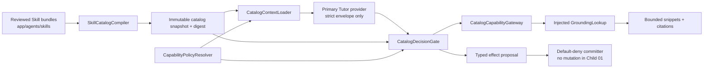

# Tutor Skill Catalog and Capability Gateway Design

## 1. Scope and Boundary

Child 01 adds an internal catalog/policy/gateway layer to the feature-disabled
Tutor Harness. It turns model-shaped references into executable behavior only
after exact catalog and policy validation. The catalog owns product
configuration; the service gateway owns runtime authorization and dispatch;
existing domain services/repositories remain the only owners of durable work.



No edge in this diagram reaches a legacy Graph/router, route handler, DB
connection/repository, worker, SSE producer, Desktop source, runner, shell,
or arbitrary network client.

## 2. Published Skill Source and Catalog

### 2.1 Source Layout

```text
aearn/services/api/app/agents/skills/
  tutor.registry-grounding/
    1.0.0/
      manifest.json
      instructions.md
      evals.json
```

`manifest.json` is intentionally JSON rather than YAML: the existing API
runtime already has Pydantic/JSON support and no YAML parser dependency. The
parent YAML block was illustrative, not a format contract. The compiler reads
only files within the developer-owned source root and resolves no model-supplied
path.

### 2.2 Manifest Contract

`SkillManifest` is a frozen Pydantic model with at least:

| Field | Contract |
| --- | --- |
| `id` | Stable dotted identifier, not a file path/URL. |
| `version` | Exact SemVer 2 value; runtime selection never accepts `current`, ranges, or wildcards. |
| `owner`, `kind`, `summary` | Reviewed metadata, bounded and safe for context. |
| `instruction_file`, `evaluation_suite_file` | Bundle-relative leaf paths; no traversal; both must exist. |
| `resource_refs` | Stable developer-governed refs only (initially `registry:grounding_sources`). |
| `requires_capabilities` | Existing descriptor ids only. |
| `allowed_effect_types` | Existing effect ids only; the initial bundle declares none. |
| `policy_tags` | Static product policy tags, not model input. |
| `input_contract`, `output_contract` | Versioned `tutor.*.v1` contract ids. |
| `content_hashes` | Compiler-verified hashes for instruction/eval resources. |
| `deprecated`, `replacement` | Optional reviewed lifecycle metadata. |

`SkillCatalogCompiler` scans known bundle paths deterministically, validates
manifests/files/hashes/descriptors, sorts by `(id, version)`, and creates a
frozen `SkillCatalogSnapshot` with a canonical SHA-256 digest. An invalid
bundle rejects the entire compilation; there is no partial catalog fallback.

The first published bundle is `tutor.registry-grounding@1.0.0`. It requires
only `grounding.retrieve`, declares `registry:grounding_sources`, and declares
no executable effect type.

## 3. Capability and MCP-Compatible Schema Contract

### 3.1 Descriptor Registry

Create immutable descriptors in `app/agents/harness/`:

- `CapabilityDescriptor`: id, exact version, mode, description, Pydantic input
  model, Pydantic result model, policy tags, and allowed effect types.
- `EffectDescriptor`: id, exact version, proposal schema, policy tags, and
  implementation owner; Child 01 has no policy-eligible executable effect.
- `CapabilitySchemaExporter`: turns a descriptor into an MCP-compatible
  `name`, `description`, and `inputSchema` JSON Schema object via Pydantic.

The only descriptor registered as executable is `grounding.retrieve@1.0.0`.
Its input model is bounded to `language_id_or_alias`, `query_text`, optional
`topic_tags`, and `top_k` (1–4). `source_id`, URL, domain, path, user id,
image, SQL, command, and arbitrary function fields are absent and rejected as
extra fields.

### 3.2 Data Shape at Existing Harness Boundaries

The generic `TutorCapabilityRequest` remains the provider-neutral outer
transport. `CatalogCapabilityGateway` reconstructs a mapping from its bounded
`TutorPayloadField`s, JSON-decodes only descriptor-declared values, and
validates that mapping through the descriptor's Pydantic input model. It never
trusts the raw field name/value merely because provider-envelope parsing
succeeded.

`TutorCapabilityResult.safe_result` keeps the existing bounded field transport.
The grounding result serializes only a status plus capped snippets/citation
metadata: source id, citation id, title, canonical URL from the registry,
section path, trust tier, content hash, relevance/match reasons, and bounded
content. Raw index rows, database errors, provider data, credentials, full
source bodies, and fetch diagnostics never appear.

## 4. Policy, Context, and Decision Validation

### 4.1 Policy Facts

Add an injected `CapabilityPolicyResolver` under `app/services/tutor/`. It
produces a frozen `CapabilityPolicyContext` for one run, containing:

- run and authoritative user scope;
- origin (`interactive` or future `proactive`);
- current input revision and catalog digest;
- policy-eligible Skill refs and capability ids;
- consent/runtime availability facts and remaining capability budget;
- declared source-registry scope.

The default resolver exposes no Skills/capabilities. Tests use deterministic
policy fakes. An integration task later supplies durable policy facts; Child 01
does not add persistence or infer permissions from model output.

### 4.2 Context Decoration

`CatalogContextLoader` wraps the existing `TutorContextLoader`. It resolves the
same policy context/snapshot and appends only:

1. safe summaries of policy-eligible exact-versioned Skills to
   `TutorContextInput.system_descriptors` when no exact Skill has yet been
   selected for the run/revision;
2. the exact reviewed instruction plus its id/version/hash to
   `TutorContextInput.system_descriptors` after a validated selection; and
3. MCP-compatible schemas for policy-eligible capabilities to
   `TutorContextInput.capability_schemas`.

The existing `TutorContextBuilder` remains the only prompt construction path
and applies its current fixed ordering, item limits, token budget, and runtime
redaction. No arbitrary catalog file body enters context; the selected
instruction is resolved only after the model selects a valid exact reference.

Child 01 supplies an injected `TutorSkillSelectionStore` with a deterministic
in-memory fake/default implementation. It keys an exact selected ref by run id
and input revision only long enough to rebuild the next context. Child 02 owns
the durable selected-version/hash evidence needed for restart/replay.

### 4.3 Decision Gate

Add a `TutorDecisionGate` port and a catalog implementation. Immediately after
the provider returns a strict `TutorDecision` and before capability dispatch or
effect commit, it validates:

- each Skill reference belongs to the current snapshot and is an exact
  policy-eligible version;
- every capability request names an eligible descriptor and uses only that
  descriptor's declared argument keys;
- every effect proposal type is catalog-declared and policy-eligible;
- selected Skill capability/effect requirements are compatible with the
  decision.

A failure yields a stable typed policy denial and no gateway/committer call.
The initial Skill allows no effect types, so every effect proposal is denied
before `DefaultDenyEffectCommitter` could be reached. This preserves Child 00's
revision stale-rejection behavior; the run loop still reloads input revision at
every unsafe boundary.

When a decision selects a previously unselected exact Skill, the gate records
that ref in `TutorSkillSelectionStore` and returns `rebuild_context=True`.
That decision may contain no capability request or effect proposal. The loop
therefore performs one new bounded provider iteration using the reviewed Skill
instruction. A selection-store miss, stale revision, unknown version, or mixed
selection/action decision is denied rather than guessed or partially executed.

## 5. Registry-Only Grounding Gateway

### 5.1 Adapter Boundary

Define `GroundingLookup` as a Tutor service port. It receives an already
validated bounded `GroundingLookupQuery` plus the registry-authorized source
scope and returns citation-ready facts. Its test/in-memory implementation uses
the existing pure `retrieve_grounding_chunks()` function against supplied
chunks. It performs no HTTP or DB work.

A future host adapter may call the existing persisted grounding index, but it
lives outside `app/agents/harness/`, is injected from composition code, and
must maintain the same bounded citation contract. Direct imports of
`app.db.connection`, psycopg, `grounding_index_repository`, legacy web tools,
or legacy Graph/router modules are forbidden in Harness/catalog/gateway code.

### 5.2 Dispatch Algorithm

1. Resolve effective `CapabilityPolicyContext`; default-deny if absent/stale.
2. Resolve `grounding.retrieve@1.0.0` in the catalog snapshot and require it
   to be policy eligible for the run/origin.
3. Parse only declared request fields and reject extras/forbidden structured
   targets before any lookup call.
4. Normalize the language through `grounding_sources.py`; derive allowed source
   ids/trust policy from the registry.
5. Invoke injected `GroundingLookup` with `top_k <= 4` and registry scope.
6. Filter/limit returned facts to registered source ids and bounded citation
   fields; return `COMPLETED`, `DENIED`, or `UNAVAILABLE` using the existing
   `TutorCapabilityResult` contract.

The capability neither takes nor fetches a URL. A URL-like or arbitrary-source
argument is a policy denial even when it appears as model text; user-visible
questions remain ordinary bounded query text rather than execution targets.

## 6. Compatibility, Rollback, and Observability

- `TUTOR_HARNESS_ENABLED` remains false, and no current product composition
  instantiates the new catalog-aware loader/gate/gateway.
- Legacy Graph and tools remain untouched and are statically excluded from new
  imports. There is no dual exposure of old and new tools.
- No migration, outbox, worker, or durable snapshot record is created. Child 02
  will persist catalog/effect/run evidence.
- Rollback is removal of the new catalog composition/initial Skill bundle from
  the isolated seam. Because there is no product traffic or durable mutation,
  no learner data rollback is required.

## 7. Test Design

- `test_tutor_skill_catalog.py`: manifest/content hash/SemVer/resource/eval
  validation, deterministic immutable snapshots, exact-version lookup, and
  MCP-compatible schema export.
- `test_tutor_capability_gateway.py`: deny-by-default policy, only eligible
  context publication, decision-gate rejection, unknown/unsafe field rejection,
  no effect commit, and no forbidden legacy/DB/network imports.
- `test_tutor_grounding_policy.py`: language/registry scope, bounded lookup
  result/citations, arbitrary URL/source denial, and no lookup for rejected
  input.
- Extend relevant Child 00 run-loop/provider/context tests only where the new
  injected decision-gate contract needs explicit coverage. Keep existing redaction,
  revision, provider, and feature-off assertions green.
