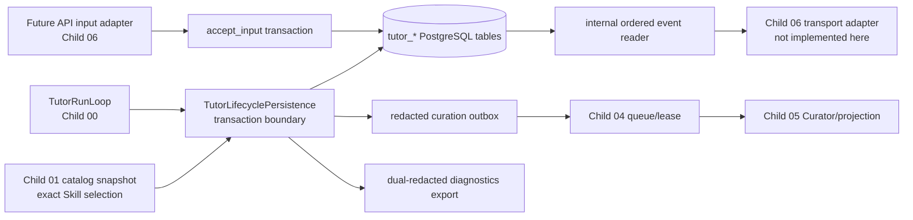

# Tutor State, Traces, and Evaluation Foundation Design

## 1. Scope and Architectural Boundary

Child 02 turns the already typed, feature-disabled Tutor Harness seam into a
durable internal foundation. It does not create learner-facing traffic. The
only production-facing persistence convention already present is repeatable
PostgreSQL bootstrap SQL, so the design adds an additive, namespaced schema
delta and explicit repository/unit-of-work contracts rather than installing a
parallel migration framework.

No path in this child reaches a public route, legacy Graph/router/tool, current
SSE writer, Desktop component, worker task, model provider, arbitrary network
client, sandbox, or direct domain mutation. `TUTOR_HARNESS_ENABLED` remains
false and no composition root enables these repositories for product traffic.

## 2. Schema Delivery and Data Model

### 2.1 Delivery Convention

Append a marked `Tutor Harness target persistence` block to
`aearn/services/api/app/db/schema.sql`. Every object is additive and
idempotent (`CREATE ... IF NOT EXISTS`, guarded indexes/constraints/trigger
creation where PostgreSQL requires it). `bootstrap_database()` remains the
single schema applier and its existing one-commit behavior is exercised twice
by the bootstrap test. No table is renamed, dropped, or reused from legacy
learning sessions/messages.

The initial rollback is application/composition rollback, not a destructive
DDL rollback: leave additive inactive tables in place, do not drop data, and
do not mutate legacy records. A future migration framework decision is outside
this child.

### 2.2 Table Responsibilities

| Table | Responsibility and protected-data rule |
| --- | --- |
| `tutor_conversations` | Target user-scoped conversation identity and lifecycle. |
| `tutor_messages` | Canonical visible learner/Tutor message rows; raw learner text may exist here only. |
| `tutor_catalog_snapshots` | Immutable catalog digest plus compact reviewed manifest/hash facts; never full Skill instructions. |
| `tutor_runs` | User/conversation scope, origin/status, current revision/counters, policy/catalog fingerprints, active lease owner/generation/expiry, terminal facts, and next event sequence. |
| `tutor_run_skill_selections` | Exact Skill id/version and manifest/instruction/evaluation hashes by run/revision; no mutable alias. |
| `tutor_run_input_events` | Accepted message reference, monotonic revision, request idempotency key/body hash/source and acceptance timestamp. |
| `tutor_run_checkpoints` | Metadata-only checkpoint reason/status/context budget/source hashes; no prompt/history/provider body. |
| `tutor_run_events` | Safe ordered run events with a per-run `event_sequence`, stable idempotency/event key, safe payload hash, and bounded payload projection. |
| `tutor_capability_invocations` | Descriptor/version/catalog/policy/revision facts, bounded request/result fingerprints/status/duration; no arbitrary targets or raw results. |
| `tutor_effects` | Effect identity/type, expected revision, active lease evidence, status transition, safe outcome/evidence and idempotency; the initial composed effect path remains deny-by-default. |
| `tutor_run_traces` | Redacted diagnostic records linked to safe lifecycle/event range and redaction/export versions; never message content. |
| `tutor_memory_curation_outbox` | Deduplicated metadata-only compaction trigger with closed source range, source hashes, policy/memory-setting versions, retention/staleness, and state. |
| `tutor_curation_proposals` | At-most-one typed proposal envelope per outbox identity with structural safe payload, provenance, confidence, retention/staleness, and no-action/stale/failed status. |

Use UUID primary keys, `timestamptz`, named `*_json` JSONB columns, `CHECK`
constraints for closed enum-like values, and explicit foreign keys/indexes.
The table family must enforce at least:

- unique `(run_id, event_sequence)` and unique `(run_id, event_key)`;
- unique `(run_id, input_revision)` for accepted input records;
- unique run-scoped input request idempotency key and body-hash collision
  detection through repository logic;
- unique exact selection identity per run/revision;
- unique effect identity/idempotency per run;
- unique outbox `idempotency_key` and unique proposal `outbox_id`;
- one terminal run transition through an update predicate/terminal field rather
  than timestamp ordering.

`next_event_sequence` belongs to the locked `tutor_runs` row. It is allocated
by the same transaction that writes an event, which makes gaps/conflicting
orders impossible without relying on `created_at` precision.
## 3. Transactional Repository Contracts

### 3.1 Explicit Lifecycle Boundary

Introduce a narrow service-layer persistence interface (final names may follow
local module conventions) rather than making the old `TutorRunStore` silently
commit one method at a time. The PostgreSQL implementation receives an
already-open psycopg connection or opens one unit of work at its application
boundary and exposes operations such as:

- `accept_input(...) -> TutorInputAcceptance`
- `record_skill_selection(...)`
- `persist_checkpoint(...)`
- `record_capability_invocation(...)`
- `commit_effect_if_current(...)`
- `complete_run(...)` / `record_waiting_result(...)`
- `events_after(..., after_sequence, limit)`
- safe trace/outbox/proposal read/write/export helpers.

The run loop is refactored only enough to delegate lifecycle writes through
this boundary. Existing in-memory ports/fakes remain usable for Child 00 unit
tests; a fake lifecycle adapter provides deterministic equivalent receipts.
The boundary does not make public API or worker composition available.

### 3.2 Input Acceptance Algorithm

For an incoming learner message, one transaction must:

1. scope the run to the authenticated target user and lock its `tutor_runs` row;
2. find a prior run-scoped request key; same body hash replays the original
   acceptance, while a different hash yields a typed idempotency conflict;
3. reject missing/terminal/cancelled/unauthorized runs before writing content;
4. insert the raw learner text into `tutor_messages` and a reference-only
   `tutor_run_input_events` row;
5. conditionally advance `tutor_runs.input_revision` by exactly one under the
   row lock, then append one safe `input_accepted` event with an allocated
   `event_sequence`; and
6. commit all rows together and return the authoritative snapshot/receipt.

No trace/outbox record contains `tutor_messages.content`. The target API
adapter later provides identity/request data; Child 02 tests call the
repository directly.

### 3.3 Lease, Checkpoint, Result, and Terminal Algorithm

A lifecycle transition first checks the active lease by owner, generation, and
expiry while locking/updating the run. It must also reject an already terminal
run before allocating a new event. For a safe checkpoint, terminal result, or
high-water compaction trigger, the same transaction writes:

1. the metadata-only checkpoint when applicable;
2. the run status/counters/terminal fields when applicable;
3. a redacted trace projection and its safe trace hash;
4. the corresponding safe ordered event; and
5. the deterministic compaction request using `ON CONFLICT` replay semantics.

A terminal update uses an authoritative predicate so only one worker becomes
the terminal writer. Losing workers receive a stable stale/lease/final receipt
and do not append a competing terminal event. A deliberate exception before
commit rolls every staged row back together.

### 3.4 Effect CAS Algorithm

`commit_effect_if_current` has a stricter boundary than the existing loop
pre-read:

1. lock/condition the target run on user scope, active lease owner/generation,
   unexpired lease, non-terminal status, and `input_revision == expected`;
2. replay an existing effect identity if it has the same idempotency/hash;
3. if revision or lease is stale, insert/update only a safe
   `stale_rejected`/unavailable effect record plus safe event and never invoke
   the domain effect callback;
4. if current, reserve the effect identity and invoke only an explicitly
   registered future effect handler that can share the same database
   transaction; then persist its safe result/event atomically; and
5. leave every unregistered Child 01 effect deny-by-default.

This avoids falsely claiming exactly-once domain semantics around an external
side effect. Child 05 and other effect owners must supply an in-transaction
handler before any effect type is enabled.

### 3.5 Internal Event Replay

`events_after` is user/run scoped and reads `event_sequence > after_sequence`
in ascending sequence order with a bounded limit. Event payloads are already
safe projections and are defensively re-projected on read. An empty suffix is
valid. Child 02 exposes no `Last-Event-ID`, SSE ID, frame, acknowledgement, or
transport retry behavior; Child 06 converts the internal cursor only after it
owns the external compatibility matrix.

## 4. Catalog, Capability, and Trace Persistence

### 4.1 Exact Catalog Evidence

At run creation/composition, persist the immutable catalog digest plus compact
reviewed manifest/hash records. A selection persistence adapter replaces the
Child 01 run-local store only for composed target persistence. It records exact
`CatalogSkillReference` and manifest/instruction/evaluation hashes against the
current revision, checks the stored catalog snapshot, and appends a safe
selection event. It never writes `current`, version ranges, full instructions,
or model-generated catalog metadata.

### 4.2 Capability and Effect Receipts

Capability records use descriptor-declared identifiers, policy decision/status
codes, duration/counters, safe field counts/hashes, and a link to an ordered
event. They do not serialize a generic provider envelope or lookup response.
Effects retain expected revision, catalog type, lease generation, safe result
reference, and state transition. The repository validates structural size and
allowlisted keys at the persistence boundary; the decision gate remains the
model authorization boundary.

### 4.3 Safe Trace Projection and Export

Create one reusable `TutorSafeProjection`/exporter built on existing runtime
redaction and Harness metadata contracts. Every diagnostic write calls it, and
every export/read calls it again. It uses an allowlist plus recursive redaction
rather than accepting arbitrary JSON. The output stores stable codes, counts,
opaque IDs, catalog hashes, source hashes, redaction version, and bounded
metadata only.

The projector rejects or removes raw prompts/history, provider request/response
or error body/reasoning, credentials, hidden tests, solution references, full
code, stack traces, host/container paths, shell/SQL targets, and URLs carrying
credentials. Value-based detectors must cover snake case, camel case, compact
keys, and misleading allowed-looking keys. A historical malformed database row
cannot leak because exporter redaction is independent of write-time redaction.
## 5. Curation Storage Envelope

A compaction request is generated only from the existing safe terminal,
checkpoint, or high-water contract. The outbox row is written by the same
lifecycle transaction and contains a deterministic idempotency key, run/
conversation/revision scope, trigger, closed event/input source range, source
IDs/hashes, policy version, learner memory-setting version, safe priority, and
retention/staleness timestamps. It has no prompt, raw source segment, provider
payload, or trace body.

`tutor_curation_proposals` supports only a structurally bounded typed envelope:
`context_summary` or `memory_entry`, outbox identity, source range/provenance,
confidence, safe payload/fingerprint, policy/memory-setting versions,
retention/staleness, and idempotent pending/no-action/stale/failed state.
Child 02 neither creates model content nor decides whether a proposal means a
valid memory/domain change. A later Curator can create/replay a proposal
through this repository, but queue leases/retry scheduling are Child 04 and
semantic validation/projection are Child 05. No proposal can write plans,
review/FSRS, attempts, messages, activity/inbox, learner-memory tables, or
execute code in this child.

## 6. Deterministic Evaluation Design

Add version-controlled cases under `tests/fixtures/tutor_evals/` and a small
fake-only runner in the Tutor test support path. Each fixture records a stable
case ID, catalog digest/Skill versions/hashes, injected clock, fake provider
sequence, fake gateway/effect behavior, expected terminal/state/event receipts,
and forbidden marker corpus. The runner rejects unknown fixture versions or
catalog identities rather than resolving a mutable current version.

Required case families:

1. policy/capability/effect denial produces no gateway/domain callback;
2. strict provider schema rejection yields primary-only `MODEL_UNAVAILABLE`
   and no diagnostic leak;
3. loop exits at deadline, zero budget, model/capability budget, cancellation,
   and bounded successful continuation without wall-clock/network dependence;
4. input race plus effect CAS produces one accepted revision, one safe event
   sequence, and `stale_rejected` with no committer call for the loser;
5. duplicate input/event/outbox/proposal identities replay the original receipt
   without duplicate durable rows; and
6. nested/value-shaped protected fields remain absent from database safe
   projections and exports.

Repository tests use PostgreSQL only where transaction/constraint/rollback
behavior is the subject. The bootstrap-heavy database batches run sequentially;
unit evals retain deterministic in-memory fakes.

## 7. Compatibility, Observability, and Rollback

- Legacy product tables, routes, Graphs, SSE writer, and Desktop code remain
  untouched. New tables are target-only and feature-off.
- Keep current public event names as potential safe `kind` values only; do not
  claim current `evt_*` IDs are durable or retrofit delivery behavior.
- Errors exposed by future adapters use stable codes and safe metadata. Internal
  persistence never serializes raw database/provider exception text into events
  or exports.
- Update `docs/architecture/tutor-harness-transition.md` with the target
  schema/lifecycle/replay/redaction/outbox/eval ownership so future children do
  not reinterpret legacy behavior as new-Harness behavior.
- Rollback before enablement disables/removes the composition adapter and leaves
  additive data intact. There is no destructive schema rollback and no legacy
  learner-data migration to reverse.

## 8. Test and Review Matrix

| Concern | Focused proof |
| --- | --- |
| schema / repeatable bootstrap | `test_db_bootstrap.py` twice-apply and Tutor table/index/constraint smoke |
| input and revision | repository tests for scoped replay, hash conflict, row lock, monotonic revision, one event |
| lifecycle atomicity | injected failure tests prove no partial checkpoint/result/event/trace/outbox rows |
| replay / terminal | concurrency and cursor-suffix tests for gap-free sequences and one terminal writer |
| effect CAS | stale lease/revision tests prove no domain committer call; duplicate effect identity replays |
| catalog replay | exact digest/version/hash persistence and rejection of mutable selection aliases |
| redaction / export | nested and value-marker corpus through every safe persistence/export path |
| curation envelope | deduplicated closed range, at-most-one proposal, no direct domain writes |
| deterministic evals | fake-only fixture runner covers denial/schema/bounded-loop/CAS/model failure/leakage |
| quality gates | focused pytest, sequential bootstrap suite, Ruff, Mypy, task validation, forbidden-import audit, diff check |