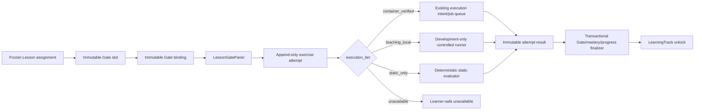

# 练习 Gate、模块诊断与受控执行解锁技术设计

## 1. 设计边界

本子任务把已经发布的 Lesson Gate slot 接到练习 authority、受控 execution queue、mastery evidence 和 LearningTrack unlock，但不接管后续完整学习工作区或复习调度。



权威边界：

- PostgreSQL 拥有 exercise version、private rubric、Gate binding/state、Attempt、result、diagnostic session、mastery evidence、plan revision 和 unlock authority。
- executor 只消费受信数据库 artifact 并写 existing job terminal result；不决定 LearningTrack pass/unlock。
- 前端只提交 learner action、expected version 和 idempotency，不计算 score/pass/mastery/unlock。
- 模型不接收完整代码、hidden tests、private rubric 或 executor internal result，也不能直接创建通过事实。
- `task.py validate` 只检查本规划，不是实施或发布批准。

## 2. 语义冻结

### 2.1 `gate_kind` 与 `requirement_kind`

现有 `ExerciseGateBlock.gate_kind` 和 `tutor_lesson_gate_slots.gate_kind` 保持教学形态：

```text
knowledge_check | guided_practice | independent_practice
```

新增 binding 字段 `requirement_kind` 表示路线约束：

```text
required | recommended | diagnostic
```

不得把已发布 slot 的 `gate_kind` 迁移或重解释为 required/recommended/diagnostic。required 只由 binding/state 层决定。

### 2.2 Attempt 类型

```text
run | submit | diagnostic_submit
```

- `run`：只获得运行反馈，不进入 Gate/mastery/progress finalization。
- `submit`：属于 Lesson Gate，可在 terminal 后更新 Gate/mastery/progress/unlock。
- `diagnostic_submit`：属于模块诊断 item，只更新 session aggregation 和诊断 evidence；全部通过后才创建计划变更提案。

### 2.3 完成独立性

```text
independent | hinted | remediated
```

服务端根据 append-only hint receipts、attempt history 和 remediation binding 计算，不接受客户端字段。diagnostic 只接受 `independent`；使用提示或补救即不能满足该诊断版本。

### 2.4 执行层级

复用现有 `ExecutionTier`：

- `container_verified`：唯一公开代码执行 tier。
- `teaching_local`：development/fixture/internal-only。
- `static_only`：无 Run，只允许确定性静态答案。
- `unavailable`：不接受执行依赖型动作。

执行 tier 由服务端 `ExecutionTierResolver` 在请求时根据 composition、runtime profile、reviewed image lock、executor health/version 和开关解析。客户端传值不参与授权。

## 3. 包与所有权

后端新增窄模块，避免把练习逻辑塞入 `track_service.py`、`lesson_service.py` 或 `tutor/public_api.py`：

```text
aearn/services/api/app/
  models/exercise_gates.py
  routes/exercise_gates.py
  services/learning/practice/
    contracts.py
    policies.py
    quality.py
    repository.py
    execution_adapter.py
    finalizer.py
    service.py
    fixtures.py
    diagnostics.py
```

职责：

- `contracts.py`：exercise/Gate/Attempt/result/diagnostic 公共与内部 typed contract、canonical hash。
- `policies.py`：版本化 pass、hint、diagnostic threshold、cooldown、execution requirement。
- `quality.py`：exercise version/private rubric/binding 发布前纯验证，不访问数据库、Docker 或 provider。
- `repository.py`：显式 SQL、scope lock、幂等 reservation、append-only persistence、transactional finalization。
- `execution_adapter.py`：把 Gate Attempt 映射到现有 execution intent/job；不创建第二队列。
- `finalizer.py`：从 terminal job/static/local result 生成 immutable safe result，并原子投影 Gate/mastery/progress。
- `service.py`：verified-only Gate use cases 和 learner-safe projection。
- `diagnostics.py`：module diagnostic session、aggregation、plan proposal 和确认激活。
- `fixtures.py`：显式版本化 Python/JavaScript/TypeScript/SQL curated fixtures。

共享执行 contract 继续位于：

```text
aearn/packages/shared/aearn_shared/execution/
```

executor 只修改：

```text
aearn/services/executor/aearn_executor/trusted_input.py
```

以及必要的 store/service contract 测试；API/Harness 不导入 Docker。

前端扩展现有 Lesson 边界：

```text
aearn/apps/desktop/src/features/learning/
  LessonDocumentPage.tsx
  lesson/
    LessonBlockRenderer.tsx
    LessonDocumentView.tsx
    LessonGatePanel.tsx
    ModuleDiagnosticModal.tsx
```

`LessonDocumentPage` 拥有请求状态；renderer 保持纯展示。

## 4. 练习 authority

### 4.1 练习版本表 `tutor_exercise_versions`

不可变共享表，关键字段：

- `id`
- `language_id`
- `exercise_key`
- `exercise_type`: `code_completion | sql_query | browser_preview | static_code_reasoning`
- `version`
- `source_kind`: 首版 `curated_fixture | registered_author`
- `title`、`learner_prompt_json`、`starter_artifact_json`
- `required_capabilities_json`
- `runtime_profile_id`、`execution_required`
- `public_feedback_policy_version`
- `content_hash`
- `validation_status=ready | rejected`
- `published_at`

共享 identity：`(exercise_key, version)` 唯一；`content_hash` 是 canonical payload hash。普通 UPDATE/DELETE 拒绝，用户 reset 不删除共享版本。

首版不把 legacy `exercises` 作为新 authority，也不把 adaptive provider output 直接写入该表。`registered_author` 只是严格发布 port 的预留 source kind，本任务默认只交付 curated fixtures 和 fake/quality tests。

### 4.2 私有评分表 `tutor_exercise_private_rubrics`

与 exact exercise version 一对一或 versioned one-to-one，字段包括：

- `exercise_version_id`
- `rubric_version`
- `private_test_bundle_json`
- `reference_answer_json`
- `score_policy_json`
- `rubric_hash`
- `published_at`

该表只允许 repository、finalizer 和 executor trusted-input seam 读取。route、公共 model、export、Conversation、trace、checkpoint、日志和普通 provider context 均不得读取或投影内容。

### 4.3 发布质量门

发布前验证：

- exact registered fields、字符串/数组/代码长度上限、稳定 key/version/hash；
- `execution_required=true` 时必须有 allowlisted runtime profile 和 private test contract；
- `static_code_reasoning` 必须 `execution_required=false` 且 evaluator 可确定性执行；
- public prompt/starter 不含 hidden marker、答案、private test、credential、URL header、路径、命令、镜像、mount 或容器标识；
- private rubric 与 public exercise language/type/profile 匹配；
- browser preview、Node TypeScript、Python 和 SQLite fixture 均通过各自 semantic validator；
- fixture validation 失败即拒绝发布，不生成简化 fallback。

## 5. Lesson Gate 绑定与状态

### 5.1 Gate 绑定表 `tutor_lesson_gate_bindings`

不可变 binding，关键字段：

- `id`
- `document_id`、`gate_key`、`block_id`
- `exercise_version_id`
- `requirement_kind`
- `pass_policy_version`
- `pass_threshold`
- `execution_requirement`: `required | optional | forbidden`
- `remediation_exercise_version_id` 可空
- `slot_contract_hash`
- `binding_contract_hash`
- `published_at`

数据库使用 `(document_id, gate_key)` 复合 FK 指向同 document slot，并验证 remediation exercise 与主 exercise language/scope 兼容。一个 slot 在一个发布 binding set 中只能有一个 active immutable binding identity；更改 exercise 或 policy 必须新增 successor document/binding，不更新旧行。

`slot_contract_hash` 至少覆盖 slot 的 `gate_kind`、assessment contract version、required capabilities 和 public prompt hash。`binding_contract_hash` 再覆盖 exercise version、requirement kind、pass policy、threshold、execution requirement 和 remediation identity。

### 5.2 Gate 状态表 `tutor_lesson_gate_states`

用户 assignment-scoped mutable projection：

- `id`
- `user_id`、`track_id`、`lesson_assignment_id`
- `document_id`、`knowledge_key`、`gate_binding_id`
- `state`: `available | in_progress | passed | remediation_required`
- `attempt_count`、`best_score`
- `latest_attempt_id`、`passing_attempt_id`
- `version`
- `passed_at`、`updated_at`

复合 FK 保证 assignment/document/user/track/key 与 binding 同 scope。`version` 用 CAS；同 assignment/binding 唯一。

state 不是 Attempt 的替代事实，可从 append-only Attempt/result 重建。required Gate 通过条件由 exact binding pass policy 计算；recommended/diagnostic Gate 可展示结果但不阻塞知识点完成。

### 5.3 Lesson 迁移

- started assignment 继续使用旧 binding 和 Gate state。
- successor Lesson proposal 计算每个 Gate 的 migration impact。
- 只有 `slot_contract_hash + binding_contract_hash` 完全相等时，新 assignment 可引用旧 passing result 生成显式 carry-forward receipt/state。
- 任一 slot、exercise、threshold、policy、execution requirement 或 remediation 变化都创建 fresh state。
- 旧 Attempt/result 永久保留，不能改写为新版本结果。

## 6. 追加式 Attempt 模型

### 6.1 尝试事实表 `tutor_exercise_attempts`

每次 accepted action 一行，普通 UPDATE/DELETE 拒绝：

- `id`
- `attempt_type`
- `user_id`、`track_id`
- `plan_revision_id`、`expected_track_version`、`expected_progress_version`
- `lesson_assignment_id`、`gate_binding_id` 可空
- `diagnostic_session_id`、`diagnostic_item_id` 可空
- `exercise_version_id`
- `submission_hash`
- `hint_state_hash`
- `independence`
- `idempotency_key`、`request_hash`
- `accepted_at`

shape CHECK：

- `run | submit` 必须绑定 Lesson assignment/Gate，诊断字段为空；
- `diagnostic_submit` 必须绑定 diagnostic session/item，Lesson Gate 字段为空；
- `run` 和 `submit` 的 action scope 必须指向 exact assignment/binding/exercise；
- `diagnostic_submit` 必须指向 session 固定 item/exercise。

幂等 identity 使用 `(user_id, operation, idempotency_key)` transaction advisory reservation + request hash。并发 first write 不能只依赖不存在行的 `SELECT FOR UPDATE`。

### 6.2 私有提交表 `tutor_exercise_attempt_submissions`

每个 Attempt 一条不可变私有 artifact：

- `attempt_id`
- `submission_kind`: `code | sql | structured_answer`
- `content_encrypted_or_private_text`
- `content_hash`
- `created_at`

首版沿用当前数据库私有存储边界，不把正文复制到公共 JSON。executor 通过 trusted-input repository 按 attempt/source scope 读取；API read projection 永不返回完整正文，只返回 hash、语言、长度和 learner 自己当前编辑器已持有的内容之外的安全摘要。

### 6.3 执行关联表 `tutor_exercise_execution_links`

append-only one-to-one link：

- `attempt_id`
- `execution_intent_id`
- `execution_job_id`
- `created_at`

只用于 `container_verified`。同 Attempt 只能链接一个 intent/job；重试读取原 link，不创建第二 job。

### 6.4 尝试结果表 `tutor_exercise_attempt_results`

每个 Attempt 最多一个 terminal immutable result：

- `attempt_id`
- `outcome`: `passed | failed | timed_out | cancelled | unavailable | invalid`
- `score`
- `safe_feedback_json`
- `capability_scores_json`
- `execution_receipt_hash` 可空
- `policy_version`
- `result_hash`
- `terminal_at`

result 只含 allowlisted stdout/test summary、bounded diagnostics 和 capability score；禁止 raw hidden-test name/body、reference answer、container ID、image ref、command、mount、path、Docker/provider exception。

### 6.5 提示回执表 `tutor_exercise_hint_receipts`

append-only：

- `id`、`attempt_scope_key` 或 assignment/binding scope
- `hint_level`
- `hint_policy_version`
- `safe_hint_json`
- `created_at`

提示内容由 versioned safe policy/curated artifact 产生，不从 private reference answer 直接截断。hint receipt 决定后续 Attempt 的 `independence=hinted`；进入 remediation exercise 后为 `remediated`。

## 7. 复用现有执行队列

### 7.1 Intent 增量迁移

扩展 `tutor_execution_intents`：

- `source_kind=tutor_message | exercise_submission`
- 旧字段 `run_id`、`conversation_id`、`source_message_id`、`exercise_id` 在 `tutor_message` 路径保持必填和原 scope FK。
- 新增 `exercise_attempt_id`、`exercise_submission_id`、`exercise_version_id`；在 `exercise_submission` 路径必填。
- `consumed_by_effect_id` 仅旧 Tutor 路径使用；Gate 路径为空。
- strict CHECK 保证两种 source shape 二选一，不能混合或全空。
- 新 Gate scope 通过复合 FK 证明 attempt/submission/exercise/user 一致。

现有旧行默认 `source_kind=tutor_message`，迁移必须 additive、bootstrap repeatable，并保留旧 NOT NULL 语义在 CHECK/trigger 中，不使用弱 nullable 放行。

### 7.2 Job owner 增量迁移

扩展 `tutor_execution_jobs`：

- `owner_kind=tutor_effect | exercise_attempt`
- 旧 `effect_record_id`、`effect_key`、run/conversation scope 在 `tutor_effect` 路径保持必填。
- 新 `exercise_attempt_id` 在 `exercise_attempt` 路径必填。
- `intent_id`、`user_id` 始终必填，并通过 owner-specific composite FK 匹配 intent/source。
- lifecycle、lease、claim generation、launch token、terminal result shape 和 terminal-to-failed cleanup convergence保持原 contract。

Gate service 在创建 Attempt/submission 后直接创建 existing intent/job；不创建 Tutor effect，不伪造 run/conversation/message。

### 7.3 共享 contract

`ExecutionJobV1` 增加：

- `owner_kind`
- old Tutor scope 的 optional fields
- `exercise_attempt_id` 或等价 opaque artifact owner

serialization 必须保持 exact one-of。旧 Tutor producer/consumer contract test继续通过；新 Gate producer 和 executor round-trip 使用相同 job schema/version 或明确的 additive version。

### 7.4 执行器受信输入

executor claim 后根据 `owner_kind/source_kind` 选择：

- `tutor_effect/tutor_message`：沿用现有 accepted Tutor message + legacy test cases 路径；
- `exercise_attempt/exercise_submission`：读取 private submission、exact exercise version、private rubric 和 reviewed runtime profile。

两条路径都只从数据库受信引用构造 launch spec。队列表中的 learner-safe result 不包含 private input。跨 scope、hash mismatch、exercise/rubric/profile version mismatch 必须在 Docker launch 前 fail closed。

### 7.5 终结器

executor 只终结 job。`ExerciseAttemptFinalizer` 由 Attempt poll、post-job recovery sweep 或同步 static/local path调用：

1. 锁 Attempt、execution link/job、binding/session 和相关 progress。
2. 若 immutable Attempt result 已存在，验证 hash 后重放。
3. 验证 job terminal、result hash、exercise/rubric/policy/assignment/plan/progress 版本仍属于 Attempt 接受时 scope。
4. 生成 allowlisted safe result并插入 `tutor_exercise_attempt_results`。
5. 对 `run` 立即结束，不写其他 projection。
6. 对 `submit` 或 `diagnostic_submit` 执行相应投影事务。

重复 poll、executor retry 或 recovery 不会重复 result/evidence/unlock。

## 8. Gate 终结与路线解锁

terminal `submit` 在一个 PostgreSQL transaction 中：

1. 插入或重放 immutable result。
2. 插入 `tutor_mastery_evidence(kind=gate)`，记录 score、independence、hint/attempt summary 和 source Attempt。
3. 使用 versioned `MasteryProjector` 重算知识点 mastery state。
4. CAS 更新 assignment-scoped Gate state。
5. 若 required Gate 全部 passed，把当前 knowledge progress 标为 `completed`；recommended/diagnostic 不影响该判断。
6. 按 active plan prerequisite 重算直接下游节点；只有所有 prerequisite 为 `completed | diagnostic_skipped` 才变为 `available`。
7. 安全更新 track `current_knowledge_key`、`last_learned_knowledge_key`、track/progress version。
8. 写入 opaque migration/projection receipt，提交后返回 learner-safe projection。

失败结果也可更新 Gate 为 `remediation_required`、attempt count、best score 和 mastery evidence，但不完成进度。stale assignment/exercise/plan/progress/gate version 返回 409，且不能把旧结果投影到新版本。已提交的 execution job/result仍作为旧 Attempt事实保留。

## 9. 不降级 mastery evidence

现有 `MasteryProjector` 会把所有 evidence 加权平均。为满足诊断失败不降低既有掌握度，给 `MasteryEvidence` 和 `tutor_mastery_evidence` additive 增加：

```text
evidence_effect = reinforcing | observational_non_degrading
```

- 既有 evidence 默认 `reinforcing`。
- Gate submit 和通过的独立 diagnostic evidence 使用 `reinforcing`。
- 失败/部分通过 diagnostic 使用 `observational_non_degrading`。

投影规则：

- confidence、mastery level、effective evidence count 只使用 `reinforcing`。
- observational evidence 可更新 `last_observation_at`、`observation_count`、weakness/recommendation summary，但不进入 confidence numerator/denominator。
- 对同一 evidence set/hash 的投影确定性重放。
- projector version 升级并保留旧 projection compatibility tests。

## 10. 模块诊断

### 10.1 模块诊断版本表 `tutor_module_diagnostic_versions`

不可变共享版本：

- `id`、`language_id`、`module_key`
- `version`、`policy_version`
- `core_capabilities_json`
- `pass_threshold=0.80`
- `require_all_core=true`
- `independent_only=true`
- `cooldown_seconds`
- `content_hash`、`published_at`

每个模块 version 必须覆盖 route module 声明的全部 core capabilities；缺项或重复 capability 发布失败。

### 10.2 模块诊断会话表 `tutor_module_diagnostic_sessions`

用户 scoped mutable lifecycle：

- `id`、`user_id`、`track_id`、`module_key`
- `diagnostic_version_id`
- `source_plan_revision_id`
- `expected_track_version`
- `state`: `active | failed | passed_pending_confirmation | confirmed | expired`
- `idempotency_key`、`request_hash`
- `started_at`、`terminal_at`、`cooldown_until`
- `proposed_plan_revision_id` 可空
- `impact_json`、`version`

同 user/track/module/version 只允许一个 active/passed-pending session。cooldown 从 terminal failure/partial result起计算；同幂等请求返回原 session。

### 10.3 模块诊断题目表 `tutor_module_diagnostic_items`

session 创建时冻结：

- `session_id`、`item_id`、`order_index`
- `capability_key`、`knowledge_key`
- `exercise_version_id`
- `threshold`
- `item_hash`

item 不在请求中动态替换。所有 item 使用相同 Attempt/result模型，且必须 `diagnostic_submit`、无 hint、无 remediation。

### 10.4 聚合与计划变更

全部 item terminal 后：

- 任一核心 capability 缺失、低于 0.80、非独立或 invalid/unavailable：session `failed`，不创建 plan revision、不跳过节点，写 observational non-degrading evidence 和 weak capability summary。
- 全部核心 capability 达标：session `passed_pending_confirmation`，为 active plan 创建 predecessor-linked proposed revision，保存 `diagnostic_skipped_module` migration impact、session/receipt/policy version、受影响节点和下游 unlock变化。

`POST .../confirm-skip` 在一个事务中：

1. 锁 session、track、active/proposed plan revisions 和模块 progress。
2. 验证 session 仍 `passed_pending_confirmation`、用户/track/active predecessor/version一致。
3. 激活 proposed successor revision。
4. 将该模块全部节点迁移为 `diagnostic_skipped`，保留旧 revision/progress/evidence。
5. 重算下游 prerequisite availability 和 current knowledge key。
6. 标记 session `confirmed` 并写 migration receipt。

通用 plan activation只保留已有 status，无法表达诊断 skip；因此 repository提供窄的 diagnostic-confirm transaction，但仍复用 plan revision/impact/activation authority，不创建第二种路线模型。

## 11. 公共 API

所有接口 verified-only、使用现有 learner-safe error envelope 和 `X-Request-Id`。跨用户、track、assignment、session 或 attempt scope 返回稳定 404，不泄露对象存在性。

### 11.1 Lesson Gate 接口

```text
GET  /api/learning-tracks/{track_id}/lessons/{knowledge_key}/gates?user_id=...
POST /api/learning-tracks/{track_id}/lessons/{knowledge_key}/gates/{gate_key}/prepare
POST /api/learning-tracks/{track_id}/lessons/{knowledge_key}/gates/{gate_key}/hints
POST /api/learning-tracks/{track_id}/lessons/{knowledge_key}/gates/{gate_key}/attempts
GET  /api/learning-tracks/{track_id}/lessons/{knowledge_key}/attempts/{attempt_id}?user_id=...
```

`prepare` 只解析 frozen assignment/binding、execution tier 和 Gate state；不调用 provider。未发布 binding/exercise 返回 not-ready。

Attempt mutation body 至少包含：

- `user_id`
- `attempt_type=run | submit`
- learner answer/code
- `expected_assignment_version`
- `expected_gate_version`
- `expected_progress_version`
- `expected_track_version`
- `idempotency_key`

服务端计算 submission/request/hint hashes。`container_verified` 返回 202 + Attempt projection；同步 static/local fixture 可返回 terminal projection。

### 11.2 模块诊断

```text
POST /api/learning-tracks/{track_id}/modules/{module_key}/diagnostics
GET  /api/learning-tracks/{track_id}/modules/{module_key}/diagnostics/{session_id}?user_id=...
POST /api/learning-tracks/{track_id}/modules/{module_key}/diagnostics/{session_id}/items/{item_id}/attempts
POST /api/learning-tracks/{track_id}/modules/{module_key}/diagnostics/{session_id}/confirm-skip
```

create body 包含 user、expected track/plan version 和 idempotency。confirm body 包含 user、expected session/track/active plan/proposed plan version 和独立 idempotency；不接受客户端节点列表、score 或 skip count。

### 11.3 公共 projection

Gate read 返回：

- frozen slot/binding/exercise public fields；
- requirement kind、Gate state/version、attempt count、best score；
- execution tier/disclosure、允许动作；
- latest learner-safe attempt/result；
- hint level/next remediation action；
- 不返回 private rubric/tests/reference answer/submission正文。

Diagnostic read 返回：

- version/policy/threshold/cooldown；
- capability coverage和 item public prompts；
- session state/item results；
- passed 后的 server-owned migration impact；
- 未通过时的 weak capability summary；
- 不返回 hidden scoring细节。

## 12. 稳定错误

新增或复用以下 learner-safe code：

- `LESSON_GATE_NOT_FOUND`
- `LESSON_GATE_NOT_READY`
- `LESSON_GATE_LOCKED`
- `LESSON_GATE_VERSION_CONFLICT`
- `EXERCISE_VERSION_NOT_READY`
- `EXERCISE_ATTEMPT_CONFLICT`
- `EXERCISE_ATTEMPT_IN_PROGRESS`
- `EXERCISE_ATTEMPT_NOT_FOUND`
- `EXECUTION_UNAVAILABLE`
- `MODULE_DIAGNOSTIC_NOT_ALLOWED`
- `MODULE_DIAGNOSTIC_COOLDOWN`
- `MODULE_DIAGNOSTIC_INCOMPLETE`
- `MODULE_DIAGNOSTIC_VERSION_CONFLICT`
- `MODULE_SKIP_CONFIRMATION_REQUIRED`
- `MODULE_SKIP_PLAN_CONFLICT`

映射原则：

- scope missing/cross-scope：404；
- stale、idempotency hash mismatch、active plan改变：409；
- malformed action/content/unsupported exercise type：422；
- execution/provider-like infrastructure unavailable：503；
- unexpected exception：稳定 503/500 envelope，不暴露 SQL、Docker、路径、命令、container、private test 或 traceback。

## 13. 前端设计

### 13.1 页面职责

`LessonDocumentPage` 在文档 ready 后并行或按需读取 Gate projection，拥有：

- Gate loading/error/stale/retry；
- 本地 editor text 和 changed-since-result 标记；
- prepare、hint、run、submit、poll/replay；
- module diagnostic modal/session；
- 从返回的 Lesson/track projection刷新当前路线。

`LessonBlockRenderer` 对 `exercise_gate` 调用 typed render seam：

```tsx
<LessonBlockRenderer
  block={block}
  renderExerciseGate={(gateBlock) => (
    <LessonGatePanel gate={gateByKey[gateBlock.gate_key]} />
  )}
/>
```

renderer 不发请求、不保存 code、不推断 requirement kind 或 pass。

### 13.2 Gate UI 状态

```text
unbound -> preparing -> available
available -> running -> run_result
available/run_result -> submitting -> passed
available/run_result -> submitting -> remediation_required
any mutable state -> stale -> refresh
any -> unavailable
```

- `unbound/not_ready`：显示稳定未准备，不展示伪练习。
- `container_verified`：按 allowed actions 显示 Run/Submit，pending时禁用重复动作并轮询 Attempt。
- `teaching_local`：仅 development fixture显示明确“教学本地执行，不代表公开沙箱”。
- `static_only`：隐藏 Run，显示“静态评估，不声称运行代码”。
- `unavailable`：隐藏执行依赖动作并显示原因。
- code改变后旧 result标为 stale，不把旧 stdout/score宣布为当前结果。
- private test只显示 bounded summary，例如通过计数与 learner-safe反馈。

### 13.3 模块诊断 modal

- 从 roadmap/module boundary 或 Lesson toolbar触发，不放在单个 Gate 内。
- 开始前展示覆盖能力、阈值、独立完成、cooldown 和“只有全部通过才可申请跳过”。
- item 顺序来自服务端；不能跳过后让 session 被判定通过。
- partial/failure 明确显示“未跳过任何知识点”，以及 safe weak capability建议。
- pass显示 migration impact和独立确认按钮；确认前旧 plan保持 active。
- confirm pending禁用重复操作；stale冲突刷新 session/roadmap，不本地应用 skip。

### 13.4 可访问性与响应式

- textarea/editor 有 label、language提示、错误说明和键盘焦点。
- pending/result 使用可见状态和适当 live region，不只 toast。
- 按钮 disabled 时给出原因。
- 1440px、900px、390px 无水平溢出；390px action纵向排列。
- 尊重 `prefers-reduced-motion`；modal focus trap/restore、Escape 和关闭按钮可用。

## 14. 安全、隐私与数据生命周期

- private submission、rubric/test/reference answer 只在数据库受控 repository/executor/finalizer边界出现。
- Attempt public projection、trace、checkpoint、log、error和 docs QA evidence使用 opaque ID/hash/version/count/safe feedback。
- 不把 learner代码复制到 Tutor conversation以驱动执行；普通 Tutor context最多读取 Gate/Attempt identity、状态、safe score summary和下一动作。
- export包含 learner-owned attempt/result/hint/diagnostic/migration safe projection，不含私有 rubric/test/executor diagnostic。
- reset/delete顺序：execution links/attempt results/hint receipts → attempt submissions/attempts → Gate states → diagnostic items/sessions → user plan/progress/mastery child；共享 exercise/diagnostic versions保留。
- 执行中的 job在 purge前按既有 lifecycle安全取消/终结，不能删除 owner后留下可 claim job。
- static/local fixture不能被生产 composition或公开 route误授权。

## 15. 并发、幂等与恢复

- 每个 mutation使用 full user + operation + idempotency key advisory reservation。
- Attempt接受与 execution intent/job创建在同一事务；provider/Docker不在该事务内。
- executor使用既有 `FOR UPDATE SKIP LOCKED`、lease generation和launch token；Gate owner不得弱化恢复语义。
- finalizer在事务内重查 exact active assignment/plan/progress；stale只阻止新 projection，不删除已执行事实。
- result/evidence/Gate/unlock各有 source Attempt唯一性，重复 finalizer读取 winner。
- diagnostic aggregation对 item result set/canonical hash幂等；相同 terminal set只创建一个 proposed revision。
- confirm skip以 session + proposed revision + active predecessor锁定；并发确认只有一个 winner。

## 16. 验证设计

### 16.1 纯 contract 与质量门

- exercise type、public/private exact fields、hash、size、hidden marker和profile compatibility正反例。
- gate_kind/requirement_kind分离、binding hash和Lesson migration carry-forward矩阵。
- pass/hint/independence/diagnostic threshold/cooldown确定性。
- mastery observational evidence不降低confidence/mastery level。

### 16.2 PostgreSQL 数据库

- bootstrap twice；所有表、index、复合 FK、shape CHECK、partial unique、append-only/lifecycle trigger。
- old Tutor intent/job rows与新 Gate owner/source rows均可写；混合shape、跨scope和弱nullable写入被拒绝。
- Attempt idempotency并发、result/evidence唯一、Gate CAS、unlock transaction。
- diagnostic session active unique、cooldown、item scope、proposal/confirm并发。
- reset/export/cutover child-to-root和共享version保留。

### 16.3 执行器

- shared contract old/new owner round-trip。
- trusted input两条路径；Gate path exact submission/exercise/rubric/profile/hash。
- reviewed lock缺失、health incompatible、disabled和profile mismatch均不launch。
- claim/lease/recovery/launch token/terminal cleanup旧回归继续通过。
- redaction证明无code/private test/path/command/container泄漏。

### 16.4 API 接口

- Gate read/prepare/hint/run/submit/poll happy path、fail、remediation、replay、stale、cross-user。
- run不改变mastery/progress；submit只由terminal result推进。
- required/recommended/diagnostic阻塞矩阵和下游unlock。
- diagnostic create/item/poll/partial/fail/pass/proposal/confirm/cooldown/replay。
- stable error envelope、X-Request-Id和unexpected exception redaction。

### 16.5 前端网页端

使用 disposable verified user、stateful mock/fake execution API和curated fixtures，在 `http://127.0.0.1:1420` 验证：

- Lesson Gate从未准备到可用、run、submit、pass/remediation、stale/retry。
- 四种 execution tier disclosure；static无Run，unavailable无伪能力。
- module diagnostic partial/fail不跳过；pass先预览，confirm后roadmap更新。
- 1440px、900px、390px；键盘、focus、modal、live状态、reduced motion。
- console无相关error/warning、无framework overlay、无水平溢出。
- 不运行 Desktop build、`desktop:check` 或Tauri校验。

## 17. 回滚

- Gate routes可 fail closed；已发布exercise/binding/Attempt/result保持只读可审计。
- 新 execution owner/source路径可禁用，旧 Tutor-effect队列继续工作；不得删除 additive columns/constraints来回滚。
- public execution缺少lock/health时回到`unavailable`，不能回退host runner。
- Frontend可暂时把Gate投影为明确不可用，但不能伪造通过或恢复旧exercise route。
- diagnostic confirm可关闭；passed-pending session和proposed revision保留，未确认前不改变active plan。


