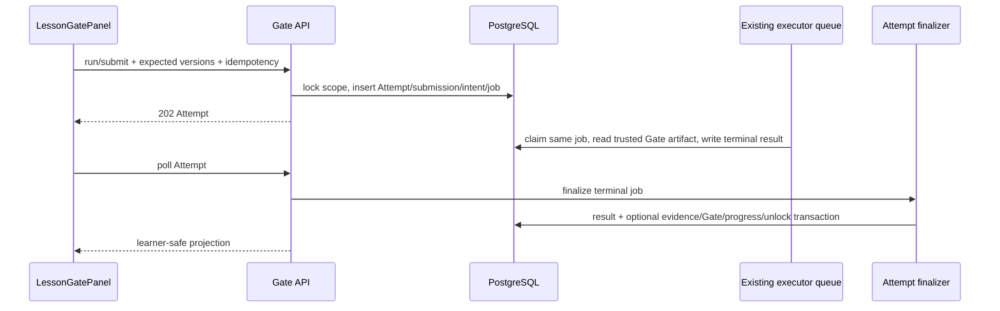
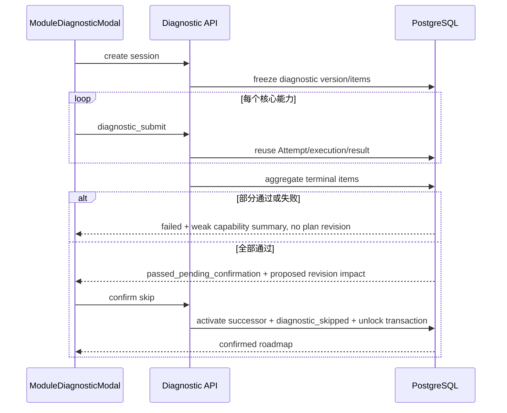

# 练习 Gate、模块诊断与受控执行仓库基线

## 调研时间与结论

本调研基于 2026-08-11 的 `main` 工作树。结论是：本子任务已有可复用的 LearningTrack、LessonDocument、execution tier 和 Tutor executor queue，但尚无新产品 authority 的 exercise version、Gate binding/state、private Attempt artifact 或module diagnostic session。实施必须做 additive integration，不能恢复legacy exercise route，也不能建立第二套queue。

## 已完成依赖

### LearningTrack 与掌握度

已归档任务：

- `.trellis/tasks/archive/2026-08/08-04-learning-track-plan-mastery-domain/`

当前实现：

- `aearn/services/api/app/services/learning/contracts.py`
- `aearn/services/api/app/services/learning/mastery.py`
- `aearn/services/api/app/services/learning/execution_tiers.py`
- `aearn/services/api/app/services/learning/track_repository.py`
- `aearn/services/api/app/services/learning/track_service.py`
- `aearn/services/api/app/services/learning/plan_repository.py`
- `aearn/services/api/app/services/learning/plan_service.py`

已存在事实：

- `NodeProgressStatus` 已包含 `diagnostic_skipped`。
- plan prerequisite 已把 `completed | diagnostic_skipped` 视为已满足。
- active plan、progress、track current key、track/progress version由PostgreSQL和service拥有。
- `ExecutionTier` 已定义 `teaching_local | container_verified | static_only | unavailable`。
- `ExecutionTierResolver` 已根据composition、reviewed image lock和executor health选择tier。
- `tutor_mastery_evidence` 已接受 `gate | module_diagnostic | review | model_code_review | trusted_import`。
- 当前 `MasteryProjector` 会对scope内全部evidence做加权平均，因此module diagnostic失败会潜在降低既有confidence；需要引入non-degrading effect。

规划结论：复用现有track/plan/progress/mastery authority；只做Gate/diagnostic所需增量，不建立第二份路线或掌握度模型。

### LessonDocument 与 Gate slot

已归档任务：

- `.trellis/tasks/archive/2026-08/08-04-lesson-document-authority-grounding/`

当前实现：

- `aearn/services/api/app/services/learning/lesson_contracts.py`
- `aearn/services/api/app/services/learning/lesson_repository.py`
- `aearn/services/api/app/services/learning/lesson_service.py`
- `aearn/services/api/app/routes/lesson_documents.py`
- `aearn/apps/desktop/src/features/learning/LessonDocumentPage.tsx`
- `aearn/apps/desktop/src/features/learning/lesson/LessonDocumentView.tsx`
- `aearn/apps/desktop/src/features/learning/lesson/LessonBlockRenderer.tsx`

已存在事实：

- `ExerciseGateBlock` 已发布 `gate_key`、`gate_kind`、`assessment_contract_version`、`required_capabilities`、`learner_prompt`。
- `gate_kind` 当前是 `knowledge_check | guided_practice | independent_practice`，表示教学形态。
- Lesson publish会写不可变 `tutor_lesson_gate_slots`。
- slot明确不包含exercise version、private rubric、Attempt、execution tier或unlock state。
- Lesson assignment会冻结started document version，successor文档通过显式proposal/migration处理。
- 当前frontend renderer只显示Gate contract和未开放提示，没有run/submit控制。

规划结论：新增binding时必须保留slot contract与`gate_kind`语义；使用独立`requirement_kind`；Gate state必须以`lesson_assignment_id`为scope，不能只以“最新document”读取。

## 当前 PostgreSQL 接缝

主schema位于：

- `aearn/services/api/app/db/schema.sql`

仓库不使用 `alembic/versions`；bootstrap由当前schema contract执行，因此所有变更必须是repeatable additive DDL，并在`test_db_bootstrap.py`证明bootstrap twice。

当前相关表：

- `tutor_execution_intents`
- `tutor_execution_jobs`
- `tutor_execution_attempts`
- `tutor_plan_revisions`
- `tutor_mastery_evidence`
- `tutor_lesson_gate_slots`
- `tutor_lesson_assignments`

当前数据库规范强调：

- user-scoped mutation需要full identity advisory reservation，不能只锁可能不存在的idempotency row；
- immutable revision/evidence/receipt拒绝普通UPDATE/DELETE；
- user reset/delete只在transaction-local purge capability和exact child-to-root路径下执行；
- execution intent/job必须用复合FK证明input/effect/job/run/user/conversation同scope；
- terminal result shape、lease、launch token和terminal convergence由数据库CHECK/trigger约束。

规划结论：新Gate owner/source迁移不能简单把旧execution字段改nullable；必须通过strict discriminator + CHECK + composite FK保留旧语义并新增新语义。

## 当前 Tutor execution queue

API侧：

- `aearn/services/api/app/services/tutor/execution.py`
- `aearn/services/api/tests/test_tutor_execution_contracts.py`
- `aearn/services/api/tests/test_tutor_execution_repository.py`
- `aearn/services/api/tests/test_tutor_execution_effect.py`
- `aearn/services/api/tests/test_tutor_execution_redaction.py`
- `aearn/services/api/tests/tutor_execution_support.py`

共享contract：

- `aearn/packages/shared/aearn_shared/execution/contracts.py`
- `aearn/packages/shared/aearn_shared/execution/catalog.py`
- `aearn/packages/shared/aearn_shared/execution/redaction.py`

executor侧：

- `aearn/services/executor/aearn_executor/trusted_input.py`
- `aearn/services/executor/tests/test_executor_service.py`
- `aearn/services/executor/tests/test_executor_main.py`
- `aearn/services/executor/tests/test_executor_launch.py`
- `aearn/services/executor/tests/test_executor_docker_conformance.py`

当前约束：

- intent绑定Tutor `run_id`、`conversation_id`、`source_message_id`、input revision和旧`exercise_id`。
- job绑定Tutor effect、run、conversation和intent。
- executor trusted input从accepted Tutor message读取learner submission，从legacy test case读取测试。
- queue lifecycle已有`pending -> claimed -> launch_reserved -> running -> terminal`、lease generation、`FOR UPDATE SKIP LOCKED`、launch token和recovery语义。
- API/Harness transaction只写intent/job；只有executor service可在commit后接触Docker。
- 缺少reviewed digest lock或兼容health时当前边界是fail closed。

缺口：Gate action不是Tutor effect，也不应创建fake conversation/message。其code必须保存在private attempt submission，由same executor queue以新owner/source one-of读取。

规划结论：扩展existing intent/job与shared contract；Gate path直接创建job但不创建effect。executor根据owner/source选择legacy trusted input或Gate trusted input。任何新queue/job lifecycle都违反父任务设计。

## 当前 legacy exercise 代码

目录：

- `aearn/services/api/app/services/exercises/adaptive_exercise_service.py`
- `aearn/services/api/app/services/exercises/evaluation.py`
- `aearn/services/api/app/services/exercises/exercise_guidance.py`
- `aearn/services/api/app/services/exercises/exercise_repository.py`
- `aearn/services/api/app/services/exercises/exercise_templates.py`

相关测试：

- `aearn/services/api/tests/test_adaptive_exercise_templates.py`
- `aearn/services/api/tests/test_exercise_semantic_validators.py`

当前事实：

- legacy exercise表、test case和provider generator仍被部分tests/helper使用。
- 当前`main.py`没有把legacy exercise route注册为新LearningTrack/Lesson产品公共authority。
- legacy adaptive generation包含provider和solution/reference语义，不满足新Gate immutable public/private authority边界。

规划结论：只允许提取/复用纯semantic validator、runner registry和受控development runner。新表和service放在`services/learning/practice/`；不恢复legacy route，不让新Gate直接引用legacy `exercise_id`。

## 当前 execution tier 与镜像锁

相关实现：

- `aearn/services/api/app/services/learning/execution_tiers.py`
- `aearn/services/api/tests/test_learning_execution_tiers.py`
- executor/shared execution catalog与health代码
- 当前reviewed image lock registry文件

当前事实：

- development可在明确fixture下得到`teaching_local`。
- public mode只有reviewed image lock + compatible executor health时才是`container_verified`。
- 当前reviewed lock registry为空，因此默认公开代码执行应稳定`unavailable`，而不是尝试host runner。
- `static_only`和`unavailable`已经是正式tier，不应被当作临时错误文案。

规划结论：本任务验证真实policy与no-fallback，不把fixture通过冒充公开container release。四语言fixture可以证明contract/adapter，但不能构成reviewed fleet批准。

## 当前前端接缝

文件：

- `aearn/apps/desktop/src/api.ts`
- `aearn/apps/desktop/src/types.ts`
- `aearn/apps/desktop/src/styles.css`
- `aearn/apps/desktop/src/App.tsx`
- `aearn/apps/desktop/src/features/learning/LearningHomePage.tsx`
- `aearn/apps/desktop/src/features/learning/LessonDocumentPage.tsx`
- `aearn/apps/desktop/src/features/learning/lesson/LessonDocumentView.tsx`
- `aearn/apps/desktop/src/features/learning/lesson/LessonBlockRenderer.tsx`
- `aearn/apps/desktop/src/features/learning/lesson/LessonSourcesPanel.tsx`

当前事实：

- Lesson reader已经是单页typed renderer，后续workspace计划复用它。
- `LessonDocumentPage`已拥有Lesson read/prepare/start/migration server state。
- `LessonBlockRenderer`对registered union exhaustive render，不渲染HTML/Markdown。
- Gate目前是contract-only block，无交互。
- 前端使用手写unknown validation，没有新增runtime validation library。
- 现有spec要求backend拥有Attempt/result/score，frontend只拥有editor和interaction state。
- 当前仓库没有可直接复用的代码编辑器组件；global CSS仍是正式样式方案。

规划结论：本任务在现有Lesson页面新增`LessonGatePanel`与`ModuleDiagnosticModal`，用typed render callback避免renderer承担API。首版采用accessible textarea，不新增编辑器或组件库。

## 父任务结构约束

父任务明确：

- 单个知识点没有skip mutation。
- 模块诊断只有全部核心能力通过才能提出整模块skip。
- 模块skip是路线结构变化，必须创建predecessor-linked plan revision并由用户确认。
- partial diagnostic不跳过节点；failed diagnostic不降低已证明掌握度。
- `tutor_execution_intents.exercise_id`需要additive artifact reference迁移，executor job lifecycle不能复制。
- plan、Gate、mastery和unlock属于PostgreSQL权威。

规划结论：模块diagnostic通过后不能直接UPDATE现有progress；必须先创建proposed successor，confirm transaction才迁移节点为`diagnostic_skipped`。

## 数据流结论

### Gate 运行与提交

### 模块诊断

## 规划决策摘要

- 保留Lesson `gate_kind`，新增binding `requirement_kind`。
- Gate state以frozen Lesson assignment为scope。
- 练习公共内容与private rubric分表且不可变。
- learner submission是private Attempt artifact，不进入Conversation。
- Gate复用existing execution intent/job，新增strict owner/source one-of，不建第二queue。
- executor只执行，Gate pass/unlock由API finalizer事务决定。
- diagnostic失败/部分通过使用`observational_non_degrading` evidence。
- diagnostic全通过先propose plan revision，用户confirm后才`diagnostic_skipped`。
- 首版四语言使用curated fixture；不调用真实provider，不批准reviewed image fleet。
- 前端只扩展Lesson reader，网页端验证，不做Desktop build。

