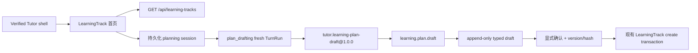

# 学习首页与对话式计划制定技术设计

## 1. 设计边界

本 child 在现有 verified Tutor shell 内增加两个正式产品视图：`learning_home` 与 `track_planner`。它复用已经冻结的 LearningTrack、Conversation/TurnRun scope、latest-input、context budget、usage/cache、summary 与 safe projection contract，不重建 Harness，也不实现 Lesson、Exercise、Review 或完整三栏工作区。



关键边界：

- 首页只消费服务端 projection，不重新计算领域状态。
- 模型只能提出结构化草案；创建 LearningTrack 仍由独立用户点击和服务端事务完成。
- 通用 Tutor decision/capability payload 的 `12 fields × 360 chars` 上限保持不变。
- Desktop 不再挂载旧 general conversation / 对话历史页面；服务端 conversation/history API 与既有数据保持兼容，规划会话继续复用同一 history/SSE/composer 内核。

## 2. Desktop 内部导航

顶层 `AppRoute` 继续只有 `loading | welcome | cutover | tutor`。在 `tutor` 内增加本地、非持久化的：

```text
TutorSurface =
  | { kind: "learning_home"; highlighted_track_id?: string }
  | { kind: "track_planner"; session_id: string }
  | { kind: "downstream_not_ready"; intent: "continue_learning" | "start_review"; track_id: string }
```

- verified bootstrap 默认进入 `learning_home`，不再默认打开空 general conversation。
- Desktop 删除 `conversation_history` surface、入口和 `TutorWorkspacePage`；不删除服务端既有 conversation 数据或 API。规划页只打开 session 已绑定的 `plan_drafting` conversation。
- “继续学习”“开始复习”产生稳定 intent。对应 downstream child 尚未交付时显示 learner-safe 未就绪提示，不创建 Lesson/Review、run 或执行结果。
- 计划确认后 refetch 首页，并用短生命周期 `highlighted_track_id` 突出新卡片；刷新后不依赖该本地状态。

## 3. 语言目录与首页投影

新增只读接口：

- `GET /api/learning-tracks/catalog?user_id={uuid}`

响应项至少包含：

- `language_id`, `display_name`
- `selection_tier`: `core | extended | degraded | unavailable`
- `selectable`
- `lesson_generation_state`
- `execution_tier`, `execution_disclosure`
- `source_trust_policy`

目录由 `language_capabilities.py`、父任务语言矩阵和 `ExecutionTierResolver` 组合；Desktop 不根据本机工具、环境变量或语言名称推断能力。静态 `/catalog` 路由必须在 `/{track_id}` 之前注册。

首页继续使用已有 `GET /api/learning-tracks`。卡片顺序采用服务端已有 `updated_at DESC, id DESC`；添加卡在前端作为最后一个固定 action item，不混入服务端列表。首页不请求或渲染语言目录；点击添加卡直接创建/恢复 session，Desktop 省略 `preferred_language_id`，语言由 planning conversation 询问并由服务端 registry 校验。

## 4. Planning session API

新增 verified-only 路由族：

- `POST /api/learning-plan-sessions`
  - 输入：`user_id`、`client_action_id`、可选 `preferred_language_id`。
  - 在 user advisory lock 下返回当前未完成 session，或原子创建 learner conversation、绑定 `plan_drafting` broad scope 与 planning session。
- `GET /api/learning-plan-sessions/current?user_id={uuid}`
  - 返回当前 `collecting | draft_ready` session 或 `null`，用于刷新恢复。
- `GET /api/learning-plan-sessions/{session_id}?user_id={uuid}`
  - 返回 session、conversation ID、当前草案安全投影和最后安全错误。
- `POST /api/learning-plan-sessions/{session_id}/cancel`
  - 显式关闭未确认 session；不删除 conversation 或草案证据。
- `POST /api/learning-plan-sessions/{session_id}/confirm`
  - 输入：`user_id`、`client_action_id`、`expected_session_version`、`draft_id`、`draft_version`、`content_hash`。
  - 锁定 session，验证 current pointer/version/hash 后，在同一事务内复用现有 `LearningPlan` contract 与 `PostgresLearningTrackRepository.create_track`，创建 track/active revision/路线/progress、将 conversation 改绑为 `learning_track`，并把 session 标记为 confirmed。

所有 mutation 复用 `tutor_api_idempotency_records`，operation namespace 使用 `learning_plan_session.*`。同 key 不同 body 为 `409 IDEMPOTENCY_CONFLICT`；跨用户 session 统一投影 `404 LEARNING_PLAN_SESSION_NOT_FOUND`。

## 5. PostgreSQL 模型

### 5.1 `tutor_learning_plan_sessions`

关键字段：

- `id`, `user_id`, `conversation_id`
- `status`: `collecting | draft_ready | confirmed | cancelled`
- `preferred_language_id` nullable
- `current_draft_id` nullable
- `confirmed_track_id` nullable
- `version`
- `last_error_code`, `last_error_at`
- `created_at`, `updated_at`, `confirmed_at`, `cancelled_at`

约束：

- `(id,user_id)` 和 `(conversation_id,user_id)` 复合作用域。
- 同一用户最多一条 `collecting | draft_ready` session 的 partial unique index。
- `confirmed` 必须同时有 `confirmed_track_id`、`current_draft_id`、`confirmed_at`；`cancelled` 必须有 `cancelled_at`。
- session 不保存 raw prompt/history/provider body/reasoning；对话正文仍只在 `tutor_messages`。

### 5.2 `tutor_learning_plan_drafts`

关键字段：

- `id`, `session_id`, `user_id`
- `draft_version`, `predecessor_draft_id`
- `language_id`, `goal_text`, `target_level`
- `weekly_minutes`, `experience_level`
- `teaching_preferences_json`, `pace_summary`
- `plan_json`, `source_summary_json`
- `content_hash`, `generator_version`, `policy_version`
- `source_run_id`, `source_input_revision`, `created_at`

约束：

- `(session_id,draft_version)` 唯一；predecessor 必须属于同一 user/session。
- 行 append-only，普通 `UPDATE/DELETE` 由 trigger 拒绝；是否 current/confirmed 只看 session pointer。
- `plan_json` 必须通过现有 `LearningPlan` canonical hash、stable key、唯一 order 与 DAG 校验后写入。
- `source_summary_json` 只保存 registry-owned source metadata；不保存检索正文或任意模型 URL。
- `(source_run_id,source_input_revision)` 最多产生一个成功草案，避免 capability replay 创建重复版本。

schema 保持 additive-first；回滚代码不删除 session/draft/track 数据。

## 6. `learning.plan.draft` 类型化 capability

### 6.1 Catalog 与 Skill

新增：

- capability descriptor：`learning.plan.draft@1.0.0`
- exact Skill：`tutor.learning-plan-draft@1.0.0`
- policy tag：`plan-drafting`
- effect：无；确认不是模型 effect。

Skill 指令要求：

1. 缺少语言、基础、目标、时间投入、经验或教学偏好时，先直接回答并只追问一个最高价值问题。
2. 信息足够时先选择 exact Skill；context rebuild 后请求一次 `learning.plan.draft`。
3. 不提供 URL、路径、命令、镜像、provider 字段或 hidden rubric。
4. 调整请求必须基于 current draft source 产生完整替代草案，不能只返回 diff。

### 6.2 保持通用 payload 上限

不扩大 `TutorEnvelopeValue`、`MAX_TUTOR_PAYLOAD_FIELDS` 或 `MAX_TUTOR_PAYLOAD_VALUE_LENGTH`。capability 输入使用 capability-specific Pydantic contract：

- 一个 `profile_json` compact string，包含受限 `language_id`、`goal_text`、`target_level`、`weekly_minutes`、`experience_level`、最多四项 teaching preferences 和 `pace_summary`。
- `module_1` 到 `module_8` 为可选 compact JSON string；至少两个、最多八个模块。每个模块包含稳定 module key、标题、核心/可跳过标记和受限节点列表；节点包含稳定 knowledge key、标题、前置 key 和 required capability key。

Gateway 解码后再次执行严格 nested Pydantic validation，并转换为已冻结的 `LearningPlan`。`generator_version`、`policy_version`、初始/修订 `change_reason`、来源摘要和 execution projection 均由服务端决定，模型不能指定。

### 6.3 Gateway 与质量门

将现有只支持 grounding 的 gateway 重构为 descriptor-first dispatcher map，但每个 handler 仍显式注册，未知 capability 默认拒绝。Plan handler 必须验证：

- run 是当前 user 的 interactive、未 superseded、未 terminal 的 `plan_drafting` scope；
- active planning session 与 run conversation 一致；
- selected Skill、catalog hash、policy fingerprint、lease、input revision 和 capability budget 有效；
- language selectable/降级信息来自服务器 registry；
- 模块/节点数量、stable key、DAG、核心节点、目标/时间范围和 required capabilities 合法；
- registry 至少能提供符合语言 trust policy 的来源摘要；
- 同一 run revision replay 返回同一 draft，不创建新版本。

通过后写入 append-only draft、CAS 更新 session current pointer/version，并返回只含 `draft_id`、`draft_version`、`content_hash`、`quality_status` 的 safe result。完整计划不进入通用 capability receipt/event/trace。

质量失败时不创建 draft 或 track，只在 session 保存 allowlisted `last_error_code`；gateway 返回 denied/unavailable，UI 读取 session 后显示可恢复错误。不得 fallback 到静态模板。

## 7. Task-aware 默认拒绝策略与 runtime composition

新增 PostgreSQL-backed `InteractiveLearningCapabilityPolicyResolver`：

- `general` 与 `learning_track` run 保持现有 default-deny，不自动开放 plan capability。
- 只有 `interactive + plan_drafting + active session + current revision` 才授予：
  - exact Skill `tutor.learning-plan-draft@1.0.0`
  - capability `learning.plan.draft`
  - tag `plan-drafting`
  - no effects
- capability runtime availability 依赖本地 handler/session/schema 可用性，不依赖模型提供字段。
- policy remaining budget 从 immutable run policy/counters 计算，不能由模型或 UI 放宽。

`TutorInteractiveRunDispatcher` 仅把 default-deny resolver/gateway 替换为上述 task-aware 组合；provider、context budget planner、lease、usage/cache receipt、repair attempt 和 run loop 不变。

## 8. Planning context 与修订

新增窄 decorator，读取已冻结的 run scope：

- 非 `plan_drafting` run 原样返回现有 `TutorContextInput`。
- `plan_drafting` run 在现有 `system_descriptors` 中追加一个 bounded `learning-plan-session` source；有 current draft 时再追加一个只含 profile、module/node keys/titles、pace 与 source IDs 的 `learning-plan-current-draft` source。
- 不新增 context category、不修改自适应预算顺序、不复制 current input，也不把完整 `plan_json`、raw history 或 provider payload塞进 descriptor。
- current input 仍单独 pinned；recent history/summary 继续低于当前输入。

新 ordinary message 产生 fresh run；若 capability 成功则创建下一版完整草案并移动 pointer。旧草案仍可审阅但不可确认。

## 9. Desktop 组件设计

建议目录：

```text
aearn/apps/desktop/src/
  features/learning/
    LearningHomePage.tsx
    LearningTrackCard.tsx
    LearningPlanBuilderPage.tsx
    LearningPlanDraftCard.tsx
    LearningLanguageCatalog.tsx
  features/tutor/
    TutorConversationSurface.tsx
  App.tsx
  api.ts
  types.ts
  styles.css
```

- 从已移除的 `TutorWorkspacePage` 保留 history/SSE/composer 内核为 `TutorConversationSurface`，仅供 planner 使用；不得复制第二套 run lifecycle，也不得重新暴露 general conversation 页面。
- planner 始终提交 `{scope_kind:"plan_drafting", task_kind:"plan_drafting"}`；普通 submit 调 conversation-input，只有 server-authorized continuation 才调 run-input。
- planning page 不显示应用左侧栏，也不渲染 Tutor hero 或外层 timeline/composer 卡片。`historyStatus=ready && timeline.length=0 && activeRun=null` 定义为未激活状态，此时隐藏 timeline、空状态文案、建议项和提示，只在可用区域中央显示圆角 Composer；首条消息被接受并设置 active run 后立即切换为学习者右侧气泡、Tutor 左侧正文和底部 Composer 的 GPT 式消息流。对话始终保持居中单列；进入 planning 页面时立即渲染右缘展开/收起按钮，并默认展开不参与主布局、不挤压对话列、与视口右缘保留明显留白的四角圆角独立浮动窗口。没有 `current_draft` 时窗口只渲染一个无业务含义的 emoji 与隐藏的可访问状态，不合成任何计划字段；服务端产出 `current_draft` 后，同一窗口原位替换为 typed plan route。用户收起同一 draft 后，普通 session 刷新不得强制重开；draft ID 更新时自动展示新版。窄屏改为底部浮动检查器，仍限制最大高度。
- 草案组件只渲染注册字段；不接受 arbitrary HTML/Markdown/React definition。
- 首页 breakpoints：宽屏三列，中等两列，窄屏一列；添加卡始终 DOM 顺序最后。
- 所有按钮具备 label、focus、disabled/loading、error/status live region；键盘可完成创建 session、发送、确认、取消和返回首页。

## 10. 并发、幂等与陈旧状态

- session create 在 user advisory lock 下串行，partial unique 是最终兜底。
- draft append 使用 session row `FOR UPDATE`，`draft_version = current + 1`；capability replay 由 source run/revision unique 返回原结果。
- confirm 同时校验 session version、current draft ID/version/hash；任一陈旧返回 `409 LEARNING_PLAN_DRAFT_STALE`。
- confirm transaction 写 track 后再写 session confirmed；任一步失败整体回滚，不留下半成品 track。
- 已 confirmed session 的同 key replay返回原 track；新 key 再确认返回 `409 LEARNING_PLAN_SESSION_ALREADY_CONFIRMED`，不创建第二条 track。
- capability/provider 运行期间的新普通输入继续 supersede 旧 run；旧 run 不能移动 current draft pointer。

## 11. 错误与安全投影

新增稳定 code：

- `LEARNING_PLAN_SESSION_NOT_FOUND`
- `LEARNING_PLAN_SESSION_CONFLICT`
- `LEARNING_PLAN_SESSION_ALREADY_CONFIRMED`
- `LEARNING_PLAN_DRAFT_NOT_READY`
- `LEARNING_PLAN_DRAFT_INVALID`
- `LEARNING_PLAN_DRAFT_QUALITY_BLOCKED`
- `LEARNING_PLAN_DRAFT_STALE`
- `LEARNING_LANGUAGE_NOT_SELECTABLE`

API details 只含安全 ID/version/field code，不含 draft body、provider diagnostics 或其他用户 owner 信息。SSE 继续只暴露既有 run/process 安全投影；草案内容只通过 user-scoped session read API 返回。

## 12. 文档与兼容

实现后同步：

- `docs/product/user-flows.md`
- `docs/product/frontend-interaction-spec.md`
- `docs/architecture/api-contract.md`
- `docs/architecture/database-schema.md`
- `docs/architecture/tutor-harness-runtime.md`
- `docs/qa/acceptance-test-plan.md`
- `docs/qa/tutor-harness-release-readiness.md`

文档只描述实装行为，并修正仍把普通 follow-up 描述为 run merge 的旧段落。受保护原型不删除、不替换；旧 Graph/onboarding 文档不恢复为 source of truth。

## 13. 验证设计

### 后端纯逻辑

- compact capability input decode、长度边界、非法 nested JSON、stable key、DAG、required capability 与 canonical hash。
- 语言目录 core/extended/degraded/unavailable 与 tier resolver 一致。
- task-aware policy：general/track deny，active plan_drafting allow，cancelled/confirmed/stale/superseded deny。

### PostgreSQL/API

- bootstrap 两次；session/draft FK/CHECK/partial unique/append-only trigger。
- create/current/read/cancel/confirm、跨用户 404、idempotency replay/conflict。
- capability draft append/replay、新版 pointer、stale confirm、provider/quality failure no half track。
- confirm 原子创建 track/revision/modules/nodes/progress 并改绑 conversation scope。

### Harness 回归

- current input pinned 且不重复；ordinary planning message fresh run；continuation 不改变 scope。
- generic capability remains denied outside plan drafting。
- usage/cache、repair attempt、adaptive budget、summary/compaction、history/SSE、安全 receipt 不回归。

### 网页端前端验证

- 仅使用 `http://127.0.0.1:1420` 的真实浏览器渲染与交互证据；不把 Desktop build/typecheck 作为默认前端校验。
- 本地 fake/API fixture 下 normal/narrow viewport：三/二/一列、添加卡直接进入 planner、无语言选择器、planner 无左侧栏/hero、对话主列居中、输入栏聚焦前后外壳视觉稳定、进入 planner 即出现右缘按钮与四角圆角浮动窗口、无草案时只有 emoji、`current_draft` 后原位展示计划且可展开/收起、恢复/修订/stale confirm、键盘焦点和无水平溢出。
- Desktop 不存在 general conversation / 对话历史入口；planner conversation 仍可恢复 history/SSE。

## 14. 回滚

- Desktop 回滚不得恢复已移除的 general conversation workspace；可以关闭 Learning Home / planner UI，但不删除新 session/draft/track 或既有 conversation 数据。
- plan capability 可从 task-aware policy 中移除并 fail closed；已有草案保持只读。
- route 注册可独立回滚；schema additive 保留。
- execution tier 异常继续 fail closed，不因 planner 可用而提升执行能力。
