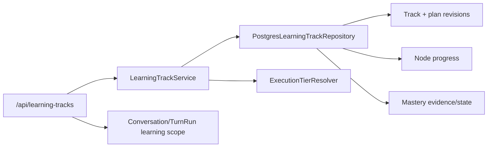

# LearningTrack、计划路线与掌握度领域设计

## 1. 设计边界

本 child 建立新教学产品的长期权威领域，但不实现教学内容和练习行为。所有新状态使用 `tutor_` 前缀，与已退休的 `learning_*` 表隔离。



本 child 不调用 provider、grounding、runner 或 executor，不创建 Lesson、Exercise、ReviewSession，也不恢复旧 Graph/learning API。

## 2. 包与所有权

新增窄领域包：

```text
aearn/services/api/app/
  models/learning_tracks.py
  routes/learning_tracks.py
  services/learning/
    __init__.py
    contracts.py
    execution_tiers.py
    track_repository.py
    track_service.py
    mastery.py
```

- route 只做 Pydantic 边界、cutover gate、request id/idempotency 和 public error mapping。
- service 负责事务用例、版本/CAS、影响预览和 safe projection。
- repository 负责显式 SQL、scope lock 和 row mapping。
- `mastery.py` 负责确定性 evidence → state 投影，不依赖模型。
- 不把新业务逻辑塞入 `services/tutor/public_api.py` 或 `learner_state.py`；后续 Tutor context adapter 通过新领域 service 读取。

## 3. PostgreSQL 模型

### 3.1 `tutor_learning_tracks`

关键字段：

- `id`, `user_id`
- `language_id`
- `goal_text`, `target_level`
- `status`: `active | paused | completed | archived`
- `current_knowledge_key`
- `version`：track 可变投影的 CAS version
- `last_learned_at`, `created_at`, `updated_at`, `archived_at`

约束：

- `UNIQUE(id, user_id)` 供复合外键使用。
- `language_id` 由应用层 registry 校验，不复制一份随语言扩展频繁修改的数据库 CHECK 列表。
- `goal_text` 和 `current_knowledge_key` 有长度边界；archive 后不能通过普通进度 mutation 重新激活。

### 3.2 `tutor_track_plan_revisions`

关键字段：

- `id`, `track_id`, `user_id`
- `predecessor_revision_id`
- `status`: `proposed | active | superseded | rejected`
- `title`, `target_level`, `plan_json`
- `generator_version`, `policy_version`
- `change_reason`, `content_hash`
- `created_at`, `activated_at`

约束：

- predecessor 必须属于同一 user + track。
- revision 内容不可 UPDATE；状态转换由窄 repository 方法控制。
- 同一 track 最多一个 `active` partial unique index。
- `content_hash` 为 canonical plan payload 的 SHA-256。

### 3.3 `tutor_track_active_plans`

- 主键 `(track_id)`，同时保存 `user_id`、`revision_id` 和 `updated_at`。
- 复合 FK 保证 active revision 与 track/user 相同。
- active pointer 和 revision status 在同一事务内切换。

### 3.4 `tutor_track_plan_modules` 与 `tutor_track_plan_nodes`

模块：

- `id`, `revision_id`, `track_id`, `user_id`
- `module_key`, `title`, `description`, `order_index`
- `is_core`, `is_skippable`

节点：

- `id`, `module_id`, `revision_id`, `track_id`, `user_id`
- `knowledge_key`, `title`, `description`, `order_index`
- `is_core`, `prerequisite_keys_json`, `required_capabilities_json`

约束：

- `(revision_id, module_key)` 与 `(revision_id, knowledge_key)` 唯一。
- `knowledge_key` 是计划版本间稳定的语义 key；行 UUID 只标识某一 revision 的节点。
- prerequisite 必须在服务端确认 revision 前解析为同 revision 内存在且无环的 key。

### 3.5 `tutor_track_node_progress`

关键字段：

- `track_id`, `user_id`, `knowledge_key`
- `status`: `locked | available | in_progress | completed | review_due | diagnostic_skipped`
- `source_plan_revision_id`
- `version`, `started_at`, `completed_at`, `updated_at`

主键 `(track_id, knowledge_key)`。计划 revision 激活时通过稳定 key 合并：保留相同 key 的进度；新 key 按 prerequisite 计算初始状态；移除 key 不删除旧 evidence，由 migration receipt 标记 detached。

### 3.6 `tutor_track_plan_migrations`

关键字段：

- `id`, `track_id`, `user_id`
- `from_revision_id`, `to_revision_id`
- `status`: `proposed | confirmed | rejected | applied`
- `impact_json`：added/removed/reordered/prerequisite_changed/retained progress 摘要
- `expected_track_version`
- `idempotency_key`, `request_hash`
- `created_at`, `confirmed_at`, `applied_at`

结构变更先创建 proposal；activate 端点确认并在事务中应用。初始 track 创建不需要 migration row。

### 3.7 掌握度

`tutor_mastery_evidence`：

- append-only `id`, `track_id`, `user_id`, `knowledge_key`
- `evidence_kind`: `gate | module_diagnostic | review | model_code_review | trusted_import`
- `source_receipt_id`, `source_receipt_hash`
- `independence`: `independent | hinted | remediated`
- `score`, `hint_count`, `attempt_count`, `evidence_summary_json`
- `created_at`
- `(track_id, evidence_kind, source_receipt_id)` 唯一，防止 replay 重复证据。

`tutor_mastery_states`：

- 主键 `(track_id, knowledge_key)`
- `confidence`, `mastery_level`: `unseen | emerging | developing | proficient | durable`
- `strengths_json`, `weaknesses_json`
- `evidence_count`, `last_evidence_id`, `projector_version`, `version`, `updated_at`

projector 只消费受信 evidence summary。模型 proposal、聊天文本或滚动行为不能写 evidence。

## 4. Conversation 与 TurnRun Scope

### 4.1 `tutor_conversation_learning_scopes`

一对一绑定：

- `conversation_id`, `user_id`
- `scope_kind`: `general | plan_drafting | learning_track`
- `learning_track_id` nullable
- `version`, `created_at`, `updated_at`

约束：

- `learning_track` 必须有同 user track；其他 scope 的 track 必须为空。
- 旧 conversation 无 row 时 public/context adapter 等价投影为 `general`，不执行 backfill 和自然语言推断。

### 4.2 `tutor_run_learning_scopes`

保存 run 创建时的不可变 scope snapshot：

- `run_id`, `user_id`, `conversation_id`
- `scope_kind`, `learning_track_id`
- `task_kind`: `general_tutor | plan_drafting | lesson_teaching | exercise_feedback | review_coaching | model_code_review | remediation`
- `knowledge_key` nullable
- `scope_version`, `created_at`

复合 FK 绑定 run/user/conversation。后续 input revision 复用同一 run 只允许 continuation 语义，不改变 run scope；普通新输入创建 fresh run 并重新快照当前 conversation scope。

## 5. Execution Tier Resolver

`ExecutionTierResolver` 是单一服务端入口，输入：

- language capability registry entry
- composition kind：`development | public`
- local runner availability（仅 development 使用）
- runtime catalog entry
- reviewed image lock + compatible executor health

输出：

```text
teaching_local | container_verified | static_only | unavailable
```

规则：

1. public 只有 reviewed lock 与兼容 health 同时成立才返回 `container_verified`。
2. development 可在本机 runner 可用时返回 `teaching_local`。
3. 无执行但有静态教学/审核能力返回 `static_only`。
4. 其余返回 `unavailable`。
5. 前端、计划生成和后续练习服务只能消费 resolver 结果，不重复实现判断。

本 child 为 resolver 注入 lock/health port 和 deterministic fake；不启动 executor。

## 6. API Contract

所有路由使用现有 cutover gate 和统一 error envelope。

### 6.1 Track

- `GET /api/learning-tracks?user_id=...`
- `POST /api/learning-tracks`
- `GET /api/learning-tracks/{track_id}?user_id=...`
- `GET /api/learning-tracks/{track_id}/roadmap?user_id=...`

创建 payload 包含 user、language、goal、target level 和完整初始计划 draft；服务端校验后原子创建 track、active revision、modules/nodes、初始 progress 和可选 scoped conversation binding。

### 6.2 Revision Proposal

- `GET /api/learning-tracks/{track_id}/plan-revisions`
- `POST /api/learning-tracks/{track_id}/plan-revisions`
- `POST /api/learning-tracks/{track_id}/plan-revisions/{revision_id}/activate`

proposal payload 带 `expected_track_version` 和完整候选计划。创建 proposal 不改变 active pointer；activate 要求 revision 是当前 active 的直接 successor、migration 状态 proposed、expected version 匹配。

### 6.3 Scope

Conversation 创建/首次 turn API 需要 additive optional `learning_scope` 输入；未提供保持 `general`。scope mutation 只允许在没有 active foreground run 时由受控服务执行，避免同一 conversation 中途改变 active run 意义。

### 6.4 Public Projection

Track list item 包含：

- track id、language/display name、goal、status
- active revision/title
- current knowledge key/title
- progress summary
- review due placeholder `0`（后续复习 child 接管真实投影）
- execution tier + learner-safe disclosure
- last learned/update time

不返回 plan raw internal metadata、mastery evidence body、provider、lock fingerprint 或 executor health detail。

## 7. Idempotency、并发与错误

- 创建和 mutation 使用现有 `tutor_api_idempotency_records` operation namespace，绑定 request hash。
- track row `FOR UPDATE` + `expected_track_version` 防止两个计划 proposal/activation 交错。
- 重要错误：`LEARNING_TRACK_NOT_FOUND`、`LEARNING_PLAN_INVALID`、`LEARNING_PLAN_VERSION_CONFLICT`、`LEARNING_PLAN_ACTIVATION_INVALID`、`LEARNING_SCOPE_CONFLICT`。
- 跨用户对象统一映射 not found；不返回 owner identity。
- 同 key 不同 request 返回 idempotency conflict，不执行第二次写入。

## 8. 迁移与兼容

- `schema.sql` 使用 guarded additive DDL，bootstrap 两次结果一致。
- 不读取/写入旧 `learning_plans`、`plan_modules`、`knowledge_points`、`review_states`。
- 不修改现有 `tutor_plan_revisions` contract；新 API 名称明确为 LearningTrack plan。
- cutover inventory、user delete/reset/export 需要加入新表；具体产品文案可在 integration child 收口，但本 child 必须先保证删除顺序和 user scope。
- 现有 Tutor routes 和 tests 不需要传 scope；默认 `general` 兼容。

## 9. 验证设计

### 数据库

- bootstrap 两次；约束/index/trigger 存在。
- 跨 user/track/revision FK mutation 被拒绝。
- 同 track 仅一个 active revision。
- plan DAG、stable knowledge key、progress merge 和 migration CAS。
- evidence replay 唯一，projector 可确定性重算。

### API

- create/list/detail/roadmap/revision proposal/activate/idempotency。
- 不同目标的同语言 tracks 独立。
- not found、version conflict、invalid plan、scope conflict。
- public projection 不包含内部字段。

### Harness 回归

- 无 scope 的现有 conversation/run 仍工作并投影 general。
- scoped run snapshot 不被 continuation 改写。
- cutover、conversation history、plan rollback、memory、activity 和 proactive focused tests 通过。

## 10. 回滚

- 代码回滚停止注册新 `/api/learning-tracks` 路由，不删除新表或已创建 evidence。
- resolver 异常时 fail closed 为 `unavailable`，不提升 tier。
- conversation scope adapter 异常时新 scoped 请求失败；旧无 scope conversation 仍按 general contract 工作。
