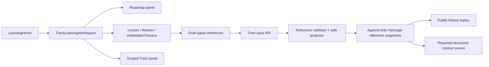

# 三栏学习工作区与结构化上下文引用技术设计

## 1. 设计目标

把已交付的 LearningTrack、Lesson、Gate/Execution、Review 与 Tutor Harness 组合为一个受服务端权威约束的工作区，同时新增最小的 typed context reference 持久化链路。UI 只负责导航、选择、预览与发起请求；引用真实性、safe projection、scope、版本和重放由 API/PostgreSQL 决定。

## 2. 总体结构

## 3. Desktop 信息架构

### 3.1 路由状态

`App.tsx` 保留 `learning_home` 与 `track_planner`，把独立 `lesson_document`/占位 Review 合并为一个 `learning_workspace` surface：

- `trackId`：必填。
- `mode`：`lesson | review`；Practice 由 Lesson Gate 嵌入呈现。
- `knowledgeKey`：Lesson/Review 当前知识点。
- `reviewSessionId`：存在时恢复具体 ReviewSession。

版本化导航指针保存到 `localStorage`，只用于刷新后定位；组件挂载后必须重新读取当前用户的 track/roadmap/artifact，失败即清除指针并返回学习首页。

### 3.2 响应式布局

- `>= 1180px`：`260px / minmax(0, 1fr) / 360px` 三栏，各自 `min-width: 0` 与独立滚动。
- `768..1179px`：中心 + Tutor 双栏，路线由显式按钮打开 modal drawer；焦点进入/退出受控。
- `< 768px`：路线、学习、Tutor 三个 tabs，一次只显示一个 panel；切换不销毁服务端状态，但改变 scope 时清空临时 UI。
- composer、当前 Gate、Review 主动作保持可达；不以 hover 作为唯一入口。

### 3.3 组件边界

- `TrackLearningWorkspace.tsx`：装配 track/roadmap、模式、conversation、draft references 和恢复指针。
- `LearningRoadmapPanel.tsx`：只渲染 roadmap projection，并把点击意图交回 workspace。
- `ReviewSessionPanel.tsx`：实现 queue/create/warmup/hint/attempt/poll/finalize，严格使用服务器 version 与 safe result。
- `LessonDocumentPage.tsx`：增加嵌入模式、选择引用和 Attempt 引用回调；保留现有 Lesson/Gate authority。
- `TutorConversationSurface.tsx`：增加 `learningScope`、draft reference chips、发送与历史 replay；scope key 变化时中止旧请求并清空 composer 状态。

## 4. 引用输入与安全快照

### 4.1 输入 union

Tutor input request 增加最多 6 个 `context_references`：

- `lesson_selection`：`learning_track_id`、`knowledge_key`、`document_id`、`document_content_hash`、`block_id`、`start_offset`、`end_offset`、`excerpt`。
- `exercise_feedback`：`learning_track_id`、`knowledge_key`、`attempt_id`。
- `execution_result`：`learning_track_id`、`knowledge_key`、`attempt_id`。
- `review_feedback`：`learning_track_id`、`knowledge_key`、`review_session_id`、`attempt_id`。

所有模型使用 discriminated union、`extra=forbid`、UUID/stable key/长度边界。引用不允许出现在 general 或 plan-drafting run。

### 4.2 服务端验证

验证器先读取已写入且不可变的 run scope，再按 kind 查询 source of truth：

- Lesson：必须是当前用户/track/knowledge 的 active assignment 与匹配的 document/hash/block；候选 excerpt 归一化后必须属于该 block 的公开文本，范围长度必须与选择一致。服务端重建 safe excerpt，并把 document 标识、content standard version/hash、block 和范围写入快照。
- Exercise feedback：必须是同用户/track/knowledge 的 terminal lesson attempt；只保存 outcome、score、safe feedback、capability scores、assistance 与公开时间。
- Execution result：除上述条件外必须有真实 execution job；只保存 safe result 与公开 job state，不读取 raw stdout/stderr、command、container 或 path。
- Review feedback：必须是同用户/track/knowledge/session 的 terminal review attempt；只保存 Review safe result 和 session/version/item identity。

客户端提交的 excerpt/feedback 只用于定位或请求，不直接进入持久化 safe payload。

### 4.3 持久化

新增 append-only `tutor_message_context_references`：

- 外键固定 `user_id + conversation_id + run_id + message_id + input_revision`。
- 记录 `reference_index`、`reference_kind`、track/knowledge、source type/id/version/hash、`safe_payload_json/hash` 与创建时间。
- `(run_id, input_revision, reference_index)` 和 `(message_id, reference_index)` 唯一。
- update/delete 由数据库触发器拒绝。

Tutor `_mutate` 已提供外层事务。输入先创建 learner message/TurnRun revision、再 snapshot run scope、最后验证并插入 references；任一引用失败会回滚整条输入，不留下孤立消息、run 或引用。

### 4.4 历史与模型上下文

- public history 在 learner message 上返回 `context_references` safe projection；Tutor 消息返回空数组。
- acceptance response 返回本次持久化 safe references，便于客户端确认并清空草稿。
- `PostgresTutorLearningContextLoader` 按 `run_id + input_revision` 读取快照，作为独立 `tutor-context-references:<message_id>` required structured source 注入；不修改 current learner input 文本。
- 快照是 append-only，因此后续 Lesson migration 或 Review schedule 更新不会改变历史语义。

## 5. Track conversation 与取消边界

Workspace 使用稳定、用户 + track 派生的幂等键调用现有 conversation create/resume API，并只绑定 track scope；每条普通消息再提供具体 `task_kind/knowledge_key`。切换 user/track/artifact 时通过 React key/effect 中止 history、SSE、Review/Lesson 请求，清空 draft references、editor stale state 与本地 safe result。

## 6. Review UI 数据流

1. 并行读取 track、roadmap、review queue。
2. 选择 due item 后用 track/schedule version 创建或幂等恢复 session。
3. warmup 后按 session stage 展示当前 item；hint 与 attempt 使用 session/item CAS。
4. pending execution 轮询同一 attempt；不重新提交。
5. 所有 item terminal 后 finalize；结果可生成 `review_feedback` 引用。
6. 页面刷新通过导航指针中的 session id 重新读取；服务器拒绝失效/跨用户 id 时清除指针。

## 7. 兼容、迁移与回滚

- schema additive-first；现有 Tutor 输入不传 references 时行为不变。
- history 新字段在 Desktop parser 中为必需空数组；同一发布中同步 API 与客户端。
- local export/reset/cutover inventory 纳入新表，但不改变既有 cutover gate。
- 回滚 UI 时可保留新表与 API 字段；回滚引用输入时停止写入即可，历史快照仍可安全读取。
- 不创建被 clean-slate guard 保留的 `LearningWorkspacePage.tsx`、`ReviewPage.tsx` 或 `reviews.py` basename。

## 8. 风险与控制

- **DOM 选择与服务端 block 文本不一致**：客户端发送 excerpt + range，服务端以归一化公开 block 文本验证并重建；不匹配返回稳定 conflict。
- **引用扩大 context**：数量、excerpt、payload 字段和总大小均有硬上限，作为 required source 但仍受 context budget 统计。
- **旧请求串入新 scope**：AbortController、scope key、服务器 FK/scope/version 三层防护。
- **模型审核表单重复**：复用现有 finding editor 与 submission contract，不复制评分逻辑。

## 9. 验证重点

- DB FK、immutable trigger、跨用户/track、active document/hash、terminal attempt、safe redaction。
- Tutor first-turn/conversation/continuation idempotency、message/run revision binding、history replay、context source ordering。
- Review Desktop parser 与流程、scope switching cleanup、responsive overflow、keyboard/focus。
- 静态 clean-slate guard 与本地数据 inventory。
