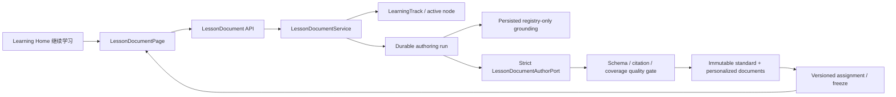
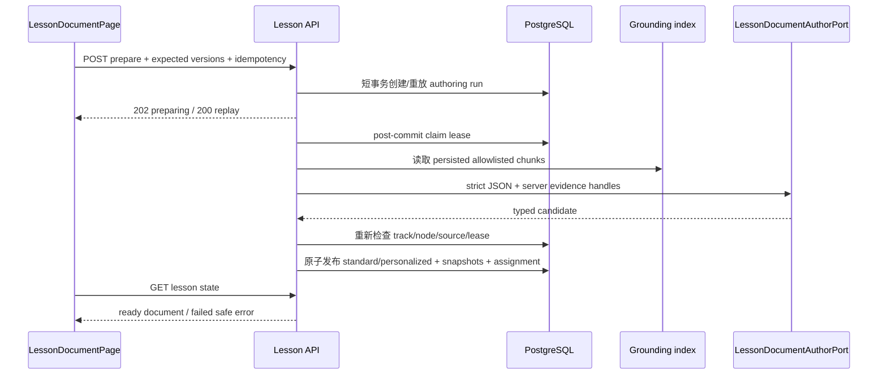

# LessonDocument 与权威来源教学内容技术设计

## 1. 设计边界

本 child 在已经完成的 LearningTrack 和 Learning Home 之上增加“课程文档 authority”，但不接管练习、执行、复习或完整三栏工作区。



明确边界：

- PostgreSQL 继续拥有 track、progress、document、assignment、authoring lifecycle 与版本 authority。
- 模型只产生 strict candidate；来源、版本、snapshot、发布和 assignment 由服务端决定。
- reindex 与 authoring 分离；交互请求只消费 persisted index，不发起开放网络抓取。
- 本任务交付单页 Lesson 阅读面与可复用 renderer；后续三栏工作区只负责重新组合，不重写文档 contract。
- `exercise_gate` 只冻结公开 slot contract，后续 Gate child 再绑定 immutable exercise version、Attempt、执行和解锁。

## 2. 包与所有权

建议新增窄模块：

```text
aearn/services/api/app/
  models/lesson_documents.py
  routes/lesson_documents.py
  services/learning/
    lesson_contracts.py
    lesson_quality.py
    lesson_repository.py
    lesson_authoring.py
    lesson_service.py
```

职责：

- `lesson_contracts.py`：block union、source snapshot、document candidate、canonical hash、lineage 与 impact contract。
- `lesson_quality.py`：纯确定性质量门；不访问数据库、provider 或网络。
- `lesson_repository.py`：显式 SQL、authoring lease/CAS、immutable document persistence、assignment lifecycle。
- `lesson_authoring.py`：读取 persisted grounding、构造 evidence handle、调用注入的 strict author port、记录 safe attempt receipt。
- `lesson_service.py`：verified use case、track/node scope、幂等、prepare/start/migrate 和 learner-safe projection。
- route 只做 Pydantic 边界、cutover gate、HTTP/error mapping、post-commit dispatch。
- 不把 Lesson 逻辑塞入 `track_service.py`、`tutor/public_api.py` 或 grounding repository。

前端建议：

```text
aearn/apps/desktop/src/features/learning/
  LessonDocumentPage.tsx
  lesson/
    LessonDocumentView.tsx
    LessonBlockRenderer.tsx
    LessonSourcesPanel.tsx
```

`LessonDocumentView` 是后续三栏工作区必须复用的纯展示边界。

## 3. Lesson block union

### 3.1 公共基类

所有 block 共有：

- `block_id`：stable lowercase key，document 内唯一。
- `type`：注册 literal。
- `order_index`：从 0 开始、唯一、连续。
- `citation_ids`：属于本 document 的 citation ID；无事实陈述的 block 可为空。

文档级字段：

- `schema_version=lesson_document_v1`
- `title`、`language_id`、`knowledge_key`
- `content_standard_version`
- `coverage_keys`
- `blocks`

### 3.2 首版注册类型

| 类型 | 主要字段 | citation 规则 |
| --- | --- | --- |
| `heading` | `title`、可选 `subtitle` | 可空 |
| `learning_objectives` | `items[]`、`coverage_keys[]` | 可空，但 coverage 必须由后续事实 block 证明 |
| `concept` | `title`、`paragraphs[]`、`coverage_keys[]` | 非空 |
| `authority_note` | `title`、`statement` | 非空且至少一个 authority source |
| `code_example` | `title`、`language_id`、`code`、`explanation[]`、`execution_claim="not_run"` | 非空；本任务禁止声称已运行/测试 |
| `comparison` | `title`、`columns[]`、`rows[][]`、`conclusion` | 非空 |
| `hint` | `title`、`steps[]` | 事实性步骤需要 citation；纯学习策略可空 |
| `exercise_gate` | `gate_key`、`gate_kind`、`assessment_contract_version`、`required_capabilities[]`、`learner_prompt` | 可空；不得含答案/rubric/tests |
| `summary` | `points[]`、`coverage_keys[]` | 非空 |
| `next_steps` | `items[]` | 可空 |

所有字符串和数组有显式上限。`code_example.code` 允许较大但仍有 document 总量上限；禁止 HTML/script/style/event handler、URL target、命令/路径/镜像和隐藏答案字段。前端不渲染 Markdown/HTML，只渲染 typed fields。

### 3.3 Gate slot 边界

`exercise_gate` 通过关系投影冻结到 `tutor_lesson_gate_slots`：

- `document_id + gate_key` 唯一；
- 保存 block ID、kind、assessment contract version、required capabilities 和公开 prompt hash；
- 不保存 `exercise_version_id`、private rubric、hidden tests、运行 profile 或解锁状态；
- 后续 Gate child 只能新增 versioned binding，不能修改已发布 slot。

## 4. Grounding source version 与快照

### 4.1 现有 grounding 增量

给 `GroundingSource` / `GroundingChunk` / `grounding_chunks` 增加：

- `source_version_label`：例如固定版本、主版本或 rolling label；由 registry 管理。
- `source_version_kind`：`fixed | rolling`。
- `document_content_hash`：抓取原始文档 hash；现有 `content_hash` 保持 chunk hash 语义。

fixture、processing、reindex、repository 和 tests 同步 round-trip。版本不得从模型或 URL 字符串临时猜测。

### 4.2 Lesson source snapshot

`tutor_lesson_source_snapshots` 在 document 发布事务内复制：

- registry：source ID、display name、provider、trust tier、source type、version label/kind；
- location：canonical URL、section path；
- evidence：grounding chunk ID、document hash、chunk hash、bounded excerpt；
- time：upstream `fetched_at`、本次 `snapshotted_at`；
- deterministic `citation_id`。

快照不对 `grounding_chunks` 建立删除阻塞 FK。reindex 可以替换索引；旧 document 仍由 snapshot 自包含重放。服务端发布前重新验证 URL 无 credential、域名属于 registry allowlist、language/trust/version/hash 与检索 evidence 一致。

## 5. PostgreSQL 模型

### 5.1 `tutor_lesson_documents`

关键字段：

- `id`
- `document_kind`: `standard | personalized`
- standard owner：`user_id=NULL`、`track_id=NULL`
- personalized owner：`user_id`、`track_id` 非空
- `language_id`、`knowledge_key`
- `content_standard_version`
- `schema_version`、`generator_version`、`policy_version`
- `standard_document_id`：personalized 必填，standard 为空
- `predecessor_document_id`：同 kind/scope/key 的前一版本
- `source_plan_revision_id`：personalized 必填
- `personalization_profile_hash`：personalized 必填
- `source_set_hash`、`coverage_keys_json`、`blocks_json`
- `change_summary`、`content_hash`、`published_at`

不保存未通过质量门的 candidate；失败只进入 authoring run。documents、blocks 与 lineage 普通 UPDATE/DELETE 均拒绝，confirmed user purge 只删除 personalized scope。标准文档是共享缓存，不属于任一用户 reset/cutover target。

关键唯一性：

- standard identity：`language_id + knowledge_key + content_standard_version + source_set_hash + generator_version + policy_version`。
- personalized identity：`user_id + track_id + knowledge_key + standard_document_id + personalization_profile_hash + content_hash`。
- `(id,user_id,track_id,knowledge_key)` 为 assignment 提供复合 scope FK；standard 的 nullable owner 通过 shape CHECK 与 partial index 管理。

### 5.2 `tutor_lesson_source_snapshots`

- `id`、`document_id`、`citation_id`
- source/version/location/evidence/time 字段
- `(document_id,citation_id)` 唯一
- document child，普通 UPDATE/DELETE 拒绝

### 5.3 `tutor_lesson_block_citations`

- `document_id`、`block_id`、`citation_id`
- FK 指向同 document snapshot
- 主键 `(document_id,block_id,citation_id)`

该关系让 JSON block citation refs 在数据库层具备可查询完整性；repository 在同一事务写 document、snapshots、block refs 和 gate slots。

### 5.4 `tutor_lesson_gate_slots`

- `document_id`、`block_id`、`gate_key`
- `gate_kind`、`assessment_contract_version`
- `required_capabilities_json`、`learner_prompt_hash`
- 普通 UPDATE/DELETE 拒绝

### 5.5 `tutor_lesson_assignments`

关键字段：

- `id`、`user_id`、`track_id`、`knowledge_key`
- `document_id`：必须指向同 scope personalized document
- `source_plan_revision_id`
- `assignment_version`、`predecessor_assignment_id`
- `status`: `proposed | active | superseded | completed`
- `impact_json`、`migration_reason`
- `started_at`、`activated_at`、`completed_at`
- `version`：CAS

每个 track/key 只有一个 active partial unique。started active assignment 不允许自动 supersede。assignment lifecycle trigger 校验状态/timestamp 与 predecessor scope。

### 5.6 `tutor_lesson_authoring_runs`

- `id`、`user_id`、`track_id`、`knowledge_key`
- `requested_kind=prepare | refresh_personalization | refresh_sources`
- `expected_track_version`、`expected_progress_version`
- `idempotency_key`、`request_hash`
- `status=pending | claimed | running | completed | failed | cancelled`
- `lease_owner_id`、`lease_generation`、`lease_expires_at`
- source/generator/policy/profile fingerprints
- result standard/personalized document/assignment IDs
- allowlisted `failure_code`、attempt count、timestamps

同一 semantic evidence 只产生一个 active run。过期 lease 可由重试 reclaim；stale track/node/source evidence 终止为安全失败，不提交文档。

### 5.7 `tutor_lesson_authoring_attempt_receipts`

append-only 保存每个实际 author provider attempt 的：

- run/attempt identity、provider/model/protocol allowlisted metadata；
- outcome/safe diagnostic；
- usage available 与 normalized token 数；
- request/result hash；
- 不保存 prompt、grounding excerpt 全文、provider response body、reasoning、URL/header 或 credential。

## 6. Authoring 数据流



### 6.1 Prepare 校验

- verified user；track 属于 user 且非 archived。
- knowledge key 属于 active plan，progress 不是 `locked`。
- request 带 expected track/progress version；防止路线切换或并发学习状态漂移。
- ready assignment 直接返回；pending run 返回 preparing；同 key/body 重放不再次调用 provider。

### 6.2 Evidence 查询

query 由服务端根据 language、knowledge key、node title/description、required capabilities 和 registry topic tags构造。provider 看见短 handle（例如 `S1`），不看见可供其改写的 source ID/URL target。至少一条满足 language source trust policy 的 citation，且核心 coverage 足够，否则 `LESSON_SOURCE_EVIDENCE_INSUFFICIENT`。

### 6.3 标准文档

- 若完全相同 identity 的 published standard 已存在，直接复用，无 provider call。
- 否则调用 strict author port，验证 candidate，并在 final transaction 发布。
- provider 调用期间不持有 PostgreSQL transaction、track lock 或 advisory lock。
- final commit 重新校验 lease、track version、active plan、source hashes 和 uniqueness；竞争者已发布时复用 winner。

### 6.4 个性化文档

输入为 published standard + bounded track/profile/mastery/execution facts。质量门对比标准文档：核心 coverage、citation coverage 和 gate keys 不得减少；`execution_tier` 只影响说明和示例选择，不能产生“已运行”声明。

## 7. Assignment、开始与迁移

### 7.1 首次 assignment

prepare 完成时创建未开始的 active assignment。`POST /start`：

1. 锁 assignment、track 和 progress；
2. 检查 expected assignment/progress version；
3. 写 `started_at`，冻结 active pointer；
4. 若 progress 是 `available`，推进到 `in_progress`；若已 `in_progress/completed/review_due/diagnostic_skipped`，保持真实状态；
5. 更新 track `current_knowledge_key` 与 `last_learned_at`；
6. 幂等保存安全响应。

本任务不写 completion、mastery evidence 或后续 node unlock。

### 7.2 更新提案

source/generator/policy/profile 变化可触发新 authoring run。若当前 assignment 未开始，可在 expected version/CAS 下替换 active draft assignment；一旦 started，只创建 `proposed` assignment。

impact 由确定性 diff 产生：

- source added/removed/version changed；
- block added/removed/reordered/changed；
- code example changed；
- gate contract changed；
- retained block/citation/gate。

`POST /migrations/{assignment_id}/activate` 要求目标 proposed assignment 是当前 active 的直接后继。激活只切换 assignment pointer；不改写旧 document，也不迁移未来 attempt/evidence。

## 8. 公共 API

建议路由族：

- `GET /api/learning-tracks/{track_id}/lessons/{knowledge_key}?user_id=...`
  - 返回 `missing | preparing | ready | failed`；ready 包含 active assignment、document、citations、可选 proposed update。
- `POST /api/learning-tracks/{track_id}/lessons/{knowledge_key}/prepare`
  - body：`user_id`、`client_action_id`、`expected_track_version`、`expected_progress_version`；202 新 run、200 replay/已 ready。
- `POST /api/learning-tracks/{track_id}/lessons/{knowledge_key}/start`
  - body：`user_id`、`client_action_id`、`assignment_id`、`expected_assignment_version`、`expected_progress_version`。
- `POST /api/learning-tracks/{track_id}/lessons/{knowledge_key}/refresh`
  - 显式请求 source/personalization 新版本，不自动迁移。
- `POST /api/learning-tracks/{track_id}/lessons/{knowledge_key}/migrations/{assignment_id}/activate`
  - body 带 current/target expected version。

route 顺序应避免静态 suffix 被 `/{knowledge_key}` 捕获。所有 route 先 cutover gate；cross-user、inactive-plan node 与不存在对象返回 `LESSON_DOCUMENT_NOT_FOUND` 或 `LEARNING_TRACK_NOT_FOUND`，不泄露 owner。

安全 projection：

- document/assignment/version/hash、registered blocks；
- citation display/provider/trust/version/section/times/canonical URL/bounded excerpt；
- source summary、authoring state、stable safe error；
- 不返回 authoring prompt/body、raw candidate、internal quality report、provider diagnostics/usage、grounding full content 或 private exercise data。

稳定错误至少包含：

- `LESSON_DOCUMENT_NOT_FOUND`
- `LESSON_DOCUMENT_NOT_READY`
- `LESSON_DOCUMENT_VERSION_CONFLICT`
- `LESSON_ASSIGNMENT_CONFLICT`
- `LESSON_SOURCE_EVIDENCE_INSUFFICIENT`
- `LESSON_DOCUMENT_GENERATION_UNAVAILABLE`
- `LESSON_DOCUMENT_INVALID`
- `LESSON_DOCUMENT_QUALITY_BLOCKED`
- `LESSON_DOCUMENT_GENERATION_IN_PROGRESS`

## 9. Frontend 设计

### 9.1 Tutor surface

扩展 `TutorSurface`：

```text
learning_home
track_planner
lesson_document { trackId, knowledgeKey }
downstream_not_ready { start_review }
```

“继续学习”使用 track 的 `current_knowledge_key`；为空时显示稳定未就绪/路线错误，不猜首节点。`start_review` 仍保留真实未交付状态。

### 9.2 Lesson 页面状态机

```text
loading -> missing -> preparing -> ready
              \-> failed -> retry
ready -> starting -> started
ready/started + proposed update -> migration preview -> activate
```

页面职责：

- 调 read；missing 时只在用户进入页面后显式 prepare，不在首页卡片预生成。
- preparing 轮询有界，离开页面取消请求；不从本地伪造进度。
- ready 使用 typed renderer；invalid payload 显示 contract error。
- source panel 可键盘打开/关闭，inline citation marker 与 source item 可互相定位。
- Gate slot 显示 contract 和“后续练习任务开放”，没有 run/submit 按钮。
- 无完整三栏、无右侧 Tutor、无 selection reference；后续 child 复用 renderer。

### 9.3 Type 安全

在 `types.ts` 定义 discriminated block union、document/assignment/authoring state。`api.ts` 对 `unknown` 做逐字段 runtime validation，拒绝未知 block、重复 block/citation、非法 URL/trust/version/status，不使用 `as` 直接放行。

### 9.4 网页端验收

只使用 `pnpm --dir .\aearn\apps\desktop dev` 启动 Vite，访问 `http://127.0.0.1:1420`；后端使用 disposable verified fixture、fixture grounding 和 fake author port。不得为了 smoke 调真实 provider、创建真实学习者数据或运行 Desktop build。

## 10. Tutor Harness 与 context 边界

- 本任务不新增允许模型直接写 document 的通用 Tutor payload，也不扩大 `12 × 360` capability envelope。
- authoring 是独立、typed、server-owned artifact workflow；它复用当前 primary-provider configuration、strict JSON 和 usage normalization，但不冒充交互式 Tutor decision。
- `TutorLearningContextAdapter` 可在 assignment ready 后增加 bounded document identity/source summary seam，但本任务不把全文 blocks 注入普通 Tutor context。
- 交互式 `lesson_teaching` Tutor capability/右侧对话由后续 workspace/integration child 根据 assignment/document ID读取，不把 LessonDocument 复制进 Conversation authority。

## 11. 并发、幂等与失败恢复

- prepare 使用 `(user_id, operation, idempotency_key)` advisory reservation + request hash 创建 authoring run；provider 调用前提交。
- authoring claim 使用 lease generation/CAS；重复 dispatcher、进程恢复和过期 lease 只能有一个 final committer。
- final commit 锁 authoring run 与 track/progress，重查 active plan、expected version、source set hash、provider candidate hash 和 uniqueness。
- document/assignment uniqueness 冲突时读取 winner 并安全完成当前 run，不创建重复版本。
- source reindex 发生于 provider 调用期间时，source set hash 不一致导致 stale failure；不得用旧证据发布到新 identity。
- provider/quality failure 保留 failed run 和 allowlisted code；retry 创建新 attempt 或新 semantic run，不修改失败 candidate 为 published。

## 12. 安全、隐私、数据生命周期

- provider prompt 只含 bounded lesson facts、standard blocks 和 evidence excerpt；不得含 raw history、learner message、provider diagnostic、mastery evidence body、secret、path/command。
- candidate/blocks 禁止完整答案、hidden test、private rubric、可执行 HTML/JS 和未经证明的 execution result。
- personalized documents/assignments/authoring runs进入 cutover target inventory；共享 standard documents 不进入 user target count。
- reset/delete 在 transaction-local purge capability 下按：authoring attempts → authoring runs → assignments → block refs/gate slots/snapshots → personalized documents → LearningTrack 既有 child-to-root 顺序删除；shared standard documents保留。
- export 包含用户可见 personalized blocks、assignment、citation metadata；省略 authoring attempts、raw evidence excerpt全集、quality internal details 和 provider数据。

## 13. 验证设计

### 纯 contract / quality

- 每种 block 正反例、unknown field/type、ID/order/citation duplication、size limit、HTML/script/URL/hidden-answer rejection。
- canonical hash deterministic；block/citation/gate 顺序变化按 contract 决定是否改变 hash。
- standard/personalized coverage、source trust、lineage、no-op/changed impact。

### Grounding

- source version/document hash 从 registry → fetch → chunk → PostgreSQL → search → snapshot round-trip。
- reindex 替换旧 chunk 后，既有 Lesson snapshot 仍可读取。
- unsupported language、no evidence、cross-language、credentialed URL、hash mismatch fail closed。

### PostgreSQL / repository

- bootstrap 两次；表、index、composite FK、partial unique、immutable/lifecycle trigger。
- standard shared uniqueness、personalized scope、block citation FK、gate slot immutability。
- authoring lease/reclaim/replay/stale finalization；assignment active uniqueness、start/migration CAS。
- cross-user/track/key、locked progress 与 active-plan mismatch 拒绝。
- reset/export/cutover target count 与 child-to-root cleanup。

### API

- read missing/preparing/ready/failed；prepare 202/replay；start；refresh/proposal；activate migration。
- stable 404/409/422/503 error envelope、X-Request-Id、安全 projection。
- provider/quality failure不创建半 document/assignment；unexpected exception 不泄露。

### 回归

- grounding source/retrieval/index/gateway tests。
- LearningTrack list/detail/roadmap/scope、plan session、cutover、local user data、Tutor context adapter。
- 完整 API suite、Ruff、Mypy、lock。

### 网页端

- normal、900px、390px viewports；从首页继续学习进入 Lesson。
- prepare loading/error/retry、ready rendering、start、source panel、citation focus、Gate unavailable copy、migration preview。
- console 无相关错误/警告、无 framework overlay、无水平溢出、键盘可操作、`prefers-reduced-motion`。
- 不运行 `desktop:check`。

## 14. 回滚

- route/dispatcher 可 fail closed；已有 documents/assignments 保持只读，不删除。
- author port 异常关闭 prepare/refresh，不 fallback 模板或开放网络。
- Desktop 可将 continue intent 暂时退回明确未就绪页，但不得删除 Lesson 数据或恢复旧 learning documentation route。
- grounding version columns additive 保留；代码回滚继续允许旧 grounding 读取，不能静默丢失 Lesson snapshot。
