# 模型代码审核练习技术设计

## 1. 架构位置

```mermaid
flowchart LR
  Gate["Lesson Gate / 模块诊断"] --> Prepare["审核题准备"]
  Prepare --> AuthorRun["Model review authoring run"]
  AuthorRun --> Author["Primary model author port"]
  Author --> Candidate["Private draft candidate"]
  Candidate --> InternalRun["Internal proactive Tutor run"]
  InternalRun --> Action["model-code-review.validate@1.0.0"]
  Action --> Queue["Existing execution intent/job queue"]
  Queue --> Executor["Reviewed executor"]
  Executor --> Validation["Validation authority"]
  Validation --> Verify["Independent verifier"]
  Verify --> Receipt["Verified Action receipt"]
  Receipt --> Publish["Atomic exercise/rubric publication"]
  Publish --> Attempt["Structured learner Attempt"]
  Attempt --> Score["Deterministic matcher and scorer"]
  Score --> Mastery["Gate/diagnostic/mastery projection"]
```



权威边界：

- authoring run/candidate 拥有生成生命周期与 draft 私有内容；
- existing executor job 拥有 parser/compile/typecheck/test 执行事实；
- model review validation receipt 拥有聚合后的预发布质量事实；
- Action Runtime 拥有 orchestration、fence、budget、verification 和 safe receipt，不复制完整 candidate/rubric/result；
- `tutor_exercise_versions` / `tutor_exercise_private_rubrics` 只保存 verified 后的不可变发布事实；
- Attempt scorer、Gate finalizer 和 mastery projector 拥有学习者评分与路线状态，模型不拥有这些事实。

## 2. 语义冻结

### 2.1 Exercise type

新增：

```text
model_code_review
```

旧 `review_ai_patch` 不作为 alias 写入新数据。迁移或测试若读取旧值，只能位于 legacy compatibility seam。

### 2.2 学习者执行与预发布执行

- `model_code_review` 的 learner attempt 固定 `execution_required=false`、`runtime_profile_id=null`，在 Gate 中投影为 `static_only`。
- candidate 的预发布 validation profile 是 private authoring metadata，可使用 Python、Node/TypeScript、SQL 等 reviewed runtime。
- learner-safe UI 必须写明“代码在发布前已由服务端验证；你本次提交没有运行代码”。
- “查看验证证据”只读取 verified validation receipt 的可见子集，不能创建新的 learner execution job。

### 2.3 私有场景类型

```text
single_correctness_issue
multiple_correctness_issues
improvement_only
fully_correct
suspicious_but_correct
fix_introduces_regression
```

`scenario_kind` 不进入公共 exercise payload。难度、预期 finding 数和诱饵策略同样保持 private。

## 3. 类型化 Contract

### 3.1 公共题面

`ExerciseVersion` 的 `learner_prompt` 与 `starter_artifact` 对 `model_code_review` 使用严格 typed parser：

```json
{
  "learner_prompt": {
    "schema_version": "model_code_review_prompt_v1",
    "requirements": ["..."],
    "review_scope": ["correctness", "regression"],
    "evidence_boundary": "prepublication_verified"
  },
  "starter_artifact": {
    "schema_version": "model_code_review_artifact_v1",
    "language_id": "python",
    "runtime_label": "Python 3",
    "model_code": "...",
    "code_hash": "sha256",
    "line_count": 12
  }
}
```

公共 payload 禁止包含 scenario、expected finding、test id/body、reference fix、rubric weight、provider metadata、用户 mastery/误区、路径、命令、镜像或 container 标识。

### 3.2 学习者提交

新增 Pydantic/TypeScript 同构 contract：

```text
ModelCodeReviewSubmission
  schema_version = model_code_review_submission_v1
  verdict = correctness_issue | no_correctness_issue | improvement_only | uncertain
  findings[0..12]
  supplemental_note?

ModelCodeReviewFinding
  client_finding_id
  start_line
  end_line
  category
  severity
  trigger_condition
  principle
  impact
  validation_method
  suggested_fix
  supplemental_note?
```

约束：

- line range 必须在 exact published code line count 内；
- `correctness_issue` 至少一个非 improvement finding；
- `no_correctness_issue` 不允许 correctness finding；
- `improvement_only` 至少一个 improvement finding且不允许 correctness severity；
- client finding id 唯一；
- canonical JSON 决定 submission hash，字段顺序不影响幂等；
- repository 继续使用 `submission_kind=structured_answer`，私有 `content_text` 保存 canonical JSON，公共 API 只返回 hash 与安全评分。

### 3.3 私有 rubric

在 `ExercisePrivateRubric.reference_answer_json` / `score_policy_json` 内保存版本化 `ModelCodeReviewRubricV1`，由专用 parser 读取：

```text
scenario_kind
expected_verdict
expected_findings[]
  finding_key
  finding_kind = correctness | improvement
  category
  severity
  accepted_line_ranges[]
  matcher_tokens
  reachability_proof_ids[]
visible_evidence_ids[]
coverage_policy
score_policy_version
feedback_policy_version
```

expected finding matcher 只使用服务端拥有的稳定 token/category/location/range 规则，不调用模型做语义裁判。每个用户 finding 与 expected finding 最多匹配一次。

### 3.4 Learner-safe result

```text
score
outcome
policy_version
score_breakdown
  verdict
  discovery
  omission
  severity
  evidence
  validation_method
  suggested_fix
  false_positive
  duplicate
finding_feedback[]
  client_finding_id
  status = supported | partial | unsupported | duplicate
  safe_reason_code
omission_band = none | limited | major
assistance_kind = independent | hinted | validation_evidence_viewed | remediated
next_action
```

不返回 expected finding id、文本、隐藏行号、隐藏测试、reference fix 或 matcher tokens。

## 4. Authoring 生命周期

### 4.1 触发与选择

`prepare_gate` 在服务端 exercise selection policy 判定需要 `model_code_review` 时：

1. 锁 exact user/track/knowledge/assignment/Gate slot。
2. 若已有 current ready binding，直接重放。
3. 若已有相同 request/profile hash 的 active/completed authoring run，返回其状态。
4. 否则创建 `tutor_model_review_authoring_runs`，响应 `preparing` 并在事务提交后 dispatch background task。

选择输入只使用 language、required capabilities、Gate kind、mastery level/confidence、bounded misconception tags、最近 assistance summary 与版本。不得把消息历史或用户身份写入模型 prompt。

### 4.2 Provider author port

新增 `ModelCodeReviewAuthorPort` 与 primary-only adapter，遵循现有 Lesson authoring 的 provider receipt 规则：

- strict JSON output；
- 无 provider 时 `MODEL_REVIEW_GENERATION_UNAVAILABLE`；
- invalid schema 时 `MODEL_REVIEW_CANDIDATE_INVALID`；
- 不 fallback 到另一 provider 或未验证模板；
- attempt receipt 只保存 provider/model/protocol/usage/request hash/response hash/safe code，不保存 raw prompt/response。

### 4.3 Candidate 与发布可见性

生成结果拆为：

- public candidate：需求、模型代码、公开审核范围；
- private candidate：scenario、expected findings、tests、reachability、coverage、score policy；
- candidate identity：public hash、private hash、combined hash、generator/prompt schema version；
- scope：user、track、knowledge、active plan revision、expected track/progress/Gate version与 profile hash。

candidate 行在 `draft | validating | verified | rejected | published` 生命周期内只允许受控 CAS；候选 payload 一旦写入不可更新，重试创建 successor candidate。

新增 `tutor_model_review_publications` 把 verified candidate、exercise version、private rubric 与 exact user/track/knowledge/Gate slot关联。发布后的 exercise 公共 payload 必须去个性化且不含 learner fact，但生成版本不会进入全局通用 fixture 选择池；只有拥有 publication link 的 exact scope 可以绑定它。用户 reset 可以删除 publication link与用户-owned authoring链，不物理改写已发布不可变内容。

## 5. Action Runtime 集成

### 5.1 Descriptor

生产 descriptor：

```text
model-code-review.validate@1.0.0
origin: proactive
allowed_task_kinds: model_code_review
side_effect_class: external_execution
resource kinds: model_review_candidate, model_review_private_rubric, model_review_validation
network: executor_managed
retry: idempotent, bounded
recovery: retry | safe_stop
verifier: model-review-publication-verifier@1.0.0
```

输入只包含 opaque `candidate_id`、`candidate_hash` 和 `validation_profile_version`；不把代码、test 或 rubric 放入 action invocation/receipt。输出只含 validation id、status、check summary code 和 authority hash。

### 5.2 Internal proactive run

每个 authoring run 创建或重放一个：

- `visibility=internal, kind=proactive` conversation；
- `origin=proactive` Tutor run；
- `tutor_run_learning_scopes(scope_kind=learning_track, task_kind=model_code_review)`；
- current catalog digest、server policy fingerprint、owned lease/generation；
- candidate hash 固定在 action stable key/resource proof。

该 run 不调用 Tutor provider decision loop，不进入 learner conversation list。它只提供统一 Action Runtime 所需的 lease、input revision、fence、budget、receipt 和 user/track scope。action terminal 后 run 以稳定结果终结。

### 5.3 Authority kind 与 verifier

新增 additive authority kind：

```text
model_review_validation
```

同步更新 Python enum 与 action attempt/verification/receipt CHECK；不修改 Action lifecycle transition 表。

verifier 必须重新读取：

- candidate exact user/track/knowledge/hash；
- validation run terminal status与 policy/version；
- required check 集合及每项 receipt hash；
- executor jobs exact owner/source/profile/lock/result hash；
- every expected finding reachability；
- correct/suspicious-correct coverage policy；
- authoring run/current plan/Gate scope仍未 stale。

任一不一致返回稳定 verification failure，不能发布。

## 6. 预发布验证与 executor

### 6.1 Existing queue 扩展

additive 扩展：

```text
tutor_execution_intents.source_kind += model_review_candidate
tutor_execution_jobs.owner_kind += model_review_validation
```

新增 candidate/validation 外键字段，并用 one-of CHECK 保证：

- Tutor message path 保持原字段和约束；
- learner exercise path 保持原字段和约束；
- model review path 必须绑定 exact candidate、validation、user、track、language/profile，Tutor message/effect/Attempt 字段为空。

executor trusted-input 根据 owner/source 读取 candidate public code、private tests 和 validation profile。API/authoring adapter只创建/读取 durable job，不构造命令或启动进程。

### 6.2 检查矩阵

每个 candidate 产生版本化 check receipts：

- `schema`：public/private contract 与边界；
- `parser`：语言语法；
- `compile_or_typecheck`：适用语言；
- `visible_tests`；
- `hidden_tests`；
- `finding_reachability`；
- `rubric_consistency`；
- `coverage`：fully-correct/suspicious-correct 必需；
- `redaction`：protected markers 与用户事实检查。

Python、JavaScript、TypeScript、SQL 的 profile 解析以当前 runtime registry 为 source of truth。缺 profile、reviewed lock 或 compatible executor 时是 `MODEL_REVIEW_VALIDATION_UNAVAILABLE`，不是通过或 host fallback。

### 6.3 发布事务

verified Action receipt 后：

1. 锁 authoring run、candidate、validation、Action receipt 与目标 Gate scope。
2. 验证 exact hashes、版本、lease/action generation、expected track/progress/Gate version和 current active plan。
3. 对 public payload 做最后 redaction/shape 校验。
4. 插入或按 exact content hash 重放 `tutor_exercise_versions`。
5. 插入 exact private rubric；相同 exercise identity 不同 rubric hash 为冲突。
6. 插入 user-scoped publication link并绑定 Gate，或保存可供模块诊断 exact scope选择的 ready version。
7. candidate/authoring run 标为 published/completed。

任何步骤失败事务回滚，不留下 ready exercise 无 rubric、publication 或 binding。

## 7. 确定性匹配与评分

### 7.1 Finding matching

候选匹配条件按顺序计算：

1. finding kind/category compatible；
2. 用户 line range 与 accepted range 相交；
3. trigger/principle/evidence/validation 的规范化 token 命中最低阈值；
4. severity 在允许偏差内。

对所有候选边按 location、category、evidence quality 和稳定 key 排序，执行确定性最大权重一对一匹配。重复用户 finding 不会重复增加 discovery，第二条及以后标记 duplicate。

### 7.2 Score policy

`model_code_review_score_v1` 至少产生以下维度：

- verdict correctness；
- severity-weighted discovery recall；
- omission；
- severity calibration；
- evidence grounding；
- validation method；
- suggested fix；
- false-positive penalty；
- duplicate penalty。

最终 score 为版本化权重的服务端函数并 clamp 到 `0..1`。对于 `fully_correct` / `suspicious_but_correct`，false positive penalty 与 verdict 权重必须足以让无证据报错无法通过。对于 `improvement_only`，把 improvement 错判为 correctness issue 计入 false positive。

### 7.3 Assistance 与 mastery

- 未请求 hint/evidence：`assistance_kind=independent`；
- 请求普通提示：`hinted`；
- 查看预发布可见证据：`validation_evidence_viewed`，映射到现有 mastery `independence=hinted`，同时在 evidence summary 保留更精确类别；
- remediation exercise：`remediated`。

Gate/diagnostic finalizer继续使用现有 exactly-once result/evidence/unlock路径；新增 scorer只返回 `ExerciseAttemptResult`，不直接写 mastery。

## 8. 数据库设计

新增建议表：

- `tutor_model_review_authoring_runs`：user/track/knowledge scope、expected versions、profile/request hash、lease/lifecycle、internal run、candidate/publication引用。
- `tutor_model_review_authoring_attempt_receipts`：append-only provider安全元数据。
- `tutor_model_review_candidates`：不可变 public/private payload hash、generator/schema/policy、scope与状态。
- `tutor_model_review_validation_runs`：candidate、action invocation、policy、terminal status、authority hash。
- `tutor_model_review_validation_checks`：append-only check receipt、job reference、safe code/hash。
- `tutor_model_review_publications`：user/track/knowledge/Gate与published exercise/rubric的exact ownership/selection link。
- `tutor_model_review_evidence_receipts`：学习者查看可见预发布证据的 append-only辅助事实。

已有表 additive 变更：

- `tutor_exercise_versions.exercise_type` CHECK 加 `model_code_review`；
- action authority CHECK 加 `model_review_validation`；
- execution intent/job owner/source one-of 扩展；
- local export/reset/cutover inventory 增加 user-owned authoring/candidate/validation/publication/action/execution 行；
- published exercise/rubric 是去个性化不可变 artifact，用户 reset 不删除仍被引用的共享版本；user-owned publication/authoring linkage必须清理。

所有 candidate、provider receipt、validation check、evidence receipt、published version/rubric 与 Attempt 子事实普通 UPDATE/DELETE 均拒绝；authoring/validation lifecycle 只允许白名单 CAS transition。

## 9. API 与错误

### 9.1 Gate prepare/read

现有 prepare route 保持路径，响应扩展：

```text
status = preparing | ready | failed
review_authoring_run?
gate?
idempotent_replayed
```

Gate read 对未绑定 review slot投影安全 authoring状态；不返回candidate body。

### 9.2 Attempt

`LessonGateAttemptRequest` 改为严格 one-of：

- 普通 exercise 使用 `submission`；
- `model_code_review` 使用 `review_submission`。

服务端读取 exact exercise type 后再次验证 one-of，防止客户端伪造类型。模块诊断 attempt 同样复用该 contract。

### 9.3 Evidence

新增 Gate-scoped evidence endpoint，要求 expected Gate version 与 idempotency；只返回 allowlisted visible check summary并写 assistance receipt。

### 9.4 稳定错误

至少包括：

- `MODEL_REVIEW_GENERATION_UNAVAILABLE`
- `MODEL_REVIEW_CANDIDATE_INVALID`
- `MODEL_REVIEW_VALIDATION_UNAVAILABLE`
- `MODEL_REVIEW_VALIDATION_FAILED`
- `MODEL_REVIEW_VALIDATION_STALE`
- `MODEL_REVIEW_PUBLICATION_CONFLICT`
- `MODEL_REVIEW_SUBMISSION_INVALID`
- `MODEL_REVIEW_EVIDENCE_UNAVAILABLE`

cross-user/track/candidate 统一映射为不泄漏 scope 的 404；version/hash stale 为 409；Pydantic shape 为 422。

## 10. Desktop 设计

新增窄组件，`LessonDocumentPage` 继续拥有请求/草稿状态：

```text
lesson/
  LessonGatePanel.tsx
  ModelCodeReviewPanel.tsx
  ModelCodeReviewFindingEditor.tsx
  ModelCodeReviewResult.tsx
```

行为：

- `preparing` 显示服务端状态与重试，不生成本地 fallback；
- 代码视图有行号、语言标签、复制与水平滚动，不使用可编辑代码 editor；
- verdict 使用 radio group；findings 使用可增删 fieldset；
- 每个字段有 label、长度提示和错误；提交 disabled 由 typed validator决定；
- hint/evidence 后显示 assisted badge；
- result 按 `client_finding_id` 对应原卡片，不能显示隐藏 finding；
- 普通 exercise textarea 逻辑保持不变。

`api.ts` 对新增 union 做 exact-key runtime validation；未知 exercise type、verdict、finding status 或 score字段 fail closed为 contract error。

## 11. 安全、数据生命周期与观测

- provider prompt/response、candidate private payload、用户 submission、expected finding与测试只能存在于明确 private repository seam。
- logs/trace/action receipt只保存 ids、hash、stable code、计数、duration和bounded summary。
- export 只输出 authoring/validation状态、exercise identity、submission hash、score维度和用户自己的 finding摘要；不输出 private rubric/candidate/test/matcher。
- reset/delete 顺序：evidence/action/execution links与jobs → validation checks/runs → publication links → unpublished candidates/provider receipts/authoring runs → internal runs/conversations；之后清理 Gate/Attempt按既有 child-to-root顺序。共享 published version/rubric仅在全局无引用且有明确维护流程时处理。
- cutover inventory 将 active authoring/validation/internal Action run 计为 active work；切换或 purge 前必须安全 terminalize。
- protected-marker测试覆盖 `expected_findings`、`private_test`、`reference_answer`、`matcher_tokens`、路径、命令、镜像、container id、provider body与 secret。

## 12. 迁移与回滚

- 所有 schema additive-first；旧 `review_ai_patch` 数据不自动迁移。
- 先注册 source-controlled fixtures和纯 scorer，再启用 dynamic authoring。
- dynamic authoring/validation可由 feature flag fail closed；关闭后现有普通 Gate继续工作，review slot显示 unavailable/failed，不退回未验证模板。
- Action descriptor或executor owner扩展失败时保留 candidate与receipt用于审计，不发布 exercise。
- 已发布 immutable exercise/rubric不原地回滚；修复通过 successor version。

## 13. 测试策略

- contract/property：submission shape、canonical hash、line range、verdict/finding约束、deterministic matching、duplicate与false positive。
- fixture：六场景、四语言、完全正确/表面可疑正确、改进项和修复引入回归。
- quality/action：descriptor hash、resource escalation、timeout/cancel/retry/stale、authority verifier、状态机无变化。
- PostgreSQL：bootstrap twice、scope FK、one-of owner、append-only、CAS、idempotency、publication transaction、cross-user、reset/export/cutover。
- executor：candidate trusted input、profile/lock/hash mismatch、no host launch、terminal/recovery。
- Gate/diagnostic：prepare async、same candidate replay、structured attempt、assistance、result/evidence/mastery/unlock exactly-once。
- redaction：API、Tutor context、trace、checkpoint、Action receipt、logs、export与release evidence。
- Desktop：type guard、表单、finding增删、result mapping、错误恢复、390/900/1440响应式、键盘与console。

## 14. 已冻结决定

- 选择 `model_code_review`，不复用 legacy `review_ai_patch`。
- learner attempt 为 `static_only`；prepublication executor 是独立的发布证据。
- 动态 candidate 用户 scoped，发布公共 payload 必须去个性化且不可含 learner facts。
- 使用 internal proactive Tutor run接入 Action Runtime，不修改核心 lifecycle。
- 新增 `model_review_validation` authority kind，Action receipt只引用该 authority。
- executor queue additive 扩展，不新建第二队列、不直接启动进程。
- scoring完全 deterministic；模型只可生成 candidate和补充教学反馈。
