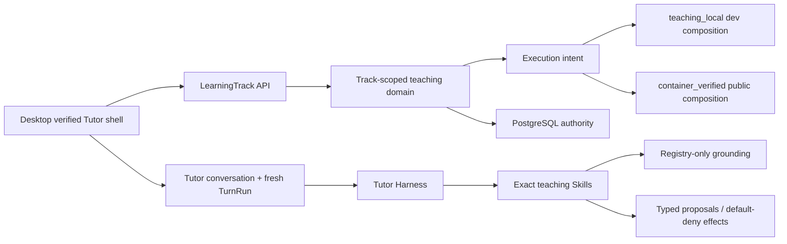
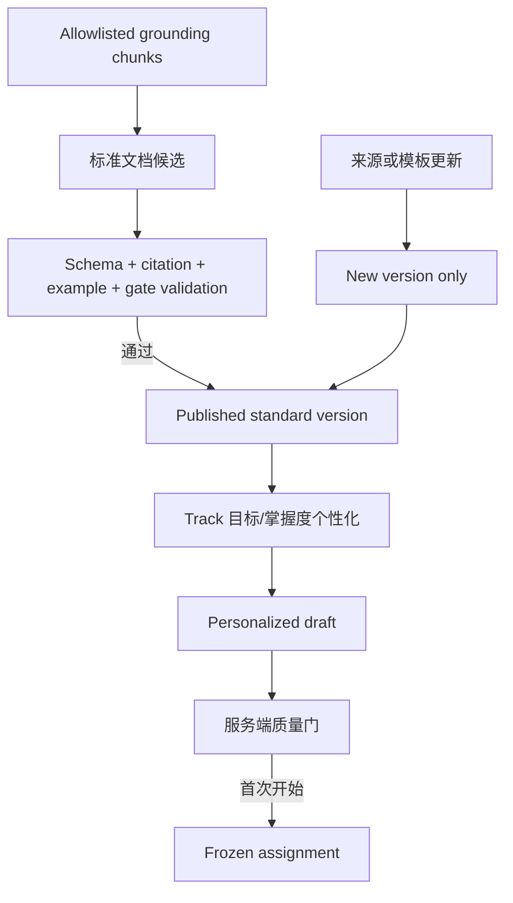
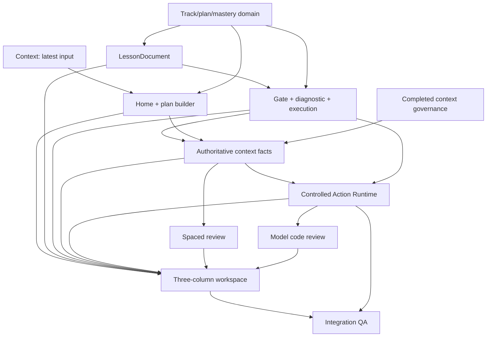

# 编程语言教学 Agent 技术设计

## 1. 架构目标

在现有 Tutor Harness 内增加一个结构化教学领域，使“学什么、学到哪里、为何解锁、何时复习、练习证据是什么”由 PostgreSQL 和类型化服务权威决定；模型负责检索、编排、解释、出题和反馈建议，但不能直接越过服务端规则修改进度、掌握度或执行目标。



## 2. 运行时边界

### 2.1 保留

- `TutorConversation` 是长期互动历史；普通输入继续创建 fresh finite `TurnRun`。
- cutover receipt、user scope、lease/revision、idempotency、checkpoint、strict primary-provider decision、safe projection 和 executor lifecycle 不变。
- 当前 `grounding.retrieve@1.0.0` 继续是开放文档证据的唯一入口；模型不得提交任意 URL。
- 公开 execution job 继续由 standalone executor 在事务提交后 claim，不允许 API 或 worker 直接启动 Docker。

### 2.2 新增

- 新的 `app/services/learning/` 领域包，内部按 `tracks`、`plans`、`lessons`、`practice`、`reviews`、`mastery` 划分窄模块。
- 新的 `/api/learning-tracks` 路由族，所有 mutation 都绑定 `user_id`、track scope、幂等键和服务端版本。
- `TutorRun` 增加固定 `task_kind` 与结构化 artifact scope，例如 `plan_drafting`、`lesson_teaching`、`exercise_feedback`、`review_coaching`、`model_code_review`、`remediation`。
- Conversation 使用一对一 scope binding 关联 planning session、LearningTrack、Lesson、ReviewSession 或 PracticeSession；旧 conversation 可保持 `general`，不自动推断归属。

## 3. 领域数据模型

### 3.1 LearningTrack 与路线

新增以下 track-scoped 表；具体列在 child 设计中冻结：

- `tutor_learning_tracks`：用户、语言、目标、状态、当前节点和最近学习事实。
- `tutor_track_plan_revisions`：不可变计划版本、predecessor、生成策略、来源与变更原因。
- `tutor_track_active_plans`：每个 track 唯一 active revision。
- `tutor_plan_modules` / `tutor_plan_nodes`：版本内不可变路线结构，节点使用稳定 `knowledge_key`。
- `tutor_track_node_progress`：track + `knowledge_key` 的可变投影，不依赖某一计划版本存活。
- `tutor_plan_migrations`：旧/新版本节点映射、影响预览和用户确认 receipt。

现有 `tutor_plan_revisions` 是 user-level Tutor outline，保留历史兼容，不自动迁移成语言主线。若后续提供人工导入，必须由用户选择语言和目标并形成新版本，不做模型静默推断。

### 3.2 掌握度

- `tutor_mastery_evidence` 是 append-only 事实：知识点、artifact/version、attempt、证据类型、是否独立完成、提示使用、分数和来源。
- `tutor_mastery_states` 是可重算投影：置信度、强弱项、最近证据和调度参数。
- 解锁、复习和计划调整只能消费服务端验证过的 evidence；模型输出是 proposal，不是事实。

### 3.3 LessonDocument

- `tutor_lesson_documents` 保存 language + knowledge_key + schema/generator version、`standard|personalized`、parent lineage、状态和 content hash。
- `blocks_json` 只允许注册 block union；练习 block 只保存 `exercise_version_id`，不嵌入隐藏答案。
- `tutor_lesson_source_snapshots` 保存 citation、section、retrieval time、source content hash 和使用范围。
- `tutor_lesson_assignments` 把 frozen personalized version 绑定到 track/node。首次开始学习后不可原地改写。

### 3.4 练习、Gate 与模块诊断

- `tutor_exercise_versions` 是不可变公共题面、runtime profile、exercise type、generator/validator version 和验证状态。
- `tutor_exercise_private_rubrics` 保存预期 finding、隐藏测试引用和评分 rubric；公共 API、对话和 trace 永不读取完整内容。
- `tutor_exercise_attempts` append-only，区分 `run|submit|review_submit|diagnostic_submit`，记录提示与 independence。
- `tutor_lesson_gate_states` 权威控制 required/recommended/diagnostic Gate。
- `tutor_module_diagnostic_sessions` 独立于 Lesson Gate；只有全部核心能力达到版本化阈值才提交模块跳过计划变更。

当前 `tutor_execution_intents.exercise_id` 通过 additive migration 支持旧 `exercise_id` 与新 `exercise_version_id` 的严格 one-of reference；executor job 生命周期不复制。

### 3.5 复习

- `tutor_review_schedule_states` 按 track + knowledge_key 保存 FSRS/调度投影。
- `tutor_review_sessions` / `tutor_review_items` 保存一次批次、warmup、正式提交与 finalization。
- 复用现有 FSRS、候选池和审核题评分算法，但通过新表和新 repository 适配；旧 `review_states`、`review_logs` 不重新开放。

## 4. LessonDocument 生成与冻结



- generation job 只读取 registry/index 中的受信 chunk；抓取/reindex 与交互式生成分离。
- 标准版本校验引用覆盖、block schema、代码示例、练习存在性和语言/runtime 一致性。
- 个性化只能调整解释深度、示例、顺序和推荐练习，不得移除计划要求的核心能力。
- frozen 后来源更新只产生新版本和 migration proposal；旧尝试继续引用旧版本。

## 5. 路线与模块诊断

- 当前已解锁知识点内部可以自由滚动到 Gate；客户端只渲染服务端已发布的可见 block range。
- 单个知识点没有“申请跳过”mutation。
- 模块节点提供独立 `placement_diagnostic` modal session；题目覆盖所有核心能力并使用独立 rubric。
- 全部核心能力通过后，服务端生成计划版本影响预览；用户确认后整模块状态变为 `diagnostic_skipped`，并生成低频复习 evidence。
- 部分通过不跳过任何知识点，只形成个性化证据，用于压缩讲解、练习推荐和薄弱点强化。

## 6. Execution Tier

统一服务端 enum：

- `teaching_local`：本机 teaching runner，只允许开发、fixture、内部演示 composition。
- `container_verified`：catalog runtime 有 reviewed immutable image lock 且 health/lock fingerprint 兼容，允许公开执行。
- `static_only`：只做文档、代码阅读、静态审核和不依赖真实运行的评分。
- `unavailable`：不生成依赖执行结果的练习。

语言卡、Lesson、Exercise 和运行按钮全部读取同一服务端 capability projection。前端不得根据本机是否安装工具链自行提升 tier。

## 7. Tutor Harness 教学能力

计划新增 reviewed exact Skills：

- `tutor.learning-plan@1.0.0`
- `tutor.lesson-coach@1.0.0`
- `tutor.exercise-coach@1.0.0`
- `tutor.review-coach@1.0.0`
- `tutor.model-code-review@1.0.0`

候选 capability/effect：

- 只读：`learning.track.read`、`learning.plan.draft`、`learning.lesson.read`、`learning.exercise.read`、`learning.mastery.read`。
- 类型化 proposal：`learning.plan.propose_revision`、`learning.lesson.propose_personalization`、`learning.practice.propose_remediation`。
- 用户确认拥有的 mutation（确认计划、确认结构变化、提交练习、申请模块诊断）由公共 API 直接执行，不依赖模型自动 effect。

ContextProjection 顺序：system/Skill/policy → authoritative current_input → task kind/scope → active plan/node → current Lesson/Exercise/Review artifact → necessary mastery evidence → optional history/summary/memory。隐藏 rubric、submitted code 全文和 raw execution detail 不进入普通模型上下文。

## 8. API 与 UI 信息架构

### 8.1 API 族

- `GET/POST /api/learning-tracks`
- `GET /api/learning-tracks/{track_id}`
- `POST /api/learning-planning-sessions`
- `GET/POST /api/learning-planning-sessions/{id}/draft|confirm`
- `GET /api/learning-tracks/{track_id}/roadmap`
- `GET /api/learning-tracks/{track_id}/lessons/{node_id}`
- `POST /api/lesson-gates/{gate_id}/attempts`
- `POST /api/learning-modules/{module_id}/diagnostics`
- `GET/POST /api/learning-tracks/{track_id}/reviews`
- `POST /api/practice-sessions/{id}/attempts`

精确 shape 由对应 child 冻结；所有 write route 使用 idempotency、expected version 和 user/track scope。

### 8.2 Desktop

外层仍由 server-authoritative cutover 决定能否进入 `tutor` shell。shell 内部新增：

```text
learning_home
  -> track_planner
  -> learning_workspace
       ├─ roadmap sidebar
       ├─ LessonDocument / ReviewSession / PracticeSession
       └─ scoped Tutor conversation
```

不引入旧 onboarding/learning/review 页面，也不恢复旧 Graph SSE。当前 conversation-first UI 迁移为右侧 scoped Tutor；旧 `general` conversation 可通过次级历史入口查看，不作为首页主导航。

## 9. 依赖顺序



- 11 个 child 已按上图依赖顺序全部完成并归档。
- `08-12-tutor-authoritative-context-facts` 已冻结 confirmed facts、question state 与统一 snapshot contract。
- `08-12-tutor-controlled-action-runtime` 已统一 grounding、plan drafting、runner execution 的 descriptor/invocation/receipt/verification 生命周期。
- Review、模型代码审核与工作区已分别消费 facts 和 Action Runtime 的服务端权威结果。
- 最终 integration 已通过长对话事实召回、重复询问、stale fencing、双重 action authority、核心语言矩阵和安全投影审计。

## 10. 迁移与兼容

- schema 采用 additive-first；不删除旧 `learning_*`、现有 `tutor_plan_revisions` 或 conversation 数据。
- 旧 user-level Tutor plan 不自动成为 track；UI 改版后保留只读历史/rollback contract，后续可提供显式导入。
- 旧 general conversation 保持可读；新 conversation 必须有结构化 scope binding。
- active API 文档只有代码与测试证明后才更新；历史 docs 不改写为当前事实。

## 11. 安全、隐私与失败

- Hidden tests、expected findings、reference answer、raw provider body、reasoning、container/path/command 不进入公共表 projection、SSE、对话或 release evidence。
- 题目/文档生成失败不使用无质量门的模板或虚构执行结果；保持 draft/failed 并提供稳定错误。
- plan、Gate、diagnostic、attempt、review finalization 全部有 version/idempotency/CAS 防重复。
- 公开执行缺少 reviewed lock 时返回 `EXECUTION_UNAVAILABLE`，不 fallback 到本机 runner。

## 12. 验证策略

- PostgreSQL schema/bootstrap 与跨用户/跨 track FK 测试。
- Pydantic/API contract、idempotency、version conflict、safe projection 测试。
- grounding/lesson schema/citation/lineage/freeze 测试。
- runner/executor tier、one-of artifact reference、hidden data redaction 测试。
- mastery/review deterministic property 与 replay 测试。
- Desktop typecheck/build、响应式三栏、modal、selection reference、SSE smoke。
- Python、JavaScript、TypeScript、SQL 各一条端到端 fixture；真实 provider 与 container fleet 是单独非发布 smoke。


## 13. 最终集成结论（2026-08-12）

父任务的业务实现全部由 child 交付。最终 PostgreSQL 集成矩阵覆盖 Python、JavaScript、TypeScript、SQL 的计划制定、Lesson、Gate、反馈、掌握度、进度、复习与 finalization；Java、HTML/CSS 仅作为扩展验证，Go、C#、Rust、C++ 按实际 tier 降级。空 image lock 下公开能力不提升为 `container_verified`。

Schema reconciliation 要求每张 `tutor_*` 表显式归类为 user-owned cutover target 或 shared immutable/catalog infrastructure。旧 `learning_*`、user-level Tutor plan、review/notes 与 Graph/runtime 数据不被静默转换。当前结果仅证明本地代码与 fixture readiness，不代表 provider、镜像、发布、部署或生产迁移批准。
