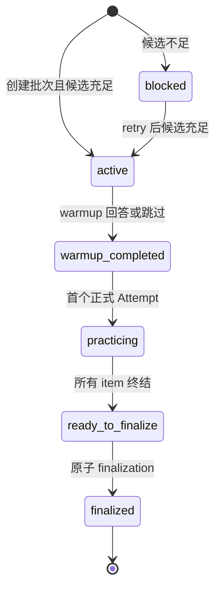

# 间隔复习与 ReviewSession 技术设计

## 1. 设计目标

在正式 LearningTrack 领域中增加服务器权威的复习队列和有限 ReviewSession。复习状态由已验证 mastery evidence、不可变 ExerciseVersion 和确定性调度策略驱动；聊天历史、前端日期比较和旧 Review 表均不参与 authority。

## 2. 领域边界

### 2.1 新增 authority

- `tutor_review_schedule_states`：`user_id + track_id + knowledge_key` 唯一的可重算调度投影。
- `tutor_review_schedule_events`：append-only 调度变更记录，保存原因、前后状态与策略版本。
- `tutor_review_sessions`：一次有限批次的 lifecycle、版本、幂等、冻结 context snapshot 和可恢复错误。
- `tutor_review_warmup_receipts`：append-only warmup/skip receipt，不产生长期 mastery 或 schedule 写入。
- `tutor_review_items`：session 创建时冻结的 ExerciseVersion、知识点、顺序和候选选择依据。
- `tutor_review_finalizations`：每个 session 唯一的 append-only 聚合 receipt。

### 2.2 复用 authority

- `tutor_exercise_versions` 与 private rubric 继续定义题目和评分。
- `tutor_exercise_attempts` 增加 `review_submit` 与 review owner shape；submission/result 保持 append-only。
- container execution 继续进入现有 durable executor queue；不新增第二套 runner。
- `tutor_mastery_evidence` / `tutor_mastery_states` 继续是掌握度事实与投影。
- `AuthoritativeContextSnapshot` 继续是冻结上下文类型。

### 2.3 明确禁止

- 不读取或写入旧 `review_states`、`review_logs`、`review_seed_banks`。
- 不注册旧 `/api/reviews`。
- 不从 Conversation history 重新推断目标、时间或偏好。
- 不在候选不足时创建低质量 fallback。

## 3. 调度策略

策略版本为 `track_review_fsrs_v1`，保持纯函数和确定性：

- `Again`：失败、超时、无效或关键能力失败；进入 `relearning`，短间隔，增加 lapse 与 risk。
- `Hard`：通过但依赖提示/补救，或分数仅刚过阈值；进入较短复习间隔。
- `Good`：独立稳定通过；按稳定度延长间隔。
- `Easy`：独立高分且关键能力全部通过；获得最长间隔。

每个 finalization 只产生一个 rating。策略输出 `due_at`、`card_state`、`stability`、`difficulty`、`risk_level`、`review_count`、`lapse_count`。普通 due 只进入队列；仅当 `risk_level=critical` 且该知识点是当前节点的直接或传递前置时，投影 `critical_prerequisite_gate=true`。

Gate 是服务端投影和补救入口，不直接篡改课程进度；后续工作区必须读取该投影决定是否先进入短 ReviewSession。

## 4. 初始 schedule 与计划迁移

- 非 review mastery evidence 首次出现时，按 evidence kind、score 与 independence 建立 schedule。
- `diagnostic_skipped` 使用低频初始间隔，避免一次诊断永久豁免。
- review evidence 不通过通用 seed 路径重复调度；由 finalization 明确写 schedule。
- 激活新计划版本时，同 `knowledge_key` 保留 schedule 并更新 source revision；删除节点写 migration event 并置为 `suspended`；再次出现时可显式恢复。
- due queue 只读取 active plan 中未 suspended 的 schedule，杜绝跨 revision 和跨 track 污染。

## 5. ReviewSession 生命周期

- 创建 session 时冻结 active plan revision、schedule version、批次 item 和 `AuthoritativeContextSnapshot`。
- warmup receipt 只更新 session stage/version。
- item submit 校验 session/item/version、题目类型和 execution tier，写 `review_submit` Attempt。
- static/model-review 立即评分；container/teaching-local 复用现有执行路径并在结果可用后终结 Attempt。
- finalization 聚合所有 item：缺少 terminal result 时拒绝；成功时写唯一 finalization、review mastery evidence、schedule event 和 schedule projection，并终结 session。
- 重放相同 idempotency + request hash 返回原结果；同 key 不同请求返回稳定冲突。

## 6. 候选选择

- 候选必须是 `validation_status=ready` 的不可变 ExerciseVersion，语言匹配，required capabilities 覆盖当前薄弱能力。
- 支持普通代码练习、`static_code_reasoning` 和 `model_code_review`。
- 对需要执行的题目，只有当前 authority 返回 `teaching_local` 或 `container_verified` 才可选择；`static_only` 不伪装执行。
- 优先避免近期重复 ExerciseVersion，并限制有限批次。
- 无合格候选时 session 保持 `blocked`，公开 `REVIEW_CANDIDATE_UNAVAILABLE`、`recoverable=true` 和 retry action。

## 7. 权威上下文

ReviewSession 使用现有 `AuthoritativeContextSnapshot` 类型保存以下有界 source：

- track 的语言、目标、target level、active revision 与当前 knowledge key；
-用户的学习风格、教学偏好和首选时间段；
- 当前 knowledge 的 mastery 与 schedule 摘要；
- correction lineage 由当前确认事实/用户配置的服务器记录表示。

快照在创建时持久化为安全 JSON 和 hash。resume、history 截断或 summary 暂不可用时直接读取该快照，不重建、不向聊天历史回退。

## 8. API contract

- `GET /api/learning-tracks/{track_id}/reviews`：due count、today queue、关键前置 Gate。
- `POST /api/learning-tracks/{track_id}/reviews/sessions`：创建或重放有限批次。
- `GET /api/learning-tracks/{track_id}/reviews/sessions/{session_id}`：恢复 session。
- `POST .../{session_id}/warmup`：记录 warmup 或 skip。
- `POST .../{session_id}/items/{item_id}/attempts`：提交正式 item。
- `GET .../{session_id}/attempts/{attempt_id}`：读取 pending/terminal Attempt。
- `POST .../{session_id}/finalize`：唯一聚合 finalization。

所有错误沿用 `{code,message,recoverable,details}`；写接口要求 `Idempotency-Key` 与 expected version。

## 9. 本地数据与 cutover

- summary/export 增加 review schedule/session/finalization 安全摘要。
- reset/delete 按 FK 逆序删除 review finalization/event/warmup/item/session/schedule，再删除 Attempt 和 track。
- cutover inventory 纳入所有新表。
- immutable/updated-at/lifecycle trigger 与 schema bootstrap assertions 同步。

## 10. 验证

1. 调度纯函数 property：时间单调、Again 最短、Easy 最长、独立优于 hinted、critical failure 提升 risk。
2. repository：batch、warmup 无长期写入、Attempt append-only、finalize exactly once、plan migration、diagnostic low-frequency。
3. cross-user/cross-track：所有 session/item/attempt/finalization 拒绝越权。
4. API：幂等、版本冲突、候选不足可恢复、pending execution 与 safe projection。
5. export/reset/cutover/schema bootstrap。
6. 全量 API Ruff、Mypy、pytest 与 Trellis/diff hygiene。
