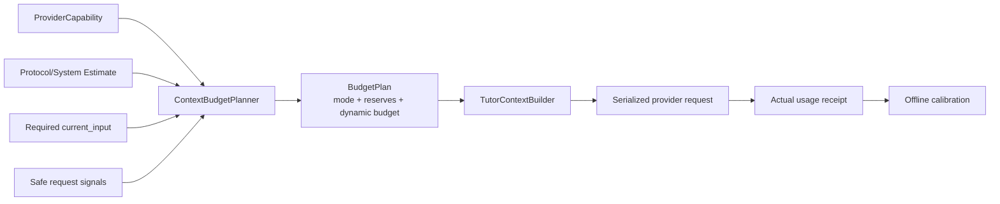

# Tutor 自适应上下文预算规划器设计

## 1. 范围与目标

本任务将“模型能容纳多少”和“本轮应该使用多少”分开。planner 计算完整请求的保守预算，选择动态档位并向 builder 分配 optional context budget；它不改变 provider 路由，不生成长期摘要，也不依赖缓存必然命中。



## 2. Provider Capability

建议新增明确 contract：

```python
@dataclass(frozen=True)
class TutorProviderContextCapability:
    input_hard_limit: int
    output_reserve: int
    protocol_reserve: int
    safety_margin: int
    maximum_dynamic_target: int
    capability_version: str
```

来源优先级：

1. 精确、受测试的 model capability registry；
2. 显式 Settings；
3. 保守默认值。

不允许仅通过模糊模型名前缀猜测 1M 或其他窗口。

## 3. Budget Plan

```python
class TutorContextBudgetMode(str, Enum):
    COMPACT = "compact"
    NORMAL = "normal"
    COMPLEX = "complex"
    EXTENDED = "extended"

@dataclass(frozen=True)
class TutorContextBudgetPlan:
    mode: TutorContextBudgetMode
    physical_input_limit: int
    required_token_estimate: int
    optional_token_budget: int
    total_input_warning_tokens: int
    total_input_critical_tokens: int
    expansion_count: int
    estimator_version: str
```

核心计算：

```text
required estimate
  = system/protocol
  + current_input
  + request envelope/metadata minimum
  + safety margin

physical optional capacity
  = physical input limit
  - required estimate

optional token budget
  = min(mode target, maximum dynamic target, physical optional capacity)
```

若 required estimate 已超过 hard limit，则在 provider 调用前失败。

## 4. 完整请求估算

当前 `Utf8ByteTokenEstimator` 可继续作为 provider-neutral 下限实现，但必须估算最终序列化形态，而不是只估算每个 context item：

- system prompt；
- teaching policy；
- canonical JSON decision example；
- `input_revision/current_input`；
- context items；
- context metadata；
- capability schemas；
- JSON key/quote/escape/array overhead；
- provider-specific instructions；
- safety margin。

建议将 message building 拆为可在 provider 调用前 dry-build 的 deterministic serializer，由 planner 和 gateway 共享，避免估算格式与真实 payload 漂移。

## 5. 档位选择

第一版使用规则型、安全 signal classifier：

### Compact

- 当前输入短；
- 不引用早期对话；
- 不含长代码/日志/文档；
- 不需要多个来源比较。

### Normal

- 普通连续教学；
- 需要近期历史与当前计划；
- 无大块外部证据。

### Complex

- 明确要求比较多个旧方案；
- 包含较长代码/错误日志；
- 需要多项相关 memory/plan/review 证据；
- working summary 表明有多个未解决分支。

### Extended

- 多文件/多文档或超长输入分析；
- 显式要求追溯更早原文；
- 复杂模式经过受控 `insufficient_context` 后有界升级；
- provider capability 足够。

classifier 输入必须是长度、类型、引用标记、候选数量等安全结构化事实，不读取隐藏 provider reasoning。

## 6. 选择和驱逐

### 必需

1. system/protocol；
2. current input。

### Optional priority

1. 最新既往消息；
2. 直接相关 active plan/review；
3. working summary；
4. 相关 learner memory；
5. activity；
6. 非必要 capability schema。

capability schema 如果是已选择 capability 的必需 contract，可在计划阶段单独预留；无关 schema 不得全量加入。

当达到 warning/critical ratio：

- warning：停止加入低相关 optional source，并请求/优先使用 summary；
- critical：删除低优先级来源、缩短历史窗口、使用结构化摘要；
- hard limit：不发送请求。

## 7. 有界升级

- 初次选择由 deterministic classifier 决定。
- 只有受控内部结果 `insufficient_context` 或 decision gate 明确要求更多已授权证据时允许升级。
- 每次升级最多移动一个档位；不得循环降级/升级抖动。
- 受现有 run `max_iterations` 和 `max_model_calls` 限制。
- 升级必须重建 context 并再次验证 input revision/supersede。

## 8. 缓存语义

- 请求前：完整输入全部计入 estimated physical usage，不扣除预计缓存。
- 请求后：actual usage receipt 记录 cached/uncached，用于成本、延迟和 estimator 校准。
- 稳定前缀可以通过 provider cache 获得成本收益，但不能因此被视为零上下文。
- cache ratio 不单独决定档位；相关性与必要性优先。

## 9. Policy 与持久化

`TutorPolicySnapshot` 增加或引用：

- capability/version；
- budget mode policy/version；
- warning/critical ratio；
- maximum expansion count；
- estimator version。

run 创建时冻结这些值，进入 policy fingerprint。checkpoint metadata 增加安全数值和枚举，不保存正文。

## 10. 兼容性和回滚

- 可以通过配置将所有请求固定到 conservative `normal`，作为回滚模式。
- 旧 run 缺少新字段时按 persisted legacy `context_token_budget` 读取，不追溯改写。
- public API/SSE 不暴露 budget mode/token 内部字段。
- 回滚 planner 不得恢复错误的 latest-input 选择，也不得删除 usage receipt 或 summary 数据。