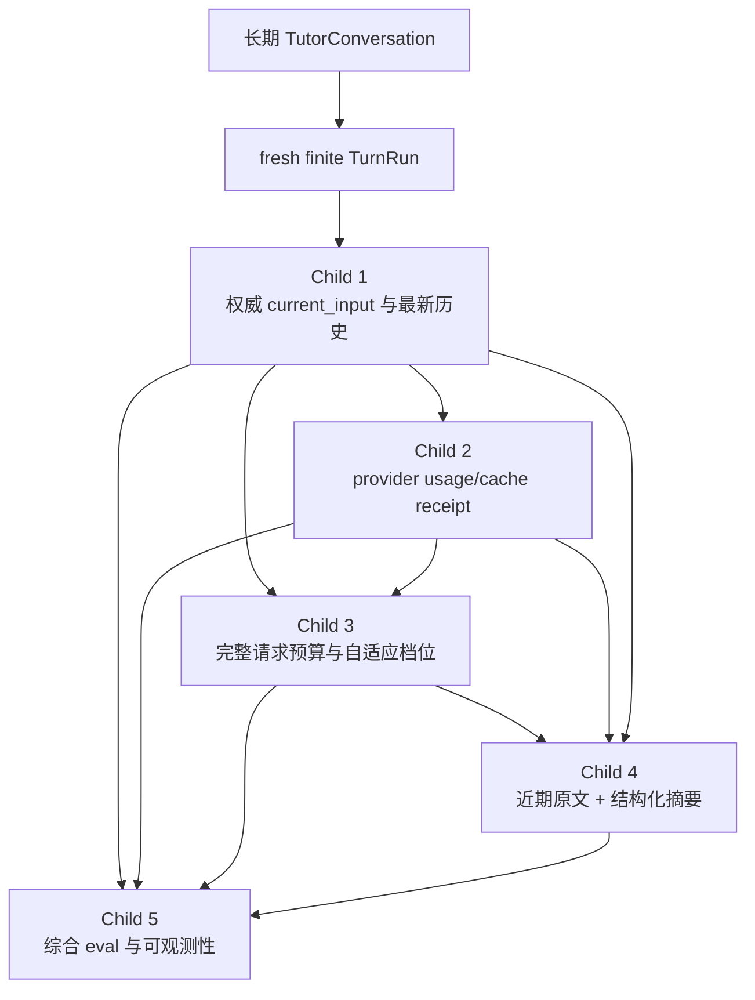
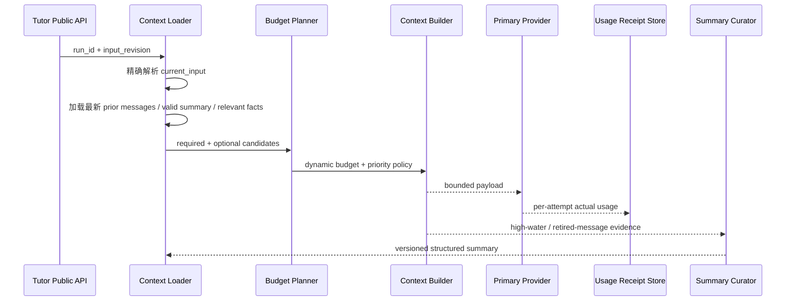

# Tutor 上下文治理与自适应预算总体设计

## 1. 设计目标

本父任务定义五个可独立验收的子任务如何共同形成完整上下文治理链路。它不直接实施业务代码，也不重新打开已经完成的 TurnRun 生命周期或 DeepSeek protocol 设计。



## 2. 核心 Contract

### 2.1 输入层

- 交互式 run：必须存在权威 `current_input`。
- 主动式 run：允许 `current_input=None`，保持现有独立策略。
- 完整历史仍由 `tutor_messages` 持久化；模型只接收受治理投影。

### 2.2 预算层

```text
provider physical input capacity
  = context window
  - output reserve

complete estimated input
  = system/protocol
  + current_input
  + dynamic context
  + metadata/schema/JSON overhead
  + safety margin
```

缓存读取只影响 actual usage 的计费/复用明细，仍占用 physical input capacity。请求前不能假设 cache hit。

### 2.3 压缩层

```text
current_input
  > newest recent messages
  > structured working summary
  > learner memory / activity
```

近期原文窗口保存最新细节；结构化摘要只覆盖被窗口淘汰的旧消息。摘要使用 conversation timeline cursor，而不是 run-local `input_revision` 充当全局游标。

### 2.4 证据层

- 请求前：保守 estimator、档位、source IDs/hashes、选择 metadata。
- 请求后：provider reported input/cached/output/total usage。
- 长对话：summary schema/version/coverage/source hash。
- 质量：离线 deterministic fixture + 显式启用的真实 provider smoke。

## 3. 子任务边界

| 子任务 | 拥有内容 | 不拥有内容 |
| --- | --- | --- |
| 最新输入与教学相关性 | current input、最新历史、教学策略 | usage、档位、长期摘要 |
| Usage 与缓存计量 | actual attempt receipt、protocol parsing | 预算决策、计费 UI |
| 自适应预算规划器 | physical hard limit、完整估算、档位、驱逐 | 摘要生成、provider routing |
| 摘要检索与压缩 | recent window、summary schema、coverage、curation | 删除原始历史、用户记忆设置合并 |
| Eval 与可观测性 | 跨层 fixtures、指标、smoke、校准 | 默认生产阈值自动修改 |

## 4. 数据流



## 5. 兼容性

- public API/SSE 不新增内部 token、prompt 或 summary debug 字段。
- 现有 `model_call_count` 保持 run-loop decision 次数语义；actual provider attempt 单独记录。
- `tutor_context_summaries` 使用 additive migration；旧短 summary 行不伪装成新结构化摘要。
- 当前 provider/model/protocol 选择和无 fallback 行为保持不变。
- 现有 local-user reset/delete/export、trace redaction、lease/CAS 和 latest-input-wins 保持有效。

## 6. Rollout 与回滚

1. 按依赖顺序逐个实施和归档 child，不并行改变多个核心 contract。
2. 每个 child 都通过现有 fake/offline gate 后再进入下一个。
3. 预算档位先以配置和 eval 运行，不根据单次 smoke 自动改变生产默认值。
4. 摘要读取可独立关闭；关闭后回退到 current input + recent history，而不是旧的错误选择算法。
5. usage receipt 可在缺失时降级为 unavailable；不能影响 learner reply。
6. 任一 child 回滚不得删除 `tutor_messages`、改变 provider credential 或恢复已归档 runtime。

## 7. 集成风险

- 使用 run-local revision 作为 conversation 摘要游标会重复或遗漏历史。
- 把 cached token 从 physical total 排除会错误放宽硬边界。
- 将 usage/summary 正文写进 trace 会建立第二份 conversation store。
- 自适应扩容若依赖模型自由文本，可能造成不可测试循环。
- 同时修改 current-input、budget、summary 和 provider contract 会使回归定位困难，因此必须按 child 顺序实施。