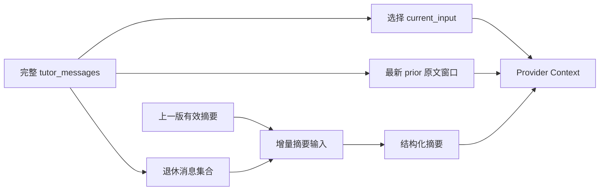

# Tutor 长对话摘要检索与压缩闭环设计

## 1. 设计原则

压缩不是删除历史，也不是把所有历史改写成一段自然语言。完整 `tutor_messages` 保持权威；模型上下文使用三个层级：

```text
L0 必需：current_input
L1 高保真：最新 prior messages
L2 压缩：覆盖更早消息的 structured working summary
```

其他 plan/review/memory/activity 按相关性作为 optional sources 加入。



## 2. Conversation Timeline

普通消息各自拥有新 run，run-local `input_revision` 通常从 1 开始，因此不能作为 conversation 级摘要游标。

定义稳定 timeline key：

```text
(created_at, message_id)
```

规则：

- 查询和选择使用 `created_at DESC, id DESC`；
- 呈现使用 `created_at ASC, id ASC`；
- coverage 使用 `covered_through_created_at + covered_through_message_id`；
- 相同时间戳由 UUID 文本/数据库 ID 稳定打破平局；
- current input identity 仍来自 `tutor_run_input_events`，不从 timeline 推断。

## 3. Structured Summary Contract

建议内部 schema：

```json
{
  "schema_version": "tutor_context_summary_v2",
  "current_goal": "...",
  "confirmed_facts": ["..."],
  "completed_steps": ["..."],
  "rejected_paths": ["..."],
  "open_questions": ["..."],
  "learner_preferences": ["..."],
  "covered_through_created_at": "...",
  "covered_through_message_id": "...",
  "source_hash": "..."
}
```

边界：

- 每个字符串和数组有明确上限；
- 只记录对后续教学连续性必要的安全事实；
- 不记录消息逐字副本、代码全文、prompt、provider detail 或 reasoning；
- `summary` 文本字段保留为最多 280 字符的 learner-safe/internal overview，`summary_json` 才是版本化结构化投影。

## 4. 数据库扩展

对 `tutor_context_summaries` 做 additive 扩展，建议新增：

- `conversation_id`
- `summary_schema_version`
- `summary_json`
- `covered_through_created_at`
- `covered_through_message_id`
- `source_hash`
- `prior_summary_id` 或 prior summary hash

约束：

- composite FK/查询证明 user/run/conversation 同 scope；
- `covered_through_message_id` 属于同 conversation；
- source hash 为 SHA-256；
- structured row 必须具备完整新字段，legacy row 可以全部为空；
- index `(user_id, conversation_id, covered_through_created_at DESC, covered_through_message_id DESC)`；
- append-only summary，纠正通过新行而不是原地修改旧摘要。

## 5. Retirement Set

在构造当前 context 时：

1. 精确找到 current message；
2. 查询 current 之前的 prior messages；
3. planner 选择能保留的最新窗口；
4. 找到上一摘要 coverage 之后、当前近期窗口之前的连续退休消息；
5. 仅该连续集合进入 compaction request。

不能摘要：

- current input；
- 仍在 recent window 的消息；
- previous summary 已覆盖的消息；
- current message 之后的干扰行；
- 跨 conversation/user 的消息。

## 6. Compaction Evidence

现有 outbox 继续只持久化：

- source IDs；
- source hashes；
- run/conversation/revision；
- trigger；
- trace/coverage metadata；
- schema/policy version。

为了生成语义摘要，worker 在合法 lease 和当前 job scope 下：

1. 加载 source IDs 对应的 `tutor_messages`；
2. 验证 user/conversation、timeline 连续性和 source hash；
3. 加载 prior summary；
4. 清理/截断临时证据；
5. 调用 primary curator；
6. 严格校验 structured summary；
7. 在一个事务内写 proposal/summary/receipt。

原始证据只存在于本次临时内存和 provider 请求，不写入 trace/outbox/proposal payload。

## 7. Curator Protocol

现有 curator 只允许一段 280 字符 summary，需要版本化扩展为严格 JSON schema。初始和 repair 都必须规定：

- 仅根据 prior summary 与给定退休消息；
- 不推断未给出的事实；
- 用户纠正覆盖旧事实；
- completed/rejected 分开记录；
- 未解决问题不伪装成已确认事实；
- 输出不得包含代码、路径、命令、SQL、provider、credential 或消息逐字 dump。

curation/inferred-memory provider 配置保持 primary-only、无 fallback；context summary 连续性策略与 inferred memory preference 分开。

## 8. Loader 检索

loader 查询当前 conversation 下：

- committed projection；
- `stale_after > now`；
- `retention_until > now`；
- schema/policy compatible；
- coverage 不晚于 current input；
- 最新 coverage 最大的单一摘要。

加载结果转为 `TutorContextSource` 的 `working_summary`。不得加载多份重叠 summary。

## 9. 冲突解析

provider instruction 和 builder 固定优先级：

```text
current_input
> recent_messages
> working_summary
> learner_memory
> activity
```

示例：

- summary：`尚未准备图片`
- current input：`我已经有了`

本轮必须以 current input 为准，并在后续 summary 中把该事项迁移到 `completed_steps/confirmed_facts`，必要时把旧路径写入 `rejected_paths`。

## 10. 触发策略

- recent retirement set 非空；
- estimated context 达到 planner warning/high-water；
- TurnRun 成功终态；
- safe checkpoint；
- current input 显式更改目标、纠正事实、声明完成或拒绝路径。

相同 prior summary + retirement set + schema/policy version 产生同一 idempotency key。

## 11. 失败与回滚

- curator disabled/unavailable/invalid：outbox/job 按现有 no_action/retry/failure 语义处理；原始历史不变。
- loader 没有有效 summary：只使用 current input + recent messages +其他安全事实。
- summary schema 回滚：停止加载 v2 structured rows，保留数据，不把 legacy row当 v2。
- 不删除 conversation history，不改变 public history/API/SSE。