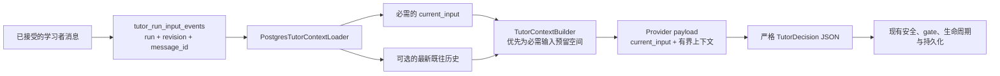

# Tutor 最新输入与教学相关性设计

## 1. 范围与边界

本次变更修复交互式 Tutor 路径，覆盖从持久化学习者输入身份、经过有界上下文构造，到严格 provider prompt 和确定性评估的完整链路。



本次变更不修改 public API shape、SSE framing、对话持久化归属、provider/model fallback 策略、capability/effect authorization、Desktop rendering 或主动式交付语义。

## 2. 根因

loader 当前以降序获取最新八条对话消息，然后将全部八条反转为时间顺序。builder 随后选择前四条 `RECENT_MESSAGES`。对于超过四条消息的对话，这种组合会选择较旧的消息，并丢弃最新的学习者轮次。

报告中的事件恰好在学习者写下 `我已经有了` 时越过四条消息上限。因此，之后的每个 TurnRun 都可能收到同一个陈旧的四消息前缀，并继续已经过时的图片/HTML 路径。

较大的 DeepSeek token-window 配置无法修复此问题，因为失败源于项目数量上限/排序 contract，而不是 token 耗尽。

## 3. 上下文 Contract

### 3.1 独立的当前输入

扩展有界上下文 contract，使交互式上下文拥有一个可选、类型化的 `current_input` 来源，并与 `recent_messages` 分离。生产环境交互式 loader 必须填充且仅填充一个当前学习者输入。主动式上下文继续保持 `current_input=None`。

权威查询链路为：

```text
tutor_runs.id = run_id
  + tutor_runs.input_revision = requested revision
  -> tutor_run_input_events(run_id, input_revision).message_id
  -> tutor_messages(id, conversation_id, role='learner', content)
```

查询必须限定在 snapshot 对应的 user/run/conversation 范围内。证据缺失、重复、跨对话、非学习者角色或 revision 不匹配时，均视为类型化 context-load failure。不得回退到最新时间戳或任意学习者行。

### 3.2 选择与呈现分离

当前输入是必需来源。既往历史和所有其他上下文 section 都是可选来源。

builder 在概念上执行两个阶段：

1. 清理并预留必需的当前输入；
2. 根据受治理的优先级和上限，使用可选 section 填充剩余 budget。

provider payload 明确呈现权威输入，例如：

```json
{
  "input_revision": 1,
  "current_input": {
    "role": "user",
    "content": "我应该学哪些语言"
  },
  "context": [
    {"section": "recent_messages", "source_id": "message:...", "content": "..."}
  ],
  "context_metadata": {}
}
```

精确的序列化 metadata 可以遵循现有 dataclass 约定，但不得把 `current_input` 隐藏在含义模糊的历史数组中。

### 3.3 Budget 处理

- 使用现有教学安全与最大来源规则清理当前输入。
- 在选择可选上下文前预留当前输入所需 token。
- 在改变当前输入之前先驱逐可选来源。
- 如果清理后的当前输入超过可用 request budget，则应用一种有文档记录的确定性有界表示策略：既保留非空学习者意图，又在内部 metadata 中标记截断，且不泄露原始数据。
- 如果连最小安全表示也无法容纳，则抛出类型化 context error，并在 provider 调用前终止。绝不能发送省略当前学习者输入的请求。
- Metadata 只记录已选择/已跳过/已截断事实和 hash；不得使其成为另一个原始历史存储区。

实现应优先采用可复用的 required-source 路径，而不是针对报告中的中文短语添加特殊逻辑。

## 4. 近期历史算法

1. 首先解析精确的当前消息 ID。
2. 读取有界的既往公开对话消息，并排除该 ID。
3. 在 section 项目上限内选择最新的 `N` 条既往消息。
4. 仅按时间顺序呈现这些已选择消息。
5. 应用现有角色标准化、清理、每来源字符边界和 token 记账。

选择逻辑在以下情况下必须继续保持正确：

- 抓取的行数多于项目上限；
- 多条消息拥有相同时间戳；
- 由于 fixture 或时钟行为，当前消息按时间戳并非最后一行；
- 总 context budget 较小；
- 旧历史包含强烈但已被拒绝的教学方向。

稳定行排序使用 `created_at` 加 `id`；当前输入身份绝不依赖该排序。

## 5. Provider 教学策略

将 system instruction 重构为两个明确部分，同时保持为一次严格请求：

1. **Decision-envelope protocol：** 精确 JSON 键、null/array 规则、标题长度限制、continuation 与 terminal 约束。
2. **交互式教学策略：** 当前输入权威性和学习者引导行为。

交互式教学策略规定：

- `current_input` 是现在必须回答的请求；
- 既往历史是辅助上下文，不是忽略当前输入的指令；
- 学习者的纠正、打断、拒绝、目标变更和完成声明会覆盖陈旧假设；
- 在回答权威当前输入前，应以可见但简洁的方式确认此类变化，并明确停止陈旧路径；
- 回答建议/比较/能力类问题后，最多再询问一个必要的后续问题；
- 不得重复已完成/已拒绝步骤，也不得强制采用早先的教学顺序；
- 如果缺少必要信息，应说明不确定性并提出一个高价值澄清问题，而不是虚构路径。

初始 provider request 与 schema-repair retry 必须使用相同的教学策略文本或共享 builder。retry 可以收紧 JSON 格式，但不得替换原始的当前输入 contract。

不得使用确定性语义 validator 尝试判断任意自然语言输出是否“正确”。硬性保证包括上下文存在性、instruction policy、安全、protocol validation，以及回归/eval 证据。

## 6. 评估设计

### 6.1 确定性 Contract 测试

扩展现有测试模块，覆盖：

- database loader 对精确当前输入的解析；
- 即使对话超过四条消息，当前输入仍被固定保留；
- 最新历史选择与时间顺序呈现；
- 当前输入不会在历史中重复；
- budget 驱逐顺序，以及失败时 provider 未被调用；
- provider payload 和 repair prompt 保留最新输入/纠正策略；
- 主动式运行无输入的兼容性。

### 6.2 现有 Tutor Eval 套件

扩展 `app/services/tutor/evals.py` 和受源码控制的 fixture 套件，增加带版本的场景，例如：

- `current_input_pinned`
- `newest_history_selected`
- `teaching_correction_policy_present`
- `current_input_unrepresentable_provider_not_called`

这些场景继续只使用 fake，并检查确定性的 context/provider-call receipt。它们不得声称 fake 响应能够证明真实模型的教学质量。

### 6.3 可选的真实 Provider Smoke

提供一个明确的开发者命令或清晰标记的小范围测试/脚本，仅在有意启用时，使用已配置 provider 运行报告中的对话。它必须：

- 仅通过现有 settings/environment 处理读取凭据；
- 绝不打印配置 secret、原始 transport body、reasoning 或 prompt；
- 只记录对学习者安全的 Tutor 消息及通过/失败 rubric 字段；
- 按轮次评判相关性、纠正确认、不重复、先回答行为和放弃陈旧路径；
- 保持在默认离线 CI 之外，并且不得被描述为发布批准。

## 7. 兼容性与迁移

- 无需数据库 schema migration，因为 `tutor_run_input_events` 已拥有精确映射。
- 上下文 dataclass 变更需要原子更新内存 fixture、loader、builder 测试、eval helper 和 provider 测试。
- 公开 conversation/history/SSE response contract 不变。
- 现有已存储对话无需重写；当前输入在运行时通过已有 accepted-input 行解析。
- 主动式运行根据现有策略继续不携带学习者聊天输入。

## 8. 失败映射

权威当前输入缺失或不一致属于内部 context failure。它必须通过现有 run-loop 映射生成稳定且对学习者安全的 unavailable/failed 结果，内部仅保留有界诊断码。不得静默回退到陈旧历史，也不得在意图不完整时调用 provider。

如果现有 run-loop 缺少足够精确的 context-build failure 映射，则应新增一个，但不得公开暴露数据库或校验细节。

## 9. 工作树安全与回滚

存在重叠未提交修改的文件包括 `config.py`、`tutor.py`、`llm_client.py`、`provider_gateway.py`、`public_api.py`、Tutor 测试和运行时文档。编辑前必须重新读取每个重叠 diff，并进行窄范围合并。

回滚仅针对代码：

- 回退独立 current-input/context/prompt 变更；
- 保留现有持久化消息和 input event，不做改动；
- 不得删除对话数据或改变 provider 凭据/配置；
- 即使实现策略发生变化，只要新回归 fixture 仍能记录该缺陷，就应保留它们。
