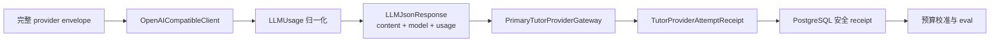

# Tutor Provider Usage 与缓存计量设计

## 1. 范围与边界

本任务只建立实际 provider attempt 的 usage 采集、归一化与安全持久化，不负责选择上下文预算，也不改变 provider/model/protocol 路由。



## 2. Usage Contract

建议增加 provider-neutral immutable contract：

```python
@dataclass(frozen=True)
class LLMUsage:
    input_tokens: int | None = None
    cached_input_tokens: int | None = None
    output_tokens: int | None = None
    total_tokens: int | None = None
    reasoning_tokens: int | None = None

    @property
    def uncached_input_tokens(self) -> int | None:
        ...
```

约束：

- 所有 provider reported 值保持可选，缺失不是零。
- 所有存在的值必须非负。
- `cached_input_tokens` 存在时必须同时存在 `input_tokens`，且不得大于它。
- `uncached_input_tokens = input_tokens - cached_input_tokens`。
- 同时保存 provider reported `total_tokens` 和规范化 calculated total；不一致只进入安全校验/指标，不能私自重写 provider receipt。
- `reasoning_tokens` 只保存数值，不保存 reasoning 内容。

`LLMJsonResponse` 扩展为：

```python
@dataclass(frozen=True)
class LLMJsonResponse:
    content: dict[str, object]
    model: str
    usage: LLMUsage | None = None
```

## 3. 协议解析

### 3.1 Responses

- `_parse_responses_stream()` 必须保留最终 `response.completed.response` 的完整 envelope，包含 `usage`。
- `_normalize_response_payload()` 后从 response object 解析 `usage.input_tokens`、`usage.output_tokens`、`usage.total_tokens`、`usage.input_tokens_details.cached_tokens` 和可用的 output/reasoning details。
- 只解析允许的整数路径；未知字段忽略。

### 3.2 Chat Completions

- 从 completion envelope 的 `usage.prompt_tokens`、`usage.completion_tokens`、`usage.total_tokens` 和 `usage.prompt_tokens_details.cached_tokens` 归一化。
- provider 使用 OpenAI-compatible 但字段缺失时返回部分 usage 或 `None`。

### 3.3 失败路径

- transport 失败且没有 provider envelope：usage unavailable。
- provider envelope 已完成但 visible content/JSON/TutorDecision 校验失败：保留该 attempt usage。
- `response.incomplete` / `response.failed` 如果 envelope 提供 usage，可以保留 receipt，但不能当作成功 usage。

## 4. Attempt Receipt

Gateway 内每次 `complete_json()` 都是一个实际 attempt，建议 contract：

```python
@dataclass(frozen=True)
class TutorProviderAttemptReceipt:
    attempt_index: int
    outcome: Literal[
        "accepted",
        "repairable_rejected",
        "terminal_rejected",
        "transport_failed",
    ]
    model: str | None
    protocol: str
    usage: LLMUsage | None
    diagnostic_code: str | None
```

`TutorProviderResult` 携带 attempts tuple，无论最终 decision 成功还是映射 `MODEL_UNAVAILABLE`，run lifecycle 都可以持久化已获得的安全 receipt。

attempt identity 建议为：

```text
(run_id, input_revision, decision_iteration, attempt_index)
```

其中：

- `decision_iteration` 是当前 run-loop provider decision 次序；
- `attempt_index` 是 gateway 内首次/repair 请求，从 1 开始；
- 不改变现有 `model_call_count` 的含义。

## 5. 持久化设计

采用 additive 表，例如：

```text
tutor_provider_attempt_receipts
```

核心列：

- `id`
- `run_id`
- `user_id`
- `conversation_id`
- `input_revision`
- `decision_iteration`
- `attempt_index`
- `provider_type`
- `model`
- `protocol`
- `outcome`
- `diagnostic_code`
- `input_tokens`
- `cached_input_tokens`
- `uncached_input_tokens`
- `output_tokens`
- `reported_total_tokens`
- `calculated_total_tokens`
- `reasoning_tokens`
- `usage_available`
- `created_at`

约束：

- composite scope FK 保证 run/user/conversation 一致；
- unique `(run_id, input_revision, decision_iteration, attempt_index)`；
- token CHECK 非负；
- cached 不大于 input；
- calculated total 与 input/output 的已知值一致；
- outcome 和 diagnostic 使用闭合 vocabulary；
- receipt append-only，不允许变更 identity 或 token 数。

## 6. 生命周期原子性

- provider 调用发生在数据库事务外。
- gateway 返回后，run loop 继续执行现有 supersede/cancel/revision 检查。
- usage receipt 可以随安全 lifecycle boundary 写入，但不得让 stale run 获得业务写权限。
- 对 superseded run，允许记录其已经发生的安全 usage receipt，因为这是成本/执行事实；不得因此写 public message、title、capability 或 effect。
- receipt 写入必须幂等；重试 persistence 复用相同 identity。

## 7. 安全投影

扩展 `TutorSafeProjection` allowlist 时只增加：

- token count；
- attempt index/iteration；
- protocol/model/provider 受限标识；
- outcome/diagnostic；
- usage version。

不得将以下字段加入 allowlist：

- request/input/messages；
- raw response；
- prompt cache key/prefix 内容；
- reasoning text；
- URL/header/body；
- credential。

receipt 不进入 public history、SSE 或 learner export。

## 8. 兼容性与迁移

- 旧 `LLMJsonResponse(content, model)` 构造调用通过 `usage=None` 保持兼容。
- fake client 可选择不提供 usage；现有 provider tests 不应全部被迫构造 usage。
- schema bootstrap 使用 additive `CREATE TABLE IF NOT EXISTS`、guarded constraints/indexes。
- 不修改现有 `tutor_runs.model_call_count` 列语义。

## 9. 回滚

- 可以停止写入/读取新 receipt，同时保留表中历史安全数值。
- 回滚 `LLMUsage` 传播时不改变 provider 请求和 Tutor decision contract。
- 不删除 receipt 或修改原始 run/message 数据。