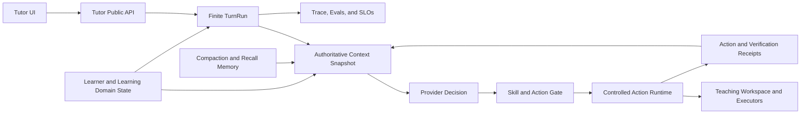

# Codex 与 Aearn Agent 架构最终评估

## 一、结论摘要

截至固定基线 `2026-08-11`：

- Codex 通用 Agent Runtime 加权得分：**90.56 / 100**。
- Aearn 当前工作树加权得分：**65.20 / 100**。
- 上下文、工具、记忆三项：Codex **38.16 / 42**，Aearn **25.08 / 42**。

这个分数不表示“Aearn 只有 Codex 的 65% 产品价值”，而表示：若用 Codex-like 通用 agent runtime 标尺衡量，Aearn 已具备可靠的有限执行、持久化、安全和教学领域状态，但在上下文连续性、通用工具 runtime、真实 workspace、长任务/多 agent 和跨会话治理上仍有明显缺口。

最准确的定位是：

> **Aearn 是一个强约束、领域型、事务化的 Tutor Agent Harness；Codex 是一个通用、工作区型、工具驱动、可恢复的 Agent Runtime。**

Aearn 不应复制 Codex 的产品形态，而应把 Codex 的运行时闭环吸收到自己的教学 authority 中。

## 二、最重要的发现

### 1. 重复询问不是简单上下文“太短”

真实对话中已经确认每周 `30小时`，后续又询问一次。链路显示：

1. 消息已经持久化。
2. loader 读取到 8 条 prior messages。
3. builder 固定只保留最后 4 条。
4. 关键回答位于更早位置，被确定性排除。
5. token 估算只有约 3049，未达到高水位。
6. working summary 当时为空。
7. terminal compaction 在 provider 调用后才进入 outbox。

因此根因是：

> **关键 planning fact 仍寄存在聊天历史；固定条数 cap 在 token 富余时提前删除它；异步 summary 又尚未接管。**

Codex 的 inline auto-compaction/replacement-history 可减少时序窗口，但真正适合 Aearn 的修复不是单纯扩大 recent messages，而是把 collecting intake 变为 typed state。

### 2. Aearn 的“确定性上下文”仍可能确定性地丢重要信息

当前 context builder 有固定顺序、token estimate、warning、critical、schema、安全 redaction 和 replay metadata。这些机制保证选择过程可重复，却没有保证选择结果语义正确。

确定性不是正确性的替代品。必须新增不变量：

- 已确认的 intake fact 在被 supersede 前必须始终进入 provider context。
- 新 correction 必须覆盖旧事实。
- unresolved question 和已回答 question 必须可区分。
- summary 未准备好时不得静默退休唯一事实来源。

### 3. Aearn 的工具体系“窄但安全”，不是“广且成熟”

Aearn 的 exact Skill、capability/effect descriptor、policy、revision、lease、receipt 和 server proof 很强。它已经避免了很多早期 agent 常见问题：模型伪造 tool ID、重复副作用、stale effect、越权 URL、未审查 handler。

但与 Codex 相比，它缺少统一通用工具 runtime：

- 动态 discovery/exposure；
- filesystem/search/patch/Git；
- shell/process session；
- browser/MCP/connectors；
- per-resource permission；
- parallel/serial scheduling；
- cancellation and terminal ownership；
- executed-tool metadata feedback；
- verify/recover policy。

因此近期重点不是增加十几个 capability，而是抽象一个可复用的受控 action lifecycle。

### 4. Aearn 的持久化与领域状态是不可替代的优势

Codex 的 rollout/history/memory 很适合通用任务连续性；Aearn 的 PostgreSQL receipt、LearningTrack、plan revision、Exercise、Attempt、mastery evidence 更适合教学事实。

不能把这些结构化状态退化成 prompt summary，也不能让通用 memory 成为学习进度真相。正确分工是：

- 数据库：authoritative domain truth。
- context snapshot：当前回合必须知道的事实投影。
- summary：语言连续性和已退休非结构化细节。
- recall memory：跨会话偏好、经验和非关键辅助信息。

## 三、Aearn 的真实成熟能力

### 已达到较高成熟度

1. finite `TutorRunLoop` 与 typed terminal outcome。
2. lease generation、heartbeat、revision、latest-input-wins。
3. provider 返回后的 stale-result fencing。
4. exact Skill selection 与两阶段 action gate。
5. capability/effect receipt、server-owned IDs 和 CAS。
6. PostgreSQL checkpoint/event/outbox 与幂等 replay。
7. execution intent/job、lease、launch token、result authority。
8. safe projection、trace/output/private evidence redaction。
9. structured context summary lineage 和 learner memory controls。
10. deterministic context/harness eval fixture。

### 部分成熟

1. adaptive token budget：物理预算较强，语义选择不足。
2. context compaction：契约严谨，但异步时序不能保护当前调用。
3. learner memory：结构化且可控，但 retrieval 与 intake bridge 不完整。
4. runners：教学用途可用，production container fleet 尚未证明。
5. evals：契约覆盖较好，真实 provider/线上行为度量不足。
6. extensibility：开发者审核治理强，动态 platform 能力弱。

### 明显缺失

1. 通用 agent workspace。
2. filesystem/search/patch/Git tool loop。
3. 动态 MCP/plugin/connectors。
4. resource-level approval/sandbox profile。
5. thread fork、goal continuation 和多 agent orchestration。
6. 通用跨会话项目 memory。
7. 线上上下文事实召回和 recovery SLO。

## 四、最高风险排序

### P0：上下文事实正确性

影响：重复问题、错误计划、对用户 correction 失忆、错误调用 capability。

必须优先：

- typed planning intake state；
- provider-visible confirmed fact snapshot；
- semantic pinning；
- compaction barrier/fallback；
- 真实日志回归测试；
- fact recall telemetry。

### P1：统一 action/tool lifecycle

影响：未来 capability 数量增加后出现分叉控制流、不可恢复副作用和不一致审计。

必须建立：

- `ActionDescriptor`/`ActionInvocation`/`ActionResult`/`ActionReceipt`；
- permission/resource scope；
- timeout/cancel/retry class；
- result feedback metadata；
- verify/recover contract；
- public projection 与 secret handling。

### P1：Context 与 durable state 统一重建

影响：数据库事实可靠，但模型请求仍可能看不到。

需要：

- 每轮从 authoritative intake/track/plan/memory 构造 one coherent state snapshot；
- resume/replay 使用同一投影器；
- summary 只补充，不覆盖 authoritative state；
- context receipt 记录必选事实、缺失原因和 supersede lineage。

### P2：教学专用 controlled workspace

影响：练习、诊断、代码反馈无法形成 Codex 式 inspect/run/verify/recover 闭环。

建议提供：

- immutable lesson/exercise inputs；
- temporary source workspace；
- explicit run/test/check tools；
- bounded artifact reads；
- patch proposal 而非任意宿主文件写入；
- executor-side sandbox 与资源声明；
- result receipt 回灌 Tutor context。

### P3：长任务、并发与多 agent

只有在 P0/P1 完成后再考虑：

- durable goal/task state；
- pause/resume/steer；
- read-only research agent；
- exercise/eval specialist；
- isolated workspace；
- dependency-aware merge 和统一 final authority。

## 五、分阶段路线图

### 近期：上下文正确性收口

1. 为 `tutor_learning_plan_sessions` 增加 collecting intake projection，或创建独立 append-only intake fact 表。
2. 保存 `field_key`、normalized value、source message、confirmed/superseded revision、confidence 和 provenance。
3. ContextBuilder 增加 required facts section，优先级位于 current input 之后、recent history 之前。
4. 把 recent-message 固定 `4` 改为 token + semantic class 双重选择；固定条数只作为最终安全上限。
5. summary 不可用且待退休消息含唯一 confirmed fact 时，停止退休或同步生成 bounded fallback snapshot。
6. 加入“30小时不得重复询问”、goal 不丢失、correction 覆盖旧值等回归。
7. 增加 `required_fact_count`、`required_fact_missing_count`、`already_answered_question_rate`。

### 中期：工具与恢复闭环

1. 抽取统一 Action Runtime，不破坏现有 capability/effect receipt。
2. 为 runner/grounding/plan drafting 定义统一 cancel、retry、timeout、verification 和 recovery 状态。
3. 将 action execution metadata 以 bounded section 回灌 provider。
4. 增加“工具调用成功但业务验证失败”的 recover loop。
5. 引入资源级 policy：网络域、文件/artifact scope、executor profile、最大输出和成本。
6. 让 trace 能关联 model call → action → receipt → verification → final answer。

### 长期：平台化但保持领域隔离

1. 把 Tutor Harness 与 controlled coding/exercise workspace 分成 target adapters。
2. 提供审核过的 MCP/connector bridge，但不允许 learner prompt 直接选择任意 server。
3. 引入 thread/goal continuation 和可恢复任务状态。
4. 只为可独立验证的读取、评测或内容生成任务引入 subagent。
5. 建立真实 provider eval、shadow replay、版本对比和线上质量趋势。
6. 将长期 memory 与 authoritative learner state 通过明确投影接口连接，禁止双写真相。

## 六、不建议照搬 Codex 的部分

1. **任意 shell/filesystem 权限**：learner-facing Tutor 没有必要获得仓库级写权限。
2. **用通用 memory 保存学习进度**：mastery、plan、review 必须留在数据库领域模型。
3. **先做多 agent 再修上下文**：会把一次漂移扩大为多个并发漂移。
4. **无限扩展 MCP/plugin**：未建立资源权限和数据分类前会破坏现有 deny-by-default 安全模型。
5. **把 rollout JSONL 当业务数据库**：Aearn 的 lease/CAS/receipt 需要关系约束与事务。
6. **把 coding-agent UI 当 Tutor UX**：工具细节、raw trace 和内部 reasoning 不应直接暴露给学习者。

## 七、建议的目标架构

核心变化不是换模型，而是增加两座桥：

1. **Domain State → Authoritative Context Snapshot**：保证已确认事实永不只存在于聊天历史。
2. **Action Result → Verification Receipt → Context**：保证工具执行形成可恢复闭环。

## 八、最终定位

Aearn 当前已经跨过“聊天机器人”阶段，进入“受控领域 Agent Runtime”阶段。它与 Codex 的差距并非需要重写全部架构：

- loop、事务、持久化、安全骨架应保留；
- 上下文必须从 message-centric 升级为 fact/state-centric；
- capability/effect 必须从领域 command catalog 演进为统一 controlled action runtime；
- workspace 应为教学目标定制，而不是开放宿主任意权限；
- memory 必须服务于领域真相，而不是取代领域真相。

如果只选择一个最优先方向，不是更换更强模型、增加更多 Skills 或引入多 agent，而是：

> **先保证每个已确认的学习事实都具有服务器拥有、可重建、可追溯、不会被固定历史窗口静默删除的表示。**

这一步完成后，Aearn 现有的 lease/revision、Skill gate、effect receipt、checkpoint 和 eval 基础才能真正转化为稳定的高智能体验。
