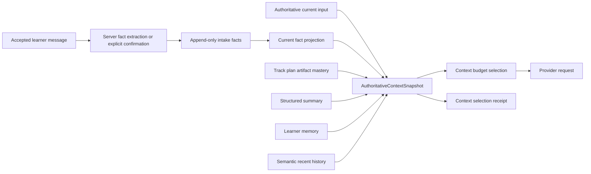

# 技术设计

## 1. 边界

本任务在现有 context input 与 provider request 之间增加“领域事实 authority + 单一 snapshot projector”，不重写 `TutorRunLoop`、provider gateway、summary curator 或 LearningTrack authority。



## 2. 数据模型

推荐新增：

- `tutor_planning_intake_facts`
  - append-only fact rows；
  - exact user/session/conversation scope；
  - `field_key` 使用受控 enum；
  - `value_json` 使用 field-specific server validator；
  - `source_message_id` 和 `source_input_revision`；
  - `state=answered_unconfirmed|confirmed|superseded|withdrawn`；
  - `supersedes_fact_id` 单前驱 lineage；
  - `value_hash`、`policy_version`。
- `tutor_planning_question_states`
  - current projection 或 append-only event + view；
  - stable `question_key` 对应 field；
  - asked/answered/confirmed/reopened 状态与 revision。

不建议直接向 `tutor_learning_plan_sessions` 增加七个可变字段，因为这会丢失 correction lineage，并让 session lifecycle row 同时承担审计日志和 current projection。

## 3. 写入流程

### 3.1 用户输入

1. 输入正常写入 `tutor_messages` 与 input event。
2. server-owned planning intake parser 只产生 typed candidate，不写 confirmed fact。
3. 明确值且 contract 允许自动确认时，在同一用户作用域事务写 candidate + confirmed row；需要澄清时写 `answered_unconfirmed`。
4. 模型只可请求稳定 `question_key` 或提出 candidate；最终 normalization/confirmation 由服务端完成。
5. correction 创建新 row，并将旧 current row supersede。

### 3.2 Draft 生成

- `learning.plan.draft` 输入从 current confirmed facts 构建，不再要求模型从历史重新抽取全部 profile。
- draft profile 与 fact snapshot 绑定 hash/version；确认 draft 时检查 facts 未 stale。
- draft 仍保存完整版本化 profile，intake facts 不替代 draft authority。

## 4. Snapshot contract

建议新增不可变 contract：

```text
AuthoritativeContextSnapshot
- run_id / conversation_id / input_revision
- task_kind / scope
- current_input
- required_facts[]
- domain_state[]
- unresolved_questions[]
- structured_summary?
- learner_memory[]
- recent_messages[]
- capability_schemas[]
- source_receipt
```

`required_facts[]` 每项只包含 learner-safe normalized value、field key、fact revision 和 bounded provenance reference。provider 不需要数据库 ID 细节，但 receipt 必须能反向审计。

## 5. 选择顺序

建议顺序：

1. system/policy/selected Skill；
2. authoritative current input；
3. task/scope；
4. required confirmed facts；
5. current domain artifact/mastery；
6. unresolved question state；
7. pinned correction/semantic history；
8. structured summary；
9. learner memory/activity；
10. ordinary recent history；
11. capability schemas。

实际 provider envelope 可按协议重新排列，但冲突优先级和必选集合必须保持。

## 6. 压缩屏障

在 `_build_compaction_input` 之前计算每个 retirement candidate 是否已经被以下任一对象覆盖：

- confirmed fact with matching source/semantic key；
- current structured summary coverage；
- authoritative domain state；
- explicit non-durable classification。

存在 uncovered critical candidate 时：

- 不退休该消息及其后的连续 prefix；或
- 同步生成确定性 bounded fallback fact projection；
- 不调用自由模型生成临时事实。

异步 curator 继续负责高质量 summary，但不是事实安全的唯一屏障。

## 7. 兼容与迁移

- additive schema；旧 session 无 facts 时保持原行为，但首次新输入必须开始建立 fact authority。
- 不从历史文本批量推断 confirmed facts；可提供用户可见“请确认已检测信息”流程。
- current context metadata 增量扩展，旧 receipt reader 忽略新字段。
- feature flag 可控制 snapshot projector，但双写期间必须比较 old/new selection receipt，不允许双重 provider request。

## 8. 失败与回滚

- fact validation 失败：保留消息，question state 进入 clarification，不写 confirmed fact。
- snapshot required fact 缺失：返回 typed internal error 或受控澄清，不静默继续生成计划。
- schema rollback：关闭新 projector，保留 append-only rows，不删除证据。
- 不允许 summary conflict 覆盖 current fact；记录 conflict telemetry 并继续使用 fact authority。

## 9. 关键测试

- 30 小时后追加至少六条消息，summary 为空，事实仍被选中。
- 30 小时更正为 10 小时，新 row supersede，旧值不进入 provider。
- 同 request/replay 只生成一条 fact receipt。
- cross-user/session source message 不能被引用。
- stale draft facts hash 阻止确认。
- resume 与实时请求 snapshot hash 相同。
- uncovered critical source 阻止 compaction retirement。
