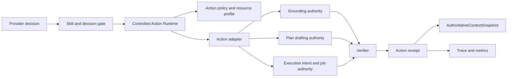
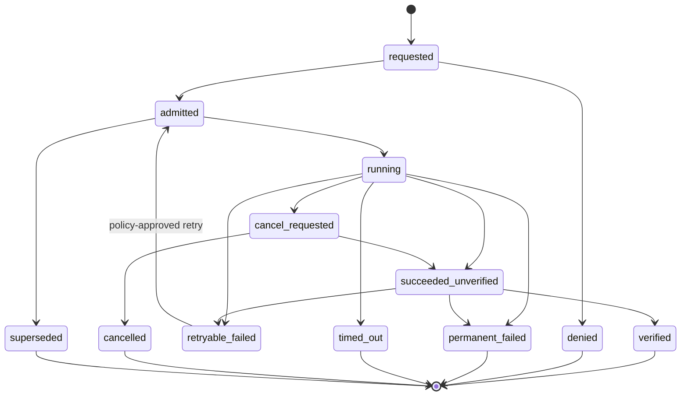

# 技术设计

## 1. 架构位置



Runtime 拥有 orchestration 状态，不拥有 LearningTrack、plan draft、exercise result 等领域事实。

## 2. Contract

### ActionDescriptor

- exact `action_id@semver`
- Pydantic input/output/public projection schema
- owner adapter id/version
- allowed origins/task kinds/Skill references
- side-effect class：`read_only|proposal|transactional|external_execution`
- resource profile
- timeout/cancellation behavior
- retry policy
- verifier id/version
- recovery policy

### ActionInvocation

- invocation id、idempotency key
- run/conversation/user/input revision
- selected Skill evidence、catalog digest、policy fingerprint
- descriptor version
- validated arguments 或 opaque server proof reference
- requested resources
- parent/retry invocation lineage

### ActionReceipt

- lifecycle status
- execution authority reference
- safe result hash/summary
- verification status/reference
- retry/recovery lineage
- usage/timing safe metrics
- created/terminal timestamps

## 3. 状态机



终态 receipt append-only；retry 创建新 attempt/invocation lineage，不回滚旧事实。

## 4. Persistence

推荐：

- `tutor_action_invocations`
- `tutor_action_attempts`
- `tutor_action_verifications`
- `tutor_action_receipts` 或 current terminal projection

但必须通过 authority reference 指向现有：

- capability invocation；
- plan draft；
- execution intent/job/result；
- effect receipt。

不要在 action 表复制完整结果或私有 payload。可以保存 safe hash、opaque handle 和状态。

## 5. Adapter 接口

```text
admit(context, descriptor, request) -> Admission
execute(admitted, cancellation) -> ExecutionReference
verify(execution_reference, resource_scope) -> VerificationResult
project(receipt) -> SafeActionContextItem
recover(failure, budget) -> RecoveryDirective
```

adapter 只能访问 descriptor 授予的 resource scope。`runner.execute` adapter 创建/关联 existing durable job，不在 API 事务中直接启动进程。

## 6. 并发与取消

- 默认同一 run 的 side-effect action 串行；read-only action 是否并行由 descriptor 声明。
- action generation + input revision + lease 形成 stale fence。
- cancel request 先持久化，再由 adapter 尝试停止；无法立即停止时后续 result 仍需 stale/cancel gate。
- terminal ownership 使用 CAS，避免 timeout、cancel 和正常完成重复终态。

## 7. Retry 与 recovery

错误分类：

- retryable infrastructure
- retryable stale-read/rebuild
- user-correctable input
- policy denied
- permanent contract failure
- superseded/cancelled

retry policy 包含次数、backoff、是否需要重新构建 context/resource proof。recovery directive 是服务器决定的 bounded enum，不是自由模型命令。

## 8. Context integration

通过 `AuthoritativeContextSnapshot` 注入最近且相关的 verified/failed action：

- action reference
- status
- safe outcome summary
- artifact handle
- verification result
- recovery hint

已 verified 且仍 current 的 invocation 可阻止 provider 生成语义相同的重复 action；具体 dedupe 由 stable action key + normalized arguments/resource fingerprint 决定。

## 9. 迁移策略

1. 先以 shadow receipt 包装现有 grounding、plan draft、runner 路径，不改变业务 authority。
2. 比较原 receipt 与 action receipt 的状态/hash/usage。
3. 一致后切换 provider context 到统一 action projection。
4. 原有专用 receipt 保留作为领域证据，Action Runtime 引用而非删除。
5. feature flag 可关闭统一 orchestration，但保留新 receipt 用于诊断。

## 10. 安全与失败

- arguments 进入 adapter 前完成 schema/policy/resource validation。
- raw exception 只进入内部安全日志；public context 使用 stable code。
- verifier 与 executor 分离，避免执行方自行声明 verified。
- MCP/外部 connector adapter 暂不实现，但 contract 必须要求 allowlist、auth ownership 和数据分类。

## 11. 测试重点

- terminal CAS race：complete vs timeout vs cancel。
- retry 不重复副作用。
- stale revision 在 adapter 前和 adapter 后均被 fence。
- verified action metadata replay 稳定。
- resource escalation 参数被拒绝。
- private runner/rubric/command data不进入 safe projection。
- shadow migration receipt 与现有 authority 一致。
