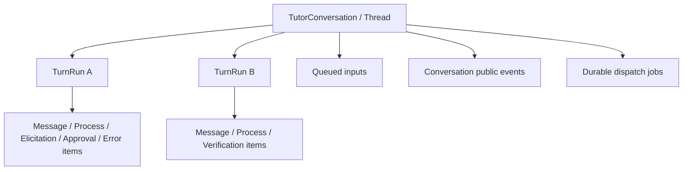
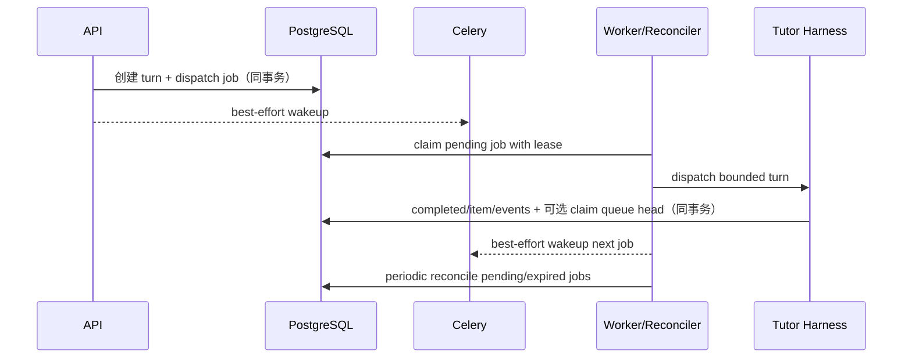

# 复刻 Codex 对话运行体验：总体技术设计

## 设计地位与权威顺序

本设计是父任务的跨子任务契约。事实权威顺序为：当前代码/schema/tests → `docs/README.md` 所列 source of truth → 本任务 research → 本设计。Codex revision `ef596c68ca35dcd42283a0014f9b7fb057147269` 只提供交互语义参考，不是 Aearn 的运行时依赖。

实施采用 inline 模式；父任务保持 coordination-only，依次启动六个子任务。任何子任务发现会改变本设计的产品行为时，返回规划阶段，而不是自行改变 Queue 默认、fresh budget 或受控 authority 边界。

## 核心模型



### Conversation

新增 conversation control 字段：

- `next_public_event_sequence bigint`：统一 stream 的下一 sequence；只在 conversation 行锁下分配。
- `control_version bigint`：Queue、active turn、blocking item 等 mutation 的乐观并发版本。
- 现有 conversation/title/last public activity 继续使用；不在 conversation 行存自由文本运行状态。

Conversation snapshot 的公开控制状态由 repository 投影：

```text
idle | running | waiting_for_input | waiting_for_approval | waiting_for_authority | queue_paused | failed_recoverable
```

它不是新的 run status，而是 active turn、pending blocking item、dispatch job 与终态的派生值。

### TurnRun

- `TutorRun` 继续作为受控 Harness 执行 authority；外部称 turn。
- 新增 `interaction_protocol_version`，历史 rows 回填 `legacy_v1`，新 turn 使用 `thread_turn_v2`。
- 新增 `retry_of_turn_id`、`retry_root_turn_id` 等重试谱系字段；`response_to_request_id` 在类型化请求表存在后以具体外键添加，对外可投影为 `in_reply_to_item_id`，不使用无法约束的多态外键。
- 新协议公开状态映射为 `in_progress | completed | interrupted | failed`。内部 `queued/leased/running/...` 保留，但不直接暴露。
- 新协议不把 model decision 的等待状态持久化为可继续消耗旧预算的 `waiting_for_input`；它持久化 typed blocking item 并结束来源 turn。

### 公开条目

不再新建一个复制全部 payload 的“万能 JSON item 表”。`TutorPublicItem` 是 API union，由权威记录投影：

- `message`：现有 `tutor_messages` + `tutor_run_input_events`/process link；
- `process`：现有 `tutor_run_public_processes` 与 steps，扩展受控 stage/state；
- `elicitation` / `approval`：新 typed request 表；
- `error`：turn terminal/public diagnostic 的安全投影。

每个 item 都有稳定 `item_id`、`turn_id`、state 与时间；客户端不得从 SSE 文本生成持久 item。

## 数据库增量

### 1. `tutor_conversation_events`

append-only 公开事件信封：

- `id`, `conversation_id`, `user_id`, `event_sequence`, `event_key`；
- `turn_id NULL`, `item_id NULL`, `item_kind NULL`；
- `kind` 为闭合 enum，如 `turn_started`, `item_started`, `item_updated`, `item_completed`, `turn_completed`, `queue_changed`, `control_state_changed`；
- `payload_json` 仅允许 learner-safe typed payload，配 `payload_hash` 与 `projection_version`；
- `UNIQUE(conversation_id, event_sequence)`、`UNIQUE(conversation_id, event_key)`。

sequence 分配、authority mutation 与 event append 在同一 transaction 中完成。SSE 只读此表，不调用 provider，不读取 raw `tutor_run_events`。

### 2. `tutor_interactive_dispatch_jobs`

- 一 run 一 job：`UNIQUE(run_id)`；
- state：`pending | leased | completed | retry_wait | dead`；
- `available_at`, lease owner/generation/expiry, `attempt_count`, bounded `last_error_code`；
- user/conversation/run 复合外键与 updated trigger；
- worker 用 `FOR UPDATE SKIP LOCKED` + lease generation claim。

创建 turn 与 dispatch job 同事务。Celery message 只携带 job/run ID 作为 wakeup；job row才是 authority。

### 3. `tutor_queued_inputs`

- `id`, user/conversation scope, `position`, `state=pending|claimed|cancelled`；
- bounded content、body hash、idempotency key、context references/planning facts 的安全 typed envelope；
- `claimed_turn_id NULL`, created/updated/cancelled/claimed times；
- pending 每 conversation 最多 10 条，由 repository transaction 强制；
- Queue 重排在 conversation 行锁下重写连续 position，并递增 `control_version`。

Queue item 被 claim 时，同一 transaction 创建 learner message、fresh turn、run input event、process、dispatch job，随后将 queue item 标记 `claimed`；任何失败整体回滚。

### 4. `tutor_interaction_requests`

- kind：`clarification | planning_input | approval | capability_result | external_result`；
- actor：`learner | authority`；
- state：`pending | answered | denied | cancelled | expired`；
- `source_turn_id`, safe question/action descriptor, schema/version, `version`, response/receipt hash；
- `answer_turn_id NULL` 与 exact scope/identity 约束。

`planning_input` 使用闭合 `question_key` 和服务端 schema；approval 只保存安全 action summary/authority key，不保存 prompt/provider 内容。capability/external receipt 必须记录 issuer、subject、hash 与 verification result。

### 5. lineage 与兼容字段

在 `tutor_runs` 添加 protocol/lineage；必要时在 process 表扩展 display state/stage。所有迁移 additive、可重复；历史 row 不 backfill conversation events，旧 history 继续由 snapshot union 投影。

## 变更操作契约

### 普通 Send

```text
idle + send
  -> create learner message + fresh turn + dispatch job
running + send
  -> create queued input (default)
blocking request + send
  -> targeted response mode；普通后续问题需显式 Queue
```

建议新增/版本化 API：

- `POST /api/tutor/conversations/{conversation_id}/turns`：idle 时创建 fresh turn；running 时若 `delivery_mode=queue` 则排队。新 Desktop 显式发送 `delivery_mode`，默认值仍为 `queue`。
- `POST /api/tutor/conversations/{conversation_id}/turns/{turn_id}/steer`。
- `POST /api/tutor/conversations/{conversation_id}/turns/{turn_id}/interrupt`：终结当前 turn 并将 Queue 置为 `queue_paused`。
- `POST /api/tutor/conversations/{conversation_id}/queue/resume`：显式解除暂停并原子 claim 队首；无 pending item 时幂等返回 idle。
- `POST /api/tutor/conversations/{conversation_id}/turns/{turn_id}/retry`。
- Queue CRUD/reorder/execute endpoints。
- `POST /api/tutor/conversations/{conversation_id}/requests/{item_id}/responses`。
- internal authority receipt endpoint/service，不暴露为 learner mutation。

所有 mutation 均要求 `client_action_id`/`Idempotency-Key`，控制类 mutation 还要求 `expected_control_version`；turn mutation 要求 expected turn/revision，request response 要求 expected item version。

### Steer

Steer 复用现有同 run input revision merge，但仅在 `thread_turn_v2` active turn 上开放：

1. 锁 conversation 与 active turn；
2. 验证 expected turn/revision；
3. 插入 learner message + run input event，递增 revision；
4. append conversation item/event；
5. run loop 在 provider return、capability、effect、message 前检查 lease/cancel/revision；旧 revision fail closed。

Steer 共享当前 turn 剩余预算，这是显式操作的可见 trade-off；预算不足时返回可 Retry/Queue 的 learner-safe 终态。

### Blocking request 与 fresh answer turn

来源 turn 产生 typed request 后：

1. transaction 创建 request/item + public events；
2. 来源 turn 以公开 `completed` 状态终结，安全 completion reason 为 `awaiting_user | awaiting_approval | awaiting_authority`，process 显示“等待你的回答/批准”；
3. conversation 无 active turn，但 control state 为 waiting，Queue 不 drain；
4. 精确 response transaction 关闭 request、创建 learner message + fresh answer turn + dispatch job，数据库关联 `response_to_request_id`，公开投影提供 `in_reply_to_item_id`；
5. fresh turn context loader 读取 request question、answer 与来源 turn safe evidence，不读取旧隐藏推理。

approval 的 effect 只能在 answer turn 中重新验证 action authority/idempotency 后提交。capability/external receipt 由服务器走同类 fresh turn，但 actor 不是 learner。

### Interrupt、立即执行与 Retry

- Interrupt 设置 cancellation/interrupt authority，append `turn_completed(interrupted)`；run loop 所有写边界再次检查。若 Queue 非空，同一 control transaction 写入 `queue_paused`，不得自动 claim。
- Queue “立即执行”在一个 control transaction 中验证 active turn、无 blocking request，interrupt 当前 turn，并 claim 指定 Queue item 创建下一 turn；这是显式 bypass pause 的独立 mutation，provider dispatch 在 commit 后由 durable job触发。
- Retry 读取失败 turn 的原始输入 evidence，创建 fresh turn 与 lineage；已提交 action/effect 按 retry-root logical key 命中旧 authority receipt，禁止重复执行。

## 持久化调度与自动出队



- 扩展 `aearn_worker.worker_app` 注册 `tutor.interactive.dispatch` 和 `tutor.interactive.reconcile`，单独 queue，优先级高于 proactive/curation。
- 配置 Celery beat 周期 reconciliation，并更新本地 `start-dev.ps1`/运行文档，使 dev worker 与 beat 都被管理。
- API 的 `BackgroundTasks` 可暂留作低延迟兼容 nudge，但不能是唯一 dispatch 路径；新路径优先发送 Celery wakeup，失败不回滚已接受输入。
- reconciler 处理 pending、lease expired 与正常 `completed` 后可 drain 的 Queue；`queue_paused`、`interrupted`、`failed` 均不得被后台扫描隐式恢复，不扫描或读取 learner raw content 到日志。

## 公开事件流与快照

- `GET /api/tutor/conversations/{id}/snapshot` 返回 conversation summary、active turn、control state、pending request、Queue、timeline page 与 `stream_cursor`。
- `GET /api/tutor/conversations/{id}/events?after=<opaque>` 返回 SSE；cursor 编码 conversation scope、projection version 与 sequence。
- 先 snapshot 后 subscribe；重连时从 last acknowledged cursor 继续。event duplicate 通过 `(conversation_id,event_sequence)` 和 stable item ID 去重。
- 事件 delta 不保证包含完整历史 payload；客户端遇到 cursor too old/version mismatch 时重新 snapshot，不自行猜测。

## 安全与可观测性

- public event payload 只允许 enum、稳定 ID、bounded learner-safe text、时间和 recoverability；repository serializer 双重 allowlist。
- raw harness event、provider request/response、prompt、CoT、trace、capability args、hidden test/rubric 均不进入 public event 表。
- structured logs 只记录 IDs、state、duration、diagnostic code；Queue content/request answer 不写日志。
- trace 增加 dispatch job、queue item、request item、retry lineage 关联，保留 user/conversation scope。

## 兼容与迁移

1. schema 先 additive 部署，旧 rows 标记 `legacy_v1`；不删除任何历史数据。
2. Child 1 提供新 snapshot/event/dispatch 底座，同时保留旧 history、run detail 与 run-local SSE 的只读投影。
3. Child 2 让新 turn 使用 `thread_turn_v2`，停止创建新 `waiting_for_input` run；cutover migration 在固定锁顺序下枚举 `legacy_v1 + waiting_for_input + non-terminal` rows，逐 conversation 幂等写入 `status='failed'`、`terminal_outcome='failed'`、`terminal_diagnostic_code='legacy_continuation_requires_new_turn'`、`terminal_at` 并清理 active lease。保留 `continuation_kind` 和历史记录用于审计，不自动创建 request/response/receipt。
4. 同一 cutover gate 让旧 `POST /runs/{run_id}/inputs` 对所有 run 统一返回 HTTP `410 Gone` 与 `TUTOR_LEGACY_CONTINUATION_DISABLED`，handler 不调用 service、不调度 background task，也不产生数据库写入。若 conversation event 底座已启用，为被终结 row 幂等追加 learner-safe terminal/error 事件；snapshot 必须能投影 `TUTOR_LEGACY_CONTINUATION_REQUIRES_NEW_TURN`。
5. Child 3 切换 Desktop 到新 contract并删除/隔离旧 continuation write caller；旧 history/run-local SSE 只用于 legacy timeline read。迁移错误卡只允许用户在普通 Composer 中开启 fresh v2 turn，不提供“继续旧回答”、approval 或 authority action。
6. v2 使用独立全局有效 gate：`TUTOR_THREAD_TURN_V2_ENABLED` 是环境 kill switch，数据库 cutover singleton 的 `state=enabled` 是跨 API/worker/Desktop 的原子 authority；两者同时满足才开放 v2。现有 `harness_cutovers(user_id, ...)` 继续只负责用户进入 Tutor 的旧产品切换。
7. global-cutover child 使用数据库 singleton/advisory lock 序列化 `idle | preparing | blocked | ready | enabled`。进入 `preparing` 后，legacy create/input/dispatch/lease acquisition 全部 fail closed；读取和已有写屏障仍可运行。
8. preparing inventory 对 `legacy_v1` 非终态分类处理：`waiting_for_input` 写 recoverable `failed` 与专用迁移卡；`queued | leased | running | waiting_for_capability` 立即写 `cancelled` + internal `legacy_protocol_cutover`、清除 lease并冻结公开 process，但对外统一投影普通 `interrupted`；`awaiting_effect_commit` 或 receipt 状态不明确则写 cutover `blocked` 并停止，不修改 effect authority。
9. 仅当不存在可写 legacy run、ambiguous effect 或新 lease，并且 schema/worker/Desktop capability preflight 通过时，singleton 才从 `ready` 进入 `enabled`。不得按 user cohort 或 conversation 首次访问懒迁移。
10. 旧 write route 作为稳定 `410 Gone` tombstone 暂时保留；物理移除 route/SSE 另行规划。rollback 只关闭 v2 并保持只读历史，不得重新启用旧 merge 语义、复活 legacy run 或把 v2 turn 转回 legacy。

## 子任务边界

- Child 1 只建立 Thread/Turn/Item/Event、snapshot/stream 与 durable dispatch 底座，不实现产品控制或 cutover。
- Child 2 只建立 Aearn-owned DSH-derived UI tokens/primitives/icons/NOTICE/test foundation，不读取 Tutor runtime 或 store。
- Child 3 只拥有 typed request、approval、authority receipt、planning catalog 与 fresh response turn，不实现 Queue 或最终 UI。
- Child 4 只消费 Child 1/3 contract，实现 Queue/Steer/Interrupt/pause/resume/execute/Retry，不拥有 request authority 或 global cutover。
- Child 5 只消费三个后端 contract，实现 global gate、legacy retirement、effect block 与 preflight，不实现日常 Queue 语义或最终 UI。
- Child 6 消费前五个冻结 contract，实现 Desktop、迁移展示、集成 QA 与文档；不重新定义后端或 cutover 语义。
