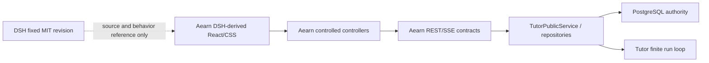
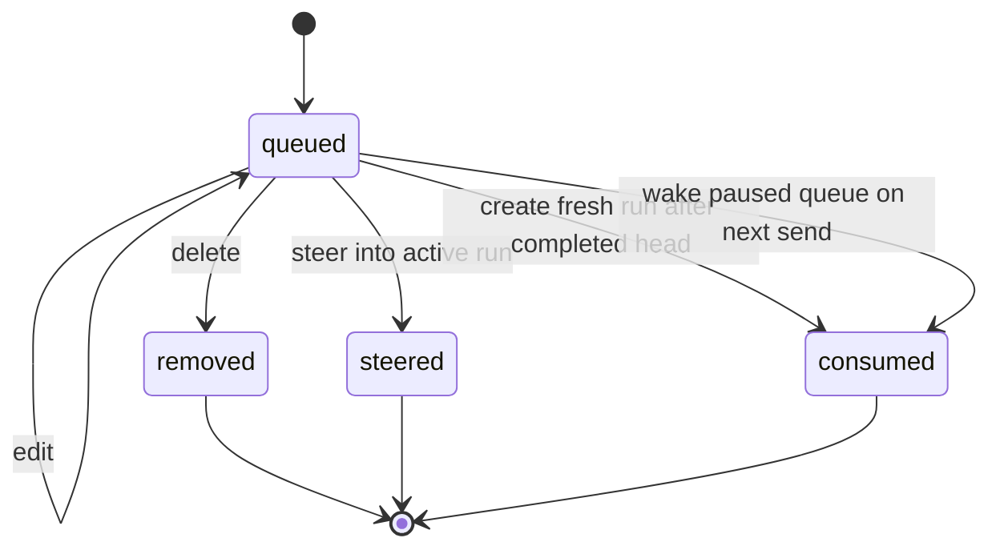

# 技术设计

## 1. 设计原则与边界

本方案复用 DSH 的选定 UI 源码和 CSS，而不是接入 DSH 应用运行时。边界如下：



- DSH-derived 层只拥有视觉、局部交互和 accessibility 行为。
- Aearn controller 层拥有 UI state、请求 busy/error、焦点和选中项。
- API/service/database 拥有 Queue、pending input、run cancellation、幂等、scope 和版本。
- Tutor loop 继续拥有模型、capability、effect、public projection 和安全终止。

## 2. 目标目录

```text
aearn/apps/desktop/
  THIRD_PARTY_NOTICES.md
  src/
    ui/
      dsh-derived/
        UPSTREAM.md
        tokens/
          aearn-light.css
          dsh-compat.css
        primitives/
          Button.tsx
          DisclosureRow.tsx
          Input.tsx
          Pill.tsx
          StateDot.tsx
          Tooltip.tsx
          MessageText.tsx
        icons/
          index.tsx
        feedback/
          AearnToast.tsx
    features/tutor/
      components/
        TutorComposer.tsx
        TutorQueueDock.tsx
        TutorQuestionComposer.tsx
        TutorThinkRow.tsx
        TutorPlanReviewPanel.tsx
      contracts/
        pendingInput.ts
        queue.ts
      TutorConversationSurface.tsx
```

具体拆分可按实现时的现有目录微调，但必须维持 `ui/dsh-derived` 与 Tutor 业务 adapter 的依赖方向。现有 `sonner` 继续作为 toast runtime；只适配 DSH 外观，不创建第二套全局通知 store。

## 3. 来源与主题实现

### 3.1 来源记录

- `THIRD_PARTY_NOTICES.md` 保存 DeepSeek Harness、固定 revision、MIT 版权/许可说明。
- `UPSTREAM.md` 逐文件记录 `Aearn path -> upstream path -> revision -> adaptation note`。
- substantial derived 文件头记录简短 SPDX/来源注释；纯行为重写文件只在 mapping 中记录参考来源。

### 3.2 Token 层

- 公共 semantic tokens 使用 `--aearn-*`，覆盖 canvas、surface、border、label、brand、focus、success、warn、danger、shadow、radius、composer geometry。
- `dsh-compat.css` 只在 `ui/dsh-derived` 内部把必要的 `--dsw-*` 映射到 `--aearn-*`，避免逐组件改写造成 upstream diff 失真。
- `aearn-light.css` 只定义白色浅色主题；不增加主题 store 或设置入口。
- 全局 `styles.css` 只保留 app/page layout 和尚未迁移的旧页面规则；新 Tutor 组件使用 CSS modules。

## 4. Typed Pending Input

### 4.1 持久化模型

新增 `tutor_run_pending_inputs`，每个 run 最多一个未解决 projection：

```text
id uuid PK
run_id uuid UNIQUE FK
user_id + conversation_id composite scope
input_revision integer
continuation_kind clarification | planning_input | approval | capability_result | external_result
question_key text nullable
schema_version tutor_pending_input_v1
presentation_json jsonb
validation_json jsonb
state pending | resolved | superseded | cancelled
created_at / resolved_at
```


### 4.2 Public contract

```ts
type TutorPendingInput = {
  pending_input_id: string;
  schema_version: "tutor_pending_input_v1";
  run_id: string;
  input_revision: number;
  continuation_kind: "clarification" | "planning_input" | "approval" | "capability_result" | "external_result";
  question_key: string | null;
  required: true;
  presentation:
    | { kind: "text"; title: string; detail: string | null; min_length: number; max_length: number }
    | { kind: "single_select"; title: string; detail: string | null; options: TutorQuestionOption[]; allow_custom: boolean }
    | { kind: "multi_select"; title: string; detail: string | null; options: TutorQuestionOption[]; allow_custom: boolean; max_selected: number };
};
```

`TutorForegroundRun`、run read 和 conversation history 的 active run projection 以 additive field 暴露 `pending_input`。Desktop 只按 discriminated union 渲染，不解析模型文案来决定组件。

### 4.3 Question catalog

新增服务端 `planning_questions.py`，以 `PlanningFactField` 为稳定 key：

- `language_id`：由当前发布课程目录生成 single select，可自定义但仍需服务端校验。
- `goal_text`：bounded text。
- `target_level`：受控 level options。
- `weekly_minutes`：受控常用分钟选项 + 数值自定义。
- `experience_level`：`new/beginner/intermediate/advanced`。
- `teaching_preferences`：受控 multi select，最多 4 项，可选 bounded custom。
- `pace_constraints`：bounded text。

run-loop 在持久化 `waiting_for_input` 时由 continuation kind + allowlisted `question_key` 构造 projection。未知 key、已确认 fact 重问或 catalog 构造失败均 fail closed，不把 provider schema 透传给 Desktop。

### 4.4 Answer flow

Typed answer 请求增加：

```json
{
  "pending_input_id": "uuid",
  "expected_input_revision": 2,
  "content": "每周 3 小时",
  "planning_facts": {"weekly_minutes": 180},
  "client_action_id": "..."
}
```

服务端在同一事务中锁定 run + pending input，验证 ownership、pending state、expected revision、question key和值域，再调用现有 planning fact repository、写 learner message/input event、标记 pending input resolved 并恢复 run。stale answer 返回稳定 `409 TUTOR_PENDING_INPUT_STALE`。

## 5. Persistent Queue

### 5.1 持久化模型

新增 `tutor_conversation_queue_items`：

```text
id uuid PK
user_id uuid
conversation_id uuid
queue_sequence bigint
version integer
state queued | consumed | steered | removed
content text (1..16000)
body_hash sha256
learning_scope_json jsonb
context_references_json jsonb
source_client_action_id text
created_at / updated_at / terminal_at
UNIQUE(conversation_id, queue_sequence)
UNIQUE(user_id, conversation_id, source_client_action_id)
```

- conversation row lock 串行化 enqueue、edit/remove、steer 和 dequeue。
- 每个 conversation 最多 20 条 `queued`；达到上限返回 `409 TUTOR_QUEUE_FULL`。
- public list 只返回 `queued`，同时返回 `queue_revision`、item `version` 和 server-computed allowed actions。
- queue item 在消费前不是 `tutor_messages`；消费/Steer 时才原子创建 learner message、input receipt 和 run/input revision，避免 timeline 提前出现未处理消息。

### 5.2 Queue delivery 兼容

扩展现有 conversation input request：

```json
{"delivery_mode": "queue"}
```

- 字段缺省时保持旧客户端 `legacy_replace` 行为。
- 新 Desktop 始终使用 `queue`。
- 无 active run 且 Queue 为空：直接创建 fresh run，返回 `placement="started"`。
- 有 active run：写 Queue，返回 `placement="queued"` 和权威 Queue snapshot。
- 无 active run但存在暂停 Queue：先把新输入追加到队尾，再 claim 最早项创建 fresh run，返回 `placement="queued_and_woke"`。

响应采用 additive discriminated union，旧路径原响应字段不删除。Desktop parser 必须严格验证 placement 对应字段。

### 5.3 Mutation API

```text
GET    /api/tutor/conversations/{conversation_id}/queue?user_id=...
PATCH  /api/tutor/conversations/{conversation_id}/queue/{item_id}
DELETE /api/tutor/conversations/{conversation_id}/queue/{item_id}
POST   /api/tutor/conversations/{conversation_id}/queue/{item_id}/steer
```

mutation body 包含 `user_id`、`expected_version`、`client_action_id`；复用 `TutorPublicService._mutate()` 幂等记录。跨用户统一 404，stale version 返回 409。

### 5.4 消费状态机



- fresh run 只有前一 run `completed` 才自动 drain 下一项。
- 其他终态暂停 Queue；不自动制造连续失败或绕过用户 stop。
- `_dispatch_interactive_run` 完成后调用一个幂等 queue drain coordinator；claim 和 run 创建在同一事务，dispatch 失败可由 lease/retry 恢复，不能丢 item 或重复 message。
- active run 的 Queue mutation/dequeue 追加 allowlisted queue event，run SSE 触发 history/control refresh；无 active run 时 mutation response 直接更新 UI，history reload/reconnect 恢复权威 snapshot。

## 6. Steer

`Steer` 不是客户端取消重启：

1. 锁定 active interactive run、queue item 和 conversation。
2. 只允许 `queued/leased/running/waiting_for_capability` 且 item 为 `queued`。
3. 创建 learner message 和 `tutor_run_input_events`，递增当前 run `input_revision`。
4. 将 item 标记 `steered`，追加 queue/input event。
5. run-loop 在既有 revision/safe-boundary 检查处发现 revision 变化，重建 context；post-provider stale result 继续被现有 fencing 丢弃。

`waiting_for_input` 不允许 Steer，避免绕过 Typed Question；`awaiting_effect_commit` 不允许注入新输入。

## 7. Stop authority

新增：

```text
POST /api/tutor/runs/{run_id}/cancel
```

请求为 `TutorMutationRequest`；service operation 为 `tutor.run.cancel`。行为：

- cross-user 或非 learner interactive run -> 404。
- `queued/leased/running/waiting_for_capability` -> 调用现有 `request_cancellation()`，返回 cancelled run + queue snapshot。
- `waiting_for_input` -> 409，UI 应显示 Typed Question；规划退出使用 planning session cancel。
- `awaiting_effect_commit` -> 409，避免暗示可回滚正在提交的受控 effect。
- terminal run：同幂等键 replay 原结果；新 action 对既有终态返回稳定 conflict，已取消状态可返回当前取消 projection。

取消事务必须立刻追加 terminal event、释放 lease、冻结 `TutorPublicProcess`；现有 conversation/run lock order 和 run-loop checks 负责阻止取消后的 Tutor message/effect/public write。首轮不向 provider transport 注入硬 abort，文档与 UI 不宣称停止计费。

## 8. Desktop 会话状态

`TutorConversationSurface` 逐步缩为 orchestration shell：

```text
history/controller
  -> Tutor message + TutorThinkRow
  -> active run state
  -> TutorQueueDock
  -> one composer seat:
       pending clarification/planning_input -> TutorQuestionComposer
       otherwise -> TutorComposer(send or stop)
  -> right floating TutorPlanReviewPanel
```

- history 继续是 timeline 唯一 source of truth。
- Queue 和 active run 从 history/control response hydrate；mutation 后只采用服务端响应，不做永久 optimistic authority。
- DSH Question Composer 本地 draft 以 `pending_input_id` 为 key；same-id replay 保留草稿，new-id 清空。
- required questions 删除 skip/close 控件；radio/checkbox/custom/pager/IME/validation 保留。
- `Think` 默认采用 DSH ReasoningRow disclosure 行；具体默认展开状态以固定上游组件为准，不为旧 message 合成内容。
- process history item 在 parser/type 中可继续存在用于兼容，但 renderer 直接忽略。
- plan inspector body 渲染 typed plan modules，不使用任意 Markdown parser。

## 9. 原始工作树迁移策略

实施每个重叠子任务前：

1. 在 `E:\codee\Aearn` 读取 `git status` 和目标文件 diff。
2. 记录与本子任务重叠的 exact hunks，重点包括 `contracts.py`、`decision_protocol.py`、skills prompts、`types.ts`、`api.ts`、`TutorConversationSurface.tsx`。
3. 在独立 worktree 手工移植语义，随后逐文件对照；不执行 `git checkout` 覆盖、不应用包含其他 prompt/model-review 工作的整包 patch。
4. 若原始修改在实施期间继续变化，先回到当前 child 的规划/设计核对，不静默选择任一版本。

## 10. 文档与兼容

实施同步更新：

- `docs/product/frontend-interaction-spec.md`
- `docs/product/user-flows.md`
- `docs/architecture/api-contract.md`
- `docs/architecture/database-schema.md`
- `docs/architecture/tutor-harness-runtime.md`
- `docs/qa/acceptance-test-plan.md`

所有变更为 additive migration；旧客户端、旧 history、旧 process projection 和缺少新字段的 fixture 必须继续可解析。

## 11. 验证设计

### Backend

- pure/service tests：question catalog、pending input、queue state transitions、cancel policy。
- PostgreSQL tests：bootstrap twice、FIFO、20-item bound、concurrent enqueue、version/idempotency、cross-user、steer、drain、pause/wake、cancel/write fence、reset/export/cutover inventory。
- API/SSE tests：new endpoints、legacy input behavior、placement union、replay cursor、terminal/queue event。

### Desktop

- 增加 Vitest + Testing Library + jsdom 组件测试基础。
- DSH-derived primitive snapshots/behavior tests。
- Queue/Question/Think/Composer/Plan controlled component tests。
- `tsc + vite build`。
- 实际浏览器 1440/900/390 + reduced-motion + IME/keyboard smoke。

### 安全与非声明

- 静态搜索 DeepSeek brand、Cordis/runtime import、raw reasoning/trace/hidden-test marker。
- 默认不执行真实 provider、生产 executor、Docker conformance 或部署。

## 12. 回滚

- Child 1 可通过移除 `ui/dsh-derived` import 恢复旧样式，旧组件暂不删除直到 Child 4 集成验证完成。
- Child 2/3 使用 additive 表和 API；回滚代码时保留表与数据，不做破坏性 drop。旧客户端兼容路径保持可用。
- Child 4 使用单一 integration commit 切换 renderer；出现视觉或交互回归时恢复旧 Tutor surface，同时保留已验证后端 authority。
- 父任务最终集成前不删除 legacy CSS/renderer；只在搜索和浏览器验证证明无引用后做窄范围清理。
