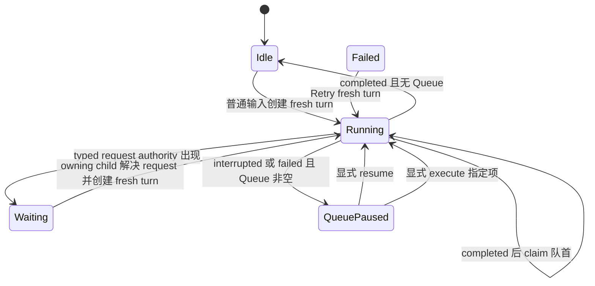

# Tutor 队列、引导、中断与重试控制：技术设计

## 状态机

## Queue authority

`tutor_queued_inputs` 使用 conversation row lock + `control_version`。新增前统计 pending<10；reorder 校验完整 ID 集合并重写连续 position。item state 为 `pending | claimed | cancelled`，claim transaction 原子创建 message/fresh run/input event/process/job/events 并标 claimed。

Claim predicate：无 active foreground turn、无 pending request、Queue 未暂停、存在 pending item、dispatch authority 可用。唯一约束与 CAS 防止重复。

## Steer

专用 service/API 验证 `thread_turn_v2`、active foreground、expected turn/revision、无 pending request。锁 conversation→queue→run，将 queue item 内容写 learner message/input event 并递增 revision，再标 item claimed-for-steer。run loop 在 provider return、decision、capability、effect、terminal message 前重新检查 cancel/lease/revision。

## Interrupt、resume 与 execute

Interrupt 在同一 control transaction 写 cancel authority、public interrupted 终态与 `queue_paused`。provider 无法硬取消时仍由写屏障丢弃迟到结果。

Resume 验证 scope/version/idempotency，解除 pause 并原子 claim 队首；无 pending item 时幂等返回 idle。Execute 验证无 pending request，在同一锁内 interrupt 当前 turn 并 claim 指定 item，形成 fresh turn；effect 提交边界不明确时 fail closed。

## Retry lineage

`retry_root_turn_id` 沿谱系稳定，`retry_of_turn_id` 指直接前驱。logical action authority 由 user/conversation/retry root/action descriptor hash 决定。receipt 已 completed 则复用安全结果；unknown/ambiguous 禁止重试 effect。

## 与 typed request 的边界

本 child 只消费 snapshot 中的 `pending_request` 与 control state，不创建、解决或取消 request。所有 Queue 控制 mutation 在 pending 时拒绝。request owning child 创建 fresh response turn 后，Queue 仍等待该 turn 正常 completed。

## 并发与错误

控制 mutation 统一 conversation lock；固定锁序 conversation→request/queue→run→dependent rows。公开 error 只含 code/message/recoverable/actions 和稳定 ID，不含 Queue 内容、provider body 或 internal diagnostic。

## 回滚

v2 control mutation 可停用并只读保留 Queue/lineage；不得回退成 latest-input-wins 或旧 run continuation merge。全局启停与 legacy retirement 由 cutover child 拥有。