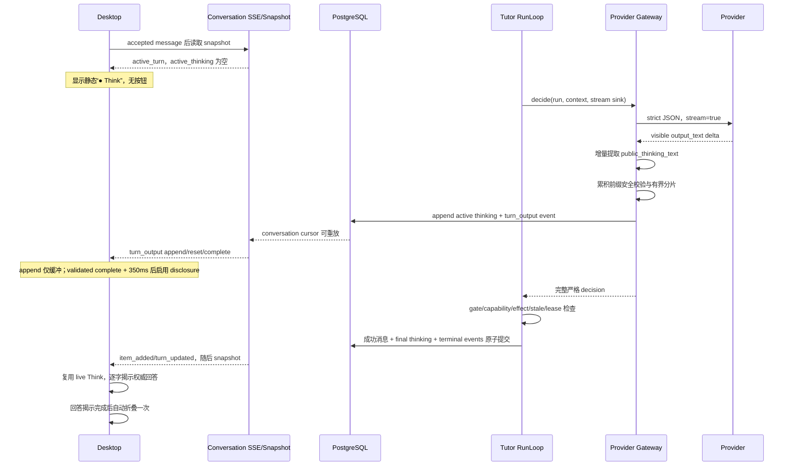

# 技术设计

## 设计目标

在不暴露 provider-native reasoning、不绕过 Tutor decision/effect 权威门的前提下，把模型专门生成的 learner-safe 公开思考文本实时投影到当前 active Turn，并让 Desktop 以逐字效果呈现。最终回答继续以成功持久化消息为权威，前端完成其逐字揭示后自动折叠 `Think`。

## 总体数据流



## Provider 输出契约

### 版本升级

将 Tutor provider contract 从 `tutor_provider_items_v3` 升级为 `tutor_provider_items_v4`：

```json
{
  "schema_version": "tutor_provider_items_v4",
  "message": {
    "type": "agent_message",
    "public_thinking_text": "模型自行排版的公开思考文本",
    "text": "最终回答",
    "conversation_title": null
  },
  "action": { "type": "turn_completed" }
}
```

- `public_thinking_text` 是一个 bounded 非空字符串，最大长度沿用旧四步总预算：`1280` 字符。
- schema 与 canonical examples 将该字段排在 `text` 前，并明确要求先生成公开思考、后生成回答。
- JSON property order 不作为安全权威；增量 projector 只识别 exact path，若 `text` 先到则不公开它。
- `TutorDecision`、`TutorRunResult` 和 persistence seam 统一改为 `public_thinking_text`，不在新业务路径继续传播步骤数组。

### 通用 visible-output observer

`OpenAICompatibleClient.complete_json()` 增加可选的通用 observer，而不是导入 Tutor 类型：

```python
class LLMVisibleOutputObserver(Protocol):
    def on_stream_start(self) -> None: ...
    def on_text_delta(self, delta: str) -> None: ...
    def on_stream_restart(self) -> None: ...
    def on_stream_complete(self) -> None: ...
```

- Responses 只把 `response.output_text.delta` 交给 observer；reasoning item 永远忽略。
- provider transport 在已输出部分文本后重试时，必须先调用 `on_stream_restart()`，不能把第二次响应追加到第一次。
- DeepSeek Chat Completions 路径如果未提供可验证的 structured stream，则保留 atomic final fallback：Desktop 的空 `Think` 保持禁用直到最终消息，不伪造实时思考。当前 Responses 路径是本任务的强制实时完成门。
- observer 异常必须关闭当前 provider stream 并向上抛出；不能被归类为普通模型无效响应后继续写 stale delta。
- `on_stream_complete()` 只表示 transport visible-output EOF，不是用户可见性的权威信号；gateway 只有在完整 JSON parse、schema/domain、安全校验与 final-text 一致性全部通过后，才提交 validated `complete`。

## 增量 JSON 字段提取

新增独立、纯函数可测的 `TutorProviderPublicTextProjector`：

- 只从根对象 exact path `message.public_thinking_text` 解码 JSON string 内容。
- 正确处理任意网络分片、UTF-8、转义引号、反斜杠、`\n`、Unicode escape、surrogate pair 和字段重排。
- 不使用正则从 raw JSON 搜索字段，不把 key 文本或相邻字段误当正文。
- 重复字段、类型错误、越界、非法 escape、对象提前结束或最终值与完整 JSON parse 不一致时 fail closed。
- 每个 provider attempt、transport restart、decision iteration 和 input revision 使用新的 `generation`；旧 generation 的回调被拒绝。

## 分片与安全门

projector 解码的公开思考字符进入 `TutorPublicThinkingChunker`：

1. 按换行、句末标点或最多 160 字符形成候选分片；不按 provider 网络 chunk 直接公开。
2. 每次验证“已公开完整前缀 + 候选分片”的累计文本，调用 `check_teaching_output()`；禁止只检查当前片段，避免敏感 token 跨分片拼接。
3. 被阻止时抛出 `TutorOutputSafetyError`，当前 generation 写 `discard/reset`，gateway 进入既有 repair；不向用户显示阻止原因或替代说明。
4. 最终 string 关闭时 flush 尾部并再次校验完整文本；完整 JSON parse 后要求最终 `public_thinking_text` 与 projector 累积值完全一致。
5. persistence 层再次验证长度、generation、lease、input revision、decision iteration 与当前 foreground ownership。

这里只允许公开模型写入的原始纯文本。安全失败不替换成“存在不可展示信息”等可见辅助文案，因为用户已要求 `Think` 除模型输出外无其他文字。

## PostgreSQL 状态

### `tutor_turn_public_thinking_streams`

新增每个 active run 一行的可恢复状态表：

- identity：`run_id` 主键及 `user_id + conversation_id + run_id` 复合 scope；
- fence：`input_revision`、`decision_iteration`、`generation`、`provider_attempt`；
- state：`active | complete | discarded | accepted`；
- payload：`thinking_text`，最大 1280；
- sequence：`next_chunk_sequence`、`last_public_event_sequence`；
- timestamps：`created_at`、`updated_at`、可选 `completed_at/discarded_at/accepted_at`。

所有 append/reset/complete/discard 使用短 transaction：

1. 锁 run 与 stream row；
2. 校验 active foreground、lease owner/generation/expiry、input revision、未 terminal/cancelled/superseded；
3. 更新 bounded accumulated text；
4. 在同一 transaction 追加 conversation `turn_output` event；
5. 保存 event sequence 回 row。

该表只保存已通过公开安全门的文本，不保存 raw JSON、provider body、reasoning、prompt 或诊断。

### `tutor_messages`

- additive 新增 `public_thinking_text text NOT NULL DEFAULT ''` 与长度 CHECK。
- 保留 `public_thinking_steps_json` 作为 legacy read compatibility，不删除、不回填旧行。
- 新 Tutor message 只写 `public_thinking_text`，步骤数组保持空；CHECK 禁止同一新行同时拥有两种非空表示。
- 读取旧行时将最多四条旧 step 以 `"\n\n"` 稳定连接为只读 `public_thinking_text`；不修改旧数据。

成功 terminal/interaction-request message transaction 必须：

- 比较 accepted generation 的完整 thinking 与最终 decision 完全一致；
- 插入 Tutor message；
- 将 stream row 标记 `accepted`；
- 追加 message item、turn/control 等已有事件；
- 任一步失败整体回滚。

失败、Interrupt、supersede、stale revision、context rebuild 或 repair 必须 discard/reset 当前 generation，不能把旧 preview 关联到新结果。

## Conversation snapshot 与 SSE

### 版本

- snapshot 升级为 `tutor_conversation_snapshot_v2`；
- event projection 升级为 `tutor_conversation_event_v2`；
- opaque stream cursor version 升级，旧 cursor 返回 `CONVERSATION_CURSOR_INVALID` 并要求 fresh snapshot；
- 路由路径保持不变。

### Snapshot 新字段

```json
{
  "active_thinking": {
    "turn_id": "...",
    "input_revision": 1,
    "generation": 2,
    "state": "active",
    "text": "已经通过公开安全门的完整前缀",
    "complete": false,
    "last_event_sequence": 42
  }
}
```

- 仅在 `active_turn` 与 stream row exact scope/revision 匹配时返回。
- discarded/accepted/terminal row 不作为 active output 返回。
- 无文本也可以返回 active identity；`text.length > 0` 或 incomplete snapshot 只形成 provisional buffer，Desktop 展开能力必须同时满足 `complete=true` 与首文本 `350ms` 稳定窗口。

### `turn_output` 事件

新增一个闭合 event kind，payload 为：

```json
{
  "output_version": "tutor_public_thinking_stream_v1",
  "input_revision": 1,
  "generation": 2,
  "operation": "append",
  "chunk_sequence": 3,
  "text": "新的安全文本片段"
}
```

- `operation`：`reset | append | complete | discard`。
- `append` 才允许非空 `text`，每片最多 160 字符；其他 operation 不带正文。
- event identity 必须带 exact `turn_id`，不得带 message/item identity。
- `generation + chunk_sequence` 与 conversation event sequence 同时校验；重复事件幂等，gap 走 snapshot reset。
- `turn_output` 是 Desktop 唯一允许直接消费 payload 的 conversation event；其他 kind 继续只安排节流 snapshot refresh。

## RunLoop 与生命周期接缝

- `TutorProviderGateway.decide()` 增加可选 `TutorPublicThinkingSink`；RunLoop 每次 decision iteration 从 lifecycle 创建与当前 snapshot/lease 绑定的 sink。
- gateway 知道 provider attempt，RunLoop 知道 decision iteration；sink 将两者和 input revision 合并为 generation fence。
- 新 decision iteration、repair、transport restart、input revision 变化或 context rebuild 先 reset/discard 旧 generation。
- provider 返回后现有 `_refresh_before_unsafe_boundary()`、decision gate、capability/effect 与 terminal write 保持权威；stream preview 不授予 action/effect/message 权限。
- lifecycle conflict 必须中止 provider 消费并沿现有 `TutorLifecycleConflict` 收口，不能降级为 `MODEL_UNAVAILABLE`。

## Desktop 状态模型

新增 feature-owned `TutorLiveThinkingState`，不放入 DSH foundation：

```ts
type TutorLiveThinkingState = {
  turnId: string;
  inputRevision: number;
  generation: number;
  receivedText: string;
  displayedText: string;
  complete: boolean;
};
```

### Hydration 与事件

- snapshot replace 时从 `active_turn + active_thinking` hydrate；identity 不匹配则清空。`complete=false` 的文本只恢复到 provisional buffer，不进入 DOM。
- `turn_output reset/discard` 清理 provisional/received/display queue；`append` exact-order 追加但保持离 DOM；validated `complete` 只在首文本 `350ms` 稳定窗口也结束后才解禁 disclosure 与 grapheme queue。
- duplicate/gap/unknown payload 不宽松处理：复用 hook 的 fresh snapshot 边界。
- conversation 切换、Retry、Interrupt 或 request takeover 清理本地 typewriter queue。

### `Think` 渲染状态机

1. **active Turn，无文本：** 渲染静态 heading `StateDot(running) + Think`；不是 button，不含 chevron、正文或其他可见文字。
2. **收到 provisional 文本但未通过完整性门：** 保持静态 heading；文本仅在内存缓冲，即使 `350ms` 已结束也不创建 button、chevron 或正文 DOM。
3. **validated `complete` 与 `350ms` 稳定窗口同时满足：** 切换为 controlled `DisclosureRow`，默认展开；`white-space: pre-wrap` 保留换行，字符队列逐 grapheme 显示，可使用非文本光标伪元素。
4. **成功 message 到达：** 通过 message `turn_id` 将 live Think 与持久化 message 对齐，不渲染两份；保留展开状态，等待 received thinking queue 完成后逐字揭示权威 answer。
5. **回答揭示完成：** 对该 message 自动折叠一次并记录本地 completion key；普通 snapshot refresh 不再次抢占用户手动选择。
6. **历史/刷新后加载的已完成 message：** 直接显示完整回答，`Think` 默认折叠，不重放动画。
7. **失败/中断且无成功 message：** 移除 live Think，由既有 error/interrupted projection 接管。

### 字符队列

- 使用 `Intl.Segmenter(..., {granularity: "grapheme"})`，fallback 为 `Array.from()`，避免拆开 emoji、组合字符和 surrogate pair。
- 每次视觉 tick 只追加一个 grapheme；可根据 backlog 缩短 tick 间隔，但不能一次跳出多字。
- thinking 和 answer 使用独立队列；answer 只有在 final snapshot 后启动。
- 自动折叠等待 answer `displayedText === receivedText`，而不是只看网络/terminal 状态。
- `prefers-reduced-motion: reduce` 下直接同步完整已批准文本，成功 message 到达后立即执行一次自动折叠。

## 可访问性与全局视觉

- 无文本 heading 使用非交互语义；不能通过 Tab 聚焦。
- validated `complete` 与稳定窗口同时满足后才使用原生 button disclosure，保留 `aria-expanded`、`aria-controls` 和 visible focus。
- 逐字正文不直接使用 assertive/polite live region，避免屏幕阅读器逐字重复；使用隐藏的有界段落级 announcement，但不增加任何可见说明文字。
- `Think` 内固定可见元素仅为状态圆点、`Think`、有文本后的 chevron 和模型文本；移除 summary、步骤数、footer、时长和所有 helper copy。
- 文本使用 literal React node，不解析 Markdown/HTML，不执行链接或标签。

## 兼容与迁移

- 不删除 `public_thinking_steps_json` 或旧 history；legacy 行只读转换为一个文本块。
- 旧 `/history` 如需维持旧客户端，可继续把新文本投影为单元素 `public_thinking_steps`；新 snapshot v2/Desktop 只消费 `public_thinking_text`。
- event/cursor version 升级强制旧 Desktop fresh snapshot，避免 v1 hook 把 `turn_output` 当未知协议错误后循环。
- feature gate 未新增；若新 stream persistence 失败，run 必须 fail closed 或保留空禁用 `Think`，不能回退到 raw provider delta。

## 风险与缓解

1. **partial JSON parser 错误：** 独立纯函数、逐字符状态机和大量 chunk/escape/fuzz fixture；不使用正则。
2. **repair/transport retry 混流：** generation reset + DB fence + event sequence 三层隔离。
3. **provider 调用期间写库：** autocommit connection 下只做短事务，不持有 conversation/run lock跨网络读取。
4. **事件量：** 后端按句段或 160 字上限聚合，前端再逐 grapheme；不写逐字 DB event。
5. **最终消息重复/闪烁：** 通过 `turn_id` reconciliation 将 live node 升级为 persisted node，并在组件测试和真实浏览器中验证 DOM 唯一性。
6. **现有 dirty worktree：** 实施前记录 scoped diff，逐文件融合当前 placeholder/height/spec修改，禁止 destructive Git。

## 回滚

- 回滚 Desktop 可停止消费 `turn_output`，恢复 snapshot-only 完成后 `Think`；数据库 additive 表/列保留不会破坏旧读取。
- 回滚 provider projector 时关闭 stream sink，最终 v4 message仍可完整解析和持久化；若需要完整协议回滚，保留 v3 legacy parser仅用于历史测试，不做运行时跨协议 fallback。
- 不删除已写入的 learner-safe stream event；cursor version/reader可忽略旧 projection，历史 message仍以 canonical表为准。
