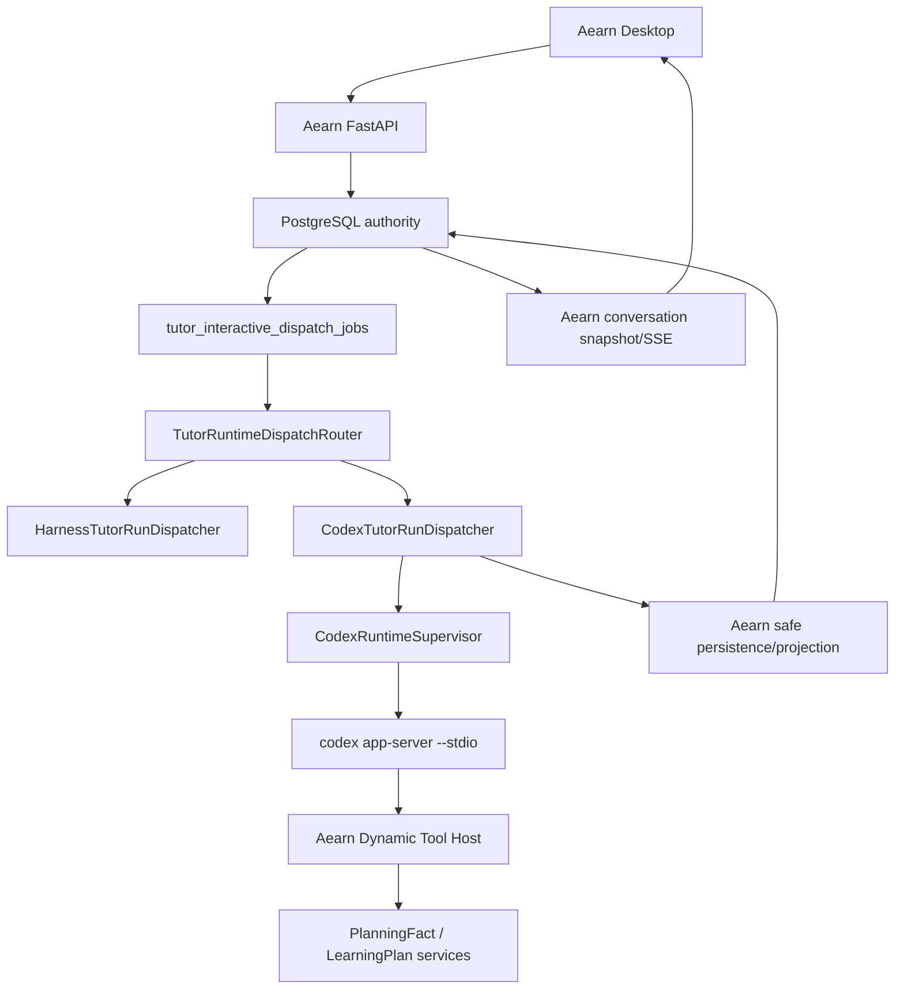

# 技术设计

## 设计目标

建立一个可替换、可回滚、服务端权威的 Codex Runtime Sidecar，使 Aearn 能复用 Codex 的 thread/turn/tool/recovery loop，同时保留现有学习领域和公开产品契约。

## 总体架构



## Authority 分层

| 层 | 权威内容 |
| --- | --- |
| Aearn API/DB | user、conversation、run、input revision、Queue、lease、runtime kind、public items、LearningPlan/LearningTrack |
| Codex App Server | 外部 thread/turn/item 执行状态、模型采样、工具循环和内部 history |
| Aearn Tool Host | domain input validation、事实读取、Capability policy、append-only mutation 与 safe result |
| Desktop | 只渲染 Aearn public projection，不决定 Runtime、tool result 或业务状态 |

Codex thread id 永远不是 public conversation id；Codex turn id 永远不是 Aearn run id。

## Runtime 选择

新增闭合枚举：

```text
harness_v1
codex_sidecar_v1
```

创建 `TutorRun` 时由 server-side scope/cutover policy 冻结 `runtime_kind`：

- 新建 `plan_drafting` 且 feature/cutover verified -> `codex_sidecar_v1`；
- 其他情况 -> `harness_v1`。

客户端不能提交 runtime kind；模型不能改变 runtime kind；Retry 继承 retry root 的 runtime kind。

## Dispatcher 替换边界

新增：

```python
class AgentRuntimePort(Protocol):
    def start_or_resume(...): ...
    def run_turn(...): ...
    def steer(...): ...
    def interrupt(...): ...
    def shutdown(...): ...

class TutorRuntimeDispatchRouter:
    def dispatch(run_id, user_id): ...
```

`TutorInteractiveWorker` 继续 claim durable job，再由 router 选择现有 Harness dispatcher 或 Codex dispatcher。Codex 路径不实例化 `TutorRunLoop`，避免双重 iteration/model/tool budget 和相互冲突的 stop condition。

## Windows 进程模型

目标 MVP 使用独立 Celery worker：

```text
queue=tutor-codex
pool=solo
concurrency=1
```

worker 内 `CodexRuntimeSupervisor`：

1. 在专用 background event loop 中启动 `codex app-server --stdio --strict-config`；
2. 完成 `initialize`、`account/read` 和 protocol capability preflight；
3. 维护 JSON-RPC request id、server request、notification 和 thread subscription；
4. 同一 worker 串行 claim Codex run，保留一个 app-server process；
5. active turn 中周期刷新 Aearn revision/control，必要时发送 `turn/steer` 或 `turn/interrupt`；
6. child crash 时标记当前 run failed/unavailable，清除 connection generation；只有没有未知副作用时才重启并处理新 run。

不使用 experimental WebSocket，也不依赖 Windows 不支持的 daemon lifecycle。

## Codex Home 与认证

- 使用独立 Aearn Codex Home，位置由配置提供，必须在 Git 外。
- 启动时只读取 `account/read` 的安全状态；auth token/API key 不写入 Aearn DB 或日志。
- 登录由本地 operator preflight 完成，可通过 app-server account API 或 `codex login` 指向该 Home。
- 禁止自动复制全局 `auth.json`、config、memory、sessions 或 plugins。
- provider/model compatibility 是 Child 1 Go/No-Go 门；目标固定为 `deepseek-v4-flash` + Responses，不支持时停止路线一，不用 OpenAI模型、其他 DeepSeek模型或 Chat Completions伪造 fallback。
- isolated Codex Home 使用 custom provider：`model_provider = "aearn_deepseek"`、`wire_api = "responses"`、`requires_openai_auth = false`，API key仅来自环境变量。

## Tool Registry

Aearn 定义自己的工具描述，不让 Codex introspect DB：

```python
class AgentToolRegistryPort(Protocol):
    def definitions(run_context) -> tuple[AgentToolDefinition, ...]: ...
    def invoke(tool_call, run_context) -> AgentToolResult: ...
```

首批工具：

### `aearn_planning_context_read`

输入仅含 server-issued session/run fence；实际 user/session 作用域来自宿主上下文，不信任模型提供 user id。

输出：confirmed facts、missing facts、current draft summary、facts revision/fingerprint 和 allowed language capability summary。

### `aearn_learning_plan_draft`

输入：2-8 个结构化 module，每个包含 typed nodes。服务端：

1. 锁 active plan session；
2. 从 planning facts 构造 profile；
3. stable-key、prerequisite、capability、source 和 quality 校验；
4. append draft；
5. 返回 draft id/version/hash。

模型不提供 profile、source、runtime target、user id、session authority 或 confirm action。

## Tool Result 分类

```text
completed            -> 继续模型并最终回答
repairable_invalid   -> 返回 safe issues，允许有界修复
awaiting_user        -> 模型生成 Aearn typed planning request
conflict             -> reload context，最多一次 rebuild
policy_blocked       -> 终止，不允许模型绕过
unavailable          -> 明确 unavailable，可按 job policy retry
fatal                -> failed turn
```

Repairable error 使用正常 structured tool result，不使用 transport exception；内容只包含安全 code/path，不包含 raw value 或内部异常。

Aearn Runtime policy仍限制：最大 model turns、tool calls、repair count、wall clock、output、cancel/revision fence。达到上限后由宿主 interrupt Codex turn并写明确 terminal outcome。

## 持久化模型

### `tutor_runs.runtime_kind`

Additive、非空、默认 `harness_v1`，只允许闭合枚举。

### `tutor_run_runtime_bindings`

建议字段：

- `run_id` 主键及 user/conversation scope；
- `runtime_kind`、`runtime_version`、`protocol_version`；
- `external_thread_id`、`external_turn_id`；
- `connection_generation`、`state`；
- `created_at`、`updated_at`、terminal timestamp。

### `tutor_runtime_item_receipts`

只保存：external item id、allowlisted item kind、status、tool name、input/result hash、安全 diagnostic、sequence/timestamp。禁止 raw argument/result/reasoning。

Aearn domain tool继续使用现有 capability/action receipts和 LearningPlan tables。

## Event 映射

| Codex event/item | Aearn 行为 |
| --- | --- |
| `turn/started` | public turn/process 进入 in_progress/thinking |
| tool call started | process step current；写 safe receipt |
| tool call completed | process step completed；domain receipt由 tool handler写 |
| `agentMessage` final | 完整 safety + lease/revision 后写 Tutor message |
| `turn/completed: completed` | terminal completed，接受 final message |
| `turn/completed: interrupted` | public interrupted，不写猜测式 final message |
| `turn/completed: failed` | public failed/error item，保留安全诊断 |
| reasoning/raw/command/path | 不进入 public projection |

`agentMessage` commentary delta 只有在 phase allowlist、累计 teaching safety、generation fence 与 stale cleanup都满足时才映射现有 public thinking stream；否则 Codex path保持静态 Think。该能力不阻塞基础 cutover，且不得回归 Harness path。

## Steer、Interrupt 与 Tool fence

- Aearn API继续写 Queue/control/input revision。
- Codex dispatcher在 event loop中检查最新 control state；新 revision发送 `turn/steer`，cancel/supersede发送 `turn/interrupt`。
- tool handler执行前、domain mutation前和 final persist前，均刷新：run active、lease owner/generation、input revision、runtime binding generation、未 terminal。
- stale tool result返回 `conflict`/ignored receipt，不能持久化旧 draft。

## 失败与恢复

| 失败 | 行为 |
| --- | --- |
| executable/version/DeepSeek Responses preflight 不通过 | 阻止 Codex admission，现有 Harness不受影响；不跨 provider/model/protocol fallback |
| app-server 启动失败 | dispatch job retry_wait，耗尽后 public unavailable/error |
| JSON-RPC protocol violation | 当前 connection generation fail closed，active run failed |
| repairable tool input | structured result回模型，同 Turn有界修复 |
| policy/safety denied | interrupt/terminal blocked，不能改写为 repair |
| worker/app-server crash | DB lease回收；未知副作用时不自动 resume mutation |
| disconnect after successful domain commit | action idempotency/replay返回原 result，不重复 append |
| Codex final message invalid/unsafe | 不公开，failed/error item；domain commit不会被撤销 |

## Cutover 与回滚

1. feature off：所有 run `harness_v1`。
2. spike/adapter ready：测试 scope only。
3. verified cutover：仅新 plan-drafting run 选 `codex_sidecar_v1`。
4. rollback：关闭新 admission；active Codex turn完成或 interrupt；已持久化 evidence不删除。
5. 不在同一个 run 中切换 Runtime，不隐式双写。

## 关键取舍

- 选择 App Server 而非 SDK：Python worker需要完整 tool callback和控制事件。
- 选择 `deepseek-v4-flash` Responses作为首个 mandatory provider/model：与Aearn当前精确模型路由一致，并避免把Sidecar建立在已弃用的Chat Completions路径上。
- 选择 stdio而非 WebSocket：当前官方支持边界更稳定，且适合本地 Sidecar。
- 选择 Dispatcher replacement而非 Provider replacement：避免双重 Agent loop。
- 选择 dynamic tools起步：最短路径复用 Python domain；用版本固定和 registry port控制实验性风险。
- 选择 plan-drafting first：范围可控且能直接验证两个已观察故障；不一次切换所有 Tutor。
