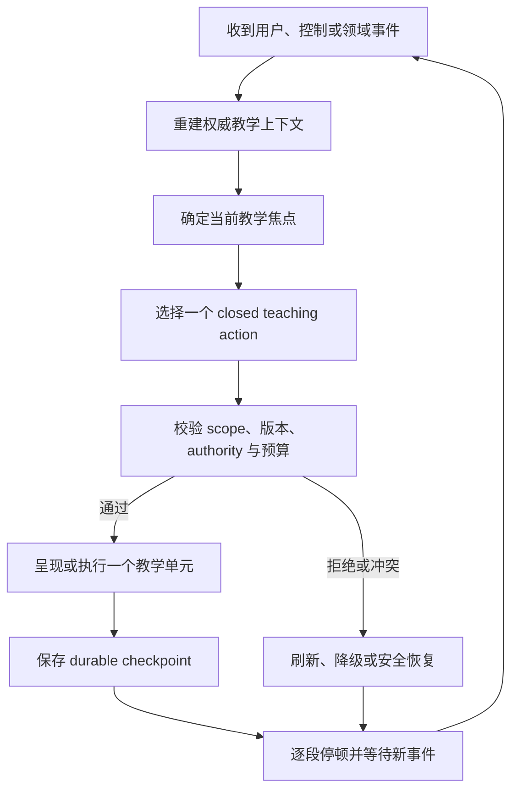

# “单步主动、逐段停顿”产品机制研究

**记录日期：** 2026-08-22  
**状态：** 已确认产品方向，用于后续 `design.md` 与 child 拆分；不代表实现已获批准。

## 1. 决策定义

“单步主动、逐段停顿”表示 Harness 拥有教学方向、材料选择和下一推荐动作，但不拥有连续推进权。进入可学习知识点后，Harness 主动完成一个教学目的完整、范围有限的教学单元，写入可恢复 checkpoint 后停止。下一次模型 Turn 必须由用户输入、typed control、Gate/Review terminal result、authority refresh 或显式恢复事件触发。

这不是“每句话停一次”，也不是“每段都考试”，而是主动发起但不夺走用户节奏。

## 2. 要解决的产品矛盾

- Harness 不主动：产品退化成 LessonDocument 阅读器加右侧聊天框。
- Harness 连续自动推进：用户难以插问、控制成本或改变路线，模型容易预先生成已被后续输入推翻的内容。
- 固定阶段流水线：虽然可测试，却会让真实疑问、纠正、跳过和前置知识缺口成为流程异常。

解决方案是让状态机约束合法动作、authority、恢复和终止，让模型在 closed teaching action 中选择当前最合适的一步。

## 3. 教学单元的边界

一个教学单元只承担一个主要目的，例如：

- 定位当前目标；
- 解释一个概念；
- 回答一个疑问；
- 换一个例子；
- 比较两个概念；
- 发起一次理解检查；
- 建议进入 Gate；
- 解释练习反馈；
- 补救一个前置知识缺口；
- 总结当前进展；
- 建议暂停。

一个单元可以包含一段解释、一个示例和必要的 Lesson 引用，但不能一次输出整节课程，也不能提前生成依赖用户尚未给出反应的后续教学内容。30～90 秒阅读或交互量可以作为 UX 参考，不成为数据库硬规则。

## 4. 停顿类型

### 4.1 软停顿

当前内容不要求用户必须回答。UI 可以提供一个推荐动作和少量次要动作，例如继续、换例子、查看教材、自由阅读；Composer 始终可用。

### 4.2 理解证据停顿

下一步确实依赖用户是否理解时，Harness 可以发起预测、解释或短回答，但用户仍可说“不知道”、继续提问、跳过或切换自由阅读。

### 4.3 Authority 停顿

下一步依赖 Gate Attempt、执行结果、ReviewSession、Lesson authoring 或 migration confirmation 时必须等待真实领域 authority，不能由模型猜测成功。

### 4.4 会话停顿

用户暂停、离开或进入自由阅读时保存焦点、未解决问题和恢复位置。暂停不是失败，也不自动完成知识点。

## 5. 事件驱动 Loop



事件至少包括：进入知识点、typed `continue`、用户消息、换例子、返回主线、自由阅读切换、Lesson 选区引用、Gate/Review terminal result、assignment/version 变化、刷新恢复和 provider unavailable。

## 6. 焦点栈与插问恢复

长期路线不应被建模成单一 `current_stage`。教学会话需要保存：

- 主教学焦点；
- 当前子焦点；
- 被暂停的父焦点；
- 未解决问题；
- 已解决问题摘要；
- 返回主线的原因与位置。

例如：

```text
理解 Python 变量绑定
└─ 为什么不需要声明类型
   └─ 与 Java 变量声明的区别
```

回答最深层问题后，Harness 可以逐层返回，而不是忘记最初目标。焦点深度、问题数量和文本长度必须有界；超过上限时压缩为待回答问题列表，不持久化模型隐藏推理。

## 7. 状态维度分离

避免创建组合爆炸的大枚举。建议后续设计将以下维度分开：

- 教学会话 lifecycle：`active | paused | completed | blocked`；
- 展示模式：`guided | free_reading`；
- 当前 Turn：继续复用 finite `TurnRun` lifecycle；
- wait reason：learner input、Attempt result、authority update 或 explicit resume；
- current teaching action：closed enum；
- active focus 与 parent focus lineage。

自由阅读不需要销毁教学会话，只改变 mode 与 wait reason。

## 8. Typed controls

以下高频控制不应依赖模型从自由文本猜测：

- `continue`；
- 返回主线；
- 换一个例子；
- 进入自由阅读；
- 返回引导；
- 暂停；
- 打开当前 Lesson evidence；
- 执行服务端已允许的 Gate。

用户仍可直接输入自然语言；typed control 是确定性快捷入口，而不是限制用户表达。

## 9. 示例：Python 列表可变性

1. 用户进入知识点，Harness 主动解释 `a` 与 `b` 指向同一列表对象，然后停顿。
2. 用户问“为什么不是复制”，系统保存主焦点并进入“赋值与复制”子焦点。
3. 用户继续问“整数也是这样吗”，系统选择对比动作。
4. 用户点击返回主线，系统从焦点 lineage 恢复列表可变性。
5. Harness 发起一次预测题并等待 learner input。
6. 错误回答进入补救，正确回答建议进入 Gate；只有真实 Gate terminal result 可以写 mastery/progress。
7. 用户随时可切换自由阅读；返回时从保存的焦点和未解决问题恢复，不从 Lesson 第一段重新开始。

## 10. 自由阅读语义

自由阅读是把推进权暂时交给用户，不是退出 LearningTrack。

- 继续使用同一 active frozen LessonDocument；
- 保留当前教学焦点、未解决问题和下一推荐动作；
- Harness 停止主动创建教学 Turn；
- 允许选区提问、引用 Gate/Review 结果和返回引导；
- 滚动、停留、展开 block 或点击“看完”不能单独生成 mastery evidence。

## 11. 失败与恢复

- provider unavailable：保留 LessonDocument 和自由阅读，不丢教学 checkpoint；
- stale/superseded Turn：结果不得发布或更新会话；
- assignment migration conflict：暂停推进，刷新 authority 并显示影响；
- required teaching context 不可表示：provider 调用前 fail closed；
- Gate/Review pending：显示真实等待，不伪造反馈；
- Desktop 刷新或重启：从 PostgreSQL 恢复，不相信本地组合状态。

## 12. MVP 默认规则

1. 进入可学习知识点后自动完成一个首个教学单元。
2. 一个 Turn 只承担一个主要教学目的。
3. 每个单元完成后保存 checkpoint。
4. 默认不自动连续创建第二个模型 Turn。
5. `continue` 等控制使用 typed event。
6. Composer 始终可用，用户新输入始终优先。
7. 插问通过有界焦点 lineage 处理，解决后可返回主线。
8. 自由阅读可立即进入和退出。
9. 阅读行为不直接生成 mastery。
10. provider 不可用时保持可阅读和可恢复。
11. UI 不向学习者展示内部 action、focus stack 或 wait reason 枚举。
12. 成功指标不是教学消息数量，而是疑问解决、主线保持、恢复准确和下一步清晰。

## 13. 后续设计输入

后续 `design.md` 需要基于本研究冻结：教学会话 schema、focus/action event contract、system-triggered Turn admission、typed controls、context priority、checkpoint CAS、Desktop projection 和与现有 Lesson/Gate/Review authority 的组合方式。
