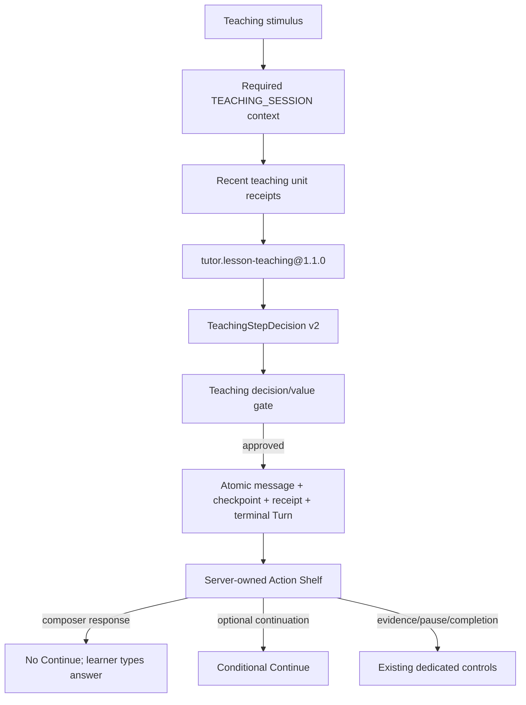

# Tutor 非文档型教学价值与条件式“继续”技术设计

## 设计地位

本设计服务于 `.trellis/tasks/08-26-tutor-beyond-document-teaching-value/prd.md`。事实权威顺序仍为当前代码/schema/tests、`docs/README.md` 索引的 source-of-truth、本任务 research、最后才是本设计。

任务保持一个 coherent cross-layer deliverable，不拆 parent/child：Skill、provider contract、receipt、checkpoint/Action Shelf 和 Desktop 必须锁步变化，拆开会产生新 Skill 已生效但 UI 仍常驻“继续”或 UI 隐藏控制但后端没有 response authority 的中间状态。

## 设计目标

1. 保留 one stimulus -> one durable Turn -> one closed teaching action -> one atomic commit。
2. 把“一个 action”重新定义为教学单元的主要/终点意图，而不是只能输出一个微句。
3. 用闭合结构化元数据证明一个新教学单元采用了哪些教学动作，以及是否需要 Composer 回答。
4. 由服务端 checkpoint/action policy 决定是否投影“继续”，Desktop 不解析自然语言。
5. 给 `continue` 提供 recent unit evidence，使其必须推进策略而不是重启或近义复述。

## 总体数据流



## 新 Skill 版本

### `tutor.lesson-teaching@1.1.0`

- 保留 `1.0.0` 目录、manifest 和 content hashes，不原地修改。
- 新目录复制必要结构后完整重写 `instructions.md` 和 `evals.json`，manifest 使用新 hashes。
- `input_contract` 仍消费 `tutor.teaching-session-input.v1` 的现有 authority；新增字段属于 additive safe context。
- `output_contract` 更新为 `tutor.teaching-step-decision.v2`。
- 新指令明确：
  - LessonDocument 与 Tutor 的职责边界；
  - 当前 learner/stimulus evidence 优先；
  - 一个单元至少两个 `teaching_moves`；
  - dominant `action` 只表示终点意图；
  - response mode 决定 Composer 或条件“继续”；
  - `continue` 必须参考 recent units 并改变策略；
  - `change_example` 才允许保留目的并更换案例；
  - 无高价值下一步时 summary/pause，不生成填充内容。

新 run 的 policy resolver 和 `TeachingTutorDecisionGate` 只选择/要求 `1.1.0`。历史 terminal run、message 和 receipt 继续读取；该任务不执行生产发布，因此 active `1.0.0` run 的部署 drain/cancel 属于后续 rollout 操作，不在本任务内伪造兼容恢复。

## TeachingStepDecision v2

### 闭合教学动作

新增 `TeachingMove`：

```text
targeted_explanation
worked_example
counterexample
misconception_contrast
guided_derivation
prediction
error_detection
micro_transfer
learner_feedback
```

Provider teaching branch additive 接受：

```python
TeachingStepDecision(
    action=...,
    objective_id=...,
    focus_id=...,
    source_handles=...,
    public_message=...,
    focus_resolution=...,
    pause_kind=...,
    escalation_hint=...,
    teaching_moves=(...),
    learner_response_mode="none" | "composer",
)
```

兼容策略：Pydantic/provider branch 可把两个新字段定义为 optional，以便旧单元测试和 legacy parser case 仍能被识别；但当 selected Skill 是 `1.1.0` 时，Teaching gate 必须要求字段存在并满足 v2 语义。新 provider canonical example 和 repair instruction 始终输出完整 v2 字段。

### v2 语义校验

- `teaching_moves` 唯一、2..4 项。
- `learner_response_mode="composer"` 时 dominant action 必须是 `check_understanding | wait_for_input`，并至少包含 `prediction | error_detection | misconception_contrast | micro_transfer` 中的一项。
- `learner_response_mode="none"` 时不得使用 `check_understanding | wait_for_input` 伪造等待。
- `change_example` stimulus 的 approved unit 必须包含 `worked_example | counterexample`。
- completion 仍要求 `summarize_progress + completion_pause`。
- public message 仍与 provider message text exact match，安全长度和 hidden/private marker 规则不变。

## Recent teaching unit context 与非重复门

`TeachingSessionRepository.teaching_context()` 从 `tutor_teaching_action_receipts` 读取当前 session 最近最多四个 safe unit：

```text
action
focus_id
teaching_moves
learner_response_mode
public_message_hash
schema_version
```

该列表不含 public message 正文、prompt、reasoning 或 LessonDocument。完整 learner-visible continuity 仍由既有 bounded `RECENT_MESSAGES` 提供。

Provider request 和 selected Skill instruction说明：

- `continue` 必须在 recent unit 后选择不同 dominant action、不同 move 组合或新的 focus/迁移目标；
- learner-message stimulus 优先根据新回答执行 feedback/remediation/advance；
- `change_example` 可保留 dominant purpose，但必须改变 example representation；
- exact message hash 不得重放。

Teaching gate 对 `control_key=continue` 执行确定性底线：同一 focus 下，如果 candidate 的 `(action, sorted teaching_moves, learner_response_mode)` 与最近 v2 unit 完全相同，或 public message hash 完全相同，返回安全 denial `teaching_unit_not_advanced`。近义语义质量由 Skill 指令、eval fixture 和 fake-provider scenarios 覆盖，不引入脆弱的关键词/相似度生产启发式。

## Action receipt v2

对 `tutor_teaching_action_receipts` 做 additive schema：

- `teaching_moves_json jsonb NOT NULL DEFAULT '[]'`，array、唯一、最多四项、只允许闭合 move enum；
- `learner_response_mode text NOT NULL DEFAULT 'none'`，只允许 `none | composer`；
- `schema_version` CHECK 扩展为 `teaching_action_receipt_v1 | teaching_action_receipt_v2`；
- `policy_version` CHECK 扩展为 `lesson_teaching_policy_v1 | lesson_teaching_policy_v2`。

历史 rows 维持 v1 + 空 moves + `none`，不 update/backfill 内容。新 `1.1.0` commit 显式写 v2/policy v2 和两个新字段。append-only trigger、FK、reset/delete/cutover count 保持；learner-safe export 可 additive 返回 enum/mode，但仍不返回 public message body。

## Checkpoint reducer 与 Action Shelf

`reduce_teaching_checkpoint()` 的优先级：

1. completion/evidence/authority/session pause 继续使用现有专用 recommendation；
2. v2 `learner_response_mode="composer"` -> `recommended_action_key="respond_in_composer"`；
3. Guided 且无需回答、仍可推进 -> `recommended_action_key="continue"`；
4. Free Reading 保持 reactive-only 与 explicit escalation 规则。

`build_teaching_action_shelf()` 改为按 `recommended_action_key` 投影：

- `respond_in_composer`：不提供 `continue` primary；可保留由服务端决定的低强调 `change_example` / `pause`，Composer 是主路径；
- `continue`：才提供 primary `继续`，并保留 bounded secondary；
- `open_evidence | resume | enter_next_knowledge`：沿用专用动作；
- 没有可执行动作时返回合法空 shelf，不制造本地 navigation 文案。

一个 Turn 仍 terminalize；“不常驻继续”只改变 terminal 后的 server projection，不让同一 provider call 自动开启第二个 Turn。

## Desktop 变更

### `ComposerActionShelf`

- 若 projection 为 null、runtime/request state，或 action 总数为 0，直接返回 `null`。
- 删除普通 ready state 下“继续阅读，或在 Composer 中提出问题”的本地 placeholder。
- completion 没有 next node 时也不伪造按钮；完成说明来自 server Tutor message/track projection。
- 有 secondary、无 primary 时只渲染 secondary；Composer 保持可输入和主要视觉权重。

### `TutorConversationSurface`

- `has-action-shelf` 仅在 shelf 存在至少一个 server descriptor 时添加，避免空绝对定位层占据 Composer 上方空间。
- 不检查 message 是否以问号结尾、不读取 `teaching_step.action` 猜状态、不本地生成“继续”。
- 现有 blocking request > runtime controls > ordinary shelf 优先级不变。

API DTO 不需要升级 `TeachingActionShelfV1`：现有 contract 已允许 `primary_action=null` 和空 action arrays。只需保持 parser 对空 action 与 `allowed_actions=[]` 的 exact consistency，并更新 component/fixture tests。

## Provider prompt 与 canonical example

- provider serializer 中 exact Skill 文案更新为 `tutor.lesson-teaching@1.1.0`。
- canonical teaching example 改为一个完整但 bounded 的 HTML/编程教学单元，展示两种 moves 和明确 response mode，不再使用“只解释一个核心概念并停顿”。
- repair prompt 要求完整 v2 fields，但不回显 rejected body/value。
- general non-teaching Tutor contract、public thinking、Responses/Chat Completions routing、primary-only/no-fallback 规则不变。

## 测试与评测设计

### Provider/Skill

- catalog 同时包含 immutable `1.0.0` 与新 `1.1.0`，policy 选择新版本；hash/digest deterministic。
- parser 兼容 legacy missing-v2-field case；selected `1.1.0` 缺字段、少于两 moves、重复 move、action/response 不匹配时 fail closed。
- canonical/repair/system prompt 包含职责边界、recent unit、conditional continue 和完整 v2 example。

### Reducer/数据库

- response mode `composer` -> checkpoint `respond_in_composer` -> shelf 无 Continue。
- response mode `none` -> eligible Continue；evidence/session/completion 优先级不回归。
- v2 receipt round-trip、CHECK、append-only、legacy v1 default、export/reset/cutover 回归。
- `continue` exact same unit signature/hash 被拒；changed strategy、new focus、learner response 和 explicit `change_example` 通过。

### Desktop/浏览器

- empty shelf 不渲染 DOM、不增加 `has-action-shelf`。
- Composer-response state 无 Continue，输入和发送仍可触达；secondary controls不抢 primary。
- conditional Continue 出现时 exact label/expected versions 来自 server。
- active runtime、typed request、evidence/session/completion、Guided/Free Reading 和三视口布局不回归。

## 兼容、发布与回滚

- 数据库改动 additive；代码回滚后新列保留，旧代码忽略。
- `1.0.0` 永久保留；新 run 切换到 `1.1.0`。本任务不执行生产发布，未来发布前应确认没有需要继续执行的 active `1.0.0` teaching run。
- 若新质量门导致 provider rejection 增加，可代码回滚 policy selection 到旧版本；不得改写 `1.0.0` 或删除 v2 receipts。
- Desktop 接收的 shelf schema 不变，因此后端先/后端后的小窗口仍能按 action arrays 安全解析；但旧 Desktop 会为无 primary 的 ready shelf补写 placeholder，所以正式 rollout 应保持 Desktop/backend 同批切换并经过 capability preflight。

## 安全与非目标

- 不新增 raw reasoning、provider payload、prompt、完整文档、完整 learner submission 或 hidden evaluation 数据。
- 不使用字符串相似度、问号检测、固定字数下限或关键词路由作为 production authority。
- 不改变 model/provider/protocol、public thinking stream、Turn budget、Queue、Steer、Interrupt、Retry 或 effect authority。
- 不调用真实 provider，不部署，不执行生产 migration。
