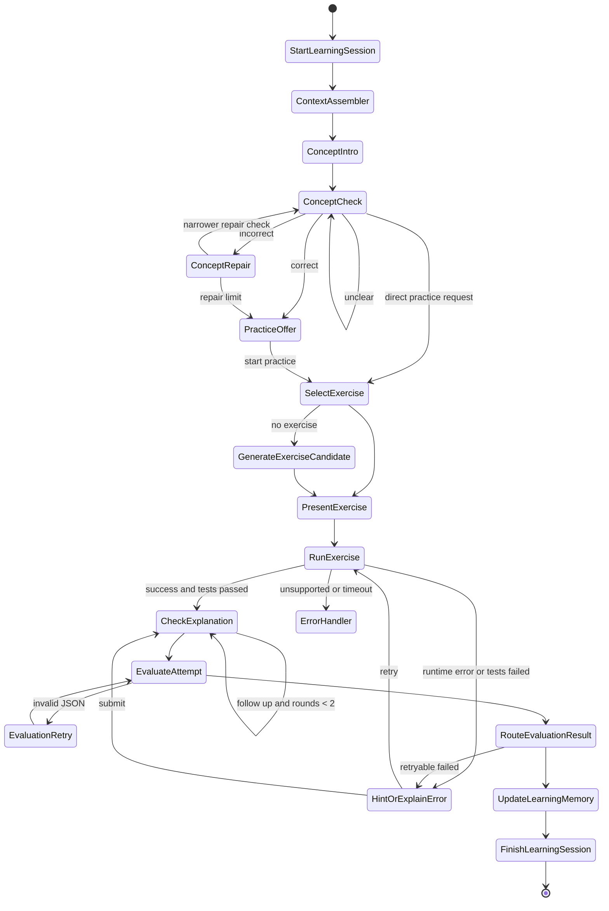
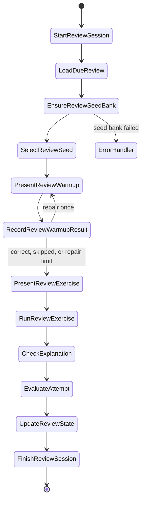

# Agent LangGraph 状态机文档

日期：2026-05-11  
状态：Draft V1.1  
适用范围：Aearn 的建档、学习会话、代码运行、Attempt 评分、复习变体、恢复学习和笔记辅助补全

## 目标

本规格把现有产品流程、API 契约、数据库 Schema、FSRS 调度和评分规则落成可实现的 LangGraph 状态机。它回答：

- State 中必须携带哪些字段
- 每个节点负责什么
- 节点之间如何按条件跳转
- 什么时候写入 `Attempt`、`KnowledgePoint`、`ReviewState`、`LearningSession`
- 失败、重试、恢复学习如何处理

本文件依赖：

- `docs/architecture/code-completion-evaluation-spec.md`
- `docs/architecture/api-contract.md`
- `docs/architecture/database-schema.md`
- `docs/architecture/fsrs-scheduling-spec.md`
- `docs/product/user-flows.md`
- `docs/product/frontend-interaction-spec.md`
- `docs/qa/acceptance-test-plan.md`

## 总体原则

1. LangGraph 只编排学习流程，不直接承担代码运行沙箱职责。
2. 代码运行、测试执行和预览由 runner service 完成，Agent 只解释结果和生成下一步动作。
3. `Attempt` 是代码练习闭环的事实记录，所有评分必须能追溯到某次 Attempt。
4. 只有 `evaluate_attempt` 可以产生最终 `code_completion_result`。
5. `ReviewState` 只在学习提交或复习提交完成后更新，不在普通聊天节点中更新。
6. 长上下文不得无限累积，节点进入前必须由 `context_assembler` 组装最小上下文。
7. 前端 UI 不暴露 `Attempt(run)` / `Attempt(submit)` 两个内部概念，只展示运行、预览、测试结果和提交结果等自然操作；后端仍必须保留两类事实记录。
8. 学习页的代码编辑器、预览和测试结果由对话中的生成式 UI 承载，不作为固定三栏页面或独立 `CodeDraftPage`。
9. 第一版基线不包含独立复盘草稿、`publishDrawer` 或面试讲述草稿流程；Agent 只能在笔记页或笔记抽屉中辅助补全用户笔记。
10. 学习页先走概念优先阶段；练习 UI 只能在概念判断通过、修正上限后的引导练习或用户明确提前练习后通过生成式工具调用出现。

## State Schema

### `AgentState`

```json
{
  "request_id": "req_001",
  "user_id": "user_001",
  "plan_id": "plan_001",
  "session_id": "sess_001",
  "session_type": "learn",
  "entry_point": "start_learning",
  "learning_stage": "documentation_reading",
  "learning_stage_state": {
    "covered_subpoint_ids": [],
    "feynman_status": "pending",
    "practice_unlock_reason": null,
    "learning_incomplete": true,
    "concept_summary": "",
    "active_concept_intro": null,
    "active_concept_check": null,
    "concept_check_attempts": 0,
    "concept_check_result": null,
    "previous_misconceptions": []
  },
  "current_stage": "DOM 事件",
  "language_course": {
    "id": "course_js_dom",
    "language": "javascript",
    "runtime_tier": "browser_preview"
  },
  "module": {
    "id": "mod_dom",
    "title": "DOM 事件"
  },
  "knowledge_point": {
    "id": "kp_dom_event_state",
    "title": "事件监听与状态变量"
  },
  "lesson_outline": [],
  "lesson_sources": [],
  "exercise": null,
  "attempt": {
    "id": "att_001",
    "attempt_type": "run",
    "runtime_status": "success"
  },
  "runtime_result": {
    "runtime_status": "success",
    "stdout": "",
    "stderr": "",
    "test_results": []
  },
  "code_completion_result": null,
  "hint_state": {
    "hint_usage_count": 0,
    "last_hint_level": null
  },
  "explanation_state": {
    "required": false,
    "round_count": 0,
    "last_result": null
  },
  "memory_snapshot": {
    "user_profile_summary": "",
    "knowledge_point_memory": {},
    "last_session_summary": "",
    "stage_summary": ""
  },
  "next_action": null,
  "errors": [],
  "side_effects": []
}
```

### 字段说明

| 字段 | 来源 | 用途 |
|---|---|---|
| `request_id` | API 层 | 幂等、日志追踪 |
| `session_type` | API 层 | 区分 `learn` / `review` |
| `learning_stage` | `LearningSession` | 区分概念判断、概念修正、练习确认、旧问答/费曼检查和练习支持 |
| `learning_stage_state` | `LearningSession` | 精简保存概念卡、当前判断题、判断次数、误解、练习解锁和概念小结 |
| `language_course` | `LanguageCourse` | 判断运行能力分层 |
| `lesson_outline` / `lesson_sources` | `KnowledgePoint` | 概念讲解提纲和官方文档来源归因 |
| `exercise` | `Exercise` | 仅在 `practice_support` 后确定模板、空缺、测试和 runtime profile |
| `attempt` | `Attempt` | 追踪运行/提交事实 |
| `runtime_result` | runner service | 作为评分和错因解释输入 |
| `code_completion_result` | `evaluate_attempt` | 统一评分结果 |
| `hint_state` | `Attempt` / 当前会话 | 控制提示次数和评分影响 |
| `explanation_state` | 当前会话 | 控制解释检查轮次 |
| `memory_snapshot` | `context_assembler` | 限制 prompt 上下文 |
| `side_effects` | 节点输出 | 记录需要提交的写库动作 |

## 顶层图

```text
route_entry
  -> onboarding_graph
  -> learning_graph
  -> review_graph
  -> resume_graph
  -> note_assist_graph
  -> error_handler
```

`route_entry` 根据 API 入口和 `session_type` 分流：

| 入口 | 条件 | 目标图 |
|---|---|---|
| `POST /api/plans/generate` | 无活动 plan | `onboarding_graph` |
| `POST /api/learning-sessions/start` | `session_type=learn` | `learning_graph` |
| `POST /api/reviews/start` | `session_type=review` | `review_graph` |
| `GET /api/learning-sessions/resume` | 存在历史会话 | `resume_graph` |
| 笔记抽屉或笔记页中的 Agent 辅助补全请求 | 存在当前会话或知识点 | `note_assist_graph` |

## 公共节点

### `context_assembler`

职责：

- 读取用户画像、当前计划、模块、知识点、最近会话摘要、阶段摘要
- 读取当前 `Exercise`、`CodeBlank`、可见测试和 `RuntimeProfile`
- 组装最小 prompt 上下文

输入：

- `user_id`
- `plan_id`
- `knowledge_point_id`
- `exercise_id`

输出：

- `memory_snapshot`
- `exercise`
- `language_course`

写入：

- 无

失败分支：

- 缺少 `LearningPlan` -> `error_handler`
- 缺少 `Exercise` -> `select_exercise`
- runtime 不支持 -> `unsupported_runtime_message`

### `persist_side_effects`

职责：

- 统一提交节点产生的写库动作
- 保证写库顺序和幂等

写入顺序：

1. `LearningSession`
2. `Attempt`
3. `SessionKnowledgePoint`
4. `KnowledgePoint`
5. `ReviewState`
6. `StageSummary`
7. `Note`

失败分支：

- 写入失败 -> 保留 `side_effects`，返回 `retryable_error`
- 幂等冲突 -> 读取已写入对象并继续

### `error_handler`

职责：

- 统一处理缺少数据、运行不支持、LLM 输出无效、写库失败

输出：

- `error.code`
- `error.message`
- `recoverable`
- `next_action`

## Onboarding Graph

### 目标

生成可确认的 `plan_draft`，并明确语言运行能力边界。

```text
collect_goal
  -> clarify_profile
  -> select_language_course
  -> generate_plan_draft
  -> validate_plan_draft
  -> confirm_plan
  -> initialize_review_state
  -> finish_onboarding
```

### 节点说明

#### `collect_goal`

输入：

- `goal_text`
- `mode`
- `materials`

输出：

- 规范化学习目标
- `entry_point=onboarding`

写入：

- 无

#### `clarify_profile`

职责：

- 澄清当前水平、目标用途、时间边界、目标语言、运行条件
- 首次生成路线只强制语言、目标用途和当前水平；时间预算可在路线卡片生成后通过普通回复补充

输出：

- `clarification_answers`
- `teaching_preference`
- `runtime_expectation`

条件边：

- 信息不足 -> `clarify_profile`
- 信息足够 -> `select_language_course`

#### `select_language_course`

职责：

- 选择或创建 `LanguageCourse`
- 标注 `runtime_tier`

条件边：

- JS / HTML / CSS -> `browser_preview`
- Python -> `python_stdout_test`
- TypeScript -> `node_typescript_test`
- SQL -> `sql_query_test`
- Java / Go / C# -> `managed_compiled_test`
- C++ / Rust -> unsupported public route; internal/planned profiles may disclose `compiled_sandbox_later` but must not generate a public course

失败分支：

- 用户要求完整项目级 Java / Go / C# 执行或包管理器工作流 -> 返回 `managed_compiled_test` 的 teaching-grade 单练习边界说明。
- 用户要求 C++ / Rust 公开路线或第一版完整运行 -> 返回暂不支持说明，不生成公开课程草稿或可运行练习。

#### `generate_plan_draft`

职责：

- 生成 `plan_draft`
- 每个模块必须能落到可练习的 `KnowledgePoint`
- 通过结构化 `show_learning_route` 工具事件向建档对话展示路线卡片，不将完整路线写入普通 Agent 文本
- 用户以自然语言提出修改时覆盖当前暂存草稿，仅最新路线卡片可确认
- post-MVP 动态路线生成可参考权威文档目录和用户目标生成 modules，但不得绕过课程 catalog、runtime boundary、`PlanDraft` validation 或 fallback 归因

输出：

- `plan_draft`
- `modules`
- `agent_notes`
- `source_attribution`

#### `validate_plan_draft`

校验规则：

- 每个模块至少包含一个可练习知识点
- 第一版基线中至少包含一个 `browser_preview` 或 `python_stdout_test` 练习
- 不允许把课程扩成泛化知识学习计划
- 未登记到 `Language`、数据库约束、课程 catalog 和 runtime boundary 的语言不得作为可确认计划

失败分支：

- 练习不足 -> 回到 `generate_plan_draft`
- runtime 承诺超出范围 -> 回到 `select_language_course`
- 动态生成失败且有安全课程模板 -> 回退到模板并记录 fallback 来源
- 动态生成失败且无安全 fallback -> 返回可恢复错误

#### `confirm_plan`

写入：

- `LearningPlan`
- `PlanModule`
- `KnowledgePoint`
- `Exercise` 引用或草稿引用

#### `initialize_review_state`

写入：

- 每个 `KnowledgePoint` 初始化 `ReviewState`
- 初始状态不进入今日复习，直到第一次 Attempt 完成

#### `finish_onboarding`

输出：

- `plan_id`
- `current_module`
- `next_entry_point=start_learning`

## Learning Graph

### 目标

完成一次概念开场、自然语言判断、必要时概念修正、生成式练习、运行、提示、解释、提交评分和状态写回闭环。

```text
start_learning_session
  -> context_assembler
  -> documentation_reading
  -> concept_qna
  -> concept_check
       -> correct: practice_offer
       -> incorrect: concept_repair
       -> unclear: concept_check
       -> direct_practice_request: select_exercise
  -> concept_repair
       -> incorrect_limit: practice_offer
       -> guided_practice_request: select_exercise
  -> practice_offer
       -> start_practice: select_exercise
  -> select_exercise
  -> present_exercise
  -> run_exercise
  -> route_runtime_result
  -> hint_or_explain_error
  -> check_explanation
  -> evaluate_attempt
  -> route_evaluation_result
  -> update_learning_memory
  -> finish_learning_session
```

### `start_learning_session`

输入：

- `user_id`
- `plan_id`
- `knowledge_point_id`

写入：

- `LearningSession(session_type=learn, started_at, entry_point, learning_stage=documentation_reading, learning_stage_state_json)`
- 首条 `LearningMessage(role=agent)`，内容为右侧文档阅读引导；不自动持久化 `show_concept_intro`

输出：

- `session_id`
- `session_state=learning`
- `exercise=null`
- `learning_stage=documentation_reading`
- `lesson_outline`
- `lesson_sources`
- `initial_tool_calls=[]`

失败分支：

- 已有未结束 session -> 返回原 `session_id`，进入 `context_assembler`
- 用户、计划或知识点不存在 -> 返回对应 not-found 错误；不会创建破损 `LearningSession`

### `documentation_reading`

职责：

- 展示右侧知识点文档、目录、章节折叠和引用到对话入口。
- 用户可围绕文档提问；提问后进入 `concept_qna`。
- 用户点击「开始概念检验」后才生成并持久化 `show_concept_intro`，进入 `concept_check`。

### `concept_intro`

职责：

- 基于 `KnowledgePoint.lesson_outline_json` 和 `lesson_sources_json` 生成 `show_concept_intro`。
- 输出必须包含概念总结、易懂例子和 2-4 个文本选项的单选判断题；不展示题面、starter code 或参考答案。

写入：

- `learning_messages(role=agent, metadata.tool_calls=[show_concept_intro])`
- 初始化 `learning_sessions.learning_stage_state_json.active_concept_intro`、`active_concept_check`、`concept_check_attempts=0`

条件边：

- 用户回答判断题 -> `concept_check`
- 用户明确要求提前练习 -> `select_exercise`，并记录 `practice_unlock_reason=concept_check_skipped`

### `concept_check`

职责：

- 使用模型判断用户对当前 `active_concept_check` 的自然语言回答。
- 返回并持久化 `show_concept_check_result(result=correct|incorrect|unclear)`。
- 只使用安全最小上下文：知识点、lesson outline/sources、当前 intro/check、用户回答、attempt count、既有误解和 safe summary。

条件边：

- `correct` -> `practice_offer`
- `incorrect` 且未达上限 -> `concept_repair`
- `unclear` -> `concept_check`
- 用户明确要求提前练习 -> `select_exercise`，先写 `show_concept_check_result(result=skipped)`

### `concept_repair`

职责：

- 修正一个最关键误解，给更简单反例和更窄判断题。
- 两次失败后停止概念盘问，提供另一个例子或引导练习路径。
- 该检查独立于练习后的 `Attempt.explanation_check_result`，不得写入 Attempt。

条件边：

- 修正后正确 -> `practice_offer`
- 仍错误且达到上限 -> `practice_offer`，标记 `repair_limit_reached=true`
- 用户选择引导练习 -> `select_exercise`，记录 `practice_unlock_reason=concept_check_repair_limit`、`learning_incomplete=true`
- 用户仍模糊 -> `concept_repair`

### `show_learning_history`

职责：

- 查询当前知识点所有 `session_type=learn` 的 `learning_messages`。
- 返回生成式历史引用 UI，只包含学习页 AI/用户对话，不包含建档页或复习页对话。
- 不自动补讲、不重放完整历史到恢复会话，只给用户可查看的引用。

条件边：

- 用户回看后继续回答或追问 -> `concept_check` 或 `concept_repair`

### `select_exercise`

职责：

- 按当前知识点、难度、历史错因选择练习
- 优先选择当前 runtime 可验证的练习

输入：

- `knowledge_point_id`
- `runtime_tier`
- `last_attempt_id`

输出：

- `exercise_id`
- `exercise_type`

条件边：

- 有待完成练习 -> `present_exercise`
- 无练习 -> `generate_exercise_candidate`

### `generate_exercise_candidate`

职责：

- 生成代码补全、改错或解释型练习草稿
- 不负责执行测试，只生成练习候选

输出：

- `Exercise` 草稿
- `CodeBlank` 草稿
- `TestCase` 草稿或 mock 测试说明

校验：

- JS / HTML / CSS 必须有可见预览或 DOM 断言
- Python 必须有函数输入输出或 stdout 判定
- TypeScript 必须有单文件函数测试或 stdout 判定
- SQL 必须有 SQLite 教学方言查询判定
- Java / Go / C# 可标记为 `managed_compiled_test`，但只能生成单文件或服务端 harness 教学练习
- C++ / Rust 不能生成公开路线练习；内部/计划态 profile 只能标记为 `compiled_sandbox_later`

写入：

- 可选写入 `Exercise`，也可只作为 session 临时练习

### `present_exercise`

输出给前端：

- 题面
- 对话内生成式 UI 描述
- `starter_code`
- `CodeBlank`
- 可见测试
- runtime 能力提示
- 运行、预览、测试和提交按钮的自然操作文案

写入：

- 无

### `run_exercise`

职责：

- 调用 runner service
- 创建或更新 `Attempt(attempt_type=run)`
- 仅记录运行、预览或测试事实，不产生最终评分

输入：

- `code`
- `filled_blanks`
- `run_mode`
- `runtime_profile_id`

输出：

- `attempt_id`
- `runtime_result`

写入：

- `Attempt.submitted_code`
- `Attempt.filled_blanks_json`
- `Attempt.runtime_status`
- `Attempt.stdout`
- `Attempt.stderr`
- `Attempt.test_results_json`
- `Attempt.error_message`
- `Attempt.error_count`

条件边：

- `runtime_status=success` 且测试达标 -> `check_explanation`
- `runtime_status=success` 但测试失败 -> `hint_or_explain_error`
- `runtime_status=runtime_error` -> `hint_or_explain_error`
- `runtime_status=unsupported` -> `unsupported_runtime_message`
- `runtime_status=timeout` -> `error_handler`

### `hint_or_explain_error`

职责：

- 当用户请求提示时生成分层提示
- 当运行或测试失败时解释错因

输入：

- `attempt_id`
- `runtime_result`
- `current_code`
- `hint_level`

输出：

- `hint`
- `error_cause`
- `fix_suggestion`
- `related_knowledge_points`

写入：

- `Attempt.hint_usage_count`
- `Attempt.error_cause`

条件边：

- 用户继续运行 -> `run_exercise`
- 用户提交 -> `check_explanation`
- 错误不可恢复 -> `evaluate_attempt`

### `check_explanation`

职责：

- 检查用户是否理解关键代码、边界条件或 AI 辅助改动
- 最多 2 轮

触发条件：

- 测试全过但使用过提示
- 练习标记 `requires_explanation=true`
- 涉及状态、闭包、异步、边界条件
- 复习变体需要确认迁移理解

输入：

- `explanation`
- `focus`

输出：

- `explanation_check_result`
- `follow_up_required`
- `feedback`

写入：

- `Attempt.explanation_text`
- `Attempt.explanation_check_result`

条件边：

- 解释通过 -> `evaluate_attempt`
- 解释不稳定且轮次 < 2 -> `check_explanation`
- 解释不稳定且轮次 >= 2 -> `evaluate_attempt`

### `evaluate_attempt`

职责：

- 调用 `code-completion-evaluation-spec.md` 中的评分规则
- 生成 `code_completion_result`
- 映射 `fsrs_rating`
- 创建或更新 `Attempt(attempt_type=submit)`，与最近一次可评分运行事实关联

输入：

- `Attempt`
- `Exercise`
- `TestCase`
- `hint_usage_count`
- `error_count`
- `explanation_check_result`

输出：

- `code_completion_result`
- `next_action`

写入：

- `Attempt.attempt_type=submit`
- `Attempt.score`
- `Attempt.score_breakdown_json`
- `Attempt.fsrs_rating`

失败分支：

- LLM JSON 校验失败 -> 按评分规格重试
- 重试失败 -> 规则引擎保守降级
- 仍失败 -> `evaluation_status=needs_manual_review`

### `route_evaluation_result`

条件边：

| 条件 | 下一节点 |
|---|---|
| `result=easy` | `update_learning_memory` |
| `result=passed` | `update_learning_memory` |
| `result=partial` 且 `next_action=review_variant` | `update_learning_memory` |
| `result=partial` 且 `next_action=show_hint` | `hint_or_explain_error` |
| `result=failed` 且可重试 | `hint_or_explain_error` |
| `result=failed` 且不可重试 | `update_learning_memory` |

### `update_learning_memory`

写入：

- `SessionKnowledgePoint.exercise_id`
- `SessionKnowledgePoint.attempt_id`
- `SessionKnowledgePoint.exercise_result`
- `SessionKnowledgePoint.exercise_score`
- `SessionKnowledgePoint.score_breakdown_json`
- `SessionKnowledgePoint.mastery_delta`
- `KnowledgePoint.status`
- `KnowledgePoint.mastery_score`
- `KnowledgePoint.weak_points_json`
- `KnowledgePoint.last_exercise_result`
- `KnowledgePoint.last_exercise_score`
- `KnowledgePoint.last_exercise_breakdown_json`
- `KnowledgePoint.last_explanation_check_result`
- `KnowledgePoint.last_session_id`
- `ReviewState.last_attempt_id`
- `ReviewState.last_fsrs_rating`
- `ReviewState.due_at`

状态规则：

- `easy` / `passed` -> `KnowledgePoint.status=reviewing`
- `partial` -> `KnowledgePoint.status=reviewing`，但标记重点复习
- `failed` -> `KnowledgePoint.status=learning`

### `finish_learning_session`

职责：

- 生成会话摘要、阶段反馈和 `next_entry_point`

写入：

- `LearningSession.ended_at`
- `LearningSession.duration_seconds`
- `LearningSession.summary_text`
- `LearningSession.next_entry_point`
- 必要时写入 `StageSummary`

输出：

- `session_summary`
- `stage_feedback`
- `next_entry_point`

## Review Graph

### 目标

对到期知识点先做短热身，再从持久化 seed bank 选择变体练习，完成 `Attempt(review_submit)` 后更新 FSRS。复习页不做长教学，warmup 也不进入 FSRS。

```text
start_review_session
  -> load_due_review
  -> ensure_review_seed_bank
  -> select_review_seed
  -> present_review_warmup
  -> record_review_warmup_result
  -> present_review_exercise
  -> run_review_exercise
  -> check_explanation
  -> evaluate_attempt
  -> update_review_state
  -> finish_review_session
```

### `start_review_session`

写入：

- `LearningSession(session_type=review, started_at, entry_point=review)`
- `LearningSession.review_stage=warmup`
- `LearningSession.review_stage_state_json`

### `load_due_review`

输入：

- `user_id`
- `knowledge_point_id`

读取：

- `ReviewState`
- `KnowledgePoint`
- 最近 `Attempt`
- 最近错因标签

失败分支：

- 无到期项 -> 返回空复习状态
- knowledge point 不存在 -> `error_handler`

### `select_review_variant`

职责：

- 兼容旧节点名；新实现中由 `ensure_review_seed_bank` + `select_review_seed` 承担。

### `ensure_review_seed_bank`

职责：

- 读取当前知识点的 `review_seed_banks`。
- 如果没有 ready bank 或 bank 已失效，同步 rescue 生成完整 seed bank。
- 正常异步生成和同步 rescue 复用同一 generator、schema、validation、安全检查和持久化路径。
- rescue 必须先持久化完整 seed bank，再允许选 seed。

失败分支：

- 生成或校验失败 -> 标记 `review_seed_banks.status=failed`，返回 `REVIEW_SEED_BANK_GENERATION_FAILED`，不得展示 fallback 题。

### `select_review_seed`

职责：

- 根据知识点、误解、ReviewState、runtime 能力和历史 Attempt 选择 seed，不按固定比例轮换。
- 支持 `code_blank`、`fix_bug`、`explain_code`、`implement_function`、`review_ai_patch`。

变体策略：

- `state_scope_error` -> 换成同类事件或状态保存场景
- `selector_error` -> 换 DOM 节点或 CSS selector 场景
- `return_value_error` -> 换函数输入输出场景
- `ai_over_trust` -> 提供 AI 生成代码，让用户找最小可验证修改

输出：

- `review_exercise`
- `selected_seed_id`
- `warmup`
- `review_stage_state`
- `variant_reason`

### `present_review_warmup`

职责：

- 展示一句话短热身，唤醒当前知识点，不展开长教学。
- 允许用户跳过；跳过写 `warmup.result=skipped`。

### `record_review_warmup_result`

写入：

- `LearningSession.review_stage`
- `LearningSession.review_stage_state_json.warmup`

规则：

- `correct` / `skipped` -> `variant_practice`
- `incorrect` / `unclear` 且 `repair_count=0` -> `warmup_repair`
- 第二次仍不正确或不明确 -> `variant_practice`，并把变体标记为 guided
- 不创建 `Attempt`，不写 `ReviewLog`，不更新 `ReviewState`

### `run_review_exercise`

等价于 `run_exercise`，但写入：

- `Attempt.attempt_type=review_submit`

补充：

- `review_ai_patch` 不运行用户代码，而是把结构化审核答案写入 `submitted_code` / `code_completion_result`。
- `review_ai_patch` 必须包含 `verdict`、`evidence`、`knowledge_point_risk`、`next_action`。
- `review_ai_patch` 的评分维度为 `verdict_correctness`、`evidence_grounding`、`knowledge_point_alignment`、`actionability`；弱证据不得映射为 `Easy`。

### `update_review_state`

职责：

- 根据 `fsrs_rating` 更新 FSRS 字段

写入：

- `ReviewState.card_state`
- `ReviewState.stability`
- `ReviewState.difficulty`
- `ReviewState.due_at`
- `ReviewState.last_review_at`
- `ReviewState.review_count`
- `ReviewState.lapse_count`
- `ReviewState.last_attempt_id`
- `ReviewState.last_fsrs_rating`

条件：

- `Again` -> 增加 `lapse_count`，缩短间隔
- `Hard` -> 小幅拉长或保持短间隔
- `Good` -> 正常拉长间隔
- `Easy` -> 明显拉长间隔

### `finish_review_session`

写入：

- `LearningSession.summary_text`
- `LearningSession.next_entry_point`

输出：

- 下次复习时间
- 本次薄弱点
- 今日剩余复习数量

## Resume Graph

### 目标

用户中断后用最小上下文恢复，而不是重放历史对话。

```text
load_resume_context
  -> decide_resume_entry
  -> assemble_resume_message
  -> route_to_learning_or_review
```

### `load_resume_context`

读取：

- 最近一次 `LearningSession.summary_text`
- `LearningSession.next_entry_point`
- 当前 `StageSummary`
- 今日 due 的 `ReviewState`
- 最近失败或 partial 的 `Attempt`

输出：

- `last_session_summary`
- `current_stage`
- `next_entry_point`
- `today_review_count`

### `decide_resume_entry`

条件边：

| 条件 | 入口 |
|---|---|
| 普通打开应用 | `learning_graph`，恢复当前学习并在消息内提示复习 |
| 中断多日且存在高风险复习项 | `review_graph` |
| 最近 Attempt 为 `failed` | `learning_graph`，从错因补讲或重试进入 |
| 最近 Attempt 为 `partial` | `learning_graph`，从变体练习进入 |
| 最近 Attempt 为 `passed` / `easy` | `learning_graph`，进入下一个知识点 |

### `assemble_resume_message`

输出：

- 简短恢复提示
- 上次停留点
- 建议入口

写入：

- 无

## Note Assist Graph

### 目标

在不离开当前学习或复习会话的前提下，辅助用户补全当前知识点的 Markdown 笔记。该图不生成完整复盘草稿，不创建 `CodeDraft`，也不提供 `publishDrawer`、`CodeDraftPage` 或面试讲述草稿入口。

```text
load_note_sources
  -> generate_note_suggestion
  -> validate_note_suggestion
  -> merge_note_patch
  -> persist_note
```

### `load_note_sources`

读取：

- `Attempt`
- `test_results_json`
- `error_cause`
- `score_breakdown_json`
- `Note`
- `LearningSession.summary_text`
- `KnowledgePoint`

### `generate_note_suggestion`

规则：

- 只生成可插入当前 Markdown 笔记的片段、要点或修改建议
- 保留用户已有笔记内容，不覆盖整篇笔记
- 可引用真实运行、测试结果和错因，但不得虚构完成状态

输出：

- `note_patch`
- `suggested_sections`
- `source_attempt_ids`

### `validate_note_suggestion`

校验：

- 建议没有虚构测试结果
- 建议没有声称用户已经掌握或已完成
- 建议引用的 Attempt 存在
- 建议不会替用户生成完整笔记

### `merge_note_patch`

职责：

- 将建议作为待确认片段返回给前端
- 由用户在笔记抽屉或笔记页中接受、修改或丢弃
- 不自动写入用户未确认的大段内容

### `persist_note`

写入：

- `Note`

## 条件边总表

| 当前节点 | 条件 | 下一节点 |
|---|---|---|
| `context_assembler` | 学习会话处于概念阶段 | `documentation_reading` / `concept_qna` / `concept_check` / `concept_repair` / `practice_offer` |
| `concept_intro` | 已生成并持久化概念卡 | `concept_check` |
| `concept_check` | 用户判断正确 | `practice_offer` |
| `concept_check` | 用户判断错误且未达上限 | `concept_repair` |
| `concept_check` / `concept_repair` | 用户明确提前练习 | `select_exercise` |
| `concept_repair` | 达到修正上限并选择引导练习 | `select_exercise` |
| `practice_offer` | 用户确认开始练习 | `select_exercise` |
| `show_learning_history` | 用户继续复述或追问旧会话内容 | `concept_check` / `concept_repair` |
| `context_assembler` | 练习已解锁但缺少 exercise | `select_exercise` |
| `select_exercise` | 无可用 exercise | `generate_exercise_candidate` |
| `run_exercise` | 运行成功且测试达标 | `check_explanation` |
| `run_exercise` | 运行错误或测试失败 | `hint_or_explain_error` |
| `run_exercise` | runtime unsupported | `unsupported_runtime_message` |
| `hint_or_explain_error` | 用户继续运行 | `run_exercise` |
| `hint_or_explain_error` | 用户提交 | `check_explanation` |
| `check_explanation` | 通过或达到轮次上限 | `evaluate_attempt` |
| `check_explanation` | 未通过且轮次未满 | `check_explanation` |
| `evaluate_attempt` | JSON 校验失败 | `evaluation_retry` |
| `route_evaluation_result` | `easy` / `passed` | `update_learning_memory` |
| `route_evaluation_result` | `partial` | `update_learning_memory` 或 `hint_or_explain_error` |
| `route_evaluation_result` | `failed` | `hint_or_explain_error` 或 `update_learning_memory` |
| `update_learning_memory` | 写入成功 | `finish_learning_session` |
| `update_review_state` | 写入成功 | `finish_review_session` |

## Prompt 模板引用

### `teaching_prompt`

用途：

- 讲解当前知识点
- 激活已有认知
- 给出最小代码片段

输入：

- `memory_snapshot`
- `knowledge_point`
- `exercise.prompt_markdown`
- `runtime_tier`

### `hint_prompt`

用途：

- 生成 `nudge` / `concept` / `code_shape`

输入：

- 当前代码
- 空缺位置
- 失败测试
- 已使用提示次数

约束：

- 默认不直接给完整答案
- 提示级别必须写回 `hint_usage_count`

### `explain_error_prompt`

用途：

- 解释运行错误、测试失败、编译错误

输出：

- `error_cause`
- `explanation`
- `fix_suggestion`
- `related_knowledge_points`

### `evaluate_attempt_prompt`

用途：

- 生成 `code_completion_result`

约束：

- 必须输出 JSON
- 必须符合 `code-completion-evaluation-spec.md`

### `note_assist_prompt`

用途：

- 辅助补全当前知识点 Markdown 笔记

约束：

- 不替用户生成完整笔记
- 不虚构测试结果
- 不创建独立复盘、题解或 AI 协作提示词草稿

## 记忆读写时机

| 时机 | 读取 | 写入 |
|---|---|---|
| 会话开始 | User、LearningPlan、PlanModule、KnowledgePoint、ReviewState、StageSummary | LearningSession、文档阅读引导 LearningMessage |
| 概念判断 / 概念修正 / 练习确认 | LearningSession、KnowledgePoint、LearningMessage | LearningSession.learning_stage_state_json、LearningMessage、show_concept_check_result metadata |
| 生成历史引用 | LearningSession、LearningMessage | 无 |
| 展示练习 | Exercise、CodeBlank、TestCase、RuntimeProfile | 无 |
| 运行或预览代码 | Exercise、RuntimeProfile | Attempt(attempt_type=run) |
| 获取提示 | Attempt、runtime_result | Attempt.hint_usage_count |
| 解释错误 | Attempt、failed_tests、stderr | Attempt.error_cause |
| 检查解释 | Attempt、explanation_text | Attempt.explanation_check_result |
| 提交评分 | Attempt、Exercise、TestCase | Attempt(attempt_type=submit)、Attempt.score、Attempt.fsrs_rating |
| 学习完成 | Attempt、code_completion_result | SessionKnowledgePoint、KnowledgePoint、ReviewState |
| 复习完成 | Attempt、fsrs_rating | ReviewState |
| 会话结束 | 当前 state | LearningSession.summary_text、next_entry_point、StageSummary |
| 辅助补全笔记 | Attempt、Note、LearningSession、KnowledgePoint | Note |

## 异常与重试

### runner 异常

| 异常 | 处理 |
|---|---|
| `runtime_error` | 进入 `hint_or_explain_error` |
| `timeout` | 标记 Attempt，提示缩小代码或重试 |
| `unsupported` | 返回运行能力边界说明 |
| runner 服务不可用 | 返回可恢复错误，不更新 ReviewState |

### LLM 异常

| 异常 | 处理 |
|---|---|
| 输出非 JSON | 触发一次 JSON 修复 prompt |
| 枚举非法 | 触发一次 JSON 修复 prompt |
| 评分与硬门槛冲突 | 规则引擎保守降级 |
| 连续失败 | `evaluation_status=needs_manual_review` |

### 写库异常

处理规则：

1. 所有写操作必须带 `request_id` 或幂等键。
2. `Attempt` 写入成功但 `ReviewState` 失败时，保留 Attempt，不重复运行代码。
3. 重试时从最近 `Attempt` 恢复 state。
4. 不允许因写库失败而向前端返回“已完成复习”。

## 幂等策略

| 操作 | 幂等键 |
|---|---|
| 开始会话 | `user_id + plan_id + knowledge_point_id + active_session` |
| 运行练习 | `session_id + exercise_id + code_hash + run_mode` |
| 提交练习 | `session_id + exercise_id + attempt_id + submit_version` |
| 更新 ReviewState | `knowledge_point_id + attempt_id + fsrs_rating` |
| 保存笔记 | `note_id + content_hash + updated_at` |

## Mermaid 状态图





## 第一版不做

- 多 Agent 协同教学图
- 完整在线编译沙箱、项目级 Java / Go / C# 编排、包管理器执行、C++ / Rust 真实编译运行
- 项目级多文件调试状态机
- 对外分发工作流
- 独立复盘草稿、`publishDrawer`、`CodeDraftPage`、面试讲述草稿
- 自动读取完整代码仓库并生成大型课程

## 后续同步

修改本文件后必须同步检查：

- `docs/architecture/code-completion-evaluation-spec.md`
- `docs/architecture/api-contract.md`
- `docs/architecture/database-schema.md`
- `docs/architecture/fsrs-scheduling-spec.md`
- `docs/product/frontend-interaction-spec.md`
- `docs/qa/acceptance-test-plan.md`
- `docs/product/user-flows.md`
- `docs/plans/learning-agent-implementation-plan.md`

## 完成标准

本状态机达到可实施状态需要满足：

- 每个核心流程都有入口、节点、条件边和终止状态。
- 每个节点都有明确输入、输出、失败分支或写入时机。
- `Attempt`、`KnowledgePoint`、`ReviewState` 的写入时机无歧义。
- `evaluate_attempt` 明确依赖代码补全评分规格。
- 恢复学习不依赖全量历史对话。
- 第一版运行能力边界清晰，不承诺任意语言实时运行。
