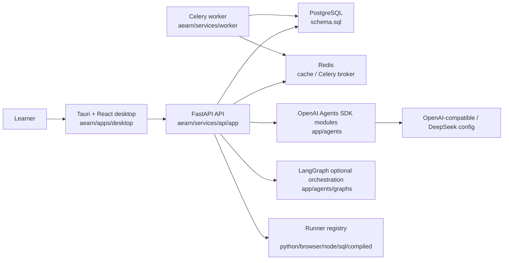

# 当前架构

> **历史快照，非当前 source of truth。** 本文生成于 2026-06-18，描述已经被 Tutor Harness 替代的旧运行时。当前事实请从 [`../../../README.md`](../../../README.md) 路由。

生成日期：2026-06-18

## 总览

## 仓库分层

| 路径 | 职责 | 当前状态 |
|---|---|---|
| `aearn/services/api/app` | FastAPI、Pydantic models、DB、routes、services、agents | Implemented |
| `aearn/apps/desktop/src` | Tauri desktop 的 React UI、状态、API client、SSE hook | Implemented |
| `aearn/services/worker` | Celery worker、review seed bank core | Partially implemented |
| `aearn/packages/shared` | 未来跨 runtime shared contracts | Documented / planned |
| `aearn/infra/docker-compose.yml` | PostgreSQL/Redis 本地依赖 | Implemented |
| `aearn/scripts/start-dev.ps1` | 本地一键启动/状态/停止脚本 | Implemented |
| `docs/` | 产品、架构、QA、setup source-of-truth 和设计原型 | Implemented，存在局部 stale risk |

## Backend API

`aearn/services/api/app/main.py` 注册的当前 route family：

| Route family | Prefix / endpoint | 主要文件 |
|---|---|---|
| Health | `GET /health` | `routes/health.py` |
| Users | `POST /api/users`、`GET /api/users`、`GET/PATCH/DELETE /api/users/{user_id}`、export/reset/data-summary | `routes/users.py` |
| Courses | `GET /api/language-courses` | `routes/courses.py` |
| Environment | `GET /api/environment/doctor` | `routes/environment.py` |
| Dashboard | `GET /api/dashboard` | `routes/dashboard.py` |
| Plans | `POST /api/plans/generate`、`POST /api/plans`、`GET /api/plans/{plan_id}` | `routes/plans.py` |
| Onboarding | `POST /api/onboarding/messages`、messages history、`POST /api/onboarding/{conversation_id}/confirm_plan` | `routes/onboarding.py` |
| Learning sessions | resume/start/documentation/concept-check/history/messages/run/hint/explain/check/submit | `routes/learning_sessions.py` |
| Reviews | today/start/messages/warmup-result/exercise-result/review chat | `routes/reviews.py` |
| Notes | list/create/update/agent-draft | `routes/notes.py` |

当前没有 route 注册的文档项包括 `GET /api/language-courses/{course_id}/exercises`、`PATCH /api/plans/{plan_id}/modules/{module_id}`、`POST /api/learning-sessions/{session_id}/finish`、`POST /api/code-drafts/generate`、`GET /api/code-drafts`、`GET /api/knowledge-points/{id}/review-metrics`。这些应按 Documented / planned 或 stale risk 处理。

## Backend module boundaries

| Package | 职责 |
|---|---|
| `app/routes` | HTTP envelope、validation error mapping、SSE response entry |
| `app/models` | Pydantic request/response models，目前是 plural 文件：`onboarding.py`、`learning_sessions.py`、`reviews.py`、`notes.py` |
| `app/services/conversations` | onboarding/learning/review conversation orchestration 和消息持久化 |
| `app/services/curriculum` | course catalog、template plan、dynamic plan generation、teaching chunks |
| `app/services/environment` | local doctor/toolchain 检查 |
| `app/services/exercises` | exercise materialization、adaptive generation、evaluation、syntax validators |
| `app/services/grounding` | trusted docs source、fetch、chunk、retrieve、reindex、citations |
| `app/services/llm` | LLM client、URL normalization、model unavailable error |
| `app/services/repositories` | users/plans/sessions/reviews/notes/dashboard/local data persistence |
| `app/services/runners` | language capability registry、runtime contracts、runner implementations |
| `app/services/streaming` | SSE writer 和 graph event stream adapter |
| `app/agents` | onboarding/learning/review/notes SDK agents、runtime guardrails、tooling、LangGraph modules |
| `app/db` | connection、bootstrap、schema、seeds、test data |

## Desktop frontend

| Layer | 主要文件 | 当前职责 |
|---|---|---|
| Shell | `App.tsx` | app bootstrap、route orchestration、global drawers、stores wiring |
| API client | `api.ts` | 固定 `API_BASE_URL=http://127.0.0.1:8001`，包装所有后端 endpoint 和 response shape checks |
| Pages | `pages/OnboardingPage.tsx`、`LearningWorkspacePage.tsx`、`ReviewPage.tsx`、`NotesPage.tsx`、`SettingsPage.tsx` | route-level workflow |
| Learning features | `features/learning/*` | editor、runtime feedback、hint、explanation、submit summary |
| Components | `components/*` | assistant thread、sidebar、doc panel、generative UI cards、note drawer、system cards |
| Hooks | `hooks/useSSE.ts`、`useAssistantRuntime.ts`、`useAutoSave.ts` | POST SSE、assistant-ui bridge、autosave |
| Stores | `stores/useAppStore.ts`、`useNotesStore.ts`、`useSettingsStore.ts` | Zustand app state、notes、settings |
| Labels/helpers | `lib/*` | bootstrap storage、desktop labels、error messages、type guards、partial JSON |

Frontend 当前不是 `docs/design/learning-agent-claude-desktop-framework.html` 的 runtime。该 HTML 是受保护视觉原型，不应删除或当成运行源码。

## 数据库结构

`aearn/services/api/app/db/schema.sql` 当前覆盖：

| 领域 | 表 |
|---|---|
| 用户与画像 | `users`、`learner_profiles` |
| 课程与路线 | `runtime_profiles`、`language_courses`、`learning_plans`、`plan_modules`、`knowledge_points` |
| 练习与提交 | `exercises`、`code_blanks`、`test_cases`、`learning_sessions`、`attempts` |
| 复习 | `review_states`、`review_seed_banks`、`exercise_variant_cache`、`review_logs` |
| 笔记 | `notes` |
| 幂等 | `idempotency_records` |
| 文档 grounding | `teaching_chunks`、`grounding_chunks`、`grounding_reindex_runs` |
| 对话 | `onboarding_conversations`、`onboarding_messages`、`review_messages`、`learning_messages` |

关键设计点：

| 设计 | 当前状态 |
|---|---|
| public language CHECK | `language_courses` / `learning_plans` 限制为 8 个公开语言 |
| `runtime_profiles` | 允许 `cpp` 作为 runtime profile language，但公开 course 不包含 C++/Rust |
| mutable table triggers | 多表有 `set_updated_at()` trigger |
| idempotency | run/submit/hint/explain/check/review 等路径使用 stable request identity |
| review batch state | `learning_sessions.review_stage_state_json` 存 review batch 过程态 |

## Agent and graph architecture

| 层 | 主要文件 | 当前状态 |
|---|---|---|
| SDK agents | `app/agents/onboarding`、`learning`、`review`、`notes` | Partially implemented，依赖 LLM 配置 |
| Runtime safety | `app/agents/runtime/*` | guardrails、structured judgement、domain context |
| Tools | `app/agents/tooling/tools.py`、`tools_web.py` | agent tools 和 web tool adapters |
| LangGraph | `app/agents/graphs/*` | Partially implemented，`LANGGRAPH_ENABLED=false` 默认关闭 |
| Graph contracts | `graph_runtime_contracts.py` | redaction、intent、run result、boundary validation |

Graph 的准确表述：它是可选编排层，负责路由/intent/安全上下文，不拥有最终 DB 写入、评分、FSRS 或 public response rendering。

## Runtime and runner architecture

| Runner | 文件 | 适用 |
|---|---|---|
| Python | `sandbox.py`、`runtime_runner.py` | `python_stdout_test` |
| Browser preview | `browser_preview_runner.py` | JavaScript / HTML / CSS DOM preview/assertion |
| Node/TypeScript | `node_typescript_runner.py` | TypeScript 单文件 function exercises |
| SQL | `sql_query_runner.py` | SQLite teaching dialect |
| Managed compiled | `managed_compiled_runner.py` | Java / Go / C# teaching-grade 单练习 |
| Registry | `runner_registry.py`、`language_capabilities.py` | language -> runtime capability selection |

## Configuration and operations

| 项 | 当前值或入口 |
|---|---|
| API base URL | frontend `api.ts` 固定 `http://127.0.0.1:8001` |
| CORS | `http://127.0.0.1:1420`、`http://localhost:1420`、`tauri://localhost` |
| API host/port default | `API_HOST=127.0.0.1`、`API_PORT=8001` |
| PostgreSQL | `postgres:15`，container `aearn_postgres`，port `5432` |
| Redis | `redis:latest`，container `aearn_redis`，port `6379` |
| LLM provider | `LLM_TYPE=openai` or `deepseek`，通过 `.env` 配置 |
| LangGraph switch | `LANGGRAPH_ENABLED=false` by default |
| Dev script | `pnpm --dir .\aearn dev` |
| Desktop check | `pnpm --dir .\aearn desktop:check` |
