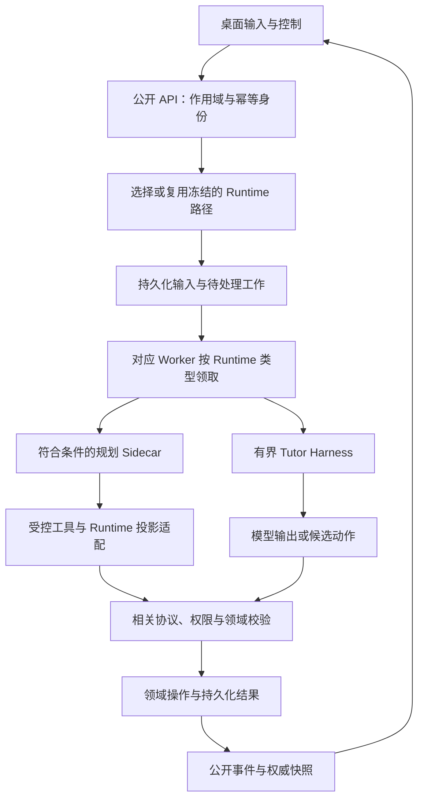
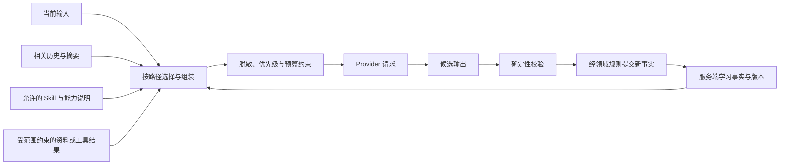
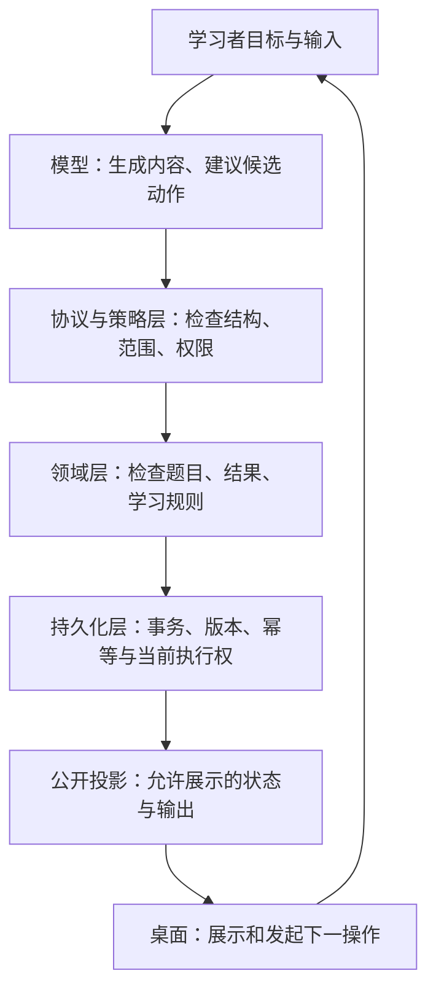

# Aearn Agent 设计与工程实现面试手册

> 核对日期：2026-09-16。源码基线：`4b595e0507282c01d8f36840990671cfcf3420a3`。这是项目面试学习材料，不是新的产品规格，也不证明系统已上线或全部真实验收通过。
>
> 阅读导航见 [专题与问题索引](README.md)，逐题证据和验证边界见 [证据索引](aearn-agent-interview-evidence.md)。核心题的文件行号对应上述源码基线；后续代码变化时需重新核对。

## 怎么使用这份手册

先用讲述稿建立整体认识，再优先学习框架选择、上下文工程、工具与状态边界。每题的短答用于抓住结论，展开用于理解机制，追问用于检查是否真正理解。不要逐字背诵不属于自己职责的内容。

- **P0** 表示必须掌握的核心问题，**P1** 表示深入实现，**P2** 表示演进与取舍讨论；不是漏洞或故障等级。
- **实现状态**回答“代码中有没有、是否历史或建议”；**验证状态**回答“通过什么方式核对、实际运行过什么”。两个维度不能互相代替。
- “源码核对”不等于功能默认启用；“相关测试存在”不等于本轮执行了这些测试；“一次真实结果”不等于全量通过。
- 问题里的“你”是面试提问形式，不是对读者个人贡献的认定。下列讲述稿以项目视角撰写；改成“我负责”前，请替换为本人确认的分工与经历。
- 本手册的比较和演进建议会明确标注，不能当作已经落地的业务能力。数字预算应看具体调用路径，不把模型窗口、请求输入、输出和线程压缩混成一个数。

## 项目讲述稿

### 1 分钟：项目做什么，核心设计是什么

Aearn 是一个面向编程学习的受控 Tutor 项目。它不只是回答问题，还围绕课程、知识点、练习和复习维护持续的学习过程。难点是既让模型根据学习者的问题灵活讲解，又不能让它随意决定权限、成绩或学习进度。

当前架构以 Tutor Harness 为主，并为符合条件的规划任务提供受控 Codex Sidecar 路径。模型负责理解和提出候选行动，服务端负责上下文、Skill 和能力校验、业务状态提交与恢复，桌面读取服务端投影。讲项目时，我会重点说明上下文如何选、动作如何被授权、失败后如何恢复，以及怎样区分模型输出与正式学习证据。项目已有对应工程机制，但默认开关、真实模型验收和生产能力要分别说明，不能笼统说“全链路已上线”。

### 3 分钟：从业务目标讲到架构

Aearn 希望解决的是持续的编程学习，而不是单次代码问答。用户有课程目标和当前知识点，教学过程可能包含讲解、澄清、练习、结果评价和复习。这样的系统会跨越多轮对话，还涉及可持久化的学习状态，因此不能只保存一串聊天消息就结束。

实现上，桌面负责输入与展示，API 负责公开契约和作用域，学习领域维护课程、练习、Artifact 与进度，Runtime 负责有界的模型决策与能力调用。Worker 根据持久化任务工作，队列更多承担唤醒作用。普通业务路径不是任意选择执行器；符合条件的规划请求才进入受控 Sidecar，其他路径仍保留相应 Harness 边界。

上下文也是主动组装的：系统需要选择当前输入、相关历史、学习事实、Skill 和必要资料，而不是把数据库全部塞进去。要区分可压缩的叙述与不能凭摘要覆盖的权威事实，并记录预算、选择与排除信息，便于解释模型为什么看到了这些内容。

模型输出之后还有确定性约束。它可以建议动作，但不因说出一个工具名就拥有执行权限；格式正确也不代表课程范围、版本或状态合法。正式结果要经过领域规则和持久化边界。桌面再通过会话事件与快照读取结果，流式展示与课程完成不是同一个状态。

验证上，我会区分契约测试、fixture 回归、真实模型调用和端到端学习证据。可以用代码和测试解释机制，但没有相应实测时，不报告性能提升、长期学习收益或生产安全承诺。个人介绍时只把实际参与的模块改写成自己的职责。

### 5 分钟：突出 Agent 设计的取舍与难点

这个项目最核心的矛盾，是开放的模型生成与严格的学习状态之间如何协作。讲解内容和澄清问题需要灵活性，不能穷举所有语言表达；但谁可以操作哪个课程、什么条件可以推进、旧请求还能不能提交，必须由确定性规则负责。

第一个设计点是 Runtime 边界。当前不是直接把整个产品交给一个通用 Agent SDK，也不是把历史 Graph 方案继续描述成现役实现。主运行时是有界的 Tutor Harness，规划场景另有受控 Sidecar。框架能提供执行、工具和持久化原语，但 Aearn 的课程状态、幂等规则、权限和公开投影仍由业务系统定义。选择自建部分能力会增加维护成本，不能只说“更灵活”而不承认代价。

第二个设计点是上下文。课程事实、当前输入、历史对话、来源和工具结果的可信度、时效性与重要性不同。系统需要按调用路径选择和约束上下文，对当前必须保留的信息和可截断信息做区分，并将模型能力、单次输入上限、输出预算与压缩触发分开。摘要可以降低信息量，却不是课程进度的事实源；发生冲突时，应检查原始权威状态和版本，而不是让模型自行裁定数据库事实。

第三个设计点是动作。模型返回的结构化决定只是候选。Harness 通过 Skill 与 capability/effect gate 检查允许范围；Sidecar 规划工具使用类型化注册表与状态栅栏，并不共用同一内部 gate。领域服务继续检查具体对象和业务条件；持久化边界处理幂等、版本与过期执行者。这样能够控制副作用，而不是希望模型每次都“自觉遵守规则”。同理，有效 JSON 不意味着有效教学操作，工具函数执行结束也不意味着学生完成学习。

第四个设计点是长生命周期与恢复。浏览器连接、一次模型请求、有限 Turn 和长期会话是不同生命周期。网络断开时，前端根据事件游标续读，发现缺口时获取快照；Worker 的恢复依赖持久化任务，而不是某个进程的内存。这里需要诚实区分：幂等的业务提交不等于模型永远只调用一次，发出中断请求也不等于外部执行已经停止。

第五个设计点是验证。可以先用确定性样例覆盖非法动作、预算、重放、脱敏和状态迁移，再单独开展真实 provider 和业务验收。评价教学效果还要看独立回答、迁移题与后续复习，不能让一段“已掌握”文案替代证据。当前执行器也有很好的边界例子：启动配置包含多层隔离约束，但审核镜像锁为空时它仍应不可用，不能因为存在 Dockerfile 就宣称已经提供生产沙箱。

最后，面试中应选自己实际处理过的一个失败案例，把症状、失败层次、根因、修复和验证讲清楚。没有真实参与或没有测量的数据就不填。这个项目的价值应通过清楚的约束、可追溯实现和诚实的验证范围体现，而不是靠堆积框架名词。

## 三张图建立整体理解

### 图一：输入、执行、提交与展示

这是职责层面的逻辑图，不表示两个 Runtime 复用完全相同的内部 gate，也不把每段可见文本都当作领域提交。新准入与冻结路径的区别见 [Runtime 选择策略](../../aearn/services/api/app/services/tutor/runtime_selection.py#L171)。持久化、工具执行和外部请求不是一个跨网络大事务；图中省略了执行中公开文本的增量投影支路。依据：[运行时分层](../architecture/tutor-harness-runtime.md#2-runtime-composition)、[Worker 领取](../../aearn/services/api/app/services/tutor/interactive_worker.py#L67)。

### 图二：上下文装配与事实权威

图示表达信息关系，而不是声称所有 Runtime 共用同一个 builder 或摘要策略。摘要与资料不会因出现在上下文里就获得修改学习状态的权限。具体路径、预算和压缩区别见第 05、06 章；入口是 [TutorContextBuilder](../../aearn/services/api/app/agents/harness/context_builder.py#L118) 与 [预算规划器](../../aearn/services/api/app/agents/harness/context_budget.py#L102)。

### 图三：谁决定什么

这是分层职责图，不把 UI 视为权限来源，也不把模型文案视为成绩。每种具体效果仍需对应的领域契约，不能用“有 gate”概括全部安全与业务保证。依据：[CatalogTutorDecisionGate](../../aearn/services/api/app/services/tutor/decision_gate.py#L54)、[公开服务](../../aearn/services/api/app/services/tutor/public_api.py#L135)。

---

## 01 项目定位与 Agent 必要性

### AG-01-001 为什么 Aearn 需要 Agent，而不是在聊天框后面接一个大模型？

**优先级**：P0　**实现状态**：当前实现　**验证状态**：源码核对；下列测试存在，不等于本轮实测通过

**考察点**：是否能从业务目标解释模型自主性，而非给普通聊天换名字。

**30 秒回答**

Aearn 要维护持续的学习目标、课程和教学状态，并在受控范围内选择讲解、澄清、练习或后续行动。模型负责理解和提出下一步，服务端负责权限、有效性和状态提交。它不是“模型说什么系统就执行什么”，而是把模型放进有边界、可恢复的学习流程。

**2～3 分钟展开**

先区分开放内容与稳定规则。针对同一个知识点，不同学习者的疑问不同，讲解和下一步建议很难穷举成固定按钮，因此需要模型理解语义；但用户归属、课程进度、工具权限、预算和终态不能靠模型自由解释。

当前架构把这两类职责拆开：Public adapter 接受请求，学习领域维护课程事实，Harness 运行有界决策循环，持久化层维护执行与事件记录。受控 Sidecar 只覆盖符合条件的规划路径，不是所有教学都交给一个无限运行的通用编码代理。

所以面试中我会先描述“持续完成学习任务”，再解释自主性在哪里、确定性在哪里。如果需求仅是解释一段代码，单次模型调用就可能足够；只有出现跨轮状态、工具副作用、失败恢复和教学进度约束时，才有引入这些工程组件的理由。

**实现证据**

- [tutor-harness-runtime.md:28](../architecture/tutor-harness-runtime.md#L28)
- [run_loop.py:60](../../aearn/services/api/app/services/tutor/run_loop.py#L60)（`TutorRunLoop`）
- 相关测试：[test_tutor_evals.py:34](../../aearn/services/api/tests/tutor/test_tutor_evals.py#L34)

**替代方案与取舍**

简单问答优先简单调用；固定步骤优先显式工作流。采用 Agent 不意味着放弃工作流。这个区分可对照 [Anthropic 的官方设计说明](https://www.anthropic.com/engineering/building-effective-agents)；外部说明只作设计参考，Aearn 的具体边界仍由本仓库代码证明。

**异常与边界**

模型能生成合理建议不等于有权产生副作用；功能关闭、Skill 不匹配或执行能力不可用时，应拒绝或明确收窄能力，而不是偷偷绕过限制。

**连续追问**

1. **问：既然服务端控制很多规则，还能叫 Agent 吗？**

   答：可以把它解释为受控 Agent：模型仍根据上下文选择内容和候选行动，服务端只规定允许的动作集合和提交条件。名称不重要，实际自主范围才重要。

2. **问：所有流程都用 Agent 会不会更灵活？**

   答：会增加不确定性、调试和验证成本。身份校验、事务、预算计数和状态迁移更适合确定性代码，模型不应该重新推理数据库约束。

3. **问：多 Agent 是否更适合教学？**

   答：需要先证明独立角色能提升质量且协调成本可控。当前系统的服务分层不等于多 Agent 协商；不能把 API、Worker 和模型提供商直接数成三个 Agent。

**不能夸大**：不能声称所有路径都由 Codex 或多 Agent 驱动，也不能把接入模型本身当作 Agent 工程成果。

### AG-01-002 你怎样定义这个学习 Agent 的成功，而不只看回答是否流畅？

**优先级**：P0　**实现状态**：当前实现　**验证状态**：源码核对；下列测试存在，不等于本轮实测通过

**考察点**：是否区分生成质量、系统完成和真实学习效果。

**30 秒回答**

我把成功拆成内容可用、协议与工具正确、业务状态正确、学习证据成立四层。回答好读只是第一层；练习必须有正式提交和评分记录，进度必须由服务端依据规则推进。长期学习效果还需要独立评估，不能从一段“你已掌握”的文案推出来。

**2～3 分钟展开**

例如一次教学先解释变量，再提出检查题。生成文字可以成功，但题目可能没有形成合法 Artifact；Artifact 存在，也可能没有可提交的题面；提交被受理，也可能尚未产生终态评分。这些都不是同一个成功事件。

因此我会沿用户链路设检查点：教学对象与当前知识范围一致，题面和响应协议可用，Attempt 与结果关联正确，Gate 满足明确条件后才推进，重连后的页面展示相同的权威状态。评估时分别统计每层错误，避免“整体成功率”把模型错误、协议错误和 UI 错误混在一起。

项目已有教学会话、Artifact、练习和复习等领域边界，但这不自动证明用户长期掌握知识。真正的学习收益应通过独立题目、迁移能力和后续复习表现验证；若没有这种实验数据，面试时就说明目前能证明工程闭环的哪一部分。

**实现证据**

- [README.md:8](../README.md#L8)
- [teaching_sessions.py:1599](../../aearn/services/api/app/services/learning/teaching_sessions.py#L1599)（`TeachingSessionService`）
- [acceptance-test-plan.md:1](../qa/acceptance-test-plan.md#L1)
- 相关测试：[test_tutor_adaptive_teaching_evals.py:34](../../aearn/services/api/tests/tutor/test_tutor_adaptive_teaching_evals.py#L34)（Gate 进度 fixture，使用开发级假执行器，不是实测学习收益）

**替代方案与取舍**

只评答案文本成本低，适合早期内容探索；产品验收需要端到端业务证据。长期学习效果实验成本更高，应与确定性协议回归分开安排。

**异常与边界**

补救练习、看提示后的正确答案与独立掌握不一定等价；测试 fixture 也只能证明指定边界，不是用户学习收益。

**连续追问**

1. **问：为什么不能让模型自己宣布学会了？**

   答：这会让负责生成和引导的同一个模型同时决定最终成绩，缺少独立业务约束。模型可以提供评价信息，但正式进度要根据服务端接受的证据更新。

2. **问：一次真实模型跑通能证明什么？**

   答：能证明该日期、该配置、该样本对应链路的运行结果，不能自动推广到所有语言、所有题型、并发故障或长期学习效果。

3. **问：你会用什么指标做下一步评估？**

   答：可设计独立题正确率、延迟复习保持率、错误概念复发率等实验指标，并同时监控系统链路完成率。这些是建议的评估方法，未采集就不能报告成已有收益。

**不能夸大**：不把 202 受理、模型文案、局部测试或单个课程结果写成完整教学效果与发布证明。

### AG-01-003 面试时怎样介绍个人工作与项目难点，才能经得起追问？

**优先级**：P1　**实现状态**：规划/建议（讲述方法；个人职责待本人确认）　**验证状态**：项目入口已核对；未验证个人分工或业务收益

**考察点**：是否能把真实职责、关键决策和证据串起来，而不是背架构名词。

**30 秒回答**

我会用“业务问题—负责范围—实现方式—验证边界”来讲。能确认的是项目用了哪些机制，不能仅凭仓库推断某个人独立完成了全部模块。一个可信难点可以是上下文与权威学习状态的一致性，但必须结合自己实际参与的代码、故障和修复来讲。

**2～3 分钟展开**

介绍时先限定场景：这是面向编程学习的受控 Tutor，不是已经大规模上线的通用全能助手。然后选择自己真正参与的两三个模块，说明输入是什么、输出是什么、为什么需要这种边界。例如上下文组装解决信息选择，决策校验解决模型候选动作是否合法，持久化解决跨轮恢复。

难点不应只说“模型不稳定”。更有信息量的讲法是指出失败发生在哪一层：模型返回合法 JSON 但字段语义不符，执行已经终结但页面只显示旧快照，或者历史摘要与当前事实冲突。之后解释如何定位、增加哪条校验、用什么样例防回归。

讲述稿可作为口述模板，但所有“我实现了”“提升了百分之多少”都需要本人确认。仓库证据适合支撑技术事实，提交记录也只能提供参与线索，不能代替完整的个人分工与因果证明。

**实现证据**

- [README.md:79](../README.md#L79)
- [context_builder.py:118](../../aearn/services/api/app/agents/harness/context_builder.py#L118)（`TutorContextBuilder`）
- [decision_gate.py:40](../../aearn/services/api/app/services/tutor/decision_gate.py#L40)（`CatalogTutorDecisionGate`）
- 测试适用性：本题是讲述建议，不存在能验证个人分工或收益的产品单测；上述入口仅支撑所举技术模块。

**替代方案与取舍**

堆叠框架名称容易显得范围大，却难回答实现细节。选择少数真实负责的链路深讲更稳妥；完整手册则用于理解周边边界。

**异常与边界**

当前代码已经经历修改，不能用今天的设计替过去的决策补写动机；没有实验记录就不报收益数字。

**连续追问**

1. **问：没有线上用户或压测数据怎么体现价值？**

   答：可以准确展示约束设计、异常案例、测试覆盖和可复现的流程，同时说明尚未验证的规模和收益。工程推理可以有价值，不需要捏造生产指标。

2. **问：能否把所有技术选型都写成自己的决定？**

   答：不能。只有本人确认负责且有记录支持时才用第一人称；否则说“项目采用”，再解释当前实现与取舍。

3. **问：面试官问失败经历怎么办？**

   答：选真实且可脱敏的案例，按症状、定位、根因、修复、验证、残余风险叙述。不复制用户原文、密钥或诊断原始载荷来增强故事感。

**不能夸大**：本文提供项目事实与讲述模板，不证明读者的个人贡献、团队规模、上线状态或商业收益。

## 02 总体架构与完整调用链

### AG-02-001 从用户发出一条消息，到页面出现教学结果，完整链路是什么？

**优先级**：P0　**实现状态**：当前实现　**验证状态**：源码核对；下列测试存在，不等于本轮实测通过

**考察点**：能否把用户请求、异步执行、业务提交和流式展示连起来。

**30 秒回答**

桌面发送带用户、会话和幂等身份的输入；API 受理时选择或复用服务端冻结的 Runtime，再持久化输入和待处理工作。对应 Worker 按 Runtime 类型领取任务，执行模型与领域操作；桌面通过 SSE 或快照读取公开投影。受理、执行、业务完成和显示完成是不同阶段。

**2～3 分钟展开**

先从边界看，而不是从框架类名看。公开路由接收请求并调用 PublicService，规范化标识和作用域，随后交给输入处理与持久化逻辑。被接受的输入并不意味着模型已经成功，Worker 负责后续调度；派发失败也需要留下可恢复的状态，而不是把完整异常塞进首次受理响应。

Runtime 不是 Worker 领到任务后任意再选。受理逻辑先选择或复用会话冻结的 runtime_kind；Worker 按该类型领取并派发。新准入只有满足开关与健康条件的 plan_drafting 路径进入 Sidecar，其他新作用域使用 Harness；已有会话或继承任务沿用其冻结值。模型候选操作随后经过各自协议、权限和领域检查，课程与评分不由前端从聊天内容推算。

展示阶段读取的是公开投影。长期会话有自己的事件序号和游标，前端处理文本项、业务事件和快照恢复。这样网络连接可以短暂中断，而会话和任务不必随浏览器连接消失；反过来，关闭一个 HTTP 流也不能当成终止后台执行的充分证据。

**实现证据**

- [tutor.py:228](../../aearn/services/api/app/routes/tutor.py#L228)（`create_conversation_input`）
- [public_api.py:216](../../aearn/services/api/app/services/tutor/public_api.py#L216)（`TutorPublicService.accept_conversation_input`）；[public_api.py:907](../../aearn/services/api/app/services/tutor/public_api.py#L907)（受理前选择 Runtime）
- [runtime_selection.py:171](../../aearn/services/api/app/services/tutor/runtime_selection.py#L171)（`TutorRuntimeSelectionPolicy.select`，冻结值优先于新准入判断）
- [interactive_worker.py:67](../../aearn/services/api/app/services/tutor/interactive_worker.py#L67)（`TutorInteractiveWorker.dispatch_job`）
- [useTutorConversationStream.ts:137](../../aearn/apps/desktop/src/hooks/useTutorConversationStream.ts#L137)
- 相关测试：[test_tutor_conversation_runtime.py:117](../../aearn/services/api/tests/tutor/test_tutor_conversation_runtime.py#L117)

**替代方案与取舍**

同步等待所有工作易理解，但长任务、断线和超时边界会耦合在一个连接里。异步受理与持久化事件需要更多状态设计，却能把执行生命周期与显示连接拆开。

**异常与边界**

首次受理成功后仍可能发生 provider 失败、领域校验失败或客户端断线；要分别读取终态与投影，而不是只有一个笼统“成功”标志。

**连续追问**

1. **问：API 返回成功为什么页面还可能没有内容？**

   答：受理只说明请求进入了可处理状态；调度、模型调用、业务提交和事件读取仍可能未完成。应通过任务/Turn 状态与安全错误码定位阶段。

2. **问：为什么不让桌面直接调用模型？**

   答：直接调用会把凭据、工具权限和课程状态规则分散到客户端。项目将正式进度与执行判断放在服务端，桌面负责输入与展示。

3. **问：SSE 断了要重新提交同一条学习消息吗？**

   答：通常先恢复事件或快照，而不是制造新输入。网络重试应保留原有幂等身份，避免把展示恢复误变成新的业务操作。

**不能夸大**：这条链路解释当前架构，不表示每一种 Runtime、语言与教学场景都已真实验收。

### AG-02-002 为什么已经用了 Celery，还要在 PostgreSQL 里保留任务和状态？

**优先级**：P0　**实现状态**：当前实现　**验证状态**：源码核对；下列测试存在，不等于本轮实测通过

**考察点**：是否区分消息通知机制与业务事实的持久化来源。

**30 秒回答**

Celery 在这里主要负责唤醒和周期调度，数据库决定谁的工作处于什么状态、谁持有当前执行权，以及哪些结果已经提交。队列投递可能重复或错过唤醒，不能把一次消息消费当成一次业务完成。持久化任务让重试、恢复和核对有共同依据。

**2～3 分钟展开**

当前 Worker 不是拿到消息后直接相信“我就是唯一执行者”。它先检查协议切换边界，再通过 repository 领取符合 Runtime 类型的任务；领取结果携带 owner、尝试次数和 lease generation。派发发生异常时，更新重试状态仍然带这些身份条件，防止旧执行者覆盖新的领取者。

这解释了为什么 broker 和业务库不是重复建设：broker 擅长通知和调度，业务库承担会话、输入修订、状态迁移及幂等结果的持久化事实。某个 Worker 退出后，后续处理可以依据记录恢复，而不是只凭进程内记忆判断发生了什么。

工程代价是需要维护领取、租约和重试状态，并控制事务长度。不能把数据库事务跨越整个模型调用，更不能因为有锁就断言外部模型只调用一次。系统要关注可重复执行的计算和不可重复提交的业务影响之间的差别。

**实现证据**

- [tutor-harness-runtime.md:34](../architecture/tutor-harness-runtime.md#L34)
- [interactive_worker.py:67](../../aearn/services/api/app/services/tutor/interactive_worker.py#L67)（`TutorInteractiveWorker.dispatch_job`）
- [interactive_worker.py:177](../../aearn/services/api/app/services/tutor/interactive_worker.py#L177)（`TutorInteractiveWorker.reconcile`）；[interactive_worker.py:209](../../aearn/services/api/app/services/tutor/interactive_worker.py#L209)（`enqueue_tutor_interactive_dispatch`，提交后的尽力唤醒）
- [worker_app.py:20](../../aearn/services/worker/aearn_worker/worker_app.py#L20)（`celery_app.conf.beat_schedule`，普通与 Codex 队列的周期 reconcile）
- 相关测试：[test_tutor_conversation_runtime.py:251](../../aearn/services/api/tests/tutor/test_tutor_conversation_runtime.py#L251)

**替代方案与取舍**

纯内存调度更轻，但进程崩溃后难恢复；把所有事情都交给 broker 又难表达课程事务。数据库持久化与队列唤醒的组合更复杂，却使关键业务状态可查询、可核对。

**异常与边界**

消息重复不应重复推进进度；持有过期 lease 的执行者不应再提交。数据库不可达时也不能假装靠本地缓存完成正式业务。

**连续追问**

1. **问：Redis 出问题就会丢失所有学习进度吗？**

   答：不能仅凭它作为队列基础设施就得出这个结论。正式学习状态由对应领域表持久化；队列故障影响唤醒与吞吐，应分别诊断调度和数据库事实。

2. **问：数据库任务表是否保证模型只调用一次？**

   答：不保证。外部调用可能在响应丢失或进程故障时重复，租约和幂等更重要的职责是避免过期或重复的业务提交。

3. **问：为什么要有 reconcile？**

   答：它提供检查持久化待处理/异常工作并恢复调度的入口，减少对单次唤醒的依赖。但是否及时恢复还取决于实际 Worker 和周期任务是否运行，不能只看函数存在。

**不能夸大**：不把 Celery delivery、租约或单个事务夸大为端到端 exactly-once 模型执行。

### AG-02-003 用户、会话和课程的隔离在哪里做？能直接称为生产级多租户系统吗？

**优先级**：P1　**实现状态**：当前实现　**验证状态**：源码核对；下列测试存在，不等于本轮实测通过

**考察点**：是否区分数据作用域、防误用边界与完整身份认证体系。

**30 秒回答**

当前公开服务会规范化用户和会话标识，并通过 repository 按学习者作用域读取状态；入口还受 cutover 决定约束。这能说明业务对象不是随意跨用户读取，但不能仅凭一个 user_id 参数就宣称已完成公网身份认证、租户 IAM 或生产安全审计。

**2～3 分钟展开**

Aearn 的产品入口是本地学习者身份与受控 Tutor 工作区。服务端会校验标识格式、确认用户存在，再以用户和会话的组合调用持久化层；读取不到所属会话时返回明确错误，而不是将前端传来的任意对象直接当成有效上下文。课程、分支和教学会话还会继续收窄业务作用域。

另外，cutover 是运行时与数据切换的业务门禁，不能误讲成登录认证。它决定当前用户是否能进入目标运行时、是否完成必要的数据状态处理，不等价于证明网络请求由某个真实用户发出。

因此面试中的准确表达是“项目有服务端归属检查与受控入口”，然后单独说明部署范围。如果未来要开放公网，需要核对认证、会话管理、CSRF/CORS、速率限制、资源隔离和审计等边界；这里不能把这些建议写成现有完成功能。

**实现证据**

- [public_api.py:482](../../aearn/services/api/app/services/tutor/public_api.py#L482)（`TutorPublicService.read_conversation_snapshot`）
- [public_api.py:516](../../aearn/services/api/app/services/tutor/public_api.py#L516)（`TutorPublicService.replay_conversation_events`）
- [cutover.py:256](../../aearn/services/api/app/services/tutor/cutover.py#L256)（`HarnessCutoverService`）
- [tutor-harness-runtime.md:10](../architecture/tutor-harness-runtime.md#L10)
- 相关测试：[test_tutor_run_repository.py:86](../../aearn/services/api/tests/tutor/test_tutor_run_repository.py#L86)

**替代方案与取舍**

本地受控使用与公网 SaaS 的威胁模型不同。先把业务归属做实是必要基础，但完整认证与运营防护需要独立设计，不能靠增加一个查询参数解决。

**异常与边界**

标识格式合法不等于拥有对象；cutover verified 不等于用户已通过公网认证；前端隐藏某条课程也不构成服务端授权。

**连续追问**

1. **问：为什么同时传 user_id 和 conversation_id？**

   答：会话标识用于定位对象，用户标识用于约束读取或修改范围。必须在服务端组合校验，而不是只依赖客户端选择了哪个会话。

2. **问：签名事件游标能替代身份认证吗？**

   答：不能。游标用于证明分页或事件位置没有被随意篡改，仍需要绑定作用域并检查请求权限；它不是通用登录凭证。

3. **问：要支持学校或企业租户，直接加 tenant_id 就够了吗？**

   答：不够。还需要定义认证主体、成员关系、授权规则、资源配额和跨租户测试。tenant_id 是数据建模的一部分，不是完整安全保证。

**不能夸大**：这不是完整安全审计；不宣称当前项目已经具备生产级多租户认证或公网部署保障。

## 03 框架选型

### AG-03-001 Aearn 当前到底用了什么 Agent 框架，是否还是 LangGraph 或 Agents SDK？

**优先级**：P0

**实现状态**：当前实现

**验证状态**：源码核对；相关测试文件存在，本轮未执行。

**考察点**：能否用源码说明运行时拓扑，而不是沿用历史架构名词。

**30 秒回答**

当前主体是项目自建的 Tutor Harness；符合服务端准入条件的新 plan_drafting 路径可以使用受控 Codex Sidecar。它们共享业务领域约束，但不是每次请求都先跑 Harness 再跑 Codex。旧 Graph、Router 和 SDK 产品运行时已经退役，不能作为当前架构介绍。

**2～3 分钟展开**

我会先把“模型、运行时、业务服务”分开讲。普通 Tutor 执行由 TutorRunLoop 管理租约、输入修订、上下文、模型决策、能力调用和提交；模型只是被调用的一环。Codex 分支则有独立 dispatcher，先确认已冻结的 runtime_kind 与 plan_drafting 作用域，再取得租约并注册服务端计划工具，由 App Server 运行回合。两条路径共同依赖计划事实、草稿校验和仓储，而不是让框架自己决定学习状态。选哪条路径是服务端策略：既有运行时身份优先继承；非计划作用域使用 Harness；符合开关和精确健康条件的新计划路径才准入 Codex。API 依赖声明没有 LangGraph 或 OpenAI Agents SDK 的直接依赖，退役测试也约束旧模块不能重新进入活跃实现。因此能证明的是当前结构，而不是所有历史迁移的动机，更不是全部功能都已完成真实运行验收。定位到这几个边界以后，才适合继续讲具体教学工具，而不是先按框架宣传页罗列能力。

**实现证据**

- [aearn/services/api/pyproject.toml:6](../../aearn/services/api/pyproject.toml#L6)：`project.dependencies`。
- [aearn/services/api/app/services/tutor/runtime_selection.py:171](../../aearn/services/api/app/services/tutor/runtime_selection.py#L171)：`TutorRuntimeSelectionPolicy.select`。
- [aearn/services/api/app/services/tutor/run_loop.py:90](../../aearn/services/api/app/services/tutor/run_loop.py#L90)：`TutorRunLoop.run`。
- [aearn/services/api/app/services/tutor/codex_dispatcher.py:176](../../aearn/services/api/app/services/tutor/codex_dispatcher.py#L176)：`CodexTutorRunDispatcher.dispatch`。
- 相关测试 [aearn/services/api/tests/tutor/test_tutor_run_loop.py:799](../../aearn/services/api/tests/tutor/test_tutor_run_loop.py#L799)（已定位相关用例，不表示本轮执行通过）。
- 相关测试 [aearn/services/api/tests/codex_sidecar/test_codex_plan_drafting_cutover.py:502](../../aearn/services/api/tests/codex_sidecar/test_codex_plan_drafting_cutover.py#L502)（已定位相关用例，不表示本轮执行通过）。

**替代方案与取舍**

自建 Harness 便于贴合既有权威服务；Codex 提供另一种受控执行内核。是否统一为一个框架应看维护成本和契约一致性，不能把“双运行时”直接包装成性能优势。

**异常与边界**

开关默认值不等于某台机器已准备好二进制、凭据和健康回执；既有会话也不会因新开关自动迁移。

**连续追问**

1. **问：是不是每轮都要调用两个模型运行时？**
   答：不是。服务端冻结 runtime_kind，dispatcher 按它执行；Codex 分支有独立执行链，不是 Harness 模型调用后的固定第二阶段。

2. **问：既然名称是自建，是不是没有使用第三方组件？**
   答：不是。项目仍使用 Web、数据库、队列和校验库，也可使用 Codex 进程；“自建”指 Tutor 编排和业务控制归项目所有，不是从零实现所有基础设施。

3. **问：为什么不能根据旧架构图回答？**
   答：因为旧图可能描述已移除模块。回答应以当前依赖、运行时选择与执行入口为基准，历史图只解释当时方案，不能补成当前调用链。

**不能夸大**

不能称当前主链仍由 LangGraph/Agents SDK 驱动，也不能说所有 Tutor 请求都使用 Codex。

### AG-03-002 为什么有了 Agent 框架，业务状态仍必须由服务端掌握？

**优先级**：P0

**实现状态**：当前实现

**验证状态**：源码核对；相关测试文件存在，本轮未执行。

**考察点**：区分框架执行状态、模型建议与领域提交权威。

**30 秒回答**

框架能组织工具调用、保存会话或恢复执行，但不能自动知道谁有权确认哪份学习计划。Aearn 把模型输出当候选决策，服务端再检查协议、Skill/能力授权、输入修订和租约，最终由领域服务在事务中提交。框架恢复成功不等于业务副作用合法且只发生一次。

**2～3 分钟展开**

这里至少有三种不同事实：模型说了什么、执行器运行到哪里、业务系统认可了什么。比如模型输出“学习计划已经生成”，只有服务端实际保存草稿并产生对应版本与内容哈希，才有可确认的草稿。Harness 先将严格 provider items 转成 TutorDecision，服务端生成 action ID 和 expected_input_revision；CatalogTutorDecisionGate 再核对所选 Skill、能力描述和 policy。到了 Codex 路径，工具服务同样检查当前 run、输入、租约 generation、runtime generation 和事实指纹，不能只相信模型传来的参数。计划确认还要匹配最新会话版本、草稿 ID、版本、哈希和事实版本，才创建轨道。这样即使执行器恢复了旧回合，旧结果也可能因事实变化被拒绝。事务和幂等负责领域一致性，框架 checkpoint 负责其自身执行连续性；两者可以协作，不能互相替代。同样，用户看到一段可见输出只证明投影已经发生，不能反向证明所有领域写入均已成功。

**实现证据**

- [aearn/services/api/app/services/tutor/decision_protocol.py:766](../../aearn/services/api/app/services/tutor/decision_protocol.py#L766)：`parse_tutor_provider_items`。
- [aearn/services/api/app/services/tutor/decision_gate.py:54](../../aearn/services/api/app/services/tutor/decision_gate.py#L54)：`CatalogTutorDecisionGate.validate`。
- [aearn/services/api/app/services/learning/plan_tools.py:689](../../aearn/services/api/app/services/learning/plan_tools.py#L689)：`LearningPlanToolService._fence_result`。
- [aearn/services/api/app/services/learning/plan_service.py:214](../../aearn/services/api/app/services/learning/plan_service.py#L214)：`LearningPlanSessionService._confirm_session`。
- 相关测试 [aearn/services/api/tests/tutor/test_tutor_provider_gateway.py:1598](../../aearn/services/api/tests/tutor/test_tutor_provider_gateway.py#L1598)（已定位相关用例，不表示本轮执行通过）。
- 相关测试 [aearn/services/api/tests/learning/test_learning_plan_sessions.py:339](../../aearn/services/api/tests/learning/test_learning_plan_sessions.py#L339)（已定位相关用例，不表示本轮执行通过）。

**替代方案与取舍**

可把同一领域服务接入 LangGraph 节点或 SDK 工具，从而复用框架调度；代价是还要明确框架 checkpoint 与业务事务之间的恢复协议，而不是另建一套可写学习状态。

**异常与边界**

JSON Schema 合法只表示形状符合要求；来源越权、版本过期、重复副作用仍需服务端拒绝。流式可见输出也不能代替领域回执。

**连续追问**

1. **问：模型能否自己生成 effect_id 来保证幂等？**
   答：不应把它当权威。当前转换器根据服务端 run、输入修订和调用轮次生成标识，避免模型随意换 ID 绕过重复检测；真正重复处理还由领域提交层负责。

2. **问：框架支持持久化恢复，为什么还检查 generation？**
   答：恢复保存的是执行状态，不代表旧进程仍拥有当前租约。generation 是当前执行权的界限，旧回调即便内容正确也不能覆盖新运行时已接管的状态。

3. **问：能否用模型 guardrail 取代全部业务校验？**
   答：不能。模型判断可辅助识别语义风险，但用户作用域、版本比较和唯一性应由确定性代码与数据库处理，否则一次误判就可能形成不可撤回的写入。

**不能夸大**

不能声称采用任何框架即可自动获得 Aearn 学习状态的 exactly-once 保证；本题未完成真实数据库并发验收。

### AG-03-003 为什么不直接用 LangGraph？它能解决什么，又不能替项目决定什么？

**优先级**：P1

**实现状态**：当前实现（Harness）；历史方案（旧 Graph）；规划/建议（替代比较）

**验证状态**：源码核对；相关测试文件存在，本轮未执行。外部能力已于 2026-09-16 核对官方正文，未做框架对比运行。

**考察点**：公平比较图编排能力与业务一致性责任。

**30 秒回答**

LangGraph 适合显式节点、分支、可暂停恢复的工作流，并且确实有 checkpoint、持久化和人工介入能力。Aearn 当前没有让它驱动产品主链；结合现有结构，可以分析自建循环更容易直接复用领域权威，但不能编造“因为 LangGraph 不支持恢复所以移除”的历史理由。

**2～3 分钟展开**

如果任务天然分成多个节点、存在并行分支与人工确认，图模型能让控制流更清晰。官方文档说明 checkpointer 持久化线程图状态，store 支持跨线程数据；interrupt 配合持久化线程与外部恢复输入，可暂停等待用户。采用时要选择适当的持久化后端，内存保存器不能证明进程重启后可恢复。Aearn 当前关注的不仅是走到哪个节点，还包括这次输入是否仍最新、工具是否被当前 Skill 允许、谁持有租约、草稿是否能按最新事实提交。如果重新采用 LangGraph，我会让节点调用现有领域服务，图状态保存工作流进度和引用，不再成为第二个计划或进度权威。收益是复用图编排及恢复设施；代价是设计图 checkpoint 与领域事务之间的一致性和重放边界。这是基于当前实现的替代分析，不是已经证实的迁移原因。

**实现证据**

- [aearn/services/api/pyproject.toml:6](../../aearn/services/api/pyproject.toml#L6)：`project.dependencies`。
- [aearn/services/api/app/services/tutor/run_loop.py:524](../../aearn/services/api/app/services/tutor/run_loop.py#L524)：`TutorRunLoop._refresh_before_unsafe_boundary`。
- [aearn/services/api/app/services/learning/plan_tools.py:575](../../aearn/services/api/app/services/learning/plan_tools.py#L575)：`LearningPlanToolService.draft`。
- 相关测试 [aearn/services/api/tests/tutor/test_tutor_run_loop.py:799](../../aearn/services/api/tests/tutor/test_tutor_run_loop.py#L799)（已定位相关用例，不表示本轮执行通过）。
- 相关测试 [aearn/services/api/tests/tutor/test_tutor_run_loop.py:421](../../aearn/services/api/tests/tutor/test_tutor_run_loop.py#L421)（已定位相关用例，不表示本轮执行通过）。
- 官方核对（2026-09-16）：[Persistence](https://docs.langchain.com/oss/python/langgraph/persistence)、[Interrupts](https://docs.langchain.com/oss/python/langgraph/interrupts)。

**替代方案与取舍**

分支多、可视化流程与人工介入频繁时，图编排的收益可能更高；流程窄且已有完整领域提交链时，引入新的执行状态体系可能增加映射成本。两者应在相同任务上比较。

**异常与边界**

图状态持久化不自动等于外部数据库事务提交；中断和恢复前后的外部副作用仍须幂等。不得把某个内存实现的限制归咎于整个框架。

**连续追问**

1. **问：LangGraph 能保存长期记忆吗？**
   答：官方有跨线程 store，与线程内 checkpoint 分工不同。但“有存储接口”不代表知道哪些学习事实可写；Aearn 的事实来源、用户隔离和更新规则仍要由应用定义。

2. **问：有了图恢复，工具还能执行两次吗？**
   答：恢复边界外的外部副作用仍可能面对重放。应把动作标识和结果回执落在领域服务，重复调用返回已有结果或冲突，而不是把是否重复交给模型判断。

3. **问：面试官要求证明自建一定更快，怎么答？**
   答：目前没有同条件压测，不能证明。可以说明省去或增加了哪些映射环节，再设计相同输入、模型和工具的延迟与失败恢复对比实验。

**不能夸大**

不得说 LangGraph 没有持久化、恢复或人工介入；不得虚构删除旧 Graph 的历史动机或性能收益。

### AG-03-004 OpenAI Agents SDK 与自建 Harness 有什么区别，为什么不能把 SDK guardrail 当业务保证？

**优先级**：P1

**实现状态**：当前实现（Harness）；规划/建议（SDK 对比）

**验证状态**：源码核对；相关测试文件存在，本轮未执行。外部能力已于 2026-09-16 核对官方正文，未做框架对比运行。

**考察点**：区分可复用 Agent 运行设施与应用自身的不变量。

**30 秒回答**

Agents SDK 提供 agent loop、工具、handoff、会话状态以及护栏和审批恢复等设施；自建 Harness 则直接围绕 Aearn 的领域契约组织执行。SDK 可以减少通用编排工作，但不会自动实现用户作用域、草稿版本、租约和评分规则。当前项目也未把 SDK 作为 API 的直接运行依赖。

**2～3 分钟展开**

选 SDK 时，应先问哪些通用工作值得复用。官方 runner 可以反复调用模型和工具，handoff 处理代理间控制权移交；sessions 和可序列化运行状态可支撑历史与暂停恢复。guardrails能检查输入、输出或所绑定函数工具的参数与结果；输入护栏作用于链首agent，输出护栏作用于产生最终输出的agent，不能理解为每次handoff或所有工具都会自动受检。人工审批则让敏感调用暂停等待决定。这些能力是真实存在的，不应为了强调自建而抹去。应用仍需决定检查器的内容、何时阻断、工具是否产生副作用及如何持久化。Aearn 已经通过严格决策协议、Skill/policy gate 和工具 fencing 把这些约束接在执行链上；若改用 SDK，比较合理的是保留领域服务，让 SDK 负责外层循环，而不是让 session history 覆盖 confirmed facts。还要明确审批恢复绑定的是哪个输入和草稿版本；一条“批准”消息不能绕过版本变化后的再次验证。评估时还应包含中途取消与重复审批，而不是只看正常多轮问答是否能完成。

**实现证据**

- [aearn/services/api/pyproject.toml:6](../../aearn/services/api/pyproject.toml#L6)：`project.dependencies`。
- [aearn/services/api/app/services/tutor/decision_gate.py:54](../../aearn/services/api/app/services/tutor/decision_gate.py#L54)：`CatalogTutorDecisionGate.validate`。
- [aearn/services/api/app/services/learning/plan_tools.py:689](../../aearn/services/api/app/services/learning/plan_tools.py#L689)：`LearningPlanToolService._fence_result`。
- 相关测试 [aearn/services/api/tests/codex_sidecar/test_codex_learning_plan_tools_postgres.py:75](../../aearn/services/api/tests/codex_sidecar/test_codex_learning_plan_tools_postgres.py#L75)（已定位相关用例，不表示本轮执行通过）。
- 相关测试 [aearn/services/api/tests/tutor/test_tutor_run_loop.py:421](../../aearn/services/api/tests/tutor/test_tutor_run_loop.py#L421)（已定位相关用例，不表示本轮执行通过）。
- 官方核对（2026-09-16）：[Agents SDK](https://developers.openai.com/api/docs/guides/agents/sdk)、[Guardrails and human review](https://developers.openai.com/api/docs/guides/agents/guardrails-approvals)、[Results and state](https://developers.openai.com/api/docs/guides/agents/results)。

**替代方案与取舍**

需要标准工具循环、handoff 与通用 SDK 生态时可优先评估 SDK；现有确定性控制点多时，要比较接入适配成本和未来维护成本，不能只数代码行。

**异常与边界**

护栏有不同执行时机；并行输入检查不等价于“主执行开始前已获授权”。有副作用的工具仍须在业务写入前做确定性检查。

**连续追问**

1. **问：SDK 有 sessions，为什么还要业务数据库？**
   答：sessions 处理运行历史和连续性，业务数据库还保存当前草稿、确认事实和学习状态。历史里出现过某个值，不代表它仍是当前有效事实。

2. **问：handoff 是不是就是项目的 runtime_kind 选择？**
   答：不是。handoff 是代理执行期间的控制权安排；Aearn 的运行时选择是服务端按作用域、历史和健康状态冻结执行器身份，两者发生层级和权限来源不同。

3. **问：用 blocking guardrail 是否就安全了？**
   答：它可以避免部分不合格输入先进入主执行，但检查逻辑仍可能不完整。具体写入还要验证用户、版本、租约与参数，不能因早先检查通过就永久放行。

**不能夸大**

不得说 SDK 没有持久化或 guardrails；本项目未因此获得 SDK 所有能力，也未执行 SDK 替代方案验收。

### AG-03-005 直接调用模型 API、自建 Harness 和使用 Agent 框架，是互斥选择吗？

**优先级**：P1

**实现状态**：当前实现；规划/建议（替代比较）

**验证状态**：源码核对；相关测试文件存在，本轮未执行。外部能力已于 2026-09-16 核对官方正文，未做框架对比运行。

**考察点**：把传输协议、Agent 循环和业务约束拆成可替换层。

**30 秒回答**

不互斥。直接 API 是模型访问方式，Harness 是应用如何组织上下文、决策和执行的控制层，SDK 或图框架也能建立在模型 API 之上。Aearn 的普通链路通过自己的 OpenAI-compatible HTTP 适配器调用模型，再由 Harness 接管业务检查；“兼容接口”也不代表正在使用 OpenAI Agents SDK。

**2～3 分钟展开**

一个最小问答可以只发一次模型请求；一旦要连续调用工具、等待用户、恢复任务，就需要某种运行循环，不论它来自框架还是自己编写。Aearn 的 OpenAICompatibleClient 按配置选择协议并封装 HTTP/SSE，provider gateway 把模型内容转成严格候选决策，run loop 再处理租约、上下文重建和动作提交。这说明直接 API 并没有消除 Agent 运行时，只是把这些职责留给项目。官方 function calling 同样区分模型提出工具调用和应用执行代码；Structured Outputs 约束结构，也不替代课程是否可选、用户是否确认等领域判断。此外，兼容网关对 JSON Schema 的支持必须单独核实，不能把官方 API 的能力无条件套到另一个 provider。选择 API、SDK 或图编排，应分别判断模型接入的兼容成本、控制流复杂度和业务写入的正确性要求。因此替换传输客户端未必需要重写业务循环，替换框架也不应同时改动用户确认语义。

**实现证据**

- [aearn/services/api/app/services/llm/llm_client.py:180](../../aearn/services/api/app/services/llm/llm_client.py#L180)：`OpenAICompatibleClient.complete_json`。
- [aearn/services/api/app/services/tutor/provider_gateway.py:173](../../aearn/services/api/app/services/tutor/provider_gateway.py#L173)：`PrimaryTutorProviderGateway.decide`。
- [aearn/services/api/app/services/tutor/decision_protocol.py:766](../../aearn/services/api/app/services/tutor/decision_protocol.py#L766)：`parse_tutor_provider_items`。
- [aearn/services/api/app/services/tutor/run_loop.py:90](../../aearn/services/api/app/services/tutor/run_loop.py#L90)：`TutorRunLoop.run`。
- 相关测试 [aearn/services/api/tests/tutor/test_tutor_provider_gateway.py:477](../../aearn/services/api/tests/tutor/test_tutor_provider_gateway.py#L477)（已定位相关用例，不表示本轮执行通过）。
- 相关测试 [aearn/services/api/tests/tutor/test_tutor_provider_gateway.py:899](../../aearn/services/api/tests/tutor/test_tutor_provider_gateway.py#L899)（已定位相关用例，不表示本轮执行通过）。
- 官方核对（2026-09-16）：[Function calling](https://developers.openai.com/api/docs/guides/function-calling)、[Structured model outputs](https://developers.openai.com/api/docs/guides/structured-outputs)。

**替代方案与取舍**

单次结构化任务直接调用 API 更容易控制；多轮工作流会逐步需要预算、状态、恢复和可观测性。框架可减少通用代码，但不应削弱既有领域边界。

**异常与边界**

不把函数调用说成“模型直接执行本地函数”；不把 JSON mode、严格 schema 支持和业务语义有效性混为一谈。

**连续追问**

1. **问：一个 Python 客户端类就算 Agent 吗？**
   答：单独客户端只是模型适配器。是否构成 Agent 系统要看有没有围绕目标读取上下文、选择行动、执行反馈和停止的闭环；这些责任在当前项目分布于多层。

2. **问：接口兼容为什么还会出错？**
   答：兼容范围可能只覆盖部分端点、字段或流式终态。项目需要校验实际协议和终态，并对缺失内容或拒绝请求分类，不能只凭 URL 长得相似就认为完全等价。

3. **问：换模型是不是只改一个名字？**
   答：模型名称只是配置的一部分。还要重新核对上下文和输出上限、协议支持、结构化输出及失败形态；尤其 Sidecar 准入有精确模型与 provider 检查，不能跳过。

**不能夸大**

不能把 OpenAI-compatible 命名写成项目依赖 Agents SDK，也不能保证所有兼容 provider 具有相同结构化输出能力。

### AG-03-006 Codex Sidecar 在项目中做什么，为什么不是把完整编码代理直接交给学习者？

**优先级**：P0

**实现状态**：当前实现

**验证状态**：源码核对；相关测试文件存在，本轮未执行。外部能力已于 2026-09-16 核对官方正文，未做框架对比运行。

**考察点**：理解外部执行内核、最小工具面和进程隔离的责任分工。

**30 秒回答**

这里接入的是受控 App Server 运行内核，用于符合条件的计划制定，不是开放用户的全局 Codex 工作区。项目准备隔离 Home 和工作目录，固定协议与准入条件，只注册类型化计划工具。模型给出草稿模块，用户、输入修订、租约和事实指纹由服务端绑定并复核。

**2～3 分钟展开**

官方 App Server 提供线程、回合、双向 JSON-RPC 与流式事件，这适合应用集成，但这些通用能力本身不等于 Aearn 业务权限。项目在 CodexRuntimeConfig 和 adapter 中约束运行环境：隔离 Home、read-only sandbox、指定 model/provider，启动 thread 时注册动态工具，再由专门 dispatcher 驱动回合。计划工具并不是让模型传任意用户 ID、SQL 或待写文件路径，而是暴露服务端认可的上下文读取和结构化草稿输入。服务端先读取当前规划事实，草稿写入前再检查 run 是否有效、输入和租约是否仍匹配、runtime generation 是否过期。另一方面，可见 Runtime 文本是按公开协议投影的产品输出，不能因此把内部 provider 载荷、提示词、工具数据和凭据原样公开。进程隔离限制执行面，领域 fencing 限制写入面，这两层缺一不可。每次合法工具写入仍要落回同一领域服务，不能因为执行发生在另一个进程就绕过权限与版本比较。

**实现证据**

- [aearn/services/api/app/agents/runtime/codex_config.py:135](../../aearn/services/api/app/agents/runtime/codex_config.py#L135)：`ensure_codex_runtime_home`。
- [aearn/services/api/app/agents/runtime/codex_adapter.py:108](../../aearn/services/api/app/agents/runtime/codex_adapter.py#L108)：`CodexAppServerRuntime.start_thread`。
- [aearn/services/api/app/services/tutor/codex_dispatcher.py:176](../../aearn/services/api/app/services/tutor/codex_dispatcher.py#L176)：`CodexTutorRunDispatcher.dispatch`。
- [aearn/services/api/app/services/learning/plan_tools.py:689](../../aearn/services/api/app/services/learning/plan_tools.py#L689)：`LearningPlanToolService._fence_result`。
- 相关测试 [aearn/services/api/tests/codex_sidecar/test_codex_learning_plan_tools.py:174](../../aearn/services/api/tests/codex_sidecar/test_codex_learning_plan_tools.py#L174)（已定位相关用例，不表示本轮执行通过）。
- 相关测试 [aearn/services/api/tests/codex_sidecar/test_codex_learning_plan_tools_postgres.py:75](../../aearn/services/api/tests/codex_sidecar/test_codex_learning_plan_tools_postgres.py#L75)（已定位相关用例，不表示本轮执行通过）。
- 官方核对（2026-09-16）：[Codex App Server](https://learn.chatgpt.com/docs/app-server)。官方通用协议能力与本仓库允许的子集分开判断。

**替代方案与取舍**

Sidecar 可复用现成回合与事件机制，但增加二进制版本、生命周期和协议兼容成本。自建 Harness 更直接；不能只看模型体验，不看运行时运维和故障收敛。

**异常与边界**

read-only sandbox 不是业务数据库只读：服务端工具仍可能合法保存草稿，因此必须保留工具授权和事务检查。approval_policy=never 也不意味着拥有无限权限。

**连续追问**

1. **问：为什么不用用户平时的 Codex Home？**
   答：共享 Home 会混入用户配置、历史和插件等不受项目控制的状态。隔离 Home 使项目能明确哪些配置属于本运行时，并避免任务数据与个人会话相互污染。

2. **问：模型不知道用户 ID，工具怎么确定作用域？**
   答：工具由服务器从当前 run 绑定身份、作用域和预期版本。模型只提交被允许的业务参数，不能靠自行填写权威字段来切换用户或运行上下文。

3. **问：Sidecar 重启后旧回调还能写入吗？**
   答：工具 fence 会比较当前与预期 runtime generation，并检查租约和输入修订；重启后的旧回调不应跨越这道边界。具体正确性仍需对应故障测试验证。

**不能夸大**

不能称已向所有学习者开放完整 Codex 编码环境；不能笼统声称所有 reasoning 都不展示，也不能称公开投影等于原始 provider 载荷。

### AG-03-007 Harness 与 Codex 如何选路，故障时为什么不直接互相兜底？

**优先级**：P0

**实现状态**：当前实现

**验证状态**：源码核对；相关测试文件存在，本轮未执行。

**考察点**：解释确定性准入、运行时身份冻结与失败时的一致性取舍。

**30 秒回答**

选路由服务端而非模型决定。已有 run 或会话运行时优先继承，非 plan_drafting 走 Harness；新计划请求只有在准入开关开启且健康、版本、模型、provider 和协议都符合时才进入 Codex。准入条件不满足会拒绝，而不是偷偷换引擎；关闭准入只影响适用的新选择。

**2～3 分钟展开**

TutorRuntimeSelectionPolicy 首先处理已有身份：如果是继承 run 或会话已冻结运行时，就延续该身份，避免一次交互中执行语义漂移。没有既有身份时，非计划作用域直接使用 Harness；关闭 Codex 计划准入也是 Harness 分支。若准入开启，策略检查 runtime 是否启用、健康回执是否存在且足够新、状态是否 ready、generation 是否有效，以及版本、模型、provider、协议是否精确匹配。失败抛出不可用原因，而不是把配置错误伪装成成功降级。这样做的分析性理由是两种执行器的线程、工具回调和恢复状态并不天然可互换。旧回合已经产生副作用时盲目重跑另一引擎，会让用户不清楚哪次执行生效。可设计显式迁移或重新发起，但必须读取最新领域状态、去重已有结果，并保留明确诊断。这把可用性问题公开为可诊断的失败，同时避免隐藏执行器切换带来的业务歧义。

**实现证据**

- [aearn/services/api/app/services/tutor/runtime_selection.py:171](../../aearn/services/api/app/services/tutor/runtime_selection.py#L171)：`TutorRuntimeSelectionPolicy.select`。
- [aearn/services/api/app/core/config.py:82](../../aearn/services/api/app/core/config.py#L82)：`Settings.codex_runtime_enabled`。
- [aearn/services/api/app/services/tutor/codex_dispatcher.py:176](../../aearn/services/api/app/services/tutor/codex_dispatcher.py#L176)：`CodexTutorRunDispatcher.dispatch`。
- 相关测试 [aearn/services/api/tests/codex_sidecar/test_codex_plan_drafting_cutover.py:1579](../../aearn/services/api/tests/codex_sidecar/test_codex_plan_drafting_cutover.py#L1579)（已定位相关用例，不表示本轮执行通过）。
- 相关测试 [aearn/services/api/tests/codex_sidecar/test_codex_plan_drafting_cutover.py:1807](../../aearn/services/api/tests/codex_sidecar/test_codex_plan_drafting_cutover.py#L1807)（已定位相关用例，不表示本轮执行通过）。

**替代方案与取舍**

自动 fallback 可能提高表面可用性，却增加副作用重放和行为不一致风险。当前选择身份稳定和显式失败；未来若加入降级，需要单独定义可安全降级的阶段和幂等边界。

**异常与边界**

源码默认启用 Codex runtime 和计划准入，不等于本机已 ready；继承分支返回冻结身份，也不等于后续执行不再检查健康和租约。

**连续追问**

1. **问：关闭开关能否把旧 Codex 会话改成 Harness？**
   答：不能按该选择函数这样推断。继承和会话冻结分支先于新准入开关，旧身份不会被此函数重写；迁移需要另有明确机制。

2. **问：健康状态不是 ready，就先让模型自己决定是否继续？**
   答：不可以。模型没有权力覆盖服务端版本和健康门禁；让它判断会把环境可信度变成随机输出。应返回安全错误并由运维或用户明确恢复。

3. **问：为什么健康回执还要检查时间？**
   答：进程曾经 ready 不能证明现在仍可用。时间窗口限制陈旧证据的使用；它仍只是准入条件，实际执行中的异常和失去租约还需单独处理。

**不能夸大**

不能称当前具备 Harness/Codex 无感跨引擎故障转移；不能把关闭准入等同于迁移全部历史会话。

### AG-03-008 怎样诚实回答“为什么从 Graph/SDK 迁移到自建”，并评估未来是否换回框架？

**优先级**：P1

**实现状态**：历史方案；当前实现；规划/建议（未来评估）

**验证状态**：源码核对；相关测试文件存在，本轮未执行。

**考察点**：区分可证实的演进事实、历史动机和今日取舍分析。

**30 秒回答**

我能证明旧 Graph/Router/SDK 已退役、当前是 Harness 加受控 Sidecar，但没有具体决策记录时，不能说当年一定因为性能或框架缺陷迁移。可以基于现有权威边界分析今天的取舍，再用相同契约和失败场景评估替代框架，而不是先宣布自建必胜。

**2～3 分钟展开**

首先给出事实链：文档索引标明当前和归档边界，依赖声明没有旧框架直接运行依赖，源码测试禁止退役模块返回活跃链路。这些只能证明“现在是什么”，不能推导“当时为什么”。其次说明当前设计的可观察特点：循环拥有预算与租约，模型行动受 schema 和能力门约束，计划工具复用服务端领域服务，Codex 被限制在明确作用域。由此可以提出分析：这种组织方式让领域权威容易集中，但项目也要自行维护重试、协议、观测和故障恢复，维护成本不应被忽略。最后给出未来替换门槛：保留相同业务服务，选一个受控流程验证新执行器，在相同模型、任务和输入下比较有效完成率、恢复正确性、维护复杂度与成本。只有证明不会重放写入、丢失确认或绕过隔离，才讨论扩展范围，而不是仅展示一个更漂亮的框架 demo。

**实现证据**

- [docs/README.md:3](../README.md#L3)：`Current runtime status`。
- [aearn/services/api/pyproject.toml:6](../../aearn/services/api/pyproject.toml#L6)：`project.dependencies`。
- [aearn/services/api/app/services/tutor/run_loop.py:90](../../aearn/services/api/app/services/tutor/run_loop.py#L90)：`TutorRunLoop.run`。
- [aearn/services/api/app/services/learning/plan_tools.py:689](../../aearn/services/api/app/services/learning/plan_tools.py#L689)：`LearningPlanToolService._fence_result`。
- 相关测试 [aearn/services/api/tests/tutor/test_tutor_run_loop.py:799](../../aearn/services/api/tests/tutor/test_tutor_run_loop.py#L799)（已定位相关用例，不表示本轮执行通过）。
- 相关测试 [aearn/services/api/tests/tutor/test_tutor_run_loop.py:859](../../aearn/services/api/tests/tutor/test_tutor_run_loop.py#L859)（已定位相关用例，不表示本轮执行通过）。

**替代方案与取舍**

保留历史记录有助于理解约束，但旧实现不能自动变成当前产品能力。替换框架可复用基础设施，也可能引入状态映射与升级兼容负担，需以可重复试验判断。

**异常与边界**

“重构后更稳定”“成本下降若干比例”“个人独立完成迁移”都需要额外证据；本次文档核对不提供这些结论。

**连续追问**

1. **问：找不到迁移记录时，面试怎么避免显得不知道？**
   答：明确区分证据与分析：先准确说明当前结构，再解释在现有约束下会怎样做选择。承认不能证明某段历史动机，比用框架刻板印象补全故事更可信。

2. **问：以后业务复杂了是否一定要上图框架？**
   答：不一定。先看新增复杂度是控制流、领域规则还是数据一致性；只有控制流与恢复编排明显成为维护负担，图框架才更直接解决问题。

3. **问：最先验证哪种失败场景？**
   答：优先验证已产生领域回执后执行器失败，以及新输入到来后旧结果返回。它们能暴露跨框架重放和权威漂移，比只跑正常路径更有区分度。

**不能夸大**

不虚构迁移动机、业务收益、个人职责或替代框架对比数据；未来试验只是建议。

## 04 决策与规划

### AG-04-001 模型如何决定下一步，怎样防止自由文本直接变成业务操作？

**优先级**：P0

**实现状态**：当前实现

**验证状态**：源码核对；相关测试文件存在，本轮未执行。

**考察点**：说明从模型候选到确定性动作的完整闭环，而不是只说用了 ReAct。

**30 秒回答**

Harness 会在预算和租约内构造当前上下文，请模型输出类型化 message/action，再经过严格解析和业务 gate。模型可以建议选 Skill、请求能力、提出 effect 或等待用户，但控制字段由服务端生成，工具和写入仍须授权。协议修复有上限，不是无限追问直到模型给出满意答案。

**2～3 分钟展开**

执行从读取 run 和获得租约开始，每轮先检查停止条件、迭代及模型调用预算，再加载当前 input revision 并构造上下文。模型调用前再次确认输入没有变化，返回后还要重新检查执行权和修订。provider items 使用禁止额外字段的模型解析；能力 request_id、effect_id 和 expected_input_revision 由服务端组装，不能让模型自报权威版本。随后 decision gate 对照已发布 Skill、能力目录和 policy 检查行动；需要新上下文时在受控范围内重建，通过后才能调用能力或提交 effect。provider gateway 对部分结构或语义不合格输出允许一次修复，并保留安全分类回执；失败会终止或返回明确不可用结果。这样模型负责在允许的语义空间中提出下一步，确定性代码负责它是否可执行、是否仍对应当前用户意图以及何时停止。可观察的失败分类也便于区分模型格式错误、授权拒绝和业务状态已变化，而不是全部显示生成失败。

**实现证据**

- [aearn/services/api/app/services/tutor/run_loop.py:90](../../aearn/services/api/app/services/tutor/run_loop.py#L90)：`TutorRunLoop.run`。
- [aearn/services/api/app/services/tutor/decision_protocol.py:149](../../aearn/services/api/app/services/tutor/decision_protocol.py#L149)：`_StrictProviderModel`。
- [aearn/services/api/app/services/tutor/decision_protocol.py:766](../../aearn/services/api/app/services/tutor/decision_protocol.py#L766)：`parse_tutor_provider_items`。
- [aearn/services/api/app/services/tutor/decision_gate.py:54](../../aearn/services/api/app/services/tutor/decision_gate.py#L54)：`CatalogTutorDecisionGate.validate`。
- [aearn/services/api/app/services/tutor/provider_gateway.py:67](../../aearn/services/api/app/services/tutor/provider_gateway.py#L67)：`PRIMARY_PROVIDER_DECISION_ATTEMPTS`。
- 相关测试 [aearn/services/api/tests/tutor/test_tutor_provider_gateway.py:1404](../../aearn/services/api/tests/tutor/test_tutor_provider_gateway.py#L1404)（已定位相关用例，不表示本轮执行通过）。
- 相关测试 [aearn/services/api/tests/tutor/test_tutor_run_loop.py:502](../../aearn/services/api/tests/tutor/test_tutor_run_loop.py#L502)（已定位相关用例，不表示本轮执行通过）。

**替代方案与取舍**

自由文本更容易快速原型，但难以稳定识别越权和恢复边界；严格协议增加模型适配与修复成本，却提供可测试的行动集合和错误分类。

**异常与边界**

合法终态候选不等于领域任务已完成；例如模型结束一轮回答，不代表计划已确认或学习目标已掌握。不能把语义修复次数等同所有网络重试次数。

**连续追问**

1. **问：为什么模型返回以后还要检查输入版本？**
   答：调用期间学习者可能补充或纠正目标。旧回答即使 schema 合法，也不应继续按过时事实调用工具；当前循环在不安全边界前刷新状态来阻断旧动作。

2. **问：模型能否请求一个目录里没有的能力？**
   答：可以产生这种候选，但 gate 会拒绝 unknown capability；即便目录有该能力，还必须满足 Skill 声明和当前 policy，不是工具名存在就可执行。

3. **问：一次修复失败后为什么不继续无限修？**
   答：继续尝试会放大延迟与费用，并可能掩盖协议错误。当前 provider 决策尝试有明确上限，耗尽后保留诊断，让恢复或新请求走显式路径。

**不能夸大**

不能把每次合法结构化输出称为安全业务成功；不能声称只有模型 prompt 在控制工具权限。

### AG-04-002 学习者只说“想做后端”时，如何确定语言，又为什么不能让模型直接确认 Python？

**优先级**：P0

**实现状态**：当前实现

**验证状态**：源码核对；相关测试文件存在，本轮未执行。

**考察点**：解释显式意图、语义候选、能力目录与用户确认的权限差异。

**30 秒回答**

系统把明确说出的当前可选语言、确定性意图标签和模型语义建议分层处理。模型只能从服务端当前候选中给出有界 shortlist；即使只推荐一种语言，也不因此写成已确认事实。证据不足或冲突时应澄清，候选的 capability_state 与 execution_family 也不等于该语言所有执行能力都已实测。

**2～3 分钟展开**

PlanningIntentResolver 先读取当前活动课程，结合明确语言及意图标签判断：在满足规则且没有冲突时，单一显式语言可自动确认；多个语言或相互冲突则进入候选选择。没有足够确定性依据时，可接收 planning-intent-hint-v2，要求一至三个唯一、规范且仍活动的语言 ID，只允许 high/medium 和封闭原因码。语义候选仍需要学习者确认，不能用模型置信度替代用户意愿；不足或非法建议走澄清，而不是默认展示全部课程。候选描述来自服务端课程和语言能力注册信息，包含能力状态与执行类别，让模型不把“可选课程”偷换成“全功能执行环境”。Codex先做不带direction_action的上下文读取，再接受一个方向决议：continue_mainline、answer_and_refocus、clarify_direction或confirmed_switch。language hint只允许搭配continue_mainline；repairable_invalid可在预算内修复重提，但已接受后再次提交相同或冲突动作都会拒绝。提交与持久化路径重新检查当前 input revision 和已有确认事实，因此旧建议不能覆盖学习者的新选择。

**实现证据**

- [aearn/services/api/app/services/learning/planning_intent.py:140](../../aearn/services/api/app/services/learning/planning_intent.py#L140)：`PlanningIntentResolver.resolve`。
- [aearn/services/api/app/services/learning/planning_intent.py:239](../../aearn/services/api/app/services/learning/planning_intent.py#L239)：`PlanningIntentResolver.resolve_for_run`。
- [aearn/services/api/app/services/learning/planning_intent.py:291](../../aearn/services/api/app/services/learning/planning_intent.py#L291)：`PlanningIntentResolver.language_candidates`。
- [aearn/services/api/app/services/learning/planning_intent.py:401](../../aearn/services/api/app/services/learning/planning_intent.py#L401)：`validate_semantic_intent_hint`。
- [aearn/services/api/app/agents/runtime/learning_plan_tools.py:313](../../aearn/services/api/app/agents/runtime/learning_plan_tools.py#L313)：`LearningPlanRuntimeToolRegistry._invoke_context`，先读、单一accepted决议及可修复重提边界。
- [aearn/services/api/app/services/learning/plan_tools.py:64](../../aearn/services/api/app/services/learning/plan_tools.py#L64)：`PlanningDirectionAction`四项闭合集合。
- [aearn/services/api/app/services/learning/plan_tools.py:99](../../aearn/services/api/app/services/learning/plan_tools.py#L99)：`PlanningContextReadInput`限制language hint与动作组合。
- 相关测试 [aearn/services/api/tests/codex_sidecar/test_codex_learning_plan_tools.py:287](../../aearn/services/api/tests/codex_sidecar/test_codex_learning_plan_tools.py#L287)（已定位相关用例，不表示本轮执行通过）。
- 相关测试 [aearn/services/api/tests/codex_sidecar/test_codex_learning_plan_tools_postgres.py:538](../../aearn/services/api/tests/codex_sidecar/test_codex_learning_plan_tools_postgres.py#L538)（已定位相关用例，不表示本轮执行通过）。
- 相关测试 [aearn/services/api/tests/codex_sidecar/test_codex_learning_plan_tools_postgres.py:575](../../aearn/services/api/tests/codex_sidecar/test_codex_learning_plan_tools_postgres.py#L575)（已定位相关用例，不表示本轮执行通过）。

**替代方案与取舍**

总让用户从全目录选实现简单，却把意图理解负担全部交回用户；直接自动替用户选又会越权。受限 shortlist 加明确确认兼顾引导和权威，但需维护活动目录与版本检查。

**异常与边界**

tutor_planning_intent_enabled关闭时有full_catalog回退；“不会扩成全目录”只适用于策略启用时。方向动作也不保证处处适用：事实齐全时answer_and_refocus返回可修复错误，只有continue_mainline且不在intake模式才允许进入draft；confirmed_switch的名字不等于已完成计划切换。

**连续追问**

1. **问：只有一个语义候选，为什么还要确认？**
   答：它仍是模型推断，而不是学习者明确指令。单候选只减少选择负担，不改变事实来源；确认后才适合作为后续计划生成的稳定输入。

2. **问：候选里带 capability_state 是否就是运行通过证明？**
   答：不是。它是服务端注册的能力分级，用来限制选择和描述执行类别。某次代码运行、provider 调用和教学验收仍需要各自回执，不能由目录元数据替代。

3. **问：旧上下文推荐的课程刚好下线怎么办？**
   答：服务端再次检查当前活动候选与输入修订。过时建议应转为拒绝或澄清，而不是因为模型此前看过它就继续创建草稿。

**不能夸大**

语义推荐不能写成用户确认；能力元数据不能写成真实执行验收；不沿用旧版 Codex clarification_required 布尔字段描述当前封闭 direction_action。

### AG-04-003 学习计划是模型直接保存的吗？草稿、确认和能力校验如何衔接？

**优先级**：P0

**实现状态**：当前实现

**验证状态**：源码核对；相关测试文件存在，本轮未执行。

**考察点**：区分计划内容候选、领域草稿与正式学习轨道。

**30 秒回答**

模型负责提出结构化模块与节点，服务端负责事实、能力、来源、结构和版本校验。Harness capability 与 Codex 工具复用计划 artifact 构建逻辑；保存后得到草稿版本和内容哈希，学习者还要确认精确草稿才能创建轨道。草稿生成、运行时回合完成、用户确认是三件不同的事。

**2～3 分钟展开**

Codex 工具读取服务器保存的 confirmed facts、缺失字段、事实修订和指纹，模型不能自行补齐用户尚未确认的 profile。draft 方法在事务内锁定活动会话，确认事实齐全且版本仍匹配，再把模型模块转换为领域对象。公共构建函数校验语言是否可公开选择、是否与会话偏好一致，以及是否具备允许的来源；随后执行计划质量和 catalog 映射检查。写入前还会再检查 fencing，保存草稿并返回版本、哈希和安全回执。节点的学习进度身份与可选内容查找映射也不能靠标题猜测。之后用户确认接口要精确匹配 session version、draft ID、draft version、content hash 和当前事实指纹，过期草稿拒绝确认，通过后才创建 LearningTrack。这里模型完成内容生成，服务端完成业务解释和提交，用户完成选择确认，三者互不替代。这还能让页面明确展示“待确认草稿”，而非用模型完成文案暗示轨道已经建立。

**实现证据**

- [aearn/services/api/app/services/learning/plan_tools.py:355](../../aearn/services/api/app/services/learning/plan_tools.py#L355)：`LearningPlanToolService.read_context`。
- [aearn/services/api/app/services/learning/plan_tools.py:575](../../aearn/services/api/app/services/learning/plan_tools.py#L575)：`LearningPlanToolService.draft`。
- [aearn/services/api/app/services/learning/plan_capability.py:212](../../aearn/services/api/app/services/learning/plan_capability.py#L212)：`build_validated_learning_plan_artifact`。
- [aearn/services/api/app/services/learning/plan_drafting.py:152](../../aearn/services/api/app/services/learning/plan_drafting.py#L152)：`build_plan_draft`。
- [aearn/services/api/app/services/learning/plan_service.py:214](../../aearn/services/api/app/services/learning/plan_service.py#L214)：`LearningPlanSessionService._confirm_session`。
- 相关测试 [aearn/services/api/tests/learning/test_learning_plan_draft_capability.py:110](../../aearn/services/api/tests/learning/test_learning_plan_draft_capability.py#L110)（已定位相关用例，不表示本轮执行通过）。
- 相关测试 [aearn/services/api/tests/learning/test_learning_plan_sessions.py:244](../../aearn/services/api/tests/learning/test_learning_plan_sessions.py#L244)（已定位相关用例，不表示本轮执行通过）。
- 相关测试 [aearn/services/api/tests/learning/test_learning_plan_sessions.py:959](../../aearn/services/api/tests/learning/test_learning_plan_sessions.py#L959)（已定位相关用例，不表示本轮执行通过）。

**替代方案与取舍**

直接接受模型整份计划更快出原型，但会混入未确认用户画像、非法目录引用和旧版本确认。复用领域构建逻辑使不同执行器保持一致，代价是必须维护稳定 schema 与错误映射。

**异常与边界**

草稿结构合法不代表学习效果达标；有来源元数据也不是已核实每条教学内容。计划确认更不意味着后续 Gate、Attempt 或进度已完成。

**连续追问**

1. **问：模型给出了完整 profile，为什么还从事实库构造？**
   答：profile 影响语言、目标与学习节奏，应来自已确认事实。让模型重新填写等于允许它偷偷改变用户意愿，服务器组装才能在两个运行时之间保持同一解释。

2. **问：为什么确认时同时校验版本和哈希？**
   答：版本标识当前会话与草稿演进，哈希绑定具体内容；再加事实指纹，能识别用户目标已变但旧页面仍在确认的情况，避免确认错对象。

3. **问：重复 draft 调用是否会产生两份相同计划？**
   答：服务端按来源读取已有草稿并通过仓储 append_draft 处理回执重放，工具返回相应稳定结果。不能仅凭模型“这次和上次一样”去重，也不能把该边界的幂等推广成所有外部动作恰好一次。

**不能夸大**

不能把 draft_completed 或 turn completed 当成学习计划已获用户确认；不能把计划校验写成完整教学或掌握度验收。

## 05 上下文工程

### AG-05-001 一次Tutor决策的上下文究竟来自哪里，为什么不能直接取聊天记录最后一条？

**优先级**：P0

**实现状态**：当前实现

**验证状态**：源码、默认配置与所列测试用例核对；本轮未执行这些运行时测试，未做provider或数据库验收。

**考察点**：从持久化输入身份到领域事实、Catalog的分层装配。

**30 秒回答**

Aearn先从run与input_revision关联的输入事件定位这次请求，再读取有界历史、计划、记忆和活动。学习层补入教学会话、已确认事实、工具回执与结构化引用，Catalog层最后按策略提供Skill和能力描述。控制事件可以没有用户文本，不能拿数据库最后一条消息伪造当前输入。

**2～3 分钟展开**

我会把上下文组装解释为“先确定这次在回答谁，再确定允许看什么”。基础Loader从run、用户、conversation和input_revision联查输入事件与message，要求唯一匹配；历史仅取当前消息游标之前的记录，所以时间戳更晚的并发消息不能顶替当前请求。它再按用户读取当前计划、最多四条active记忆和四条活动，并寻找当前conversation有效的已提交摘要。学习Loader根据冻结的学习scope补入课程来源、TeachingSession、Action回执、规划事实和服务端重建的引用；知识检查还使用精确题目及提交证据。最后Catalog装饰器根据权限和已选Skill决定注入目录摘要还是选定指令。这个顺序把身份、业务事实和可用操作区分开。特别是teaching_control与domain_event没有current_input，它们根据真实stimulus继续教学，而不是制造一条“继续”的用户消息。这也让故障可以按层定位：先检查输入身份，再检查领域来源，最后检查目录授权，避免把没有送进模型的证据误判为模型故意忽略。上下文是一次受控投影，不是把整个数据库变成提示词。

**实现证据**

- [aearn/services/api/app/services/tutor/interactive.py#L152](../../aearn/services/api/app/services/tutor/interactive.py#L152)：PostgresTutorContextLoader.load_context。
- [aearn/services/api/app/services/tutor/interactive.py#L468](../../aearn/services/api/app/services/tutor/interactive.py#L468)：PostgresTutorContextLoader._load_current_input_row。
- [aearn/services/api/app/services/tutor/interactive.py#L548](../../aearn/services/api/app/services/tutor/interactive.py#L548)：PostgresTutorLearningContextLoader.load_context。
- [aearn/services/api/app/agents/harness/catalog_context.py#L30](../../aearn/services/api/app/agents/harness/catalog_context.py#L30)：CatalogContextLoader.load_context。
- 测试：[aearn/services/api/tests/tutor/test_tutor_context_loader.py#L32](../../aearn/services/api/tests/tutor/test_tutor_context_loader.py#L32)（本轮未执行）。
- 测试：[aearn/services/api/tests/tutor/test_tutor_context_loader.py#L88](../../aearn/services/api/tests/tutor/test_tutor_context_loader.py#L88)（本轮未执行）。

**替代方案与取舍**

直接拼接最近N条消息更简单，却不能处理输入revision、并发与控制事件。按任务分层装配需要更多持久化身份，但能明确哪条证据属于本次决策。

**异常与边界**

input_revision不匹配、输入事件不唯一或教学authority陈旧会返回类型化错误；上下文装配并不意味着所有候选都会通过后续预算筛选。

**连续追问**

1. **问：为什么“最新消息”不可靠？**

   答：另一请求可能插入更晚消息，时间戳也可能相同。输入事件的run与revision绑定才说明哪条消息触发本次任务，测试专门覆盖了更晚行干扰。

2. **问：能力描述为什么最后才装？**

   答：候选数据不等于授权。Catalog先验证策略与run身份，再公开允许运行且预算未耗尽的能力，已选Skill还需匹配版本和hash。

3. **问：没有current_input是不是丢消息？**

   答：不一定。教学控制或领域结果本来就以结构化stimulus触发；此时加载同教学session此前的可见消息提供连续性，不伪造用户发言。

**不能夸大**

不能声称每轮都读取全量历史或“模型能访问整个数据库”；这里只核对有界、预先限定scope的服务端读取。

### AG-05-002 预算不够时先保留什么、删掉什么？“必需上下文”是否绝不会被截断？

**优先级**：P0

**实现状态**：当前实现

**验证状态**：源码、默认配置与所列测试用例核对；本轮另执行2例纯函数合成边界复核，未执行所列pytest，未做provider或数据库验收。

**考察点**：选择顺序、条目限制、必需事实fail-closed与输入裁剪的区别。

**30 秒回答**

当前输入先占预算，TeachingSession和required_facts遇到分区条数、字符或token超限时拒绝；可选内容按固定层级进入，近期消息优先考虑确认事实、纠正和未解决问题。但“必需”不保证任意嵌套数据逐字段无损：通用清洗另有集合上限，知识检查精确证据才走专门的保真分支。

**2～3 分钟展开**

Aearn不是只设一个总token数。默认builder先处理当前输入，再按system、teaching_session、required_facts、action_receipts、recent_messages、active_plan、review、working_summary、learner_memory、activity、capability_schemas遍历。每层还有独立条数：教学会话一项，必需事实八项，近期消息四项，工作摘要一项。单来源默认上限是1200字符，当前输入还受公开消息1600字符上限约束，实际取较小值；真实interactive装配没有覆盖这些默认值。教学会话与必需事实超分区条数、检测到字符截断或放不下时fail-closed；当前输入则可确定性缩短并记录truncated。这是表示与预算门禁，不是通用无损保证：普通嵌套映射最多保留20项、列表最多12项，而当前超限检测未把集合项数减少计入truncated。可选来源放不下就跳过，近期消息先选语义重点和较新消息，再按时间顺序输出。因此“优先保留”不是“保证原文完整”，“语义固定项”也不是免预算资格。选中来源还会记录标识、内容摘要值、所占预算及跳过数量，便于解释某条资料为什么不可见。严格拒绝与允许裁剪必须分别测试，否则“没有超预算”也可能只是关键资料被悄悄丢弃。

**实现证据**

- [aearn/services/api/app/agents/harness/contracts.py#L110](../../aearn/services/api/app/agents/harness/contracts.py#L110)：CONTEXT_SECTION_PRIORITY。
- [aearn/services/api/app/agents/harness/context_builder.py#L34](../../aearn/services/api/app/agents/harness/context_builder.py#L34)：DEFAULT_SECTION_ITEM_LIMITS。
- [aearn/services/api/app/agents/harness/context_builder.py#L130](../../aearn/services/api/app/agents/harness/context_builder.py#L130)：TutorContextBuilder.build。
- [aearn/services/api/app/agents/harness/context_builder.py#L406](../../aearn/services/api/app/agents/harness/context_builder.py#L406)：TutorContextBuilder._select_current_input。
- [aearn/services/api/app/agents/harness/context_builder.py#L559](../../aearn/services/api/app/agents/harness/context_builder.py#L559)：_source_value_exceeds_limit仅检测递归字符长度，未检测集合项数被裁剪。
- [aearn/services/api/app/agents/harness/context_builder.py#L612](../../aearn/services/api/app/agents/harness/context_builder.py#L612)：_sanitize_value的20字段/12项通用嵌套上限。
- [aearn/services/api/app/services/tutor/interactive.py#L965](../../aearn/services/api/app/services/tutor/interactive.py#L965)：TutorInteractiveRunDispatcher.dispatch。
- 测试：[aearn/services/api/tests/tutor/test_tutor_context_builder.py#L324](../../aearn/services/api/tests/tutor/test_tutor_context_builder.py#L324)（本轮未执行）。
- 测试：[aearn/services/api/tests/tutor/test_tutor_context_builder.py#L418](../../aearn/services/api/tests/tutor/test_tutor_context_builder.py#L418)（本轮未执行）。
- 测试：[aearn/services/api/tests/tutor/test_tutor_context_builder.py#L452](../../aearn/services/api/tests/tutor/test_tutor_context_builder.py#L452)（本轮未执行）。

**替代方案与取舍**

纯滑动窗口实现成本低，却容易丢掉较早的纠正；全量摘要节省空间，但会混淆事实与解释。这里用确定性分层、语义标记和硬拒绝换取可解释性。

**异常与边界**

Builder自身先处理system等可选项，预算规划器会额外以optional_token_budget=0预演必需部分。纯函数复核中，普通required_facts的13项列表剩12项、21字段映射剩20项，均未拒绝且truncated_count=0；这不代表已证明某条真实规划事实丢失，也不能把该通用清洗路径描述成任意对象的无损校验。

**连续追问**

1. **问：语义pin是不是绝对保留？**

   答：不是。它影响近期消息候选选择，真正装入还要经过条数和token检查；required_facts有分区条数、检测到的字符截断及预算硬约束，但通用嵌套清洗的集合裁剪不能据此称为逐字段无损。

2. **问：为什么教学JSON不直接截到1200字符？**

   答：裁出半个JSON会丢失objective、版本或source handles。教学序列化保持对象完整，超过既定字符上限就报不可表示，由上游处理而非让模型猜。

3. **问：把输入预算从小窗口调大就能看更多原文吗？**

   答：不能保证。单来源字符数、每层条数和实际候选数仍会限制可见内容；要同时检查这几层，不能只调token参数。

**不能夸大**

不能说当前输入永不裁剪、任意required_facts逐字段无损，或把1200字符当成1200token；这些是基线默认值，不代表用户本机环境或其他自定义Builder。

### AG-05-003 如何估算一次请求的token？只统计用户输入为什么不够？

**优先级**：P0

**实现状态**：当前实现

**验证状态**：源码、默认配置与所列测试用例核对；本轮未执行这些运行时测试，未做provider或数据库验收。

**考察点**：近似估算、完整messages序列化、元数据固定点与usage校准。

**30 秒回答**

默认估算器按UTF-8字节数除以四向上取整。预算规划器不是只算正文，而是用与调用共用的serializer构建system和user messages，再估算序列化结果，加128的协议预留和256的安全余量。它记录版本与估计值，并能和provider实际input_tokens比较；这仍不是官方tokenizer精算。

**2～3 分钟展开**

中文字符和ASCII代码的字节长度不同，因此代码使用UTF-8字节数而非字符数作为近似token依据，最小结果为一。更重要的是，输入预算覆盖真正要交给provider的messages：system中的协议与教学规则、user中的current_input、context以及context_metadata，都通过同一个serializer构造，避免估算与发请求采用两份模板。元数据又包含估计值，规划器通过有限轮固定点重算使计数稳定，并保留必需请求的下界；超限时缩减可选容量，必需请求仍超限则不调用模型。事后calibrate读取usage.input_tokens与估计值求绝对误差，缓存token独立记录，不能再加到总输入上重复计数。准确边界是“序列化messages的估计”，不是整个HTTP wire、JSON Schema与重试附加反馈的精确token总量，也没有证明所有语言下估计都偏大。排查时应同时看估算版本、能力版本、实际输入用量和是否发生裁剪，而不是只看聊天框里的文字长度。安全余量只能降低预估偏差造成溢出的风险，不能把近似算法变成数学上界。

**实现证据**

- [aearn/services/api/app/agents/harness/context_builder.py#L110](../../aearn/services/api/app/agents/harness/context_builder.py#L110)：Utf8ByteTokenEstimator.estimate_tokens。
- [aearn/services/api/app/agents/harness/context_budget.py#L329](../../aearn/services/api/app/agents/harness/context_budget.py#L329)：TutorContextBudgetPlanner._estimate_complete_request。
- [aearn/services/api/app/agents/harness/context_budget.py#L275](../../aearn/services/api/app/agents/harness/context_budget.py#L275)：TutorContextBudgetPlanner.calibrate。
- [aearn/services/api/app/agents/harness/provider_request.py#L42](../../aearn/services/api/app/agents/harness/provider_request.py#L42)：TutorProviderRequestSerializer.build_messages。
- [aearn/services/api/app/services/tutor/provider_gateway.py#L223](../../aearn/services/api/app/services/tutor/provider_gateway.py#L223)：PrimaryTutorProviderGateway.decide。
- 测试：[aearn/services/api/tests/tutor/test_tutor_context_budget.py#L199](../../aearn/services/api/tests/tutor/test_tutor_context_budget.py#L199)（本轮未执行）。
- 测试：[aearn/services/api/tests/tutor/test_tutor_context_budget.py#L237](../../aearn/services/api/tests/tutor/test_tutor_context_budget.py#L237)（本轮未执行）。
- 测试：[aearn/services/api/tests/tutor/test_tutor_context_budget.py#L294](../../aearn/services/api/tests/tutor/test_tutor_context_budget.py#L294)（本轮未执行）。

**替代方案与取舍**

接入各模型tokenizer能提高匹配度，但要维护模型与协议版本。统一估算加余量成本较低；后续若采用精算也应保留完整messages与实际usage的校准接口。

**异常与边界**

128与256是代码默认预留，不是误差证明。修复请求会额外添加反馈，不能把首次messages预估描述为所有后续请求都经过等价精算。

**连续追问**

1. **问：缓存命中是否腾出了上下文窗口？**

   答：这里预算预检不扣除缓存。usage.cached_input_tokens被独立记录，不能因缓存可能降低成本就把其当作不占请求输入。

2. **问：为什么估计值需要固定点计算？**

   答：估计值写入context_metadata后会改变序列化长度。重复重算并保留下界，可以避免元数据变化让记录的数字低于必需请求估计。

3. **问：这个calibrate会自动调预算吗？**

   答：当前方法产出估计、实际、缓存、误差及是否落在安全余量内的记录；方法本身不修改配置，也不能据此声称已实现自动学习型调参。

**不能夸大**

不能把utf8_bytes_v1叫精确tokenizer、已验证误差上界或全HTTP请求严格计数；本轮未调用provider做校准。

### AG-05-004 百万上下文、128K输入和16K输出在项目中分别代表什么？

**优先级**：P0

**实现状态**：当前实现

**验证状态**：源码、默认配置与所列测试用例核对；本轮未执行这些运行时测试，未做provider或数据库验收。

**考察点**：区分仓库登记的模型能力、应用input cap、预留输出与实际决策输出。

**30 秒回答**

这些数字不是同一个开关。基线对精确deepseek-flash登记1,000,000的模型窗口，但Harness应用输入上限是131,072；61,440是最大输出预留，普通Tutor决策实际默认输出预算是16,384。规划器的192,512是输入上限加输出预留的应用预算，并非模型物理窗口。其他模型走保守默认，不能按名称相似套用。

**2～3 分钟展开**

我先声明这些是仓库在基线登记和使用的值，而不是本次对供应商物理能力的实测。Settings只有provider为deepseek且model精确等于deepseek-flash时才采用该专用配置；类似的preview名称不会自动继承。物理能力配置为1,000,000，但应用输入cap是128×1024，输出最大预留是60×1024，所以传给Harness能力对象的窗口容量是192,512，再扣61,440得到131,072的输入硬限。这里字段叫context_window也不能误读成物理模型窗口。与此同时PrimaryTutorProviderGateway取的是tutor_decision_max_output_tokens，默认16,384，而不是把61,440全部用作普通决策输出。协议预留128、安全余量256还会参与完整messages估计。非精确匹配模型默认窗口5296、输出预留1200，输入硬限4096，可选动态上限仅512；这些都是未被环境覆盖时的配置，不是当前进程设置快照。面试里给数字时我会同时报单位、所属路径和默认条件，防止把十进制百万与按一千零二十四换算的容量混用。提高某个应用参数也不会顺带改变近期消息条数或解除教学事实的完整性检查。

**实现证据**

- [aearn/services/api/app/core/config.py#L12](../../aearn/services/api/app/core/config.py#L12)：DEEPSEEK_V4_FLASH_CONTEXT_WINDOW_TOKENS。
- [aearn/services/api/app/core/config.py#L476](../../aearn/services/api/app/core/config.py#L476)：Settings.uses_deepseek_v4_flash_responses。
- [aearn/services/api/app/core/config.py#L483](../../aearn/services/api/app/core/config.py#L483)：Settings.tutor_context_window_capacity_tokens。
- [aearn/services/api/app/core/config.py#L525](../../aearn/services/api/app/core/config.py#L525)：Settings.tutor_decision_max_output_tokens。
- [aearn/services/api/app/services/tutor/provider_gateway.py#L148](../../aearn/services/api/app/services/tutor/provider_gateway.py#L148)：PrimaryTutorProviderGateway.__init__。
- 测试：[aearn/services/api/tests/tutor/test_tutor_context_budget.py#L93](../../aearn/services/api/tests/tutor/test_tutor_context_budget.py#L93)（本轮未执行）。

**替代方案与取舍**

让每次请求直接顶满物理窗口能减少主动裁剪，但也扩大成本和失败影响；应用单独设cap能控制请求规模。这里解释代码取舍，不声称已测出最优值。

**异常与边界**

输出预留与实际输出上限分开后，预算显得保守并不等于算错。配置校验还要求输入与输出容量不越过登记窗口，降低物理配置时不能保留不相容的上限。

**连续追问**

1. **问：为什么不直接说“上下文是1M”？**

   答：这只能描述仓库登记的外部能力。实际发给Harness的输入还受131,072、必需内容、单来源1200字符和分区条数限制，1M不足以说明运行行为。

2. **问：16,384与61,440是否冲突？**

   答：不冲突。前者是普通Tutor决策gateway实际取用的默认max_tokens，后者用于最大输出能力与输入预算预留；其他业务调用仍应分别追踪。

3. **问：未知模型能否复用deepseek-flash配置？**

   答：不会自动复用。精确匹配失败时进入configured-conservative-provider-v1；测试对preview后缀断言输入硬限4096与可选上限512。

**不能夸大**

不能把代码能力登记称为供应商最新规格或实测支持；未读环境配置，不能声称本机当前运行的provider、cap或输出预算与默认值完全相同。

### AG-05-005 Aearn如何按任务复杂度分配上下文，而不是一直使用同一预算？

**优先级**：P1

**实现状态**：当前实现

**验证状态**：源码、默认配置与所列测试用例核对；本轮未执行这些运行时测试，未做provider或数据库验收。

**考察点**：可解释分类、可选容量公式、动态水位与有界扩展。

**30 秒回答**

规划器把任务分成compact、normal、complex、extended四档，依据输入长度、行数、代码围栏、来源数量等确定；默认目标为16,000、64,000、96,000、130,688。它先算必需请求，再取档位目标、动态上限和剩余容量的最小值作为可选预算。默认最多升档一次，不能突破硬上限。

**2～3 分钟展开**

动态分配不是模型随意要求更多token。分类器读取当前输入和候选来源的可观测信号，例如400字符可进入normal、4000字符可进入complex、12000字符可进入extended，还会考虑行数、代码围栏、长来源数，以及没有工作摘要时的近期消息量。先用零可选预算构造必需请求，计算其完整messages开销，再分配可选内容；四档默认目标只是可选容量目标，不是总请求上限。预警与临界阈值也主要建立在“必需估计＋可选预算×0.8或0.95”之上，因此无需等物理窗口接近耗尽才触发压缩。若选Skill等门禁返回REBUILD_CONTEXT，run loop可增加扩展计数并重建，默认最多升一级；这不同于增加模型窗口或无限重试。固定档位可用于稳定实验，但仍受同一硬限和来源裁剪约束，分类只是确定性启发式而非语义复杂度的真值。

**实现证据**

- [aearn/services/api/app/agents/harness/context_budget.py#L248](../../aearn/services/api/app/agents/harness/context_budget.py#L248)：TutorContextBudgetPlanner.classify_mode。
- [aearn/services/api/app/agents/harness/context_budget.py#L114](../../aearn/services/api/app/agents/harness/context_budget.py#L114)：TutorContextBudgetPlanner.build_context。
- [aearn/services/api/app/agents/harness/context_budget.py#L295](../../aearn/services/api/app/agents/harness/context_budget.py#L295)：TutorContextBudgetPlanner._dynamic_thresholds。
- [aearn/services/api/app/services/tutor/run_loop.py#L294](../../aearn/services/api/app/services/tutor/run_loop.py#L294)：TutorRunLoop.run。
- [aearn/services/api/app/core/config.py#L275](../../aearn/services/api/app/core/config.py#L275)：Settings.tutor_context_compact_target_tokens。
- 测试：[aearn/services/api/tests/tutor/test_tutor_context_budget.py#L144](../../aearn/services/api/tests/tutor/test_tutor_context_budget.py#L144)（本轮未执行）。
- 测试：[aearn/services/api/tests/tutor/test_tutor_context_budget.py#L169](../../aearn/services/api/tests/tutor/test_tutor_context_budget.py#L169)（本轮未执行）。
- 测试：[aearn/services/api/tests/tutor/test_tutor_context_budget.py#L263](../../aearn/services/api/tests/tutor/test_tutor_context_budget.py#L263)（本轮未执行）。

**替代方案与取舍**

固定预算便于对比但可能浪费简单请求；语义模型预测预算灵活，却引入额外请求和不可重复性。当前方案选择透明规则，便于用离线case复现边界。

**异常与边界**

非精确匹配模型的动态上限默认512，四档目标再大也会被截住；配置max_expansions=1限制的是扩展次数，不是整个run的provider调用次数。

**连续追问**

1. **问：为什么警戒线不直接设物理窗口的80%？**

   答：很多请求的应用可选预算远小于物理窗口。按当前任务容量设水位，才能在这次分配已拥挤时及时产生压缩请求。

2. **问：模型说“信息不足”就自动扩容吗？**

   答：不是凭一句自然语言扩容。代码在决策门禁返回REBUILD_CONTEXT时推进有限扩展计数；仍由服务端policy控制重建与run生命周期。

3. **问：四档是不是实际都会填满？**

   答：不是。候选数量、每层条数和每项字符上限会让实际装入远低于目标；预算是允许使用的最大可选空间，不是必须填充的配额。

**不能夸大**

不能声称已实现token最优分配、成本降低比例或质量收益；规则与离线测试存在，本轮没有成本测量或真实任务对照实验。

### AG-05-006 聊天很长时如何压缩，怎样避免把尚未确认的事实压没？

**优先级**：P0

**实现状态**：当前实现

**验证状态**：源码、默认配置与所列测试用例核对；本轮未执行这些运行时测试，未做provider或数据库验收。

**考察点**：退休前缀、事实保护屏障、异步摘要与来源身份验证。

**30 秒回答**

Builder依据实际保留的近期消息计算可退休的连续前缀，遇到受保护消息就停止，单批最多24条。持久化压缩envelope主要记录ID、hash与覆盖游标；后台curator再精确读取有界证据生成结构化摘要，经租约、revision、来源hash与回执校验后提交。默认curation预算为零，不能说每轮都在自动总结。

**2～3 分钟展开**

压缩不是把所有旧消息交给模型自由写一段话。Loader最多准备32条候选，builder从实际被选入的近期窗口之前截取连续前缀，再用未解决问题、纠正或尚未安全投影的事实来源设置屏障，最多退休24条。请求带前序摘要身份、退休消息ID与内容hash、覆盖到的时间和message ID，以此计算来源hash，避免摘要错接另一轮证据。后台读取时重新验证证据；生成结果采用current_goal、confirmed_facts、completed_steps、rejected_paths、open_questions、learner_preferences等有界结构，而不是取代业务事实表。提交要求有效租约、对应策略与输入revision，回读又检查conversation、schema、时效及committed receipt。摘要和推断记忆是两种projection：关闭推断记忆不必禁止结构化摘要，但基线curation日预算及输出预算均默认零，gateway会返回no_action，不能从代码存在推断它默认持续运行。故障定位还要分清触发、排队、生成、提交和回读五个阶段：看到高水位请求只能证明第一步，后续被预算拒绝或身份校验拦住时，不能用旧成功记录代替这一轮的摘要结果。

**实现证据**

- [aearn/services/api/app/agents/harness/context_builder.py#L340](../../aearn/services/api/app/agents/harness/context_builder.py#L340)：TutorContextBuilder._build_compaction_input。
- [aearn/services/api/app/agents/harness/contracts.py#L35](../../aearn/services/api/app/agents/harness/contracts.py#L35)：MAX_TUTOR_CONTEXT_COMPACTION_MESSAGES。
- [aearn/services/api/app/services/tutor/interactive.py#L655](../../aearn/services/api/app/services/tutor/interactive.py#L655)：PostgresTutorLearningContextLoader.load_context。
- [aearn/services/api/app/services/tutor/curation.py#L57](../../aearn/services/api/app/services/tutor/curation.py#L57)：CurationContextSummaryProposalV2。
- [aearn/services/api/app/services/tutor/curation.py#L182](../../aearn/services/api/app/services/tutor/curation.py#L182)：PrimaryCurationGateway.propose。
- [aearn/services/api/app/services/tutor/learner_state.py#L655](../../aearn/services/api/app/services/tutor/learner_state.py#L655)：TutorLearnerStateRepository.latest_context_summary_for_conversation。
- [aearn/services/api/app/core/config.py#L356](../../aearn/services/api/app/core/config.py#L356)：Settings.tutor_curation_daily_budget。
- [aearn/services/api/app/core/config.py#L359](../../aearn/services/api/app/core/config.py#L359)：Settings.tutor_curation_max_output_tokens。
- 测试：[aearn/services/api/tests/tutor/test_tutor_context_builder.py#L489](../../aearn/services/api/tests/tutor/test_tutor_context_builder.py#L489)（本轮未执行）。
- 测试：[aearn/services/api/tests/tutor/test_tutor_context_summary.py#L274](../../aearn/services/api/tests/tutor/test_tutor_context_summary.py#L274)（本轮未执行）。
- 测试：[aearn/services/api/tests/tutor/test_tutor_context_summary.py#L296](../../aearn/services/api/tests/tutor/test_tutor_context_summary.py#L296)（本轮未执行）。
- 测试：[aearn/services/api/tests/tutor/test_tutor_context_summary.py#L416](../../aearn/services/api/tests/tutor/test_tutor_context_summary.py#L416)（本轮未执行）。

**替代方案与取舍**

同步总结容易阻塞当前回答，全历史重算又增加暴露面；异步有界前缀较容易追踪，但摘要有延迟，必须允许近期消息和权威事实在摘要尚未到达时独立工作。

**异常与边界**

retired表示从本次工作上下文压缩候选退役，不等于删除数据库原始消息；摘要生成失败也不能用没有来源验证的自由文本顶替。

**连续追问**

1. **问：旧消息里确认过的事实压缩后怎么办？**

   答：已投影事实通过required_facts再次进入；未安全投影或仍开放的问题会成为保护屏障。摘要是补充叙事，不能替代这条硬事实通路。

2. **问：怎样避免迟到摘要污染新输入？**

   答：任务提交检查outbox与run的input_revision、租约代际、来源hash及有效期，回读再检查覆盖游标早于当前输入，不能把任意最新摘要拿来用。

3. **问：关闭inferred memory是不是就没有摘要？**

   答：不是。结构化context_summary有独立projection_kind，测试在推断记忆关闭时验证摘要流程；但还需后台任务预算与输出配置允许，默认零预算不会自动产出。

**不能夸大**

不能把压缩envelope称为完整会话备份或已生成摘要，也不能声称默认开启长期自动记忆；本轮未执行后台任务或验证数据库投影。

### AG-05-007 把Lesson选区、执行结果或知识检查放进Prompt，如何避免越权和泄露？

**优先级**：P0

**实现状态**：当前实现

**验证状态**：源码、默认配置与所列测试用例核对；本轮未执行这些运行时测试，未做provider或数据库验收。

**考察点**：引用身份验证、安全投影、脱敏与不可信内容分层。

**30 秒回答**

客户端传的是引用定位信息，不是可以直接相信的权威正文。服务端按user、track、knowledge及document或Attempt身份重新验证，只保存有界安全快照；引用作为独立required_facts注入，不拼进用户发言。Builder继续递归脱敏，协议还声明题目与提交是数据而非指令，但这些措施不能证明消灭了所有提示注入。

**2～3 分钟展开**

引用的安全要从读取前做，不能等拼完Prompt再跑正则。ContextReferenceRepository最多接受六个引用，要求学习track scope，验证精确Lesson文档、版本、hash、block与范围，或者同用户同知识点的真实终态Attempt。服务端重建safe_excerpt或结果摘要，再用message、run、input_revision绑定，输入事务任何引用无效都不能留下半份消息。学习Loader把它们放进required_facts，用户原文保持原样。随后builder结合通用redact_value和Harness敏感字段规则，过滤隐藏测试、参考答案、凭据、原始provider内容等，并对普通映射、列表和文字做有界处理。知识检查的精确题目和已评分提交另走专门证据路径：不能被摘要清洗任意改写，若脱敏会改变内容则拒绝，而不是带着损坏证据继续评分解释。最后Prompt明确提交文本不具备指令权限，执行权限仍靠服务端门禁，不能靠一句“请忽略恶意指令”兜底。

**实现证据**

- [aearn/services/api/app/services/learning/context_references.py#L57](../../aearn/services/api/app/services/learning/context_references.py#L57)：PostgresTutorContextReferenceRepository.record_for_input。
- [aearn/services/api/app/services/tutor/interactive.py#L599](../../aearn/services/api/app/services/tutor/interactive.py#L599)：PostgresTutorLearningContextLoader.load_context。
- [aearn/services/api/app/agents/harness/context_builder.py#L459](../../aearn/services/api/app/agents/harness/context_builder.py#L459)：TutorContextBuilder._serialize_source。
- [aearn/services/api/app/agents/harness/context_builder.py#L591](../../aearn/services/api/app/agents/harness/context_builder.py#L591)：_redact_harness_sensitive_fields。
- [aearn/services/api/app/agents/harness/provider_request.py#L115](../../aearn/services/api/app/agents/harness/provider_request.py#L115)：TutorProviderRequestSerializer.build_messages。
- [aearn/services/api/app/services/learning/context_references.py#L359](../../aearn/services/api/app/services/learning/context_references.py#L359)：PostgresTutorContextReferenceRepository._lesson_selection。
- 测试：[aearn/services/api/tests/tutor/test_tutor_context_references.py#L113](../../aearn/services/api/tests/tutor/test_tutor_context_references.py#L113)（本轮未执行）。
- 测试：[aearn/services/api/tests/tutor/test_tutor_context_references.py#L348](../../aearn/services/api/tests/tutor/test_tutor_context_references.py#L348)（本轮未执行）。
- 测试：[aearn/services/api/tests/tutor/test_tutor_context_builder.py#L88](../../aearn/services/api/tests/tutor/test_tutor_context_builder.py#L88)（本轮未执行）。

**替代方案与取舍**

直接附上客户端选区更省一次查询，却让客户端决定证据内容；把所有数据都替换成摘要则会损失精确题目身份。当前按引用类型决定安全投影与不可改写部分。

**异常与边界**

required_facts仍受条数与长度上限；“安全快照”不等于业务结论正确。知识检查的精确证据若命中保护规则会失败关闭，而不是降低保护等级。

**连续追问**

1. **问：为什么不把引用文本附到learner content末尾？**

   答：独立结构能保留引用来源、范围与hash，避免把服务端事实和用户发言混成一段；历史展示也能证明用户原来究竟说了什么。

2. **问：只有脱敏足够防跨用户读取吗？**

   答：不够。脱敏处理的是已读取内容，权限必须在查询与对象关联时检查user、track等身份，否则即使删掉姓名也仍可能泄漏其他用户业务信息。

3. **问：hash相同是否说明内容安全？**

   答：hash提供一致性身份，不判断正文是否恶意。还需安全字段投影、敏感内容过滤、把数据与指令分开，以及执行侧授权。

**不能夸大**

不能声称模型看见完整隐藏测试、原始stdout或任意客户端payload，也不能把hash与脱敏描述为完整提示注入防护证明。

### AG-05-008 Codex线程压缩、Harness压缩envelope和Teaching checkpoint是不是一回事？

**优先级**：P0

**实现状态**：当前实现

**验证状态**：源码、默认配置与所列测试用例核对；本轮未执行这些运行时测试，未做provider或数据库验收。

**考察点**：模型连续性、后台压缩调度与业务恢复权威的不同生命周期。

**30 秒回答**

不是。Codex线程压缩管理外部运行时的长线程；Harness envelope是带来源ID、hash和游标的后台摘要请求；Teaching checkpoint则是数据库中的教学状态与authority版本。线程总结不能替代成绩或进度，生成envelope也不代表摘要已成功，更不代表教学checkpoint已提交。

**2～3 分钟展开**

我按“谁拥有、恢复什么”区分三层。CodexRuntimeConfig为受控Sidecar生成隔离Home配置，基线写入1,000,000窗口、950,000自动压缩阈值及total范围，remote_compaction_supported明确为false；这是本项目固定集成契约，不是所有Codex版本的通用保证。Harness每次重建自己的有界上下文，压缩envelope保存本次选择的来源身份、覆盖范围与触发原因，经outbox和curator才可能得到可回读摘要；run checkpoint保存的是安全元数据，不是provider线程或完整消息快照。TeachingSession checkpoint则保存objective、focus、未解决问题、证据游标及冻结的track、plan、progress、assignment、document authority，追加前序链并以版本推进。恢复时必须重新核对当前业务authority，不能让Codex的文本总结或一个旧工作摘要写回教学状态。因此三层可以同时存在，但成功回执、失败恢复和失效判断完全不同。例如重连后显示了上一段解释，只证明可见历史恢复；系统还要重新绑定课程版本和当前教学位置才能继续推进。把三种机制混称“会话记忆”，会掩盖模型连续性正常而业务证据已经失效的情况。

**实现证据**

- [aearn/services/api/app/agents/runtime/codex_config.py#L36](../../aearn/services/api/app/agents/runtime/codex_config.py#L36)：CodexRuntimeConfig。
- [aearn/services/api/app/agents/runtime/codex_config.py#L135](../../aearn/services/api/app/agents/runtime/codex_config.py#L135)：ensure_codex_runtime_home。
- [aearn/services/api/app/services/tutor/persistence/curation.py#L154](../../aearn/services/api/app/services/tutor/persistence/curation.py#L154)：CurationPersistenceMixin._persist_checkpoint_and_outbox_locked。
- [aearn/services/api/app/services/learning/teaching_sessions.py#L1411](../../aearn/services/api/app/services/learning/teaching_sessions.py#L1411)：TeachingSessionRepository._insert_checkpoint。
- [aearn/services/api/app/services/learning/teaching_sessions.py#L614](../../aearn/services/api/app/services/learning/teaching_sessions.py#L614)：TeachingSessionRepository.structured_summary。
- 测试：[aearn/services/api/tests/codex_sidecar/test_codex_runtime_config.py#L41](../../aearn/services/api/tests/codex_sidecar/test_codex_runtime_config.py#L41)（本轮未执行）。
- 测试：[aearn/services/api/tests/codex_sidecar/test_codex_runtime_config.py#L57](../../aearn/services/api/tests/codex_sidecar/test_codex_runtime_config.py#L57)（本轮未执行）。
- 测试：[aearn/services/api/tests/tutor/test_tutor_context_summary.py#L274](../../aearn/services/api/tests/tutor/test_tutor_context_summary.py#L274)（本轮未执行）。
- 测试：[aearn/services/api/tests/tutor/test_tutor_teaching_sessions.py#L69](../../aearn/services/api/tests/tutor/test_tutor_teaching_sessions.py#L69)（本轮未执行）。

**替代方案与取舍**

只依赖provider线程最容易起步，但切换运行时、线程损坏或模型总结错误时，应用很难判断业务状态。保留应用级事实与checkpoint增加实现成本，却把恢复权留在服务端。

**异常与边界**

Sidecar配置未默认证明此轮任务选择了Codex路径，也不证明阈值实际被触发。1M与950000均为仓库固定配置；本轮未验证外部版本能力或远程compact端点。

**连续追问**

1. **问：线程压缩后能否说课程进度不会丢？**

   答：必须分开举证。模型记忆可以变短，但课程进度应从领域表和教学authority重新读取；线程文本本身没有证明完成状态的权力。

2. **问：存在压缩envelope能证明什么？**

   答：只能证明形成了带来源身份的请求或持久化调度材料。还需要curation任务、成功投影回执和后续读取证据，才能说摘要真正进入工作上下文。

3. **问：TeachingSession摘要是让LLM重新总结checkpoint吗？**

   答：当前structured_summary由服务端结构化状态派生，并校验checkpoint身份、版本、authority和source_hash，不是模型自由摘要反推出来的业务真值。

**不能夸大**

不能说Harness自身拥有Codex线程压缩机制，也不能用外部线程compaction成功替代Aearn业务恢复验收；本题不把本项目配置推广为所有上游版本的通用能力。

## 06 记忆与学习者状态

### AG-06-001 长期记忆是什么，模型能不能自行给学习者写一个永久标签？

**优先级**：P0

**实现状态**：当前实现

**验证状态**：源码、默认配置与所列测试用例核对；本轮未执行这些运行时测试，未做provider或数据库验收。

**考察点**：客观事实、推断记忆、用户控制、租约与证据谱系。

**30 秒回答**

项目把objective_fact与inference分开。客观记忆可以由受控effect、可信服务或学习者更正写入；推断记忆必须经过curation提案和投影回执，带confidence、来源、策略及记忆设置版本。用户能更正或删除，旧记录保留状态与替换关系。默认推断记忆关闭，模型没有直接写库接口。

**2～3 分钟展开**

记忆不是聊天里出现一句“你不擅长循环”就永久生效。TutorMemoryEntry显式区分客观事实与推断，保存state、category、statement、provenance、证据ID及hash。客观事实的effect必须关联已提出的effect记录，可信服务或学习者控制也有专门入口；它们都只能提交有界安全文本。更正会锁定同用户的active记录，把旧记录设为corrected，再插入replaced_entry_id指向旧记录的新客观事实；删除也是状态迁移，不是假装历史不存在。推断条目由curator投影，提交前核对提案、run/outbox、租约owner及generation、policy、设置版本和有效时间，同一proposal的不同内容hash会冲突。要明确一个实现边界：字段里虽有retention_until与stale_after，当前list_memory_entries主要按user和active状态查询，没有直接加时间或偏好过滤，所以不能夸大为每次读取都会自动清除过期或已关闭偏好下的旧推断。实际加载器只取最近四条活跃记忆，因此记忆仓库里存在某条记录，也不保证模型每轮都能看到它。持久化成功、列表可见和进入最终上下文是三个需要分别确认的事实。

**实现证据**

- [aearn/services/api/app/services/tutor/learner_state.py#L89](../../aearn/services/api/app/services/tutor/learner_state.py#L89)：TutorMemoryEntry。
- [aearn/services/api/app/services/tutor/learner_state.py#L414](../../aearn/services/api/app/services/tutor/learner_state.py#L414)：TutorLearnerStateRepository.record_objective_memory_from_effect。
- [aearn/services/api/app/services/tutor/learner_state.py#L591](../../aearn/services/api/app/services/tutor/learner_state.py#L591)：TutorLearnerStateRepository.correct_memory_entry。
- [aearn/services/api/app/services/tutor/learner_state.py#L1151](../../aearn/services/api/app/services/tutor/learner_state.py#L1151)：TutorLearnerStateRepository.commit_inference_memory_projection。
- [aearn/services/api/app/services/tutor/learner_state.py#L1326](../../aearn/services/api/app/services/tutor/learner_state.py#L1326)：TutorLearnerStateRepository.list_memory_entries。
- [aearn/services/api/app/core/config.py#L350](../../aearn/services/api/app/core/config.py#L350)：Settings.tutor_inferred_memory_enabled。
- 测试：[aearn/services/api/tests/tutor/test_tutor_memory.py#L17](../../aearn/services/api/tests/tutor/test_tutor_memory.py#L17)（本轮未执行）。
- 测试：[aearn/services/api/tests/tutor/test_tutor_memory.py#L97](../../aearn/services/api/tests/tutor/test_tutor_memory.py#L97)（本轮未执行）。
- 测试：[aearn/services/api/tests/tutor/test_tutor_memory_curation_scheduler.py#L182](../../aearn/services/api/tests/tutor/test_tutor_memory_curation_scheduler.py#L182)（本轮未执行）。

**替代方案与取舍**

把记忆混在滚动摘要里实现更少，但很难单独纠正、关闭推断或追溯来源；专门的记忆表与projection链成本更高，却能清楚区分“用户确认”和“模型推断”。

**异常与边界**

objective_fact是记录类型与写入通道，不是“自然语言内容已被形式化证明”。默认关闭推断与输出预算为零，也不能说明库里一定没有既往开启时生成的记录。

**连续追问**

1. **问：客观事实一定不能由模型提议吗？**

   答：模型可以通过受控tutor.memory.record提案提出，但不是直接SQL写入。服务端校验能力、effect身份、证据字段和提交条件，最后由repository写入。

2. **问：用户纠正后为何不直接覆盖旧statement？**

   答：追加替换关系能说明新记忆从何而来，也避免旧回执悄悄改变含义；旧条目标为corrected后默认active查询不再使用它。

3. **问：有TTL字段就等于实现自动遗忘吗？**

   答：不是。写入和投影的时效校验已存在，但当前记忆列表没有按时间过滤；应进一步核对清理路径，不能把字段设计直接描述成已验证的自动遗忘闭环。

**不能夸大**

不能声称默认长期自动记忆已开启、所有记忆天然正确或过期必定立即不可见；本题明确只读查询的时间过滤边界。

### AG-06-002 工作摘要、学习者记忆和课程状态冲突时，谁说了算？

**优先级**：P0

**实现状态**：当前实现

**验证状态**：源码、默认配置与所列测试用例核对；本轮未执行这些运行时测试，未做provider或数据库验收。

**考察点**：个性化线索与可提交业务事实之间的权威边界。

**30 秒回答**

记忆与摘要只提供连续性和个性化线索。规划字段来自已确认事实与question state，教学进度来自服务端progress和当前checkpoint authority。模型即使说“你已掌握”，也不能替代这些状态；例如completion_pause必须与服务端completed进度一致，重复询问已确认规划字段会被门禁阻止。

**2～3 分钟展开**

我会区分“模型如何理解用户”和“系统允许提交什么”。Prompt要求优先理解当前输入与显式控制，再参考当前服务端authority，旧消息、摘要和记忆只作辅助；但这种优先级不能解释成用户一句话能改成绩。规划层从当前planning session取确认事实和问题状态，投影成带revision与fingerprint的required_facts；模型若再次询问已确认字段，PlanningQuestionDecisionGate会拒绝并留下reasked记录。教学层则把track、plan、progress、assignment与document的当前权威版本绑定到session，structured_summary由checkpoint派生并复核hash。决策中的completion_pause必须恰好对应服务端progress_status=completed，否则返回业务拒绝。由此，即使摘要写了“已经完成”、记忆写了“擅长变量”，也只能改变解释方式，不能产生评分、解锁或跳到下一知识点的授权；业务写入仍需各自领域服务和有效证据链。这样的分工还避免摘要里一个措辞变化反向改变课程状态：旧叙事不能替代当前事实投影，后者仍需通过必需上下文的表示与预算检查。该门禁不应夸大为任意嵌套对象的无损保证，通用集合清洗的边界见AG-05-002。

**实现证据**

- [aearn/services/api/app/agents/harness/provider_request.py#L24](../../aearn/services/api/app/agents/harness/provider_request.py#L24)：TUTOR_TEACHING_POLICY。
- [aearn/services/api/app/services/learning/planning_facts.py#L514](../../aearn/services/api/app/services/learning/planning_facts.py#L514)：PostgresPlanningFactRepository.project_snapshot。
- [aearn/services/api/app/services/learning/planning_facts.py#L810](../../aearn/services/api/app/services/learning/planning_facts.py#L810)：PlanningQuestionDecisionGate.validate。
- [aearn/services/api/app/services/learning/teaching_sessions.py#L614](../../aearn/services/api/app/services/learning/teaching_sessions.py#L614)：TeachingSessionRepository.structured_summary。
- [aearn/services/api/app/services/tutor/decision_gate.py#L410](../../aearn/services/api/app/services/tutor/decision_gate.py#L410)：TeachingTutorDecisionGate.validate。
- 测试：[aearn/services/api/tests/tutor/test_teaching_completion_prompt.py#L95](../../aearn/services/api/tests/tutor/test_teaching_completion_prompt.py#L95)（本轮未执行）。
- 测试：[aearn/services/api/tests/tutor/test_teaching_completion_prompt.py#L116](../../aearn/services/api/tests/tutor/test_teaching_completion_prompt.py#L116)（本轮未执行）。
- 测试：[aearn/services/api/tests/tutor/test_tutor_context_builder.py#L418](../../aearn/services/api/tests/tutor/test_tutor_context_builder.py#L418)（本轮未执行）。

**替代方案与取舍**

让模型自己综合摘要给mastery评分更灵活，但会把不可追溯语言判断变成业务写入。当前以模型生成教学表达、服务端持有状态与证据为分工，代价是更明确的领域协议。

**异常与边界**

服务端权威也可能因后续版本变化而过期，所以不能只在读上下文时验证一次；提交边界要重新核对。字段叫confirmed_facts的模型摘要也不等于规划事实表里的确认事件。

**连续追问**

1. **问：当前用户说“我完成了”是否应高于progress？**

   答：它高于旧聊天的叙事，足以触发解释或检查，但不能直接修改完成状态。教学gate仍读取服务端progress，并拒绝无completed权威的completion_pause。

2. **问：记忆还有什么用？**

   答：它可以表达学习偏好、既往背景和解释节奏，降低重复交流。它的价值是提供上下文，不是替代Attempt结果、知识检查回执或课程进度。

3. **问：如何阻止模型不停问同一个问题？**

   答：不是只靠Prompt提醒。规划问题有稳定question_key，gate查询该字段是否已确认；确认过再问会被拒绝并记录，required_facts负责持续把事实带给模型。

**不能夸大**

不能把客观记忆、模型摘要中的confirmed_facts、教学covered_concepts或一段表扬等同于独立mastery/评分/进度证明。

### AG-06-003 同一条长期对话中，知识点切换和Artifact澄清分支怎样避免串状态？

**优先级**：P0

**实现状态**：当前实现

**验证状态**：源码、默认配置与所列测试用例核对；本轮未执行这些运行时测试，未做provider或数据库验收。

**考察点**：业务scope隔离与可见聊天连续性不是同一种隔离。

**30 秒回答**

长期conversation可以不换，但TeachingSession冻结user、track、knowledge和课程版本，run绑定精确session、checkpoint与stimulus。Artifact澄清是挂在阻塞Artifact上的深度一分支，复用或推进也要验证scope。要诚实区分：业务状态强绑定，不代表所有Prompt历史都按知识点完全隔绝；普通用户输入历史仍按conversation读取。

**2～3 分钟展开**

项目选择保留一条长期track conversation，同时用TeachingSession划分知识点权威段。教学上下文先检查run scope仍然有效，再联查冻结checkpoint、当前progress和Lesson来源；authority变更不能靠聊天内容猜测修复。控制或领域事件的近期历史更严格，只沿同teaching_session、user、conversation的先前run读取，排除未来和其他session；普通learner_message基础历史却按conversation游标读取，因此不能声称整个Prompt完全没有跨知识点旧话。对阻塞Artifact，branch repository按run输入事件、Artifact的user、track、knowledge、session以及checkpoint祖先关系绑定分支，只有匹配的active Artifact才能作为锚点；重复绑定不同message或revision会冲突。完成分支回复还要求该Turn已完成且公开message属于它，帮助行为需要精确回执。这种隔离的重点是防止旧分支推动新课程状态，而不是把长期对话切成互相不可见的聊天窗口。分支并非另起一个能无限嵌套的教学状态机；返回主线和切换方向必须走显式业务控制。前序摘要可以保留连续性，但不能越过版本与来源校验，为新知识点创建虚假的完成证据。

**实现证据**

- [aearn/services/api/app/services/learning/teaching_sessions.py#L707](../../aearn/services/api/app/services/learning/teaching_sessions.py#L707)：TeachingSessionRepository.teaching_context。
- [aearn/services/api/app/services/tutor/interactive.py#L329](../../aearn/services/api/app/services/tutor/interactive.py#L329)：PostgresTutorContextLoader._load_teaching_recent_messages。
- [aearn/services/api/app/services/tutor/interactive.py#L218](../../aearn/services/api/app/services/tutor/interactive.py#L218)：PostgresTutorContextLoader.load_context。
- [aearn/services/api/app/services/tutor/branching.py#L100](../../aearn/services/api/app/services/tutor/branching.py#L100)：PostgresTutorBranchRepository.bind_turn。
- [aearn/services/api/app/services/tutor/branching.py#L922](../../aearn/services/api/app/services/tutor/branching.py#L922)：PostgresTutorBranchRepository._active_artifact_scope。
- [aearn/services/api/app/services/tutor/branching.py#L267](../../aearn/services/api/app/services/tutor/branching.py#L267)：PostgresTutorBranchRepository.complete_turn。
- [aearn/services/api/app/core/config.py#L320](../../aearn/services/api/app/core/config.py#L320)：Settings.tutor_learning_artifacts_enabled。
- [aearn/services/api/app/core/config.py#L326](../../aearn/services/api/app/core/config.py#L326)：Settings.tutor_artifact_teaching_mode_enabled。
- 测试：[aearn/services/api/tests/tutor/test_tutor_teaching_context.py#L100](../../aearn/services/api/tests/tutor/test_tutor_teaching_context.py#L100)（本轮未执行）。
- 测试：[aearn/services/api/tests/tutor/test_tutor_teaching_sessions.py#L69](../../aearn/services/api/tests/tutor/test_tutor_teaching_sessions.py#L69)（本轮未执行）。
- 测试：[aearn/services/api/tests/tutor/test_tutor_branch_continuation.py#L596](../../aearn/services/api/tests/tutor/test_tutor_branch_continuation.py#L596)（本轮未执行）。
- 测试：[aearn/services/api/tests/tutor/test_tutor_branch_continuation.py#L1045](../../aearn/services/api/tests/tutor/test_tutor_branch_continuation.py#L1045)（本轮未执行）。

**替代方案与取舍**

每个知识点新建conversation隔离简单，但损失长期连续性；完全共享一份可写状态又容易串进度。当前保留会话连续性，通过冻结scope、精确回执和checkpoint版本隔离写入权。

**异常与边界**

用户级memory本来就可跨知识点用于个性化，前序session摘要也可作为辅助历史；这些不能升级为当前session authority。Artifact功能相关开关默认关闭，分支代码存在不代表默认可用。

**连续追问**

1. **问：对话里看得到旧内容就算隔离失败吗？**

   答：不一定。阅读连续性与业务写入隔离是两回事；关键是旧内容不能冒充当前checkpoint、Artifact结果或进度证据，不能只按UI是否隐藏来判断。

2. **问：为什么要验证checkpoint祖先？**

   答：Artifact创建于某个教学checkpoint，后续澄清可能已推进session。确认当前checkpoint从它派生，能接受合法延续，同时拒绝不相干或已更换权威段的锚点。

3. **问：模型说“这个分支解决了”能直接回主线吗？**

   答：不能只相信一句话。分支完成要匹配当前Turn的终态与权威公开message，涉及帮助还要回执；后续主线推进另受continuation和领域authority约束。

**不能夸大**

不能声称全部历史、摘要和用户记忆在知识点间物理隔离；当前严格限定的是教学与分支权威，普通用户输入的可选历史仍按conversation连续读取。

## 07 RAG 与知识来源

### AG-07-001 Aearn 当前实际怎样检索知识，能称为混合检索吗？

**优先级**：P0。**实现状态**：当前实现为持久化 grounding 索引与确定性词项排序；RAG 2.0 混合检索仍属规划。**验证状态**：源码与测试断言核对；本轮未运行测试、网络采集或数据库。

**考察点**：解释实际召回、排序与降级机制，而不是把 RAG 架构名词当作实现。

**30 秒回答**：已有知识检索，不是从零开始。课程生成从 PostgreSQL 读取同语言的 grounding chunk，在 Python 内按词项、主题标签、来源信任偏好和知识点标题打分，默认取四段。它目前不是向量检索、数据库全文检索加语义重排；这些不能从 RAG 2.0 任务名称反推成已经实现。

**2～3 分钟展开**：先区分“怎么把资料入库”和“怎么从库里挑资料”。既有重建流程遍历注册来源的种子页面，抓取后清洗、按章节切块，再由 repository 保存；查询阶段不会临时开放互联网搜索。持久化查询先把课程语言解析成内部语言集合，再读取对应语言的全部 chunk。课程生成还会在排序前应用来源准入过滤，避免不合格片段挤占名额。排序给词项交集、标题命中、主题标签、偏好信任等级和知识点标题分别加分，同分按 chunk ID 保持稳定；正分不足或没有命中时，用同语言、按信任层级排序的片段补足。因此返回四段不等于四段都精确覆盖当前知识点。版本标签会随证据携带，但当前查询不是精确课程版本过滤；知识点键主要参与查询与标签，不构成独立课程语料权限。这个实现可解释、易做离线回归，代价是全量语言片段装载、简单分词和固定段数都存在扩展边界。

**实现证据**：[`grounding_retrieval.py`](../../aearn/services/api/app/services/grounding/grounding_retrieval.py#L29) 的 `retrieve_grounding_chunks`（29）、`_score_chunk`（60）、`_terms`（106）；[`grounding_index_repository.py`](../../aearn/services/api/app/services/grounding/grounding_index_repository.py#L131) 的 `search_persisted_grounding_chunks`（131）与 `_load_grounding_chunks_for_languages`（247）；[`lesson_authoring.py`](../../aearn/services/api/app/services/learning/lesson_authoring.py#L419) 的 `_load_evidence_snapshots`（419）。测试 [`test_grounding_retrieval.py`](../../aearn/services/api/tests/grounding/test_grounding_retrieval.py#L48)（48、89）断言排序因素及无命中 fallback。

**替代方案与取舍**：数据库全文索引可避免把同语言全部片段载入 Python；可选向量召回可补词项不匹配。它们需要额外的范围、版本和评估约束，不能仅增加 embedding 就宣称回答可靠。

**异常与边界**：未知语言或空索引返回空结果；无关键词命中仍可能返回 fallback。当前分词正则主要覆盖字母数字等字符，不能当作完备的中文语义检索。

**连续追问**：
1. **问：为什么四个引用不代表检索质量高？**
   答：数量只是上限和补足策略。零分 fallback 也可进入结果，必须同时检查匹配原因、范围与内容，不能用引用数代替相关性或覆盖率评估。
2. **问：知识点 ID 能隔离同语言的不同框架吗？**
   答：当前检索没有把它作为硬过滤条件；课程生成用标题和知识点键构造查询。把框架当一等 Subject 并做精确范围过滤，是另一个能力层次。
3. **问：HTML/CSS 组合课程怎么处理？**
   答：语言解析可以把公开课程语言映射到多个内部 capability，对各语言检索后统一排序、截取总上限；这不同于无约束地跨语言兜底。

**不能夸大**：不能声称当前已经具备 BM25、向量库、hybrid fusion 或模型 reranker，也不能从简单打分推导出实测召回率。

### AG-07-002 如何证明课程引用来自可信资料，而不是模型生成了一个看似官方的链接？

**优先级**：P0。**实现状态**：当前实现。**验证状态**：抓取、来源准入、快照持久化与测试断言核对；未执行真实抓取或生成验收。

**考察点**：区分 URL、来源证明、内容哈希、冻结快照和历史可读性。

**30 秒回答**：不让模型随便写 URL 充当证据。服务端按来源注册表抓取，并校验跳转、来源类型及内容哈希；新课程只接受有合格 provenance 的片段。生成时把来源、版本、文档和片段哈希、时间与节选冻结到 LessonDocument 的来源快照里，引用再绑定这个快照。

**2～3 分钟展开**：可信引用是一条可回查的链，而不是字符串长得像官网。抓取器先校验注册来源和 URL 白名单，受控 HTTP 路径还检查最终 URL，防止跳转绕过来源范围。清洗切块时会核对原文哈希及 provenance 的来源、请求地址、最终地址；不一致就不继承可信证明。新课程的准入函数进一步要求注册语言和来源元数据一致、可信等级合格、哈希有效、抓取时间带时区，并排除导航噪声。fixture 和无来源证明的历史 chunk 可以供测试或历史读取，却不能默认冒充新的 HTTP 教材依据。课程生成把通过检查的片段转成快照，保留文档版本标签、两级哈希、节选与快照时间；发布时按文档存储来源及 block 引用关系。后续查看课程从文档快照读取，而不是重新搜索最新 chunk。这保证解释的是当时课程依据，但并不证明引用内容永远正确或仍然最新。

**实现证据**：[`grounding_fetcher.py`](../../aearn/services/api/app/services/grounding/grounding_fetcher.py#L100) 的 `GroundingDocsFetcher.fetch`（100）；[`grounding_processing.py`](../../aearn/services/api/app/services/grounding/grounding_processing.py#L137) 的 `clean_and_chunk_document`（137）、`is_admissible_lesson_source`（184）；[`lesson_repository.py`](../../aearn/services/api/app/services/learning/lesson_repository.py#L540) 的 `PostgresLessonDocumentRepository._insert_document_children`（540）和 `load_source_snapshots`（402）。测试 [`test_lesson_source_provenance.py`](../../aearn/services/api/tests/learning/test_lesson_source_provenance.py#L67)（67、79、97、106）覆盖历史、fixture、篡改和注入 transport 边界。

**替代方案与取舍**：每次展示都读取最新网页更“新鲜”，却会让旧课程失去可复现依据；只保存链接成本低，却无法解释网页内容变更。快照增加存储与治理成本，换来稳定证据身份。

**异常与边界**：新教材来源不合格时拒绝准入，不给旧记录补写虚构的 HTTP provenance。测试函数含有“real”字样也不自动等于本轮真实联网记录。

**连续追问**：
1. **问：有 SHA-256 就能证明内容正确吗？**
   答：哈希只证明内容身份和一致性，不判断技术事实的真伪。正确性仍依赖来源、版本适用性与教材质量校验，不能混成一个保证。
2. **问：重新入库会改掉旧课的引用吗？**
   答：课程读取使用 document ID 对应的来源快照，快照保存自己的节选和哈希，而不是再次检索。新索引不应被描述为自动刷新了历史教材。
3. **问：为什么 fixture 不直接标为官方资料？**
   答：fixture 证明的是确定性流程可测，不证明真实 HTTP 采集。代码只允许显式离线测试 seam 放行 fixture，改一个标题不能提升来源身份。

**不能夸大**：不能把白名单等同于完整网络安全审计，也不能把版本元数据、稳定快照说成已实现完整版本语料发布体系。

### AG-07-003 既有 grounding 能力、Tutor 实际入口与 RAG 2.0 规划应该怎样分开讲？

**优先级**：P0。**实现状态**：已有检索与受控 capability；当前交互式 Tutor 未开放 grounding 查询；RAG 2.0 为规划。**验证状态**：源码组合与任务 PRD/status 核对；未读环境配置、未验证运行实例开关。

**考察点**：能力存在、依赖接线、策略开放和生产验收是四件不同的事。

**30 秒回答**：课程生成已经消费持久化索引；受控 grounding capability 也有输入校验和来源过滤。但当前 Tutor dispatcher 注入的是空内存 lookup，交互式策略只允许特定规划 capability，教学回合没有可调用 capability。因此不能把已有底层检索说成“每轮 Tutor 已做生产 RAG”，也不能说整个项目没有 RAG。

**2～3 分钟展开**：我会从三个层次解释。第一层是已存在的资料管道：HTTP 采集、持久化 chunk、课程来源快照都有具体实现。第二层是受控工具接口：grounding 请求只能提交有界的语言、查询、标签和数量，不能提交任意 URL、命令或文件路径；网关把注册语言对应的来源与策略允许的来源求交，再验证返回数据。但接口可用不等于当前产品接通。当前交互 dispatcher 创建空的 InMemoryGroundingLookup，策略在教学场景给空 capability 集合，在规划场景只给学习计划生成能力，所以不能由网关测试推定真实对话已经访问持久化检索。第三层才是 RAG 2.0：九月三日任务提出一等 Subject、版本化 corpus、数据库全文检索、可选 embedding、融合与覆盖度决策；截至本轮基线，相关任务仍标 planning。这些是相对于现有实现的新增目标，而不是可以写进当前能力清单的结果。

**实现证据**：[`interactive.py`](../../aearn/services/api/app/services/tutor/interactive.py#L936) 的 `TutorInteractiveRunDispatcher.dispatch`（936，979 注入空 lookup）；[`plan_policy.py`](../../aearn/services/api/app/services/learning/plan_policy.py#L39) 的 `InteractiveLearningCapabilityPolicyResolver.resolve`（39）；[`capability_gateway.py`](../../aearn/services/api/app/services/tutor/capability_gateway.py#L103) 的 `CatalogCapabilityGateway._dispatch_grounding`（103）。测试 [`test_tutor_grounding_policy.py`](../../aearn/services/api/tests/grounding/test_tutor_grounding_policy.py#L285)（129、285）验证受控适配器，不证明产品接线。规划状态见 [2026-09-16 本地任务核对快照](aearn-agent-interview-evidence.md#rag-planning-snapshot)；该状态来自本地规划记录，不属于源码提交本身。

**替代方案与取舍**：直接给 Tutor 接持久化 lookup 看似简单，但仍须明确来源授权、课程范围、预算和证据新鲜度。规划中的精确 corpus 体系更强，也带来发布、回滚和迁移成本。

**异常与边界**：策略拒绝、lookup 不可用与检索成功但为空是不同结果；空结果不能包装成“已找到官方依据”。

**连续追问**：
1. **问：只把任务改成 completed 就算有混合检索了吗？**
   答：不算。任务状态是管理元数据，还要有排名实现、消费端接线、配置和测试证据；反过来也不能用 planning 抹掉先前已有的检索能力。
2. **问：模型可以要求检索某个官网地址吗？**
   答：这条 capability 接受查询事实，不接受任意可执行目标。服务端从注册表与 policy 交集确定来源，模型不能通过参数扩大来源权限。
3. **问：版本标签和版本化 corpus 有什么区别？**
   答：标签是片段或快照的描述；corpus 还需要不可变发布集、激活指针和精确范围约束。当前保存标签不能推出已存在后面整套管理机制。

**不能夸大**：不宣称 RAG 2.0 已交付、当前 Tutor 每轮都检索、线上语料覆盖完备，或只凭 task status 否定既有 grounding。

## 08 Prompt/Skill/协议

### AG-08-001 为什么同时有Prompt、Skill和Capability，不直接写一个大system prompt？

**优先级**：P0

**实现状态**：当前实现

**验证状态**：源码、默认配置与所列测试用例核对；本轮未执行这些运行时测试，未做provider或数据库验收。

**考察点**：稳定协议、按需教学指令和服务端执行权限的分工。

**30 秒回答**

system prompt规定机器协议和通用教学边界；Skill是有版本、有hash的任务指令包；Capability是服务端可执行能力描述，是否暴露和调用由策略决定。Catalog先给合格Skill摘要，选中后才注入指令并重建上下文。普通直接回答不需要硬选Skill，模型也不能靠指令文字创造新能力。

**2～3 分钟展开**

这三个概念解决的问题不同。TutorProviderRequestSerializer生成稳定system规则：每次输出一条学习者可见message和一个typed action，服务端控制的ID、revision与终态不能由模型指定；教学请求再加teaching_step、source handles和完成权威约束。CatalogContextLoader先从策略允许的Skill生成简要目录；选择存入run与input_revision后，只有精确版本、manifest_hash和instruction_hash仍匹配，才把该Skill指令置于上下文中，促使模型按任务处理。Capability schema则再次按策略、runtime支持和剩余预算筛选，不因Skill文本宣称某工具存在就自动可用。这样常规问答无需加载整套教学或执行指令，受管操作才走选Skill、重建、请求能力或effect的阶段。需要坦白：注入到context不保证整份长指令不被builder的1200字符等限制裁剪；Catalog完整性与实际Prompt可见性是两层问题。因此调试时要分别问三件事：指令是否被选中、是否实际进入模型输入、能力是否允许执行。只在文件中搜到一句规则，不能证明模型已经看到，也不能证明服务端已授权对应操作。

**实现证据**

- [aearn/services/api/app/agents/harness/provider_request.py#L42](../../aearn/services/api/app/agents/harness/provider_request.py#L42)：TutorProviderRequestSerializer.build_messages。
- [aearn/services/api/app/agents/harness/catalog_context.py#L30](../../aearn/services/api/app/agents/harness/catalog_context.py#L30)：CatalogContextLoader.load_context。
- [aearn/services/api/app/agents/harness/catalog_context.py#L97](../../aearn/services/api/app/agents/harness/catalog_context.py#L97)：CatalogContextLoader._selected_skill。
- [aearn/services/api/app/services/tutor/decision_gate.py#L54](../../aearn/services/api/app/services/tutor/decision_gate.py#L54)：CatalogTutorDecisionGate.validate。
- [aearn/services/api/app/agents/harness/context_builder.py#L459](../../aearn/services/api/app/agents/harness/context_builder.py#L459)：TutorContextBuilder._serialize_source。
- 测试：[aearn/services/api/tests/tutor/test_tutor_provider_gateway.py#L1287](../../aearn/services/api/tests/tutor/test_tutor_provider_gateway.py#L1287)（本轮未执行）。
- 测试：[aearn/services/api/tests/tutor/test_tutor_skill_catalog.py#L66](../../aearn/services/api/tests/tutor/test_tutor_skill_catalog.py#L66)（本轮未执行）。
- 测试：[aearn/services/api/tests/tutor/test_teaching_selected_skill_repair.py#L196](../../aearn/services/api/tests/tutor/test_teaching_selected_skill_repair.py#L196)（本轮未执行）。

**替代方案与取舍**

单个大Prompt修改快，但任务无关规则互相干扰且难以追溯版本；拆成Skill会增加选择与重建环节。这里只说明结构性取舍，不虚构历史迁移动机或已测token节省。

**异常与边界**

Prompt要求两阶段不等于所有路径都只靠模型主动选Skill：Catalog gate存在唯一合格action Skill推断选择路径，仍需记录选择并重建，而不是绕过服务端授权。

**连续追问**

1. **问：Skill是不是另一个Agent或进程？**

   答：这里是编译进Catalog的版本化指令与能力契约，不是随选随启动的子Agent。实际执行仍由Harness、能力gateway和领域服务承担。

2. **问：Prompt说“可以运行代码”是否就能执行？**

   答：不能。Capability需在策略允许列表、runtime支持范围和预算内，effect还必须符合已选Skill声明与服务端提交条件；文本不是授权凭据。

3. **问：Skill选定后为什么还校验hash？**

   答：防止已保存选择指向的内容与当前Catalog不一致。相同ID和版本不足以解释字节内容是否被意外改过，hash不匹配就不能当作有效选中指令。

**不能夸大**

不能把Skill存在说成模型能访问所有工具，也不能声称长Skill全文必定进入Prompt；分层机制不等于已证明教学质量最优。

### AG-08-002 Skill版本如何保证可复现？为什么不能直接修改旧instructions再重算hash？

**优先级**：P0

**实现状态**：当前实现

**验证状态**：源码、默认配置与所列测试用例核对；本轮未执行这些运行时测试，未做provider或数据库验收。

**考察点**：精确版本目录、原始字节完整性、Catalog指纹与历史包保留。

**30 秒回答**

Skill按id/精确SemVer目录发布，manifest声明输入输出契约、指令和eval文件hash。编译器验证路径、已知能力、资源与原始字节SHA-256，再生成Catalog摘要；选择记录绑定版本及hash。基线教学Skill是1.2.1、输出契约v3，旧1.0.0、1.1.0、1.2.0保留，不能照抄旧文档版本。

**2～3 分钟展开**

版本化的目的不是给Prompt贴个标签，而是让某次决策使用的内容可以重新找到。编译器拒绝符号链接和不符合目录规则的bundle，要求manifest的id、version与目录一致，声明的能力、effect和资源都存在于可信范围，再读取非空UTF-8指令与eval字节。指令及eval的SHA-256按原始字节计算，manifest自身则按规范JSON计算hash，最终快照digest还覆盖能力描述，因此运行选择能核对内容身份。测试固定历史教学bundle的hash，并验证1.2.1的语义方向恢复内容及v3输出契约。改已发布文本后顺手重算manifest虽然可能让局部编译再次通过，却改变了旧版本含义，破坏历史回放，因此语义修订应发布新版本。Windows换行也会影响字节hash，不能把CRLF差异当成随意更新manifest的理由；这些是可复现性保障，不是自动证明教学效果。排查时可以先比对检出字节和已发布清单，再判断究竟是内容变更还是本地换行造成的不一致；不要为了让启动通过而消除这条告警。

**实现证据**

- [aearn/services/api/app/agents/harness/skill_catalog.py#L265](../../aearn/services/api/app/agents/harness/skill_catalog.py#L265)：SkillCatalogCompiler.compile。
- [aearn/services/api/app/agents/harness/skill_catalog.py#L304](../../aearn/services/api/app/agents/harness/skill_catalog.py#L304)：SkillCatalogCompiler._compile_bundle。
- [aearn/services/api/app/agents/harness/skill_catalog.py#L422](../../aearn/services/api/app/agents/harness/skill_catalog.py#L422)：_validate_evaluation_suite。
- [aearn/services/api/app/agents/harness/catalog_context.py#L97](../../aearn/services/api/app/agents/harness/catalog_context.py#L97)：CatalogContextLoader._selected_skill。
- [aearn/services/api/app/agents/skills/tutor.lesson-teaching/1.2.1/manifest.json#L2](../../aearn/services/api/app/agents/skills/tutor.lesson-teaching/1.2.1/manifest.json#L2)：tutor.lesson-teaching@1.2.1 manifest。
- [aearn/services/api/app/services/tutor/decision_gate.py#L264](../../aearn/services/api/app/services/tutor/decision_gate.py#L264)：TeachingTutorDecisionGate固定1.2.1；1.2.1/v3是当前使用契约，不只是目录中有该版本。
- 测试：[aearn/services/api/tests/tutor/test_tutor_skill_catalog.py#L66](../../aearn/services/api/tests/tutor/test_tutor_skill_catalog.py#L66)（本轮未执行）。
- 测试：[aearn/services/api/tests/tutor/test_tutor_skill_catalog.py#L99](../../aearn/services/api/tests/tutor/test_tutor_skill_catalog.py#L99)（本轮未执行）。
- 测试：[aearn/services/api/tests/tutor/test_tutor_skill_catalog.py#L193](../../aearn/services/api/tests/tutor/test_tutor_skill_catalog.py#L193)（本轮未执行）。
- 测试：[aearn/services/api/tests/tutor/test_tutor_skill_catalog.py#L288](../../aearn/services/api/tests/tutor/test_tutor_skill_catalog.py#L288)（本轮未执行）。

**替代方案与取舍**

浮动latest别名和在线可编辑Prompt发布便利，但难以归因一次结果。精确版本与hash要求更严格的发布纪律；它们不替代权限管理和代码审查，也不阻止有权限的人同时恶意修改源码及测试。

**异常与边界**

eval文件通过编译只代表有效JSON、至少一个case及稳定ID等结构要求，不代表执行通过。还存在文档漂移：基线docs/README.md第16行仍写1.2.0，teaching-session-authority规范第25～28行仍写1.1.0/v2；本题按当前TeachingTutorDecisionGate固定的1.2.1与manifest的v3解释，不把旧说明当现役契约。

**连续追问**

1. **问：为什么hash不先统一换行再算？**

   答：当前契约明确按文件原始字节校验，规范化会改变已有发布身份。应使检出字节符合已审定manifest，而不是为当前机器的偶然变化重新定义历史版本。

2. **问：manifest的hash和instructions的hash有什么区别？**

   答：指令与eval的hash对应原始内容字节，manifest_hash对应模型导出的规范JSON；前者定位资源内容，后者定位整个声明，选择记录同时检查manifest与instruction。

3. **问：有固定版本就能复现模型答案吗？**

   答：只能复现指令与契约身份。模型版本、输入事实、运行策略和随机性仍会影响答案；不能把Catalog可复现偷换成自然语言输出逐字一致。

**不能夸大**

不能把文件系统称为防篡改存储，也不能把eval声明存在说成已完成评估；当前教学版本应以gate固定的1.2.1为准，不能把仍可解析或仍在Catalog中的旧版本当作当前教学可选版本，历史包也不应改写。

### AG-08-003 模型输出合法JSON就能执行业务动作吗？决策协议怎样分层验证？

**优先级**：P0

**实现状态**：当前实现

**验证状态**：源码、默认配置与所列测试用例核对；本轮未执行这些运行时测试，未做provider或数据库验收。

**考察点**：结构合法、语义一致、业务授权与提交时效四层校验。

**30 秒回答**

不能。当前provider外层协议是tutor_provider_items_v5，严格限制字段和action；parser生成服务端ID与revision，并检查教学message和动作的语义一致。随后Catalog和Teaching gate再检查Skill、能力、focus、source handles及完成状态。即使这些都通过，写入前仍要核对租约与当前authority。

**2～3 分钟展开**

结构化输出先解决“能不能理解模型答了什么”。Pydantic模型禁止额外字段，action使用闭合类型；parser把能力请求和effect转为领域对象，并由服务端生成request_id、effect_id及expected_input_revision。教学路径还校验public_message与message.text完全一致、父子focus关系以及完成暂停对应总结动作。再往后才是业务gate：选择的Skill版本和hash是否有效、工具是否属于该Skill与当前策略、目标objective和source handles是否来自当前session、teaching_moves是否为二到四个唯一值、interaction是否与教学动作相容，以及progress是否真正completed。格式或可修复语义错误可以由同一provider在有界的两次决策尝试中修复，反馈只带安全字段路径和错误类别；不是换模型或无限重试。最终提交还要刷新revision和authority，因此一次schema成功、一次HTTP成功或一句“已完成”都不能直接换成业务成功。这种分层也方便返回可解释的失败：字段错误、授权拒绝和权威陈旧分别有稳定诊断，而不是全部归咎为模型答错。安全反馈不需要复制被拒绝的原始内容。

**实现证据**

- [aearn/services/api/app/services/tutor/decision_protocol.py#L47](../../aearn/services/api/app/services/tutor/decision_protocol.py#L47)：TUTOR_PROVIDER_ITEMS_SCHEMA_VERSION。
- [aearn/services/api/app/services/tutor/decision_protocol.py#L149](../../aearn/services/api/app/services/tutor/decision_protocol.py#L149)：_StrictProviderModel。
- [aearn/services/api/app/services/tutor/decision_protocol.py#L707](../../aearn/services/api/app/services/tutor/decision_protocol.py#L707)：_teaching_step_semantic_issues。
- [aearn/services/api/app/services/tutor/decision_protocol.py#L766](../../aearn/services/api/app/services/tutor/decision_protocol.py#L766)：parse_tutor_provider_items。
- [aearn/services/api/app/services/tutor/decision_gate.py#L286](../../aearn/services/api/app/services/tutor/decision_gate.py#L286)：TeachingTutorDecisionGate.validate。
- [aearn/services/api/app/services/tutor/provider_gateway.py#L67](../../aearn/services/api/app/services/tutor/provider_gateway.py#L67)：PRIMARY_PROVIDER_DECISION_ATTEMPTS。
- [aearn/services/api/app/services/tutor/run_loop.py#L305](../../aearn/services/api/app/services/tutor/run_loop.py#L305)：TutorRunLoop.run。
- [aearn/services/api/app/core/config.py#L237](../../aearn/services/api/app/core/config.py#L237)：Settings.tutor_deepseek_responses_json_schema_enabled。
- 测试：[aearn/services/api/tests/tutor/test_teaching_decision_semantic_feedback.py#L131](../../aearn/services/api/tests/tutor/test_teaching_decision_semantic_feedback.py#L131)（本轮未执行）。
- 测试：[aearn/services/api/tests/tutor/test_teaching_decision_semantic_feedback.py#L157](../../aearn/services/api/tests/tutor/test_teaching_decision_semantic_feedback.py#L157)（本轮未执行）。
- 测试：[aearn/services/api/tests/tutor/test_tutor_provider_gateway.py#L1287](../../aearn/services/api/tests/tutor/test_tutor_provider_gateway.py#L1287)（本轮未执行）。
- 测试：[aearn/services/api/tests/tutor/test_teaching_completion_prompt.py#L116](../../aearn/services/api/tests/tutor/test_teaching_completion_prompt.py#L116)（本轮未执行）。

**替代方案与取舍**

纯自然语言协议更宽松，却难以确定一个动作究竟执行了什么；只依赖JSON Schema又不能查当前数据库状态。分层验证增加拒绝和修复路径，但能把格式问题与业务越权分开。

**异常与边界**

外层items v5、Skill版本1.2.1、teaching-step-decision.v3是三个不同版本维度。DeepSeek原生JSON Schema开关默认关闭，也不取消服务端严格解析；不能把供应商输出约束当成唯一保障。

**连续追问**

1. **问：为什么ID不能让模型自己填？**

   答：request/effect身份与input_revision共同支撑归属、去重和提交条件。让模型自造会产生跨轮歧义，parser按当前run生成才能与服务端生命周期对应。

2. **问：一次合法teaching_step为什么仍可能失败？**

   答：schema看不到最新session和progress。它可能引用不允许的source handle，或者请求未完成课程的completion_pause；业务gate会拒绝这些形式正确、状态错误的动作。

3. **问：修复两次是否意味着一次run最多调用两次模型？**

   答：不是。两次限制针对一次gateway决策尝试及其修复；run还能因为选Skill、重建上下文等进入后续决策，整体受另一组run预算和生命周期控制。

**不能夸大**

不能把合法JSON、通过schema、返回200、产生公开message或provider修复成功等同于评分、进度或真实业务提交成功。

## 09 工具调用与执行权限

### AG-09-001 Skill、capability、effect 与服务端权限是什么关系？

**优先级**：P0。**实现状态**：当前实现，权限按具体入口开放。**验证状态**：catalog gate、网关和实际策略源码核对；相关离线测试存在，本轮未执行。

**考察点**：把模型的选择、声明式约束和真正的业务授权分开。

**30 秒回答**：Skill 是有精确版本和哈希的行为包；capability 是有类型输入的能力请求；effect 是待提交的业务变更提案。它们都不是模型自行授予的权限。服务端同时检查 catalog、已选 Skill、当前用户与回合策略、运行时可用性、预算和字段结构，最终写入还要过领域校验与事务围栏。

**2～3 分钟展开**：模型返回一个工具名并不直接进入函数执行。catalog gate 先确认能力存在，而且属于所选 Skill 的 requires_capabilities；effect 则必须在 allowed_effect_types 中，并通过自己的提案模型校验。真正 dispatch 时还要重新解析 policy，核对 run、用户、输入修订及 catalog digest，检查同意状态、来源类别与 policy tags。网关读取已选 Skill 的精确版本与 manifest、instructions 哈希，防止上一轮或旧包的选择被挪用；然后检查当前 runtime 是否具备该能力，以及本轮预算是否剩余。最后才解码声明字段并进入受控 handler。这样设计不是信任 Prompt 中一句“不要越权”，而是让越权请求在到达副作用前没有可执行路径。当前策略也很保守：教学回合只开放教学 Skill，capability 集合为空；有效规划回合才开放精确的计划生成能力。名为 READ 的 capability 也不代表系统完全不持久化，它仍可能产生受控领域产物和调用回执，业务语义要看具体 handler。

**实现证据**：[`decision_gate.py`](../../aearn/services/api/app/services/tutor/decision_gate.py#L205) 的 `CatalogTutorDecisionGate._validate_capability_requests`（205）、`_validate_effect_proposals`（225）；[`capability_gateway.py`](../../aearn/services/api/app/services/tutor/capability_gateway.py#L58) 的 `CatalogCapabilityGateway.dispatch`（58）；[`capability_policy.py`](../../aearn/services/api/app/services/tutor/capability_policy.py#L63) 的 `CapabilityPolicyContext.matches`（63）、`allows_descriptor`（75）；[`plan_policy.py`](../../aearn/services/api/app/services/learning/plan_policy.py#L39) 的 `resolve`（39）。测试 [`test_tutor_grounding_policy.py`](../../aearn/services/api/tests/grounding/test_tutor_grounding_policy.py#L301)（301）覆盖策略拒绝和 runtime 不可用。

**替代方案与取舍**：把权限写在 system prompt 最省代码，但无法处理过期选择、参数走私和重放；把所有工具永久关闭又失去业务价值。精确白名单牺牲开放性，换来可审计的最小授权。

**异常与边界**：未知能力、Skill 未声明、策略不允许和 runtime 不可用分开返回。看到 Skill 中的工具说明，不等于该用户这次调用已获授权。

**连续追问**：
1. **问：Skill 能不能自己扩大权限？**
   答：不能。Skill 只是约束来源之一，服务端 policy 还要允许相同能力和 tags；两者不满足时拒绝，不因 instructions 写得更具体就放行。
2. **问：有 Pydantic 校验为什么还要权限校验？**
   答：类型正确只能证明形状可解析，不能证明用户、回合、版本和来源范围正确。合法结构的跨用户或过期请求仍然必须被拒绝。
3. **问：READ capability 为什么还能生成学习计划？**
   答：READ 是这套 gateway 的调用类别，不是对领域数据库零写入的承诺。计划 handler 仍受规划会话与回执约束；判断副作用必须追到领域 owner，不能只看枚举名。

**不能夸大**：不能把模型遵循 Skill 说成安全保证，也不能声称所有注册能力都在当前产品入口可用。

### AG-09-002 模型提出写操作后，如何防止过期结果和重试产生重复副作用？

**优先级**：P0。**实现状态**：当前已有通用 effect 提交基础设施；当前交互 dispatcher 仍使用默认拒绝的 effect committer。**验证状态**：持久化实现和数据库测试断言核对；未执行数据库测试。

**考察点**：区分提案、领域写入、提交回执和逻辑动作幂等。

**30 秒回答**：effect 不是生成后直接执行。repository 在事务中锁定会话和 run，先查已有请求回执，再核对输入修订、取消状态及 lease 代次。跨重试还用 retry-root、effect 类型和规范 payload 哈希形成逻辑动作键；已提交就复用 commit ID，而不是再次调用领域 handler。

**2～3 分钟展开**：重复写入有两种来源：同一请求网络重发，以及失败后创建新回合再次提出同一业务动作。第一种通过 run 内的 effect identity 和幂等键处理，既有记录必须同时匹配类型、输入修订与 payload 哈希，否则报告冲突。第二种在同一 retry lineage 内计算逻辑动作键，并使用事务级 advisory lock 串行化该键的检查。已存在 committed 结果时返回原 commit ID；状态含糊时拒绝，避免猜测是否可以再写。对于全新动作，repository 重新验证 run 未终结、未取消、输入修订仍当前，且 lease owner、generation 与时效匹配，再验证 teaching authority、descriptor、选定 Skill 与已注册 handler。只有通过这些检查，才在同一连接内预留 effect、调用领域 handler 并记录结果事件。这里的承诺是受控事务内的业务提交去重，不是 HTTP、模型或外部程序从未执行两遍。当前交互组合仍默认拒绝通用 effects，基础设施测试不能被描述为向模型开放任意写操作。

**实现证据**：[`effects.py`](../../aearn/services/api/app/services/tutor/persistence/effects.py#L305) 的 `EffectsPersistenceMixin.commit_effect_if_current`（305；326—358 请求重放，416—442 逻辑重放，471 领域调用）；[`interactive.py`](../../aearn/services/api/app/services/tutor/interactive.py#L989)（989）注入 `DefaultDenyEffectCommitter`。测试 [`test_tutor_effect_commit.py`](../../aearn/services/api/tests/tutor/test_tutor_effect_commit.py#L19)（19、147）断言过期拒绝不调用 handler，以及 retry lineage 只产生一次领域记录。

**替代方案与取舍**：仅按随机请求 ID 去重容易漏掉新回合重试；对所有相同 payload 永久去重又可能阻止合法重复业务。以 retry root 限定逻辑身份，更贴近本次重试语义。

**异常与边界**：新输入覆盖旧输入后，即使模型生成了正确格式的答案，也不能提交旧 revision 的写入；相同身份不同内容是冲突，不是“最后一次覆盖”。

**连续追问**：
1. **问：有幂等键为什么还要 lease？**
   答：幂等键解决重复身份，lease 围栏解决谁现在有权提交。过期 worker 提交全新 effect 时不会撞到旧键，仍必须被 owner/generation 校验挡住。
2. **问：教学动作都走这套通用 effect 吗？**
   答：不是。教学 step 由专门的 terminal commit 路径提交 checkpoint、消息和回执；不能把通用 effect 基础设施当成所有业务写入的唯一入口。
3. **问：数据库事务能保证外部 API 恰好执行一次吗？**
   答：不能。事务只能原子保护参与事务的状态；外部系统还需要自己的幂等协议和执行回执。本项目此处展示的是受控 handler 提交边界，不是跨系统一次性保证。

**不能夸大**：不说“Agent 永不重复调用工具”，也不把 effect 的离线/数据库测试当作真实 provider 端到端成功。

### AG-09-003 学习者点击 Run 时，执行授权为什么不能只靠前端按钮？

**优先级**：P0。**实现状态**：当前已实现 Artifact owner 与显式执行路径；Artifact 两个开关默认关闭。**验证状态**：以 SQL Workspace 为具体案例核对路由、owner、runner 与测试；未验证本机配置或真实执行。

**考察点**：解释显式行为、精确 owner、短事务准入和锁外执行的边界。

**30 秒回答**：按钮只表达用户意图。服务端还检查 Artifact 所属用户、会话、课程、TeachingSession、当前版本和允许动作，由对应 owner 接受 Run。SQL Workspace 在事务里只创建 pending Attempt，提交后才运行有界 SQLite 查询；结果回到统一 scorer 和 Attempt repository，不能借 Run 给课程直接加进度。

**2～3 分钟展开**：以现有 SQL Workspace 为例，一次 Run 携带 Artifact 版本、会话范围和 client action identity。Artifact repository 先锁会话与目标记录，优先处理完全一致的动作重放，再检查版本、终态和允许动作；旧页面或其他会话的请求不能直接进入 owner。SQL owner 只接受明确的 Run 与 v2 presentation，拒绝已有 pending Attempt 的再次运行，并把提交哈希、Learning Item 版本和 ExerciseVersion 绑定成请求身份。准入阶段保存私有提交、pending Attempt 与关联，不在 Artifact 锁内执行 SQL。路由提交之后，observer 再精确读取已提交的 owner/Attempt 关系与发布版本，释放读取事务后调用独立 SQLite 执行器。结果返回后重新锁 Attempt，已有 terminal result 就停止，否则按不可变 ExerciseVersion 的能力要求评分并写结果。SQL 学习库不是应用 PostgreSQL；这类 Attempt 的类型是 run，finalizer 写结果后提前返回，不推动 Gate、掌握度或课程完成。服务端不接受浏览器提供的分数作为结果权威，页面的表格与状态只是已保存执行结果的安全投影；用户重载页面，也不会把已提交的私有代码变成一条新的执行授权。

**实现证据**：[`repository.py`](../../aearn/services/api/app/services/learning/artifacts/repository.py#L759) 的 `PostgresLearningArtifactRepository.apply_action`（759）；[`sql_workspaces.py`](../../aearn/services/api/app/services/learning/artifacts/sql_workspaces.py#L60) 的 `admit_sql_workspace_run`（60）、`observe_sql_workspace_attempt`（184）；[`learning_artifacts.py`](../../aearn/services/api/app/routes/learning_artifacts.py#L311)（311—340）提交后观察；[`practice/repository.py`](../../aearn/services/api/app/services/learning/practice/repository.py#L938)（938—939）Run 不进入 Gate 投影。测试 [`test_tutor_teaching_artifact_commit.py`](../../aearn/services/api/tests/tutor/test_tutor_teaching_artifact_commit.py#L1352)（1352）；默认值见 [`config.py`](../../aearn/services/api/app/core/config.py#L320)（320—330）。

**替代方案与取舍**：在前端直接执行很快，却没有业务权威；在长数据库事务内跑代码容易扩大锁持有时间。先持久化准入再锁外执行增加状态步骤，却留下可恢复的 Attempt 身份。

**异常与边界**：准入成功不代表执行成功；提交后进程中断可以留下 pending 状态，需要后续观察路径处理。源码有路径不等于当前实例已经开启 Artifact 功能。

**连续追问**：
1. **问：重放相同 Run 会再建一个 Attempt 吗？**
   答：正常的相同 client action 与规范请求会返回既有事件，不再次调用 owner；同身份却更换代码或参数则是冲突，不能悄悄覆盖提交。
2. **问：执行结果为什么还要经过 scorer？**
   答：runner 提供执行事实，scorer 按 ExerciseVersion 的能力要求产生结果。stdout、前端表格或模型评价都不能自行变成分数权威。
3. **问：两名 observer 同时执行会不会跑两遍 SQL？**
   答：锁外阶段可能重复计算，终结阶段重新锁 Attempt 并检查既有结果，避免重复业务终结。它证明结果落库去重，不证明物理执行严格一次。

**不能夸大**：不能将本例推广成所有语言都具备相同隔离等级；也不能把一次 Run 通过当作独立提交、Gate 通过或课程完成。

## 10 状态机、持久化与恢复

### AG-10-001 为什么教学 checkpoint 不能只放在模型历史或进程内存里？

**优先级**：P0。**实现状态**：当前实现。**验证状态**：持久化事务、authority 检查与回滚测试源码核对；未执行数据库或故障注入。

**考察点**：说明业务 checkpoint、会话版本与模型上下文的不同责任。

**30 秒回答**：模型历史说明“说过什么”，教学 checkpoint 决定“现在允许做什么”。TeachingSession 绑定课程、知识点、教材与进度版本；checkpoint 是追加链，current pointer 通过 CAS 前进。教学消息、checkpoint、回执和关联 Artifact 必须在同一事务中提交，否则会出现界面已经讲下一步、后端仍停在上一阶段的分裂状态。

**2～3 分钟展开**：长期 Tutor conversation 可以跨知识点存在，但一个 TeachingSession 只代表特定知识片段的教学权威。每个教学 run 冻结 session、checkpoint、输入刺激、track、plan、progress、教材 assignment 和 document 哈希。提交之前重新读取当前状态：只要教材、计划、进度或 checkpoint 已变化，旧模型结果就不能照常写入。成功路径不是更新一个任意 JSON，而是用确定性 reducer 计算下一 checkpoint，追加带 predecessor 的记录，再按 session version 做比较并交换。相同事务随后写 learner-visible 消息、安全 action receipt、必要的 Artifact 与事件，并完成 run 和 outbox；任何一步失败都回滚。checkpoint 本身不是压缩后的聊天摘要，不能用 provider 的一段总结代替它。恢复时从持久化 pointer 和冻结范围重新组装必要上下文，仍要验证它和当前业务权威一致；不会因为“上次模型记得”就跳过版本检查。这把模型的可变输出与业务状态的可审计推进分开了。发生冲突时，旧证据仍能用于追查当时依据，而不会被新的会话状态原地抹掉。

**实现证据**：[`teaching_sessions.py`](../../aearn/services/api/app/services/learning/teaching_sessions.py#L582) 的 `TeachingSessionRepository.assert_run_scope_current`（582）；[`effects.py`](../../aearn/services/api/app/services/tutor/persistence/effects.py#L685) 的 `_commit_teaching_step_locked`（685，745 追加 checkpoint、758 附近 session CAS）；[`run.py`](../../aearn/services/api/app/services/tutor/persistence/run.py#L706) 的 `RunPersistenceMixin.complete_run`（706，788—824 原子提交链）。测试 [`test_tutor_teaching_artifact_commit.py`](../../aearn/services/api/tests/tutor/test_tutor_teaching_artifact_commit.py#L1152)（1075、1152）覆盖发布状态变化及消息插入后事件失败的整体回滚。

**替代方案与取舍**：只存最新 JSON 更简单，但覆盖历史后很难解释状态来源；把所有模型调用包在事务内又会长期持锁。当前方案保留追加证据和短提交事务，代价是更多版本与冲突处理。

**异常与边界**：终结回放可返回既有 terminal result；新提交仍必须符合 lease、input revision 和 teaching scope。恢复旧 checkpoint 不授权覆盖新教材或新进度。

**连续追问**：
1. **问：已经对 run 加锁，为什么还检查 session version？**
   答：锁住一个 run 不代表其依赖的教材、课程与教学会话没变化。session CAS 和范围检查保护跨实体关系，避免旧回合覆盖其他合法操作的结果。
2. **问：数据库成功但客户端没收到响应怎么办？**
   答：已提交的消息、checkpoint 与事件仍在同一权威链里；客户端应重新读取并重放已有结果，而不是要求模型重新宣布一次教学进度。
3. **问：追加链是不是完全不能修改任何字段？**
   答：不可变的是历史 checkpoint 等证据；session 当前指针和版本本来就需要受控推进。不能把 append-only 误解成所有表都只能 INSERT。

**不能夸大**：不把 checkpoint 等同于长期记忆、上下文压缩或模型思维记录；原子提交代码与回滚测试也不代表本轮已经做过真实容灾演练。

### AG-10-002 同一 Conversation 收到新输入后，Turn 与 input_revision 怎样阻止旧结果提交？

**优先级**：P0。**实现状态**：当前实现，区分 run 内 revision 与 thread_turn_v2 新 Turn 分支。**验证状态**：输入接收、替代、lease 与 late-result 测试源码核对；未启动 worker 或验证本机协议开关。

**考察点**：解释会话身份、有限回合、输入修订及过期执行者之间的围栏。

**30 秒回答**：Conversation 是长期对话容器，Turn/run 是一次有限执行，input_revision 标识这次执行所依据的输入版本。run 内受理输入会按幂等身份记录并 CAS 增加 revision；thread_turn_v2 的普通新消息则创建新 Turn，先把旧前台 Turn 终结为被替代。旧 provider 返回后还要重新检查取消、revision 和 lease，不能凭旧快照写结果。

**2～3 分钟展开**：必须先看具体入口，不能把“新消息”统一理解成在旧任务尾部追加。accept_input 在事务中锁会话与 run，按幂等键查既有输入；相同内容返回原 message 和 revision，同键不同正文报冲突。新的合法输入才写消息、按旧 revision 条件更新版本，并记录输入事件，取消或终态 run 不再接受新输入。thread_turn_v2 的普通消息走另一条路径：会话锁下先拒绝未解决的交互请求，再终结旧 foreground run，创建新 run，并写 superseded_by 关联。模型侧则在调用前重查 revision，变化就重建上下文；返回后和副作用边界继续检查替代、取消及执行权。run lease 用 owner、generation 和期限标识执行者，新接管增加代次；未被接管时允许晚 heartbeat，接管后旧代次不能续租。terminal commit 最后再校验 lease 和 revision。由此，即使网络慢、客户端重发或旧模型晚到，持久化结果仍不能任意覆盖新输入；但外部模型调用可能已经发生，围栏不等于物理停止。

**实现证据**：[`run.py`](../../aearn/services/api/app/services/tutor/persistence/run.py#L292) 的 `RunPersistenceMixin.accept_input`（292）、`acquire_lease`（123）、`heartbeat_lease`（164）、`complete_run`（706）；[`interaction.py`](../../aearn/services/api/app/services/tutor/persistence/interaction.py#L115) 的 `create_interactive_turn`（115）和 `_create_interactive_turn_locked`（152）；[`run_loop.py`](../../aearn/services/api/app/services/tutor/run_loop.py#L187)（187—193）重查输入、`_refresh_before_unsafe_boundary`（524）重查围栏。测试 [`test_tutor_run_repository.py`](../../aearn/services/api/tests/tutor/test_tutor_run_repository.py#L212)（142、212）覆盖取消前置与晚续租；[`test_tutor_run_loop.py`](../../aearn/services/api/tests/tutor/test_tutor_run_loop.py#L502)（502）断言 provider 返回后被替代即停止。

**替代方案与取舍**：只让前端丢弃旧响应，后端仍可能写入错误状态；只比较消息时间戳又不能识别执行代次。明确的 revision、Turn 替代关系与 lease generation 更复杂，但能验证哪一份结果仍有提交权。

**异常与边界**：run 内输入幂等不等于所有新 Turn 路由都使用同一个去重范围；必须按对应 admission 的身份解释。等待中的 typed interaction request 需要先解决，不能以普通消息偷偷跨过它。

**连续追问**：
1. **问：新输入一定会增加旧 run 的 revision 吗？**
   答：不一定。accept_input 有 run 内修订语义，thread_turn_v2 普通消息则创建有限新 Turn 并替代旧前台 run；必须说明具体协议分支，不能把两种生命周期混成一个。
2. **问：lease 过期为什么还允许 heartbeat？**
   答：只有精确 owner/generation 仍匹配、且未取消或终结时才能续租。没有接管者时保留慢调用结果；一旦新领取增加 generation，旧 worker 续租就失败。
3. **问：旧模型已经返回答案，是否代表取消失败？**
   答：不必然。外部请求结束与业务提交授权是两件事；围栏可以拒绝晚到结果的决策、工具或写入，但不能据此宣称 provider 从未执行或已经停止计费。

**不能夸大**：不说模型、任务或工具物理执行严格一次；不把 thread_turn_v2 的源码分支说成本机运行配置已启用。

### AG-10-003 自动续教如何恢复而不重复开回合，也不抢走学习者正在进行的交互？

**优先级**：P1。**实现状态**：当前实现。**验证状态**：stimulus、continuation arbiter 和并发/优先级测试源码核对；未运行实时教学会话。

**考察点**：用精确触发证据和持久化意图调度，而不是“模型说继续就继续”。

**30 秒回答**：每个教学 run 都有不可变的真实刺激：学习者消息、教学控制或领域事件。需要续教时先记录 continuation intent，不直接假造一条用户消息。服务端按固定优先级、前台回合和澄清分支状态领取意图，重新校验 session 权威，再在事务中创建回合并消费 claim。

**2～3 分钟展开**：恢复的关键是记住“为什么要继续”，而不只是保存一个 continue 布尔值。stimulus 记录精确消息或控制/领域事件身份，并和 run、session、checkpoint 的冻结范围绑定；同一 run 重新写刺激时，payload 哈希不同就冲突。Artifact 完成等事件产生持久化 continuation intent，producer 与真正开回合分离。仲裁器按学习者消息、显式 Artifact 操作、预期事件、展示定时器、后台工作的顺序处理；已有前台 run、待处理学习者输入或活跃澄清分支时不会直接推进主线。claim 有 owner、代次和期限，过期可释放，高优先级候选可以让尚未消费的低优先级 claim 退回等待。dispatcher 在事务内再次解析当前教学权威，以 intent ID 构成控制动作身份，创建准确的教学 run，再把 claim 消费到该 run。自动 timer/background 在非 Guided 模式下被取消。这样既支持中断后恢复，也避免无限自激发；但新回合受理仍不等于模型已经完成下一教学单元。

**实现证据**：[`teaching_sessions.py`](../../aearn/services/api/app/services/learning/teaching_sessions.py#L1432) 的 `_insert_stimulus_scope`（1432）；[`continuation.py`](../../aearn/services/api/app/services/tutor/continuation.py#L47) 的 `CONTINUATION_PRIORITY`（47）、`PostgresTutorContinuationIntentRepository.claim_next`（347）、`consume_claim`（437）、`TutorContinuationDispatcher.dispatch_next`（1367）。测试 [`test_tutor_branch_continuation.py`](../../aearn/services/api/tests/tutor/test_tutor_branch_continuation.py#L670)（670、739、1674）覆盖竞争 claim、固定优先级及 Guided/stale 边界。

**替代方案与取舍**：仅发一个后台消息容易在重复投递时重复开回合，也难处理用户抢先输入；持久化 intent 多了表和状态迁移，但把待办、已领取和已消费分开了。

**异常与边界**：优先级抢占这里指未消费的调度 claim，不等于能硬中断已执行的外部模型。权威变旧时取消意图，不把旧结果硬接到新的课程范围。

**连续追问**：
1. **问：为什么不能伪造“用户点击继续”的消息？**
   答：会混淆学习者意图与系统事件，污染历史和审计。typed stimulus 保留真正来源，控制回合不需要虚构 learner message。
2. **问：两名 dispatcher 同时消费一个意图怎么办？**
   答：消费要求状态仍为 claimed，且 claimant、generation、期限都匹配；会话锁和事务把开回合与消费关联起来，失败方不能另造一个合法消费记录。
3. **问：澄清分支结束以后是否丢失主线待办？**
   答：意图是持久化记录，分支期间只是阻止领取；分支解决后仍按当前权威与优先级重新判断。它不是依赖一个易丢失的前端计时器。

**不能夸大**：continuation 受理不等于教学闭环完成；不存在“自动继续一次就自动通过 Gate”这类授权关系。

## 11 教学业务闭环

### AG-11-001 一次正式 Gate 提交怎样更新 Attempt、掌握度与课程进度？

**优先级**：P0。**实现状态**：当前实现。**验证状态**：教学 gate、Attempt finalizer 与课程完成测试源码核对；不推断当前学习者进度，不声称真实模型主线通过。

**考察点**：把交互完成、执行成功、测评通过、掌握度和课程进度拆成各自权威。

**30 秒回答**：正式 Gate 提交先保存不可变 Attempt result，再核对当前课程与教材范围，按阈值更新 Gate、追加带独立性标记的掌握度证据；当前教材的 required Gates 全部通过才推进节点。TeachingSession 和 Artifact 负责教学与交互状态，不自行给分、解锁或宣布完成。

**2～3 分钟展开**：一次教学可能同时产生多个“完成”，必须讲清对象。Artifact completed 可能只表示演示看完、知识检查已答或代码 Run 已返回，不等于知识点完成。Attempt finalizer 先保存终态结果；若是普通 run 类型，直接返回，不进入 Gate 与课程进度投影。正式 Gate 提交则再次锁定并核对 track、progress、assignment 与 document；范围已经过期时保留结果，但标记不投影到当前课程。范围有效后，服务端依据 outcome 和 pass threshold 更新 Gate，并追加带 independence 的掌握度证据；只有当前 assignment 的 required Gates 全部通过，才把知识点进度设为 completed、解锁可达节点并推进路线。教学模型只能消费这些事实：decision gate 要求 completion_pause 与服务端 progress_completed 一致，不能用总结文案创建完成状态。还应区分 Gate passed 与独立掌握：通过阈值是测评判断，独立性则是证据解释的一部分，不能互相替代。界面上的进度应来自这条正式投影链，而不是看到一个完成卡片就自行增加百分比。

**实现证据**：[`practice/repository.py`](../../aearn/services/api/app/services/learning/practice/repository.py#L903) 的 `PostgresExerciseGateRepository.finalize_gate_attempt`（903；938 Run 提前返回，958—970 过期不投影，990—1067 Gate/进度）；[`decision_gate.py`](../../aearn/services/api/app/services/tutor/decision_gate.py#L410) 的 `TeachingTutorDecisionGate.validate`（286，410—413 完成暂停约束）。测试 [`test_exercise_gate_repository.py`](../../aearn/services/api/tests/learning/test_exercise_gate_repository.py#L45)（45）检查 required Gate 提交产生结果、掌握度证据与 completed 进度。

**替代方案与取舍**：让模型直接写 completion 简单却不可审计；把全部交互统一为一个布尔值也会混淆练习和测评。分层 owner 多一些状态，但能回答每次推进究竟由哪条证据授权。

**异常与边界**：旧教材上的正确答案不必丢弃，但不能推进新教材的 Gate；passed 的结果、eligible 的证据和当前路线完成率也不是同一个指标。

**连续追问**：
1. **问：输出“测试通过”为什么不足以完成课程？**
   答：首先要有权威 Attempt result，其次要是正确范围的正式 Gate 提交；普通 Run 即使结果通过，finalizer 也不会走课程推进分支。
2. **问：分数和进度为什么不都放在 Artifact 上？**
   答：Artifact 是统一交互投影，owner 可能是不同学习对象。让它自行评分或解锁会复制领域规则，导致同一次 Attempt 出现两套真相。
3. **问：如何证明当前主线真的完成了？**
   答：要读取当前 track 的正式进度及其 Gate、Attempt 结果链，并单独提供 provider、持久化和界面证据。本轮只核对源码，不能拿旧课程或历史比例代替当前验收。

**不能夸大**：不能把课堂交互完成、接口受理、模型总结或某个保留测试课程完成，替换成当前整条主线已通过的结论。

### AG-11-002 用 Hint、看答案、做补救题之后，如何避免把“被帮助的正确”算成独立掌握？

**优先级**：P0。**实现状态**：当前实现为结构化知识检查与回执驱动后继选择。**验证状态**：确定性评分、assistance receipt、候选 SQL 与相关测试核对；未做本轮真实学习者验收。

**考察点**：区分正确性、帮助程度、补救策略与迁移验证。

**30 秒回答**：答案由服务端按已发布题目规则评分，帮助通过独立回执记录。Hint 按层级依次解锁；直接看答案单独记账。原题完成后不可改写，补救或迁移题必须是不同、已发布且范围合格的题。只有正确且没有提示、也不是补救响应，才标记 independent_mastery_eligible；这个资格仍不是自动课程完成。

**2～3 分钟展开**：知识检查的权威不是模型临场编一个答案，而是已发布 Learning Item 的公开题面和私有规则。响应先过封闭结构校验，再按题型确定性评分：选项集合、排序全排列、文本规范化或精确代码范围各有明确比较。H1、H2、H3 必须顺序请求，每次首次披露产生 assistance receipt；题目的基础难度不会因为看提示而改标签。提交时，正确与否和 assistance_kind 分开保存；提示后答对、补救题答对及直接看答案都不能宣称这次是独立掌握。原 Artifact 锁定后，服务端按策略选择后继：原题首次错误且策略要求补救时选指定的同难度或低一档题；补救再错或直接看答案需要迁移检查。候选还必须属于当前课程节点能力范围、已发布、不同于当前题且未在该范围用过。缺少必需后继时整体操作拒绝，不先写半张答题回执。后续模型负责解释已发生的事实，而不重写得分或自行创造后继题身份。

**实现证据**：[`knowledge_checks.py`](../../aearn/services/api/app/services/learning/artifacts/knowledge_checks.py#L123) 的 `_apply_hint`（123）、`_apply_direct_answer`（159）、`_apply_response`（222）、`_score`（319）、`_select_successor`（528）；[`test_knowledge_checks.py`](../../aearn/services/api/tests/learning/test_knowledge_checks.py#L115)（115）覆盖结构化评分；[`test_tutor_teaching_artifact_commit.py`](../../aearn/services/api/tests/tutor/test_tutor_teaching_artifact_commit.py#L828)（828）覆盖 Hint 重放、不可变答题回执及 evaluation continuation。

**替代方案与取舍**：只记录最终 correct 会高估学习效果；每次都让模型自由评价又难以重放。结构化评分牺牲开放答案的灵活性，换来可审计性；复杂表达不能硬塞进精确匹配题型。

**异常与边界**：不是任何答错都强制补救，需遵循发布策略；independent_mastery_eligible 只是本次 response 的资格字段，不证明已经写入主线掌握度或通过正式 Gate。

**连续追问**：
1. **问：补救题答对为什么还不能算独立？**
   答：它是在已知失败和干预之后完成，源码明确标记 remediated。它说明补救有效，但不能冒充原始无帮助测量；迁移检查用于采集新的证据。
2. **问：迁移检查答对就保证掌握了吗？**
   答：正确且无提示的迁移响应可以具备独立资格，但仍只是指定范围的一条证据。是否影响 mastery 或 Gate 必须看各自 owner 的正式消费路径。
3. **问：能否用一道相似题临时填补后继空缺？**
   答：不能由模型临时补造。候选要满足发布状态、能力子集、难度、未使用与内容区分约束；没有符合条件的必需后继就拒绝提交，保持闭环身份可靠。

**不能夸大**：不能把 Hint 后答对、补救通过或直接显示答案计为独立掌握，也不能声称所有知识检查都会自动推进路线。

### AG-11-003 Review 为什么按有限会话统一结算，而不是每做一道题就更新复习计划？

**优先级**：P1。**实现状态**：当前实现。**验证状态**：ReviewSession 聚合、事务结算及重复终结测试源码核对；未验证当前复习队列或真实长期学习效果。

**考察点**：解释复习 Attempt、掌握度证据、调度策略与一次性结算之间的关系。

**30 秒回答**：ReviewSession 是范围冻结的有限批次。每道题产生自己的终态 Attempt，但整个批次满足完成条件后，服务端才聚合分数、独立性和关键能力失败，统一决定评级与下次复习时间。finalization 回执把 schedule event 和 mastery evidence 绑定起来，重复请求复用结算，不重复提高掌握度。

**2～3 分钟展开**：复习会话创建时固定课程、计划版本和题目集合；warmup 可以帮助进入状态，但不等于正式复习测量。每题提交保存自己的结果，未完成的批次不能先用已答的一部分得分结算。finalize 必须处于 ready_to_finalize，session、track、plan 与 schedule version 都要仍匹配，并且拿到每个 item 对应的终态 review_submit 结果。聚合后由确定性调度策略产生 again、hard、good 或 easy：关键能力失败或题目未全过优先 again，使用帮助时不能走独立高信心分支。服务端同时考虑该知识点是否是当前学习的前置条件，更新 schedule 并记录原因事件，再追加以 finalization 为来源的 mastery evidence，保存统一结算哈希。整段操作在调用方事务内完成，已有 finalization 则按请求身份重放，内容冲突拒绝。这样“本批结果”“掌握度变化”和“复习时间变化”共享一次结算依据，而不是模型评价或前端每刷新一次就重复累积。

**实现证据**：[`reviews/session_repository.py`](../../aearn/services/api/app/services/learning/reviews/session_repository.py#L714) 的 `PostgresReviewSessionRepository.finalize_session`（714；725 重放、763 聚合、814—887 调度/证据/回执）；[`reviews/scheduler.py`](../../aearn/services/api/app/services/learning/reviews/scheduler.py#L64) 的 `rate_review`（64）；[`reviews/service.py`](../../aearn/services/api/app/services/learning/reviews/service.py#L687) 的 `ReviewService.finalize_session`（687）建立事务并提交教学领域事件。测试 [`test_review_sessions.py`](../../aearn/services/api/tests/learning/test_review_sessions.py#L116)（116、251）断言 warmup/单题未提前增加复习证据、批次完整及重复结算去重。

**替代方案与取舍**：逐题立即更新调度反馈更快，却可能在半个批次后过早奖励或重复累计；有限批次统一结算保留整体测量语义，但需要 ready_to_finalize 状态与中断恢复。

**异常与边界**：题量不足不能偷偷降低题目质量填补；计划或 schedule 在复习途中改变，旧会话不能覆盖新状态。算法规则存在不等于已经验证长期遗忘预测准确率。

**连续追问**：
1. **问：warmup 和正式作答为何分开？**
   答：warmup 是准备活动，不应混入正式测量；测试明确检查 warmup 后以及批次尚未结算时，没有提前产生本批的 Review mastery evidence。
2. **问：重复点击结束为什么不会重复加掌握度？**
   答：repository 先检查已有 finalization，并比较 request hash；一致返回原结算状态，冲突拒绝。事务把证据、调度事件和结算回执绑定在一起。
3. **问：关键前置能力失败为何需要单独处理？**
   答：平均分可能掩盖学习当前节点所必需的薄弱能力。聚合保留 critical_failure，调度再结合当前前置关系判断风险，而不是只让模型给一句总评。

**不能夸大**：不将业务结算去重说成模型只调用一次；不声称当前队列已经清空、真实学习者长期记忆改善或所有语言都完成真实复习验收。

> **基线文档差异记录（供最终集成保留）**：本轮只读核对发现，`docs/README.md:16` 仍写教学 Skill `1.2.0`，`.trellis/spec/backend/teaching-session-authority.md:79` 保留 `1.1.0`/decision v2 描述；而当前 [`TeachingTutorDecisionGate._SKILL_VERSION`](../../aearn/services/api/app/services/tutor/decision_gate.py#L268)（268）与 [`InteractiveLearningCapabilityPolicyResolver._TEACHING_SKILL_VERSION`](../../aearn/services/api/app/services/learning/plan_policy.py#L27)（27）均为 `1.2.1`。本稿按当前代码解释权威机制，不据旧版本描述回写运行时，也未擅改规格。

## 12 安全与代码执行隔离

### AG-12-001 如果学习材料或用户消息里出现 Prompt Injection，系统靠什么限制后果？

**优先级**：P0　**实现状态**：当前实现　**验证状态**：源码核对；下列测试存在，不等于本轮实测通过

**考察点**：是否把提示词建议与真正的权限边界区分开。

**30 秒回答**

不能只在系统提示里写“忽略恶意指令”。Harness 路径会对模型动作做 Skill、capability、effect 和当前策略检查；Sidecar 规划工具另有类型化注册表和状态栅栏。最后都要由领域与持久化逻辑决定是否提交，不能因模型被诱导就授予任意权限；内容层误导仍需单独评估。

**2～3 分钟展开**

注入可以出现在消息、资料、代码注释或工具结果中，所以防护必须跨层。上下文层限制进入模型的信息范围并脱敏，避免把隐藏测试、凭据或其他用户状态一起提供；模型层的指令能帮助区分数据与任务，但不是不可绕过的安全沙箱。

决定真正风险的是输出之后发生什么。Harness 的 CatalogTutorDecisionGate 会重新解析策略，检查是否过期，以及 Skill、capability request 和 effect proposal 是否获准。Sidecar 规划路径不是复用这个 gate：它通过 LearningPlanRuntimeToolRegistry 限定工具，再由领域工具检查输入修订、lease、Runtime generation 和事实版本。调用方不能因为模型说出正确工具名就直接执行。

还需要区分两种攻击结果：越权执行和内容误导。前者应由确定性边界拦截，后者可能表现为偏题、错误建议或诱导用户操作，即使没有工具调用也可能有害。因此测试要同时观察动作是否被拒绝、受保护内容是否泄漏，以及教学目标有没有被恶意材料带偏。

**实现证据**

- [decision_gate.py:54](../../aearn/services/api/app/services/tutor/decision_gate.py#L54)（`CatalogTutorDecisionGate.validate`）
- [learning_plan_tools.py:98](../../aearn/services/api/app/agents/runtime/learning_plan_tools.py#L98)（`LearningPlanRuntimeToolRegistry.from_postgres`）；[plan_tools.py:689](../../aearn/services/api/app/services/learning/plan_tools.py#L689)（`LearningPlanToolService._fence_result`）
- [context_builder.py:543](../../aearn/services/api/app/agents/harness/context_builder.py#L543)（`_sanitize_source_value`）
- [safe_projection.py:126](../../aearn/services/api/app/services/tutor/safe_projection.py#L126)（`TutorSafeProjection`）
- 相关测试：[test_tutor_trace_redaction.py:21](../../aearn/services/api/tests/tutor/test_tutor_trace_redaction.py#L21)

**替代方案与取舍**

单纯关键词过滤容易漏掉语义改写，也可能误伤教学内容。结构化权限检查能保护确定性的动作边界，但不能替代模型质量和对抗样例评估。

**异常与边界**

已经进入模型上下文的秘密不能指望靠输出过滤可靠收回；更应在提供上下文前阻断。工具被拒绝也不自动证明这次注入完全无影响。

**连续追问**

1. **问：JSON Schema 验证通过，为什么还要 gate？**

   答：Schema 主要检查结构与类型，不能证明当前用户、课程、Skill 和运行修订允许这个动作。语义与授权必须使用服务端当前事实验证。

2. **问：为什么不能让模型自己判断这是不是注入？**

   答：可以作为辅助信号，但如果被攻击的组件同时负责最终授权，边界仍不可靠。真正的权限规则不能只存在于同一个模型的回答里。

3. **问：安全测试该检查什么？**

   答：至少检查非法动作没有副作用、受保护标记没有进入公开输出、错误被映射为安全状态，并单独评价目标偏移。一次攻击没成功不能作为绝对免疫证明。

**不能夸大**：不能声称彻底解决 Prompt Injection，也不能把某个正则、提示词或拒绝案例称为完整安全证明。

### AG-12-002 让学习者运行代码如何隔离？为什么不能说“用了 Docker 就安全”？

**优先级**：P0　**实现状态**：当前实现　**验证状态**：源码核对；下列测试存在，不等于本轮实测通过

**考察点**：是否理解代码执行的攻击面、可信配置和实际启用条件。

**30 秒回答**

独立容器执行器使用服务端审核的不可变 image lock 构造启动配置，而不是让模型选择镜像、命令或挂载。配置包括无网络、只读根文件系统、非 root、去能力及资源上限。但当前 image-lock 清单为空且默认关闭，因此能讲已实现的隔离机制，不能讲已经提供生产级容器执行服务。

**2～3 分钟展开**

风险不只是代码会不会死循环，还包括网络访问、文件读取、进程逃逸和资源耗尽。build_launch_spec 根据审核后的 lock 与当前任务身份生成固定配置：network_mode 为 none，根文件系统只读，使用受审核的非 root 用户，移除全部 capabilities，并设置 CPU、内存、PID、文件描述符、日志与输出限制。可写空间通过受限 tmpfs 提供。

模型、学习者和队列载荷不能自行选择镜像、entrypoint、挂载或特权参数。任务和 lock 的 runtime identity 与 fingerprint 必须匹配，启动还要求已记录 launch token。外部副作用不确定时不能无条件再起一个容器。

尤其要看当前交付状态：仓库 image-locks.json 的 locks 是空数组；服务的健康检查在开关关闭或无 lock 时返回不可用。Dockerfile 和单元测试证明的是构建定义与部分契约，不等于镜像已经审核、发布并通过真实隔离验证。

**实现证据**

- [launch.py:34](../../aearn/services/executor/aearn_executor/launch.py#L34)（`build_launch_spec`）
- [service.py:184](../../aearn/services/executor/aearn_executor/service.py#L184)（`ExecutorService._refresh_health`）
- [settings.py:48](../../aearn/services/executor/aearn_executor/settings.py#L48)
- [image-locks.json:1](../../aearn/infra/executor/image-locks.json#L1)
- 相关测试：[test_executor_launch.py:47](../../aearn/services/executor/tests/test_executor_launch.py#L47)；[test_executor_service.py:116](../../aearn/services/executor/tests/test_executor_service.py#L116)；[test_executor_service.py:137](../../aearn/services/executor/tests/test_executor_service.py#L137)

**替代方案与取舍**

本机子进程更方便开发，但边界与受控容器不同；浏览器 Preview 也不是同一个执行级别。应按语言和能力明确标注，不用“沙箱”一词抹平差异。

**异常与边界**

无审核 lock、镜像不可用、清理失败或启动状态不确定时必须明确失败/不可用；不能自动改用 host 命令或临时拉任意镜像作为降级。

**连续追问**

1. **问：为什么要锁 digest 而不是 latest 标签？**

   答：标签可以指向变化的内容。不可变引用和 fingerprint 有助于把审核、运行和结果关联到同一个镜像身份，但还需要实际供应链与运行验证。

2. **问：限制网络还不够吗？**

   答：不够。文件系统、权限、进程数量、CPU/内存、输出和超时都可能造成风险；隔离需要多层资源和权限约束。

3. **问：现在面试可以说支持容器执行了吗？**

   答：应说“实现了受控执行器及相关契约，当前默认关闭且审核锁为空”。如果要声称可用，必须另有确切镜像、配置、健康状态和真实运行证据。

**不能夸大**：不声称容器已默认可用、通过真实 Docker conformance、支持任意语言，或绝对不存在逃逸风险。

### AG-12-003 怎么在可观测性与隐私之间取舍？日志和流式输出是否一样处理？

**优先级**：P0　**实现状态**：当前实现　**验证状态**：源码核对；下列测试存在，不等于本轮实测通过

**考察点**：是否理解诊断元数据、用户可见内容与内部原始载荷的不同边界。

**30 秒回答**

诊断记录应优先保留安全标识、阶段、稳定错误码、版本和计数，而不是复制整份 prompt、模型载荷或代码。Aearn 对诊断做白名单投影和导出时再投影，并用受限结构日志帮助定位。用户可见 Runtime 输出则有独立协议，不能笼统说所有 reasoning 都不显示，也不能把任意原始 payload 当作公开内容。

**2～3 分钟展开**

TutorSafeProjection 不是对任意对象做一次字符串替换，而是只接受白名单字段，限制嵌套和集合大小，并在 export 时再执行投影，防止历史异常数据绕过今天的规则。它的职责是让诊断记录不成为第二份聊天内容仓库。

log_safe_event 限定标识、数值、布尔字段，也允许有界的服务端 schema 规则与枚举期望；调用方不能把原始验证异常或用户文本冒充这些规则。异常对象只贡献自身与显式 cause 的类型，不输出 args、message 或 traceback。这样可以沿 request、run、job、lease generation 和 stage 找到失败阶段，而不把学习者代码、隐藏测试或密钥写进常规日志。

但诊断与产品展示不是一条通道。当前前端允许 tutor_runtime_item_stream_v1 的 reasoning/final_answer 项，且严格检查字段、修订和 generation。这说明“允许的可见 Runtime 项”与“完整 provider 请求响应、工具内部内容”必须分别讨论，不能把脱敏规则概括成一个不符合实现的绝对口号。

**实现证据**

- [safe_projection.py:136](../../aearn/services/api/app/services/tutor/safe_projection.py#L136)（`TutorSafeProjection.project`）
- [safe_projection.py:140](../../aearn/services/api/app/services/tutor/safe_projection.py#L140)（`TutorSafeProjection.export`）
- [safe_diagnostics.py:45](../../aearn/services/api/app/core/safe_diagnostics.py#L45)（`log_safe_event`）
- [useTutorConversationStream.ts:278](../../aearn/apps/desktop/src/hooks/useTutorConversationStream.ts#L278)
- 相关测试：[test_safe_diagnostics.py:24](../../aearn/services/api/tests/tutor/test_safe_diagnostics.py#L24)；[test_tutor_trace_redaction.py:59](../../aearn/services/api/tests/tutor/test_tutor_trace_redaction.py#L59)；[useTutorConversationStream.test.ts:61](../../aearn/apps/desktop/src/hooks/tests/useTutorConversationStream.test.ts#L61)

**替代方案与取舍**

原始载荷最方便临时排错，却扩大泄漏面。安全元数据降低风险但可能不足以还原问题；更深入诊断需要单独授权和受控留存，不能默认全量开启。

**异常与边界**

历史脏数据、异常字符串和看似普通的 action_identifier 都可能携带敏感内容；不可信值应哈希或拒绝，而不是因为字段名安全就原样打印。

**连续追问**

1. **问：为什么导出时还要再脱敏？**

   答：持久化数据可能来自旧版本或异常路径。写入时校验不能保证历史每一行都合规，导出时重投影可以减少旧数据泄漏风险。

2. **问：日志不写原始异常会不会无法定位？**

   答：应记录稳定错误码、阶段、异常类型、版本与关联 ID，并通过针对性复现与测试定位。缺少这些字段时应改进诊断结构，而不是立即打开全部 payload。

3. **问：哈希后是不是就完全匿名了？**

   答：不是。哈希仍可能用于关联，也可能对低熵内容被猜测；只应保存必要值，并结合访问控制、留存期限和数据最小化。

**不能夸大**：不宣称所有信息都零泄漏，也不把 diagnostics 白名单等同于所有产品输出通道的统一内容规则。

## 13 流式交互与前后端一致性

### AG-13-001 为什么使用 SSE？传输的只是模型 token 吗？

**优先级**：P0　**实现状态**：当前实现　**验证状态**：源码核对；下列测试存在，不等于本轮实测通过

**考察点**：是否理解展示增量、业务事件与持久化协议的区别。

**30 秒回答**

项目主要是服务端持续推送、客户端通过普通请求提交操作，SSE 适合这种方向。但这里不是裸 token 转发：流中有会话事件身份、序号、游标、Turn 身份和受控输出项。前端用 fetch 读取 text/event-stream，分别处理文本与业务事件；SSE 是传输形式，业务完成仍取决于服务端状态。

**2～3 分钟展开**

先区分两条通路：用户消息、暂停、重试等命令通过 API 提交；服务端再把执行与展示变化按事件推给桌面。相比把所有通信塞进双向连接，当前需求可以让命令的幂等响应和事件恢复保持各自清晰。

流式文本也有结构。前端识别公开 thinking stream 和 Runtime item stream，两者都携带 input_revision、generation、chunk_sequence；Runtime 项还带 item_id 与受限 channel。append、complete、reset、discard 不是同一种操作，不能简单把每个 text 追加到一个全局字符串。

会话事件层再提供独立的 sequence 与 cursor，用于重连和顺序判断。因此“收到一段完整答案”不等于评分完成，“输出项 complete”也不等于整个课程完成。把传输事件、输出项与领域终态分开，才能解释为什么页面可以流畅展示，同时又不能根据模型文案擅自推进业务。

**实现证据**

- [useTutorConversationStream.ts:137](../../aearn/apps/desktop/src/hooks/useTutorConversationStream.ts#L137)
- [useTutorConversationStream.ts:258](../../aearn/apps/desktop/src/hooks/useTutorConversationStream.ts#L258)（`toTutorTurnOutputPayload`）
- [tutor.py:169](../../aearn/services/api/app/routes/tutor.py#L169)（`stream_conversation_events`）
- 相关测试：[useTutorConversationStream.test.ts:61](../../aearn/apps/desktop/src/hooks/tests/useTutorConversationStream.test.ts#L61)

**替代方案与取舍**

WebSocket 更适合需要持续双向低延迟消息的场景，但也要设计重连和业务协议；轮询更简单却可能增加延迟与请求。选 SSE 不代表它天然保证状态一致性。SSE 的标准行为可对照 [WHATWG 规范](https://html.spec.whatwg.org/multipage/server-sent-events.html)。

**异常与边界**

当前实现是 fetch + 流解析，并非直接依赖浏览器 EventSource 自动完成一切；不能把标准客户端的自动行为误说成项目自己的已实现保证。

**连续追问**

1. **问：为什么需要 generation 和 chunk_sequence？**

   答：它们使前端能辨别同一 Turn 中不同生成批次与输出顺序，支持 reset/discard 等操作，降低旧增量混入新答案的风险。

2. **问：complete 事件能否直接把课程标为完成？**

   答：不能。输出项结束是展示协议含义；课程完成需要独立的服务端学习状态和相应业务证据。

3. **问：是不是完全不能展示 reasoning？**

   答：不是当前实现的事实。Runtime item 协议允许 reasoning 和 final_answer 通道，但这不授权转发全部内部 provider 事件、工具载荷或敏感信息。

**不能夸大**：不把 SSE 选型等同于可恢复业务协议，也不把输出流的完成当成教学结果完成。

### AG-13-002 网络断开、事件重复或中间丢失时，页面怎样恢复？

**优先级**：P0　**实现状态**：当前实现　**验证状态**：源码核对；下列测试存在，不等于本轮实测通过

**考察点**：是否设计了增量恢复失败后的权威快照路径。

**30 秒回答**

客户端保存不透明游标，重连时通过 Last-Event-ID 发送；服务端按用户和会话读取之后的事件。前端跳过已处理序号，发现序号缺口、非法游标或事件结构错误时要求重新读取权威快照。其余 HTTP/网络错误按重连计数退避；成功建流会清零计数，所以不是整个会话的总重试上限。

**2～3 分钟展开**

useTutorConversationStream 在请求头携带最近 cursor，通过 fetch 逐帧解析事件。已有上一事件的 sequence 时，重复/旧事件直接跳过；若新事件超出上一序号加一，立即触发 onResetRequired 并停止当前流。新订阅仅携带不透明 cursor，不把它解析成 sequence，因此第一帧没有客户端上一序号可比，游标的归属与有效窗口由服务端校验。这避免只收到一半增量时仍把本地页面当作完整状态。

服务端 replay_conversation_events 以 user_id、conversation_id 和 cursor 调用 repository；无效游标返回可恢复错误，明确要求新快照。read_conversation_snapshot 则重新提供当前会话投影以及 teaching_sessions，不需要客户端从零重演所有历史文字。

这是增量优先、快照兜底的恢复方式：组件收到重置回调后重新取快照，幂等输入另行防止重复业务操作。默认重连上限为 3，按 250 毫秒起指数退避，但读到成功响应体就重置计数；反复成功建流又立即断流可能持续重连，不能宣称已有覆盖整个会话的防重试风暴保证。

**实现证据**

- [useTutorConversationStream.ts:117](../../aearn/apps/desktop/src/hooks/useTutorConversationStream.ts#L117)
- [useTutorConversationStream.ts:173](../../aearn/apps/desktop/src/hooks/useTutorConversationStream.ts#L173)
- [public_api.py:516](../../aearn/services/api/app/services/tutor/public_api.py#L516)（`TutorPublicService.replay_conversation_events`）
- [public_api.py:482](../../aearn/services/api/app/services/tutor/public_api.py#L482)（`TutorPublicService.read_conversation_snapshot`）
- [conversation.py:1097](../../aearn/services/api/app/services/tutor/persistence/conversation.py#L1097)（`ConversationPersistenceMixin.conversation_events_after`，作用域与保留窗口校验）
- [TutorConversationSurface.tsx:393](../../aearn/apps/desktop/src/features/tutor/TutorConversationSurface.tsx#L393)（`requireThinkingSnapshot`，实际触发快照刷新）
- 相关测试：[useTutorConversationStream.test.ts:110](../../aearn/apps/desktop/src/hooks/tests/useTutorConversationStream.test.ts#L110)；[test_tutor_conversation_runtime.py:157](../../aearn/services/api/tests/tutor/test_tutor_conversation_runtime.py#L157)

**替代方案与取舍**

只重连不校验序号更简单，但可能在丢事件后继续展示错误状态；每次都全量刷新可靠直观但代价更高。增量加快照需要额外版本与游标协议，却把异常恢复路径明确化。

**异常与边界**

游标属于具体作用域，不可拿上一用户或上一会话的 cursor 续读当前会话；快照与后续订阅仍需正确衔接，不能靠清空聊天框伪装恢复成功。

**连续追问**

1. **问：重复事件是不是服务端一定出错了？**

   答：不一定。网络重连和至少一次传输可能让同一事件再次出现，客户端应依据稳定身份或序号去重，而不是重新执行业务动作。

2. **问：为什么发现缺口不直接忽略？**

   答：缺失事件可能改变 Artifact、队列或教学状态。继续追加文字无法知道丢了什么，读取权威快照比猜测补丁更安全。

3. **问：快照是否等于模型的对话摘要？**

   答：不是。快照是服务端状态投影；模型摘要是压缩上下文的一种内容表示。恢复 UI 或业务事实不能依赖模型重新总结。

**不能夸大**：不宣称断线从不发生、SSE 消息只送一次，或仅靠客户端序号就完成端到端业务幂等。

### AG-13-003 怎样避免“前端看起来已停止或已通过，但后端其实不是”的假状态？

**优先级**：P0　**实现状态**：当前实现　**验证状态**：源码核对；进度刷新测试属于前置提交时已通过的 7 文件/133 测试集合，不能外推中断全链路

**考察点**：是否把交互反馈、业务确认和异步响应竞态分开处理。

**30 秒回答**

停止读流不等于停止后端任务，点击通过也不等于正式进度变化。控制操作必须发给服务端并带预期版本和 Turn 身份；页面在收到权威结果后再刷新。课程进度刷新同时检查用户、课程、知识点和请求 generation，避免旧请求覆盖新页面。

**2～3 分钟展开**

第一类问题是取消。AbortController 只能取消这条客户端读取链路，不能证明模型进程、Worker 或外部工具已经终止。项目的 interrupt_turn 是独立的业务操作，带 expected_control_version、expected_turn_id 和 expected_input_revision，并使用幂等键处理。因此 UI 应区分“发出中断请求”和“已观察到终态”。

第二类问题是进度刷新。TrackLearningWorkspace 只处理当前作用域中满足条件的终态 Attempt，再同时读取课程详情、路线图和复习队列。新请求会中止旧请求，同时递增 generation；响应回来后再次检查 scope、generation 和返回对象的 track_id，防止切换课程后把旧课程结果写进新界面。

这也说明 UI 保护只是最后一层。禁用按钮可以减少误触，却不能阻止接口被重复调用；真正的权限、幂等和评分仍在服务端。前端的职责是忠实反映这些结果，并对冲突和恢复给出明确交互。

**实现证据**

- [public_api.py:372](../../aearn/services/api/app/services/tutor/public_api.py#L372)（`TutorPublicService.interrupt_turn`）
- [TutorConversationSurface.tsx:559](../../aearn/apps/desktop/src/features/tutor/TutorConversationSurface.tsx#L559)（`runMutation`，操作结束/失败后刷新快照；765 行停止按钮调用正式中断 API）
- [useTutorConversationStream.ts:113](../../aearn/apps/desktop/src/hooks/useTutorConversationStream.ts#L113)
- [TrackLearningWorkspace.tsx:175](../../aearn/apps/desktop/src/features/learning/TrackLearningWorkspace.tsx#L175)（`refreshRouteSummary`）
- [TrackLearningWorkspace.tsx:293](../../aearn/apps/desktop/src/features/learning/TrackLearningWorkspace.tsx#L293)（`handleLessonProgressChange`）
- 相关测试：[LearningWorkspaceProgressRefresh.test.tsx:97](../../aearn/apps/desktop/src/features/learning/tests/LearningWorkspaceProgressRefresh.test.tsx#L97)；[LearningWorkspaceProgressRefresh.test.tsx:114](../../aearn/apps/desktop/src/features/learning/tests/LearningWorkspaceProgressRefresh.test.tsx#L114)

**替代方案与取舍**

立即乐观显示“停止成功/进度完成”更快，但错误代价较高。可以先显示请求中等临时反馈，正式结果仍等待权威状态；只刷新整个应用则简单但会打断学习上下文。

**异常与边界**

请求已受理但实际运行未停、用户切换课程、旧响应晚到、失败 Attempt 或不匹配知识点都要分别处理；不能只看 HTTP 200 或一个 loading 布尔值。

**连续追问**

1. **问：为什么 abort 后还要检查 generation？**

   答：取消与响应交付可能存在竞态，某些结果已经进入异步回调。generation 与 scope 检查提供额外保护，不把取消信号当成绝对屏障。

2. **问：禁用提交按钮能证明后端幂等吗？**

   答：不能。用户可重放请求，多标签页也可能并发操作。后端必须独立验证幂等身份、版本与结果，UI 只是降低重复操作概率。

3. **问：拿到评分结果为什么还重新读取进度？**

   答：评分和路线、复习队列有不同投影。重新读取服务端摘要能获得正式关联状态，避免前端自行根据分数推算所有后续变化。

**不能夸大**：当前测试集合包含 fixture；不能据此宣称真实 provider 的中断、并发控制与所有端到端进度都已实测通过。

## 14 评估、测试与可观测性

### AG-14-001 如何测试 Agent？为什么“几个问题回答得不错”还不够？

**优先级**：P0　**实现状态**：当前实现　**验证状态**：源码核对；下列测试存在，不等于本轮实测通过

**考察点**：是否能建立内容、协议、状态和真实运行的分层验证。

**30 秒回答**

我把测试分成确定性契约、故障与恢复、模型效果、端到端业务证据。项目已有 fixture 驱动的 Tutor eval，会检查策略拒绝、严格协议、有界循环、过期 effect、不可用模型和脱敏等场景；这些适合回归，但不能替代真实 provider、正式 Attempt 与 Gate 进度的独立验收。

**2～3 分钟展开**

先把可以确定断言的部分从模型不确定性中拆出来。合法/非法决策、预算上限、用户作用域、重复请求、过期版本、事件恢复等应使用可控输入检验，失败时能够定位到协议或状态逻辑，而不是每次依赖模型恰好返回相同答案。

当前 eval loader 校验 fixture 结构、case identity 和期望；run_tutor_eval_case 按场景执行并比较 observed 与 expected。它还核对被评 Skill 的版本、catalog digest 与文件 hash，避免改了规则却沿用一份语义已经不匹配的绿色结果。

然后单独评模型质量与真实系统链路：模型是否产生可用内容、工具是否真正执行、结果是否持久化、业务进度是否正确、页面是否展示一致。各层结果要分开报告。如果测试把 provider 替成固定响应，它证明的是给定模型结果下的系统行为，而不是模型在真实数据上的正确率。

**实现证据**

- [evals.py:75](../../aearn/services/api/app/services/tutor/evals.py#L75)（`load_tutor_eval_cases`）
- [evals.py:112](../../aearn/services/api/app/services/tutor/evals.py#L112)（`run_tutor_eval_case`）
- [evals.py:152](../../aearn/services/api/app/services/tutor/evals.py#L152)（`_assert_catalog_identity`）
- [acceptance-test-plan.md:1](../qa/acceptance-test-plan.md#L1)
- 相关测试：[test_tutor_evals.py:34](../../aearn/services/api/tests/tutor/test_tutor_evals.py#L34)；[test_tutor_adaptive_teaching_evals.py:34](../../aearn/services/api/tests/tutor/test_tutor_adaptive_teaching_evals.py#L34)

**替代方案与取舍**

全靠真实模型测试接近实际但慢、昂贵且难定位；全用 fixture 快而稳定但覆盖不了真实模型分布。分层组合可让日常回归与明确授权的真实验收各司其职。

**异常与边界**

fixture 与 Skill hash 不匹配时不能为了通过而随意更新期望；应确认规则变化是否被审查。历史通过记录也不自动覆盖今天的代码与模型。

**连续追问**

1. **问：怎么判断失败来自模型还是系统？**

   答：保留分层断言和安全关联信息：provider 返回、协议解析、权限校验、领域提交与 UI 投影分别判断。模型返回正确而状态提交错误，仍是系统问题。

2. **问：LLM-as-a-judge 能替代所有测试吗？**

   答：不能。它可辅助评价开放内容，但事务、权限、重复提交和精确进度适合确定性断言；judge 本身还需要样例校准与偏差检查。

3. **问：全量测试通过能否直接发布？**

   答：不能。还需核对测试范围、环境、真实服务与执行能力、数据迁移和运营风险。项目的验收文档也区分验证记录与发布授权。

**不能夸大**：不把 fixture 通过率写成真实模型质量，不把绿色构建写成发布批准，也不捏造端到端成功率。

### AG-14-002 怎样证明上下文策略改善了效果，而不只是减少了 token？

**优先级**：P0　**实现状态**：当前实现　**验证状态**：源码核对；下列测试存在，不等于本轮实测通过

**考察点**：是否能提出可比较、可复现且不遗漏关键事实的评估方法。

**30 秒回答**

需要同时看资源与信息保真。项目的上下文评估 receipt 包含估算和实际 token、来源选择/排除、截断、事实覆盖、重复追问、重放稳定性和 provider 调用等字段。比较策略时必须固定样本与版本，检查关键事实有没有丢；token 更少但忘了当前目标，不能算改进。

**2～3 分钟展开**

一个合理的样本集应覆盖长对话、当前输入很长、历史纠错、事实更新、摘要冲突、来源过多和模型能力缺失等情况。对每个 case，先定义必须保留的事实、允许丢弃的内容与期望决策，再比较不同策略的结果，而不是只看一次人工感觉。

TutorContextEvalReceipt 已为这种分析提供结构：记录 provider/model/capability/estimator/budget 版本，估算与实际输入、缓存与非缓存 token，selected/skipped/truncated 数量，以及 required_fact_missing_count、confirmed_question_reasked_count、current_input_present、replay_stable 等维度。实际 usage 字段可能为空，不能把 None 当零。尤其要注意离线 runner 使用 _FixtureJsonClient：其中 provider_called、usage 来自假客户端/fixture，first_token_latency_ms 来自 fixture 的 observability 字段，并不是访问真实模型后自动测得的指标。

要说明“改善”，还需要同一数据集的前后对照和明确验收阈值。当前有评估结构不等于已经完成显著性实验；没有对照记录时，只能说具备哪些测量能力，不能声称降低多少成本或提升多少学习效果。

**实现证据**

- [context_evals.py:117](../../aearn/services/api/app/services/tutor/context_evals.py#L117)（`TutorContextEvalReceipt`）
- [context_evals.py:349](../../aearn/services/api/app/services/tutor/context_evals.py#L349)（`run_tutor_context_eval_case`）；[context_evals.py:436](../../aearn/services/api/app/services/tutor/context_evals.py#L436)（`_selection_receipt`，467 行构造假客户端、534 行读取 fixture 延迟）
- [context_evals.py:376](../../aearn/services/api/app/services/tutor/context_evals.py#L376)（`build_tutor_context_calibration_report`）
- 相关测试：[test_tutor_evals.py:102](../../aearn/services/api/tests/tutor/test_tutor_evals.py#L102)；[test_tutor_evals.py:138](../../aearn/services/api/tests/tutor/test_tutor_evals.py#L138)

**替代方案与取舍**

只优化 token 很容易过度裁剪；只看最终文字又难定位原因。兼顾质量、事实覆盖、成本与延迟的指标更全面，但数据集和评估维护成本也更高。

**异常与边界**

不同模型 tokenizer、输出预算和缓存行为会影响比较；每次换模型、Skill 或预算版本，都要说明对照条件是否仍可比。

**连续追问**

1. **问：为什么估算 token 不能直接当账单？**

   答：估算器用于装配和预算，实际计费受 provider 的计数、缓存和价格规则影响。应使用真实 usage 与当时价格计算，缺数据时明确缺失。

2. **问：摘要越短是不是越好？**

   答：不是。摘要应保留当前任务所需信息，尤其不能抹掉已确认事实或最新纠错。用关键事实覆盖和后续决策验证，而非只按压缩率排序。

3. **问：一个平均值够吗？**

   答：不够。长尾输入、关键事实丢失和特定场景失败可能被平均掩盖。应分场景比较，并明确样本量、版本和异常个例。

**不能夸大**：字段和评估函数存在不等于所有指标已实际采集，更不等于已有性能、成本或教学收益提升数字。

### AG-14-003 真实调用失败时，你怎么定位，而不是不停改 Prompt 或重试？

**优先级**：P0　**实现状态**：当前实现　**验证状态**：源码核对；下列测试存在，不等于本轮实测通过

**考察点**：是否能建立分层诊断路径与有限修复策略。

**30 秒回答**

先确定失败阶段：受理/调度、provider、输出完整性、协议结构、权限与领域语义、持久化、前端投影。用安全错误码、字段路径、版本、尝试次数与关联 ID 找到证据，再只修对应层。不能将所有失败都归因于模型，也不能用扩大 token 和无限重试掩盖契约错误。

**2～3 分钟展开**

例如前端没有看到练习，需要先问请求有没有进入 Worker、模型是否返回完整输出、结构是否通过验证、业务对象是否提交，最后才检查展示层。如果后端已经存在合法 Artifact，继续调整提示词通常不是最有效的方向；若模型输出在长度限制处中断，则应检查预算和内容结构，而不是绕过发布验证。

当前安全日志支持 stage、code、field_path、expected_type、attempt、input_revision、lease_generation 等字段。它们可以关联一次失败而不记录被拒绝的原文。Worker 的异常路径将失败映射为安全码，并通过当前领取身份更新重试状态，避免旧执行者任意覆盖。

修复后应补一个针对根因的确定性回归；若问题确实属于真实 provider 行为，再在明确授权下执行有限实测，并记录未通过的边界。文档编写本身不会触发这些实测，也不能把旧日志中的某次成功当作新版本已修复的证明。

**实现证据**

- [safe_diagnostics.py:15](../../aearn/services/api/app/core/safe_diagnostics.py#L15)
- [safe_diagnostics.py:45](../../aearn/services/api/app/core/safe_diagnostics.py#L45)（`log_safe_event`）
- [interactive_worker.py:88](../../aearn/services/api/app/services/tutor/interactive_worker.py#L88)
- [evals.py:112](../../aearn/services/api/app/services/tutor/evals.py#L112)（`run_tutor_eval_case`）
- 相关测试：[test_safe_diagnostics.py:124](../../aearn/services/api/tests/tutor/test_safe_diagnostics.py#L124)

**替代方案与取舍**

全量抓取原始 payload 可能更快复现但风险更大；只看一个通用错误码又缺乏定位能力。应增加安全的阶段和规则信息，再按需进行受控诊断。

**异常与边界**

重试之前区分可重试的瞬时故障与稳定的协议/业务拒绝；超时后也不能假定外部操作没有发生。并发、旧 lease 和前端缓存需要与模型失败分开分析。

**连续追问**

1. **问：为什么不先换一个更强模型？**

   答：更强模型可能改善内容，但无法修复错误的课程作用域、旧版本提交或前端解析。先定位层次，才能判断换模型是不是对症。

2. **问：什么时候重试合理？**

   答：在明确的暂时性失败、可核对的操作状态和有限预算下重试。固定 schema 错误、授权拒绝或已发生副作用的不确定状态不能盲目重复。

3. **问：验证报告最重要的是什么？**

   答：写清输入场景、版本、执行命令、实际结果和未覆盖项。尤其分开协议成功、真实模型结果、业务提交和页面显示，不用一个“已跑通”概括所有边界。

**不能夸大**：本章是基于现有诊断机制的方法论，不声称本轮运行了新的真实 provider、数据库或完整故障恢复测试。

## 15 性能成本与演进

### AG-15-001 怎样控制模型调用成本，为什么 max_model_calls 不是账单请求数？

**优先级**：P1

**实现状态**：当前实现；规划/建议（成本测量）

**验证状态**：源码核对；相关测试文件存在，本轮未执行。

**考察点**：区分逻辑决策、协议修复、网络重试和实际 token 费用。

**30 秒回答**

成本控制是多层的：Harness 限制循环、模型决策、能力和 effect；provider gateway 限制协议修复；HTTP 层只对指定错误进行有界重试，Sidecar 另有工具与文本/时间预算。一次逻辑决策可能产生多次请求，因此计费不能只读 model_call_count，还要核对各次实际请求和 usage。

**2～3 分钟展开**

TutorRunLoop 在每轮调用前检查 max_iterations 和 max_model_calls，调用后增加逻辑计数；能力与 effect 也有自己的上限。该计数不等于物理请求数：gateway 的 PRIMARY_PROVIDER_DECISION_ATTEMPTS 为二，对部分可修复输出至多增加一次替换尝试；底层真实 HTTP 路径的 _request_with_retries 对特定状态码和传输异常至多尝试三次。注入的测试 transport 分支又不完全经过同一路径，所以不能拿 fixture 调用次数当生产账单。Codex 配置把其 provider request/stream 重试设为零，但仍有应用工具修复和回合控制，两种限制不能混为一层。测成本时应关联 run、逻辑 iteration、provider attempt 与实际网络尝试，区分成功、修复和失败所耗 token；输入预算、输出上限与时间上限也分别记录。本次只有机制和配置证据，没有同条件实测费用，不给出每轮成本或节省比例。还应记录失败消耗在成功任务之外的占比，否则只平均成功请求会系统性低估真实费用。

**实现证据**

- [aearn/services/api/app/services/tutor/run_loop.py:90](../../aearn/services/api/app/services/tutor/run_loop.py#L90)：`TutorRunLoop.run`。
- [aearn/services/api/app/services/tutor/provider_gateway.py:67](../../aearn/services/api/app/services/tutor/provider_gateway.py#L67)：`PRIMARY_PROVIDER_DECISION_ATTEMPTS`。
- [aearn/services/api/app/services/llm/llm_client.py:29](../../aearn/services/api/app/services/llm/llm_client.py#L29)：`LLM_PROVIDER_RETRY_ATTEMPTS`。
- [aearn/services/api/app/services/llm/llm_client.py:725](../../aearn/services/api/app/services/llm/llm_client.py#L725)：`_request_with_retries`。
- [aearn/services/api/app/agents/runtime/codex_config.py:135](../../aearn/services/api/app/agents/runtime/codex_config.py#L135)：`ensure_codex_runtime_home`。
- [aearn/services/api/app/agents/runtime/learning_plan_tools.py:45](../../aearn/services/api/app/agents/runtime/learning_plan_tools.py#L45)：`LearningPlanToolBudget`。
- 相关测试 [aearn/services/api/tests/tutor/test_tutor_provider_gateway.py:1404](../../aearn/services/api/tests/tutor/test_tutor_provider_gateway.py#L1404)（已定位相关用例，不表示本轮执行通过）。
- 相关测试 [aearn/services/api/tests/tutor/test_tutor_provider_gateway.py:865](../../aearn/services/api/tests/tutor/test_tutor_provider_gateway.py#L865)（已定位相关用例，不表示本轮执行通过）。
- 相关测试 [aearn/services/api/tests/codex_sidecar/test_codex_learning_plan_tools.py:485](../../aearn/services/api/tests/codex_sidecar/test_codex_learning_plan_tools.py#L485)（已定位相关用例，不表示本轮执行通过）。

**替代方案与取舍**

重试能改善暂时性网络故障，却可能放大最坏延迟和成本；结构修复可以挽救可恢复输出，但不能把鉴权、配置或明确拒绝无限重试。策略要按错误类别设置，而非统一 retry。

**异常与边界**

源码上限不是实际请求分布，输出 max tokens 也不是每次实际用量。模型调用失败可能已消耗 token；缺失 usage 应标未知，不能默认为零。

**连续追问**

1. **问：max_model_calls 设为三，是不是最多发三次 HTTP？**
   答：不是。它限制逻辑决策轮次，单轮内部可能有协议修复和传输重试；计算物理上界还要看具体协议路径和触发条件，实际费用应以可关联的请求 usage 为依据。

2. **问：Sidecar 设置零重试，是否完全不会重复执行？**
   答：不是。那是其 provider 传输重试配置，不涵盖应用工具修复、任务重投或用户重新发起。业务操作仍需版本检查和幂等回执。

3. **问：预算越小是不是一定更省钱？**
   答：不一定。过小预算可能增加截断、修复和重新发起，完成同一任务反而消耗更多请求。应同时测单位成功任务成本和有效完成率，而不是只比较单次输入长度。

**不能夸大**

不能提供未测量的平均费用、降本比例或总吞吐；不得用逻辑 model_call_count 冒充 HTTP 次数或完整账单计数。

### AG-15-002 流式输出越快越好吗？怎样处理慢消费者、失控工具和取消后的残留执行？

**优先级**：P1

**实现状态**：当前实现；规划/建议（性能测量）

**验证状态**：源码核对；相关测试文件存在，本轮未执行。

**考察点**：将背压、故障收敛和执行隔离纳入性能讨论。

**30 秒回答**

不能只看第一个字符出现得多快。Sidecar 对通知、item、tool、文本和时间设上限，事件分发有界等待消费者；预算耗尽或取消后，要确认回合终止，必要时关闭自己拥有的 runtime，不能收到 interrupt ACK 就宣布停止。性能评估还应包含业务回执延迟、取消收敛和资源峰值。

**2～3 分钟展开**

模型持续输出而消费者跟不上时，无界队列会把短时流量变成内存和延迟风险。当前 adapter 为事件订阅使用有界队列，发布时给消费者有限排空时间；长期拥塞才以明确错误收敛。运行回合还统计原始通知、item、tool 和文本预算，工具注册表则限制调用、修复、冲突、载荷、结果及墙钟时间。文本超限不能伪装成“语义不清楚，请再选语言”，因为那会把基础设施失败变成业务成功分支。取消或预算终止也不是发一条 interrupt 就结束：代码等待匹配线程/回合的终态；若只有 ACK、连接损坏或 turn ID 未知，则停止当前 supervisor 拥有的进程，无法确认清理时禁止复用。这样会付出等待和重启成本，却防止旧回合继续耗费资源或产生迟到工具写入。实际快慢仍要用故障与正常场景共同测量。

**实现证据**

- [aearn/services/api/app/agents/runtime/codex_adapter.py:141](../../aearn/services/api/app/agents/runtime/codex_adapter.py#L141)：`CodexAppServerRuntime.run_turn`。
- [aearn/services/api/app/agents/runtime/codex_adapter.py:542](../../aearn/services/api/app/agents/runtime/codex_adapter.py#L542)：`CodexAppServerRuntime._publish_event`。
- [aearn/services/api/app/agents/runtime/codex_adapter.py:468](../../aearn/services/api/app/agents/runtime/codex_adapter.py#L468)：`CodexAppServerRuntime._stop_turn`。
- [aearn/services/api/app/agents/runtime/learning_plan_tools.py:45](../../aearn/services/api/app/agents/runtime/learning_plan_tools.py#L45)：`LearningPlanToolBudget`。
- [aearn/services/api/app/agents/runtime/learning_plan_tools.py:235](../../aearn/services/api/app/agents/runtime/learning_plan_tools.py#L235)：`LearningPlanRuntimeToolRegistry.invoke`。
- [aearn/services/api/app/services/tutor/codex_dispatcher.py:176](../../aearn/services/api/app/services/tutor/codex_dispatcher.py#L176)：`CodexTutorRunDispatcher.dispatch`。
- 相关测试 [aearn/services/api/tests/codex_sidecar/test_planning_runtime_limits.py:219](../../aearn/services/api/tests/codex_sidecar/test_planning_runtime_limits.py#L219)（已定位相关用例，不表示本轮执行通过）。
- 相关测试 [aearn/services/api/tests/codex_sidecar/test_planning_runtime_limits.py:244](../../aearn/services/api/tests/codex_sidecar/test_planning_runtime_limits.py#L244)（已定位相关用例，不表示本轮执行通过）。
- 相关测试 [aearn/services/api/tests/codex_sidecar/test_planning_runtime_limits.py:341](../../aearn/services/api/tests/codex_sidecar/test_planning_runtime_limits.py#L341)（已定位相关用例，不表示本轮执行通过）。

**替代方案与取舍**

小批量文本合并可以降低投影频率，但可能增加首段或尾段等待；强制中断可以限制资源失控，但需要证明停止而非只改善 UI。阈值应由负载实验调整，不能以默认值证明最优。

**异常与边界**

局部关闭仅针对本 supervisor 拥有的 runtime，不是停止用户其他进程。可见 Runtime 输出与内部载荷不同，性能日志不应为方便分析而记录提示词、工具参数或 secret。

**连续追问**

1. **问：interrupt 返回成功，为什么还要等终态？**
   答：ACK 只说明请求被接受，不能证明远端已停止。若立即释放执行权，旧回合可能与新回合重叠；等待终态或结束拥有的进程，才能建立明确收敛边界。

2. **问：慢前端是否会让整台服务一直等？**
   答：有界等待防止无限堆积或无限阻塞，耗尽时明确失败。但具体吞吐与隔离效果仍要在消费者速率变化和并发任务下测量，不能仅凭队列有上限就保证全局可用性。

3. **问：该如何报告流式性能？**
   答：把排队、provider 首次可见输出、最终展示、领域回执和取消确认分别计时，再按成功与失败路径分组报告分位数；同时观察队列峰值和重启率，不用一个首字延迟概括所有体验。

**不能夸大**

不把流式首字等同业务成功；不宣称已有吞吐、尾延迟或多租户隔离压测结论；ACK 不等于远端终止。

### AG-15-003 没有性能数据时，怎样提出可信的优化与框架演进计划？

**优先级**：P2

**实现状态**：当前实现（测量入口）；规划/建议（演进方案）

**验证状态**：源码核对；相关测试文件存在，本轮未执行。

**考察点**：把优化假设变成可验证实验，并保留正确性门禁。

**30 秒回答**

先声明没有实测数字，再沿当前调用链拆出测量点：排队、上下文准备、模型/重试、工具、提交和展示。以有效完成率、单位成功任务成本、尾延迟和恢复正确性联合评价，固定模型与任务后一次只改一个因素。不能先声称换框架或扩大上下文一定提升效果。

**2～3 分钟展开**

我会把现有机制当实验入口，而不是当结论。Harness 有逻辑迭代与 provider attempt 记录点，Sidecar 有计数、预算和终止原因；可以围绕这些关联任务级观测，但仍须核实实际网络尝试和 usage 覆盖是否完整。建立数据集时至少区分普通问答、语言歧义、计划草稿、用户改目标、provider 错误和取消等场景，正常成功与失败恢复分别统计。基线固定模型、协议、任务和工具结果后，再测试上下文筛选、工具结果压缩、文本合并或新运行时，不同时改 prompt、模型和框架。正确性门槛优先：不得越权写入、确认旧草稿、复活已取消任务或把预算错误包装成澄清成功。只有在同等质量和安全边界下，单位成功任务成本或延迟的改善才有意义。落地时从单一受控路径开始，保留冻结身份和失败退出策略；本文提出的是测量方案，不是已经批准的迁移或发布计划。

**实现证据**

- [aearn/services/api/app/services/tutor/run_loop.py:90](../../aearn/services/api/app/services/tutor/run_loop.py#L90)：`TutorRunLoop.run`。
- [aearn/services/api/app/services/tutor/provider_gateway.py:173](../../aearn/services/api/app/services/tutor/provider_gateway.py#L173)：`PrimaryTutorProviderGateway.decide`。
- [aearn/services/api/app/agents/runtime/codex_adapter.py:141](../../aearn/services/api/app/agents/runtime/codex_adapter.py#L141)：`CodexAppServerRuntime.run_turn`。
- [aearn/services/api/app/services/tutor/runtime_selection.py:171](../../aearn/services/api/app/services/tutor/runtime_selection.py#L171)：`TutorRuntimeSelectionPolicy.select`。
- [aearn/services/api/app/services/learning/plan_service.py:214](../../aearn/services/api/app/services/learning/plan_service.py#L214)：`LearningPlanSessionService._confirm_session`。
- 相关测试 [aearn/services/api/tests/tutor/test_tutor_run_loop.py:685](../../aearn/services/api/tests/tutor/test_tutor_run_loop.py#L685)（已定位相关用例，不表示本轮执行通过）。
- 相关测试 [aearn/services/api/tests/codex_sidecar/test_planning_runtime_limits.py:352](../../aearn/services/api/tests/codex_sidecar/test_planning_runtime_limits.py#L352)（已定位相关用例，不表示本轮执行通过）。
- 相关测试 [aearn/services/api/tests/learning/test_learning_plan_sessions.py:339](../../aearn/services/api/tests/learning/test_learning_plan_sessions.py#L339)（已定位相关用例，不表示本轮执行通过）。

**替代方案与取舍**

离线 fixture 可稳定比较协议与错误处理，但不能代表真实 provider 质量或成本；真实运行能补充这些数据，却需独立授权、受控数据和费用预算，不能为文档写作擅自调用。

**异常与边界**

RAG、模型、SDK 或图框架的潜在收益都是待验证假设；不得把某项规划或一个成功样例当作默认上线能力，也不把部分观测字段称为完整计费系统。

**连续追问**

1. **问：只做平均延迟对比够吗？**
   答：不够。平均值容易掩盖重试、排队和取消清理的尾部风险；应同时报告分位数、失败率和样本分组，否则可能把“失败得更快”误当性能优化。

2. **问：如何公平比较 Harness 与替代框架？**
   答：保持相同模型、任务、工具结果和领域服务，先证明契约与失败恢复等价，再比较控制流开销、完成质量和维护复杂度。若副作用权限不同，性能数字本身就不可比。

3. **问：哪类优化应该先拒绝？**
   答：为了省时而跳过当前输入、租约或草稿版本检查应先拒绝，因为它会改变正确性目标。能先尝试的是不改变权威边界的传输合并、冗余上下文减少和测量改进。

**不能夸大**

本题为建议，不含已完成压测、上线收益、迁移排期或未经确认的个人贡献；真实 provider/DB 验证需主会话另行授权。
