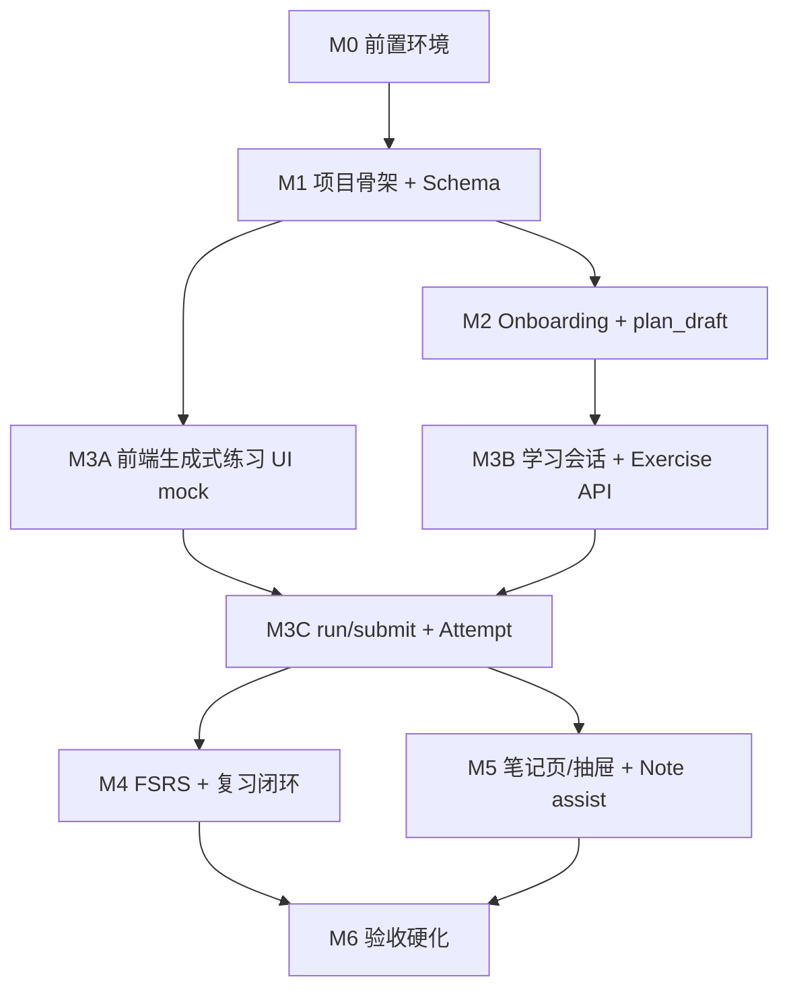

# Aearn 实施计划与 Post-MVP 路线

日期：2026-05-29
状态：First-version baseline + Post-MVP Draft
关联产品流程：`docs/product/user-flows.md`  
前置配置：`docs/setup/development-environment.md`  
验收依据：`docs/qa/acceptance-test-plan.md`

## 目标

把当前项目从“第一版 MVP 里程碑计划”升级为可以交给开发 Agent 执行和审查的版本化实施规格。第一版闭环已成为稳定基线；后续任务可以进入 post-MVP / v1.1 增强，但每个增强必须明确保留哪些第一版契约。

第一版只交付一个窄闭环：

```text
语言选择 -> 生成 plan_draft -> 确认学习计划 -> 进入当前学习会话 -> 概念开场与自然语言判断 -> 对话中生成代码练习 UI -> 运行/预览 -> 提交 -> 保存 Attempt -> 更新 ReviewState -> 记录笔记
```

## 当前阶段判定

- 第一版 release readiness 已完成，结论为 `ready to release`，证据见 `../../.trellis/tasks/archive/2026-05/05-18-05-18-release-readiness/release-report.md`。
- 当前不再受“只能实现最小 MVP 切片”的限制；可以推进动态路线生成、模型 provider 替换、练习 UI 优化等 post-MVP / v1.1 增强。
- 第一版基线仍是回归门禁：`PlanDraft` 公共结构、latest-card-wins、`Attempt(run)` / `Attempt(submit)` 后端事实记录、FSRS 后端决策、hidden tests 不泄露、模型失败不暴露 provider 细节。
- post-MVP 文档必须区分“已发布基线”“正在实现”“后续保留草案”，不得把未完成增强写成已上线能力。

## 不变产品边界

- 前端 UI 不暴露 `Attempt(run)` / `Attempt(submit)` 内部概念，只展示运行、预览、测试、提交结果。
- 后端必须保留 `Attempt(attempt_type=run)`、`Attempt(attempt_type=submit)`、`Attempt(attempt_type=review_submit)` 三类事实记录。
- 第一版基线不做独立复盘草稿流程、`publishDrawer`、`CodeDraftPage`、面试讲述草稿或自动对外发布。
- 第一版基线只保留笔记页与笔记抽屉；Agent 只能辅助补全当前 Note，不自动生成完整笔记。
- 普通打开应用默认进入当前学习并提示复习；只有中断多日且复习高风险时才优先进入复习。
- 设置页不能修改后端固定评分规则、Attempt 必填事实记录策略或 FSRS 调度规则。
- 动态路线生成不得绕过课程 catalog、runtime boundary、`PlanDraft` validation 或 `source_attribution`。
- 新增语言公开支持必须同步扩展 `Language` 枚举、数据库约束、课程 catalog、runtime boundary、API 契约、前端展示和验收用例；不能只靠权威文档 URL 或 prompt 承诺。

## Post-MVP / v1.1 工作队列

| 方向 | 当前状态 | 目标 | 必须保留的基线 |
|---|---|---|---|
| 动态学习路线生成 | `05-29-dynamic-plan-generation` in progress | 从固定 `COURSE_TEMPLATES` 扩展为模型参考权威文档和用户目标生成 modules | `PlanDraft` 结构不变、latest-card-wins、fallback 可解释、未登记语言不公开承诺 |
| DeepSeek official Chat Completions provider | `05-29-deepseek-official-chat-completions-provider` planning | 用官方 DeepSeek Chat Completions 替代不稳定 relay 路径 | `MODEL_UNAVAILABLE` 映射、SSE/JSON 形状、无 raw provider error |
| 练习卡 UI 直观性优化 | `05-29-exercise-card-ui-optimization` in progress | 优化编辑区、运行反馈和主/辅操作层次 | 操作数据流不变、前端不暴露内部 `Attempt` 类型、≤1180px 响应式 |
| 学习页概念开场与判断流 | `05-30-learning-page-concept-intro-check-flow` in progress | 在学习会话入口生成 `show_concept_intro`，用自然语言判断进入 `show_concept_check_result` 和练习确认 | 不泄露 hidden tests、`solution_reference`、raw prompt、raw provider error；模型输出非法时返回 `CONCEPT_INTRO_GENERATION_FAILED` |

## 实施目录假设

正式项目目录建议为仓库内新目录：

```text
aearn/
  apps/desktop/
  services/api/
  services/worker/
  packages/shared/
  infra/
```

历史 `01_` 到 `07_` 教程子项目不作为最终应用目录；需要参考时只提取概念，不复用其目录结构作为正式 runtime 主代码。

## 任务分层

| 层级 | 职责 | 主要文档 |
|---|---|---|
| Product | 流程、页面、边界、不做什么 | `product/user-flows.md`、`product/frontend-interaction-spec.md` |
| Contract | API、枚举、错误码、幂等 | `architecture/api-contract.md` |
| Data | Schema、migration、事实表 | `architecture/database-schema.md` |
| Agent | LangGraph 图、节点、写库时机 | `architecture/langgraph-state-machine.md` |
| Runtime | 运行/预览/测试判定 | `architecture/code-completion-evaluation-spec.md` |
| Review | FSRS 调度、ReviewState、ReviewLog | `architecture/fsrs-scheduling-spec.md` |
| QA | 验收、契约测试、前端手工 QA | `qa/acceptance-test-plan.md` |

## 依赖顺序



## 并行规则

- `M1-DATA-*` 完成后，`M2-BE-*`、`M3-FE-*`、`M5-FE-*` 可以并行推进。
- `M3-BE-03 submit/evaluate` 必须等待 `M1-DATA-02 attempts/review_states` 和 `M3-BE-02 runner`。
- `M4-*` 必须等待 `Attempt(submit)` 和 `ReviewState` 写入稳定。
- `M5 Note assist` 可先使用 mock Agent，但正式写库必须等待 `notes` 表和 `POST /api/notes/{note_id}/agent-draft`。
- 任何会写 `Attempt`、`ReviewState`、`ReviewLog` 的任务都必须先完成 API 契约和数据库字段核对。

## Milestone 0：前置环境配置

目标：固定本机工具链、服务依赖、环境变量和正式项目目录边界。

| ID | 类型 | 任务 | 输入 | 输出 | 依赖 | 验收 |
|---|---|---|---|---|---|---|
| M0-ENV-01 | Setup | 验证 Windows 工具链 | `development-environment.md` | 工具链版本记录 | 无 | PowerShell、Git、Docker、Node、pnpm、Rust、Python、uv 可用 |
| M0-ENV-02 | Infra | 启动 PostgreSQL / Redis | `infra/` compose 草案 | 本地服务可连接 | M0-ENV-01 | DB 与 Redis 连接命令通过 |
| M0-ENV-03 | Config | 生成 `.env.example` | API/DB/LLM/FSRS 配置清单 | 不含真实密钥的 env 模板 | M0-ENV-01 | 无真实 secret，字段覆盖 API、worker、desktop |
| M0-ENV-04 | Repo | 创建正式项目目录 | 本实施计划 | `aearn/` 骨架 | M0-ENV-01 | 后续任务不再写入 `01_` 到 `07_` 教程目录 |

## Milestone 1：项目骨架与基础数据

目标：让桌面端、API、数据库、worker 能启动，并能写入基础对象。

| ID | 类型 | 任务 | 输入 | 输出 | 依赖 | 验收 |
|---|---|---|---|---|---|---|
| M1-BE-01 | Backend | 创建 FastAPI 服务骨架 | `api-contract.md` | `services/api` 启动入口、健康检查 | M0 | `GET /health` 返回 ok |
| M1-FE-01 | Frontend | 创建 Tauri + React 桌面骨架 | `frontend-interaction-spec.md` | `apps/desktop` 路由、壳布局 | M0 | 桌面端能调用 `/health` |
| M1-DATA-01 | Data | 建立 migration 基线 | `database-schema.md` | users、preferences、plans 基础表 | M0-ENV-02 | migration 可重复执行 |
| M1-DATA-02 | Data | 建立学习与练习核心表 | `database-schema.md` | learning_plans、knowledge_points、exercises、attempts、review_states | M1-DATA-01 | 可插入 plan、exercise、attempt、review_state |
| M1-WORKER-01 | Worker | 创建 Celery worker 骨架 | `fsrs-scheduling-spec.md` | worker 启动入口、任务注册 | M0-ENV-02 | worker 可连接 Redis |
| M1-QA-01 | Test | 建立契约测试与 smoke 测试目录 | `acceptance-test-plan.md` | API smoke、DB migration test | M1-BE-01、M1-DATA-01 | smoke 能在本机运行 |

## Milestone 2：Onboarding 与课程计划

目标：用户能选择目标语言，生成 `plan_draft`，确认成正式学习计划，并进入当前学习。

| ID | 类型 | 任务 | 输入 | 输出 | 依赖 | 验收 |
|---|---|---|---|---|---|---|
| M2-BE-01 | Backend | 实现用户建档与偏好 API | `api-contract.md` | `POST /api/users`、`PATCH /preferences` | M1-BE-01、M1-DATA-01 | 拒绝评分/Attempt/FSRS 规则修改 |
| M2-BE-02 | Backend | 实现固定课程模板 | `user-flows.md` | JS/HTML/CSS、Python 入门模板 | M1-DATA-02 | 生成的知识点含 runtime_tier |
| M2-AGENT-01 | Agent | 实现目标澄清与 `plan_draft` 生成节点 | `langgraph-state-machine.md` | onboarding graph 初版 | M2-BE-02 | plan_draft 可解释来源与风险 |
| M2-BE-03 | Backend | 实现确认计划 API | `api-contract.md`、`database-schema.md` | `POST /api/plans` | M2-AGENT-01 | 创建 LearningPlan、KnowledgePoint、ReviewState |
| M2-FE-01 | Frontend | 实现 Onboarding 页面 | `frontend-interaction-spec.md` | 目标输入、计划预览、确认操作 | M1-FE-01、M2-BE-03 | 确认后进入当前学习 |
| M2-QA-01 | Test | 覆盖 UF-01 / UF-02 | `acceptance-test-plan.md` | onboarding 测试用例 | M2-FE-01 | `plan_draft` 成功与失败路径可验证 |

## Milestone 3：生成式代码练习闭环

目标：用户在对话中的生成式 UI 中读代码、补全、运行/预览、提交，并保存 Attempt。

| ID | 类型 | 任务 | 输入 | 输出 | 依赖 | 验收 |
|---|---|---|---|---|---|---|
| M3-BE-01 | Backend | 实现学习会话 API | `api-contract.md` | `POST /api/learning-sessions/start`、resume、`show_concept_intro` / `show_concept_check_result` 工具合同 | M2-BE-03 | 普通打开进入当前学习，概念开场/判断结果可持久化重放 |
| M3-BE-02 | Runtime | 实现 run/preview runner 边界 | `code-completion-evaluation-spec.md` | browser_preview、python_stdout_test 初版 | M1-DATA-02 | `success`、`runtime_error`、`timeout`、`unsupported` 可区分 |
| M3-BE-03 | Backend | 实现 run Attempt 写入 | `api-contract.md`、`database-schema.md` | `/run` 写 `Attempt(run)` | M3-BE-02 | run 不更新 ReviewState |
| M3-BE-04 | Backend | 实现 submit/evaluate 写入 | `code-completion-evaluation-spec.md` | `/submit` 写 `Attempt(submit)`、code_completion_result | M3-BE-03 | result、score、fsrs_rating 符合规则 |
| M3-AGENT-01 | Agent | 实现 hint / explain-error 节点 | `langgraph-state-machine.md` | hint、explain-error、check-explanation | M3-BE-03 | 不默认直接给完整答案 |
| M3-FE-01 | Frontend | 实现对话内生成式练习 UI | `frontend-interaction-spec.md` | GeneratedCodeExerciseCard、Editor、Preview/Stdout/Test panes | M1-FE-01 | UI 不显示 Attempt 内部类型 |
| M3-FE-02 | Frontend | 实现 stale/error/loading 状态 | `frontend-interaction-spec.md` | 运行中、失败、旧结果 stale、重试 | M3-FE-01 | 旧运行结果不会冒充当前结果 |
| M3-QA-01 | Test | 覆盖 UF-04 / UF-05 / CE-01~CE-10 | `acceptance-test-plan.md` | 学习闭环测试 | M3-BE-04、M3-FE-02 | P0 用例 100% 通过 |

## Milestone 4：FSRS 与复习闭环

目标：提交结果能更新 ReviewState，系统能生成待复习队列，并通过短热身、seed bank 变体和 `review_ai_patch` 完成复习闭环。

| ID | 类型 | 任务 | 输入 | 输出 | 依赖 | 验收 |
|---|---|---|---|---|---|---|
| M4-DATA-01 | Data | 完成 review_logs、review_seed_banks 与索引 | `database-schema.md` | review_logs、review_seed_banks、due 查询索引 | M1-DATA-02 | 每次 ReviewState 更新有日志；seed bank 可记录 ready/failed |
| M4-BE-01 | Backend | 实现 FSRS 调度服务 | `fsrs-scheduling-spec.md` | scheduler、fallback、幂等键 | M3-BE-04、M4-DATA-01 | 重试不重复增加 review_count |
| M4-WORKER-01 | Worker | 实现 due review 计算任务 | `fsrs-scheduling-spec.md` | Celery 定时任务 | M4-BE-01 | 到期任务可查询 |
| M4-BE-02 | Backend | 实现复习 API | `api-contract.md` | `/reviews/today`、`/reviews/start`、`/reviews/{session_id}/warmup-result`、`/reviews/{session_id}/exercise-result` | M4-BE-01 | warmup 不更新 FSRS；due、未 due、seed rescue 失败路径明确 |
| M4-AGENT-01 | Agent | 实现 review graph | `langgraph-state-machine.md` | ensure_review_seed_bank、select_review_seed、record_review_warmup_result、update_review_state | M4-BE-02 | 复习变体保留同一错因，`review_ai_patch` 弱证据不 Easy |
| M4-FE-01 | Frontend | 实现 ReviewPage | `frontend-interaction-spec.md` | 队列、短热身、复习练习、`review_ai_patch` 表单、FSRS 指标 | M4-BE-02 | due_at、forget_risk、score 来自后端 |
| M4-QA-01 | Test | 覆盖 UF-06 / FSRS-01~FSRS-09 | `acceptance-test-plan.md` | FSRS、warmup、seed rescue、review_ai_patch 集成测试 | M4-FE-01 | P0 复习用例全通过 |

## Milestone 5：笔记页、笔记抽屉与辅助补全

目标：用户能在学习/复习时记录知识点笔记，Agent 只提供辅助补全建议。

| ID | 类型 | 任务 | 输入 | 输出 | 依赖 | 验收 |
|---|---|---|---|---|---|---|
| M5-DATA-01 | Data | 完成 notes 表与约束 | `database-schema.md` | notes、knowledge_point_id 关联 | M1-DATA-02 | 同知识点笔记可查询 |
| M5-BE-01 | Backend | 实现 Note CRUD API | `api-contract.md` | `GET/POST/PATCH /api/notes` | M5-DATA-01 | 保存失败不丢内容 |
| M5-AGENT-01 | Agent | 实现 note_assist_graph | `langgraph-state-machine.md` | `POST /api/notes/{note_id}/agent-draft` | M5-BE-01、M3-BE-04 | 不创建 CodeDraft，不自动生成完整笔记 |
| M5-FE-01 | Frontend | 实现笔记抽屉 | `frontend-interaction-spec.md` | 会话内 NoteDrawer、自动保存状态 | M5-BE-01、M3-FE-01 | 不打断代码练习 |
| M5-FE-02 | Frontend | 实现笔记页 | `frontend-interaction-spec.md` | NotesPage、语言/知识点筛选、Markdown 编辑 | M5-BE-01 | 学习和复习共用同一份笔记 |
| M5-QA-01 | Test | 覆盖 UF-07 / UF-08 | `acceptance-test-plan.md` | 笔记保存与辅助补全测试 | M5-FE-02、M5-AGENT-01 | 不存在独立草稿生成入口 |

## Milestone 6：设置、恢复与发布前硬化

目标：补齐设置边界、恢复入口、错误状态和发布前审查。

| ID | 类型 | 任务 | 输入 | 输出 | 依赖 | 验收 |
|---|---|---|---|---|---|---|
| M6-BE-01 | Backend | 实现 dashboard/resume 决策 | `user-flows.md` | `GET /api/dashboard`、`GET /api/learning-sessions/resume` | M3、M4 | 普通打开当前学习，高风险才优先复习 |
| M6-FE-01 | Frontend | 实现 SettingsPage | `frontend-interaction-spec.md` | 七类设置页面 | M2-BE-01 | 不出现评分/Attempt/FSRS 规则开关 |
| M6-FE-02 | Frontend | 实现恢复学习状态 | `user-flows.md` | resume banner、review notice、high risk route | M6-BE-01 | 5 秒内看到当前学习入口 |
| M6-QA-01 | Test | 执行全量验收计划 | `acceptance-test-plan.md` | P0/P1/P2 测试报告 | M2~M6 | P0 100%，P1 >= 95% |
| M6-DOC-01 | Docs | 回写实现偏差 | 本计划与实际实现 | 文档差异清单 | M6-QA-01 | 无未解释的 contract 偏差 |

## 最小可运行切片

第一阶段开发必须先跑通以下切片，不能先做复杂复习、可视化或笔记增强：

1. `M0-ENV-01` 到 `M0-ENV-04`。
2. `M1-BE-01`、`M1-FE-01`、`M1-DATA-01`、`M1-DATA-02`。
3. `M2-BE-02`、`M2-BE-03`、`M2-FE-01`。
4. `M3-BE-01`、`M3-BE-02`、`M3-BE-03`、`M3-BE-04`。
5. `M3-FE-01`。
6. `M3-QA-01` 中 UF-01、UF-03、UF-04、CE-01、CE-03 的最小用例。

切片通过标准：

- 用户能创建目标并确认计划。
- 系统能进入当前学习会话。
- 前端展示一张生成式代码练习卡片。
- 用户能运行或预览一次代码。
- 用户能提交一次答案。
- 后端保存一条 `Attempt(run)` 和一条 `Attempt(submit)`。
- 前端不显示 `Attempt(run)` / `Attempt(submit)` 内部类型。

## 开发 Agent 分工建议

最多并行 3 个开发 Agent：

| Agent | 负责范围 | 不得修改 |
|---|---|---|
| Backend Agent | `services/api`、API contract 实现、runner 接口、Note API | 前端样式、Tauri 壳 |
| Frontend Agent | `apps/desktop`、生成式 UI、页面状态、设置页 | 数据库 migration、FSRS 算法 |
| Data/Agent Agent | migration、LangGraph 节点、FSRS worker、note_assist_graph | 桌面端组件视觉 |

主线程负责整合、冲突解决、最终验收和文档回写。

## 审查步骤

每完成一个 Milestone，按以下顺序审查，不跳级：

1. 文档一致性审查：确认实现没有偏离 `user-flows.md` 的第一版基线和 post-MVP 标注，特别是 `CodeDraftPage`、`publishDrawer`、独立复盘草稿不得回流。
2. API 契约审查：对照 `api-contract.md` 检查路径、字段、枚举、错误码、幂等键和响应示例。
3. 数据写入审查：对照 `database-schema.md` 检查 `Attempt`、`ReviewState`、`ReviewLog`、`Note` 的写入时机和约束。
4. Agent 状态机审查：对照 `langgraph-state-machine.md` 检查节点输入、输出、条件边、失败分支和重试行为。
5. 前端边界审查：对照 `frontend-interaction-spec.md` 检查生成式 UI、stale 状态、错误状态、禁用状态和设置页限制。
6. 评分与调度审查：对照 `code-completion-evaluation-spec.md` 和 `fsrs-scheduling-spec.md` 检查 score、fsrs_rating、due_at 是否只由后端计算。
7. 验收测试审查：对照 `acceptance-test-plan.md` 执行 P0/P1 用例；P0 不通过不得进入下一 Milestone。
8. 文档回写审查：如果实现为了落地做了取舍，必须回写本计划和对应规格，不允许只在代码里体现。

## 审查命令

文档结构检查：

```powershell
Get-ChildItem -Path docs -Recurse -File | Select-Object FullName
```

旧范围回流检查：

```powershell
$patterns = @(
  'CodeDraft' + 'Page',
  'publish' + 'Drawer',
  '独立复盘' + '草稿',
  'retrospective' + '_graph',
  '/api/code' + '-drafts'
)
Select-String -Path docs\**\*.md,docs\*.md -Pattern ($patterns -join '|')
```

旧文档引用检查：

```powershell
$patterns = @(
  'agent-memory' + '-design',
  'api' + '-design',
  'data' + '-model',
  'desktop-ia' + '-and-layout',
  '2026-04-25-learning-agent' + '-design-v1',
  'documentation' + '-roadmap',
  'super' + 'powers' + '/plans'
)
Select-String -Path docs\**\*.md,docs\*.md -Pattern ($patterns -join '|')
```

实施计划任务完整性检查：

```powershell
Select-String -Path docs\plans\learning-agent-implementation-plan.md -Pattern 'M[0-9]-[A-Z]+-[0-9]+|输入|输出|依赖|验收|审查步骤'
```

核心边界检查：

```powershell
Select-String -Path docs\**\*.md,docs\*.md -Pattern 'Attempt\(run\)|Attempt\(submit\)|笔记抽屉|当前学习|复习高风险|设置页|FSRS'
```

## 发布前通过标准

- P0 验收用例 100% 通过。
- P1 验收用例通过率不低于 95%。
- 所有写 `Attempt`、`ReviewState`、`ReviewLog` 的路径都有幂等和失败恢复说明。
- 前端没有暴露内部 Attempt 类型。
- 设置页没有破坏后端评分、Attempt、FSRS 固定规则的入口。
- 文档中旧草稿流程只允许出现在“非第一版基线 / 后置 / 已移除”语境。
- post-MVP 增强有明确 fallback、回滚、source attribution 和未实现能力边界。
