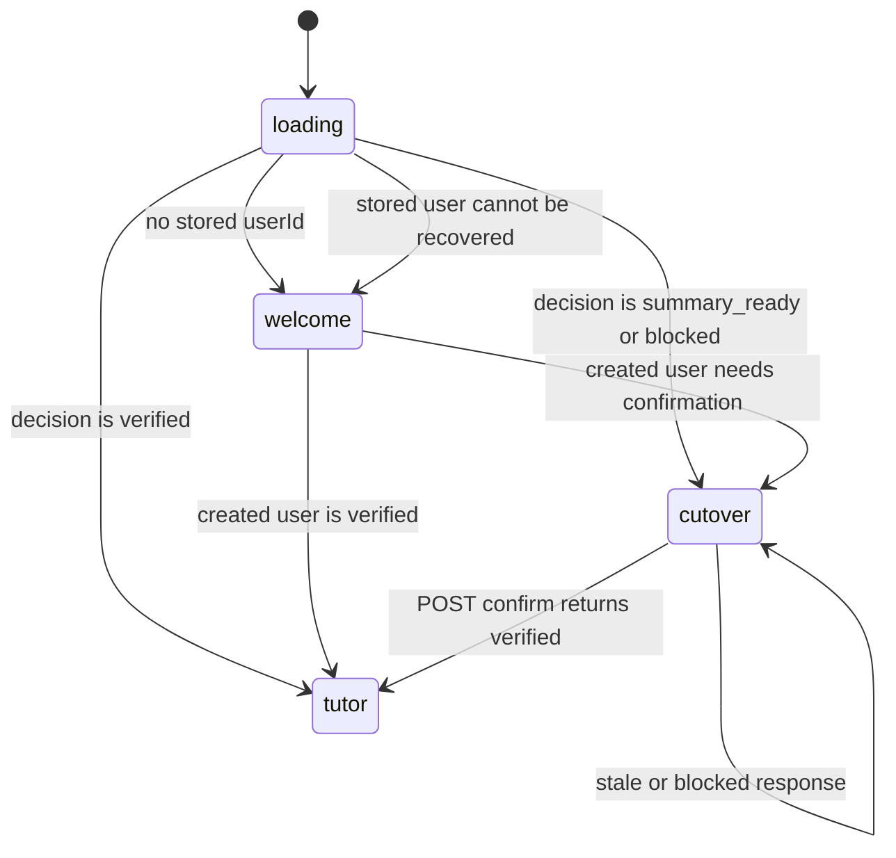

# Aearn Tutor 桌面端交互规格

**状态：** 当前 Desktop 交互契约，2026-08-12。
**适用范围：** `aearn/apps/desktop/src/` 的 React + Tauri UI。
**权威来源：** `App.tsx`、`stores/useAppStore.ts`、`api.ts`、
`pages/HarnessCutoverPage.tsx`、`features/learning/TrackLearningWorkspace.tsx`、`features/learning/ReviewSessionPanel.tsx`、`features/tutor/TutorConversationSurface.tsx` 与类型/测试。

本规格取代旧 Onboarding、LearningWorkspace、Review、Notes 和 Graph/SSE UI
描述。Desktop 只呈现服务器授予的 Tutor 状态；它不会编排 provider、Graph、
后台队列、切换删除范围或执行器。

## 设计目标

1. **先准入、后工作区。** 任何本地身份恢复都先读取服务器 cutover decision，
   再渲染用户可操作的 Tutor UI。
2. **解释不可逆边界。** 有旧数据时，清理页显示服务器摘要和保留项，明确代码
   回退不会恢复清理的数据。
3. **保持历史连续、普通输入独立。** conversation history、公开 process 和
   run 状态可恢复；每条普通消息创建新的有限 TurnRun，只有服务器明确授权的
   continuation 才能复用等待中的 run。
4. **让学习记录受用户控制。** Activity/inbox、记忆、计划版本和偏好在同一
   工作区中以 learner-safe projection 展示。
5. **不泄露内部细节。** UI 不显示 provider 原始错误、内部 reason、prompt、
   checkpoint、capability schema、执行命令、hidden tests 或密钥。

## 顶层状态机

`AppRoute` 只能是 `loading`、`welcome`、`cutover` 或 `tutor`。不存在可由
客户端直接导航的 legacy route。

## Bootstrap、缓存与服务器权威

### Bootstrap 顺序

1. `useAppStore.bootstrap()` 并行读取 `/health` 和语言课程目录；健康状态只
   用于显示，不构成服务器准入的替代品。
2. 读取本地 bootstrap。若没有 `userId`，进入 `welcome`。
3. 有 `userId` 时，先读取 `GET /api/users/{user_id}`，然后立即写回
   `{ userId, planId: null }`。
4. 读取 `GET /api/harness/cutover?user_id=...`，仅由响应 `state` 决定
   `cutover` 或 `tutor`。
5. 任何恢复失败都会清除本地 bootstrap，回到 `welcome`。UI 不发送旧
   dashboard、resume、plan 或 session 恢复请求。

### 本地存储边界

- 可持久化的身份事实只有本地 `userId`；旧 `planId` 一律归一化为 `null`。
- 切换确认成功后再次写入 `{ userId, planId: null }`，并让工作区重新读取
  目标状态。
- local storage 不能证明 cutover，不能保存切换摘要/nonce，不能恢复被删除的
  legacy 数据，也不能绕过 server gate。
- 学习工作区只额外保存版本化导航指针
  `aearn.learning-workspace.v1:{userId}`：`{version,trackId,mode,knowledgeKey,reviewSessionId}`。
  它不是 server state；刷新后必须重新读取并校验 track、roadmap、Lesson/Review 与 conversation。

## 页面与组件

| UI 状态 | 主要组件 | 用户可见职责 | 禁止职责 |
| --- | --- | --- | --- |
| `loading` | `LoadingScreen` | 显示本地身份/服务器状态读取进度 | 猜测用户是否已切换或恢复旧页面 |
| `welcome` | `WelcomeScreen` | 收集显示名称并创建本地用户 | 保存模型密钥、provider 或 learning plan |
| `cutover` | `HarnessCutoverPage` | 显示服务器摘要、阻塞原因、保留项和确认动作 | 选择表、计数、checkpoint 线程或删除范围 |
| `tutor` | `LearningHomePage` / `LearningPlanBuilderPage` / `TrackLearningWorkspace` | 学习主线、计划制定、路线、Lesson/Practice、Review 与 scoped Tutor | 前端计算进度/评分/到期/解锁，运行 Graph 或直接写数据库 |

顶层 `App` 只包含应用菜单、API 健康文本、一个不可覆盖的当前入口标签以及
上述主体。侧栏折叠只能改变布局，不改变 active route 或 server decision。

## 切换页面：`HarnessCutoverPage`

### `summary_ready`

- 显示 `legacy_categories`、`legacy_profile_fields`、可精确归属的 checkpoint
  数，以及保留的 identity/notification 类别。
- “刷新摘要”重新请求服务器；确认前摘要变更会返回 stale 错误，用户必须查看
  新摘要。
- 确认按钮只在复选框选中且请求未 pending 时可用。
- `POST /api/harness/cutover/confirm` 必须带服务器已给出的 version、summary
  version、nonce、hash 和新建的 client action ID。

### blocked / error

- `blocked_target_state` 显示“发现预切换 Tutor 数据”；UI 不提供删除/迁移
  该数据的快捷入口。
- `blocked_checkpoint_scope` 显示“无法安全确认历史运行状态归属”；UI 不提供
  宽泛 checkpoint 清理。
- 其他错误以公开 `error.code` 和可读 `message` 显示，不渲染后端异常细节。

## Tutor 工作区：`TutorWorkspacePage`

### 会话导航、主列与 run 状态

- `App.tsx` 保存当前选择的 conversation ID。左侧显示“新对话”和最多 8 条由
  `last_public_activity_at` 倒序的 recent conversation；仅当服务器声明仍有更多时显示
  “查看全部对话”。完整列表是可键盘操作的轻量面板，采用 cursor 分页，不把所有
  history 塞进侧栏。
- 选择“新对话”只清空本地 timeline/run/composer context 并将 selection 设为 draft；
  **不得**创建 conversation、run、message 或 sidebar item。首个非空提交调用
  `POST /conversations/first-turn`，成功后才选中新 conversation 并刷新 recent list。
- 选择已有 conversation 时，页面取消旧 snapshot request/stream、清空旧本地 timeline，
  从 `GET /conversations/{id}/snapshot` hydrate 最新 40 条倒序 public timeline、active turn、
  pending typed request、Queue、control version/state 与 opaque `stream_cursor`。更早记录继续
  使用 snapshot 的 history cursor prepend，并保持滚动锚点。
- 普通 composer 只调用 conversation-input/first-turn。运行中 Send 显示“加入 Queue”；
  Stop、Steer、Queue edit/delete/reorder/execute/resume、Retry 与 typed request response 都携带
  snapshot 返回的 expected identity/version。Desktop 没有 `/runs/{run_id}/inputs` caller，
  也不会因 legacy waiting 状态恢复旧 continuation。
- pending typed request 完全占用 composer 席位。clarification、planning input 与 approval
  使用服务端 presentation/allowed action；authority request 只显示等待状态。此时普通 composer、
  Queue tray 与 conversation control mutation 不可触达。
- Composer 最多 16,000 个字符，可用 Ctrl/⌘+Enter 提交；pending 时禁用重复动作。
  timeline 是独立纵向滚动区，Composer 在 desktop view 保持可见，新的 snapshot 条目
  不得把它持续挤出主要可视区。
- timeline 只渲染 server public `message`、typed request 与 learner-safe `error`。
  独立 `process` item 仅为兼容解析和 cursor 顺序存在，不进入主 renderer。Tutor message 的
  bounded `public_thinking_steps[]` 通过 DSH-derived `Think` disclosure 默认展开；不得从 process、
  SSE/raw trace、tool/category 或 provider reasoning 合成公开思路。
- legacy waiting 的 `TUTOR_LEGACY_CONTINUATION_REQUIRES_NEW_TURN` 显示 fresh-turn 迁移卡；
  ordinary cutover cancellation 使用普通 interrupted 视觉，不显示系统故障或自动动作。

### SSE 交互

`useTutorConversationStream` 是 conversation-global transport hook。snapshot 是 timeline、Queue、
request 与 control state 的唯一 authority；event 只触发节流 snapshot refresh。hook 保存 opaque
signed cursor，忽略重复/旧 sequence，发现 gap、cursor invalid 或协议错误时关闭旧流并重新 snapshot。

- endpoint 变更、选择其他 conversation 或组件卸载时必须清理旧 stream；新的 history
  hydrate 不得被旧 stream callback 关闭。
- 首次连接不发送 cursor；重连时只发送最后已消费的数字 `Last-Event-ID`。
- 同一 run 的重复/倒退 ID 被丢弃；保留 512 个已见 ID 防止重复呈现。
- `done` 和 `error` 是 transport 终态；没有 `id` 的 error 不更新 cursor。
- 非终态的 `waiting_for_input` `run_state` 可携带 learner-safe `public_message`；
  Desktop 以服务端 history 刷新后的消息为准，并只在 explicit continuation 可用时
  展示继续确认控制。
- 自动重连最多两次。`SSE_CURSOR_INVALID`、未知事件或不完整帧显示稳定的
  `TUTOR_SSE_PROTOCOL_ERROR` / error 入口，而不是把不可信 payload 渲染成 UI。

### 侧列：学习控制

| 面板 | 数据与动作 | UI 边界 |
| --- | --- | --- |
| `TutorActivityPanel` | activity、inbox、read、dismiss | 背景建议只以 activity/inbox 呈现，不显示为聊天或系统通知 |
| `TutorMemoryPanel` | memory、correct、delete | 显示安全 statement/evidence；校正和删除均为有确认的 API 状态变更 |
| `TutorPlanPreferencesPanel` | plan revision、rollback、memory/proactive preference | 只能回退到直接前驱；只可切换 inferred memory 与暂停主动建议 |

“暂停主动建议”默认显示为可用但未暂停。恢复（`proactive_paused=false`）会恢复该
用户的 `enabled=true` 偏好；它不会绕过 verified receipt、全局 pause、日预算、
冷却、并发或熔断器。

## 责任边界

### Desktop 负责

- 本地身份 bootstrap 与失效缓存清理。
- 请求 JSON/SSE、解析已公开类型、显示 loading/error/retry 状态。
- 生成客户端 idempotency action ID。
- 响应式布局、键盘提交、可访问标签和操作反馈。

### API / Harness 负责

- cutover summary、确认、数据删除/验证、runtime gate 和所有持久化事务。
- 输入 revision、run 预算/lease、Skill/capability/effect validation、provider
  failure mapping、SSE 顺序和 redaction。
- activity/inbox/memory/plan/preference 的用户范围和幂等。
- scheduler、curation、executor 和 provider composition。

### 前端禁止越界

- 不根据本地状态把 `cutover` 改成 `tutor`。
- 不保存、传输或展示 provider key、prompt、provider-native reasoning、raw event/trace、
  hidden tests、reference answers、完整 learner code、shell/SQL/path 或 Docker
  信息。
- 不发起 `runner.execute`，不启动 subprocess/worker，不把 proactive activity
  伪装成聊天消息或桌面通知。
- 不重新引入旧 Onboarding/Learning/Review/Notes 页、legacy SSE parser 或
  Graph-specific component。

## 响应式与可访问性验收

- 窄视口下主列与控制列必须可读；Composer 和主要操作不可溢出视口或被侧栏遮挡。
- 所有可操作控件有可读的 label、disabled/loading 状态和 error/status live
  region。
- 键盘可以聚焦并提交 Composer、切换偏好、刷新/确认 cutover、处理 inbox。
- 服务器离线、cutover blocked、SSE 中断和并发 conflict 均显示公开错误并保留
  用户仍可安全操作的部分。

## 相关文档

- [用户流程](./user-flows.md)
- [Tutor Harness Runtime](../architecture/tutor-harness-runtime.md)
- [API 与 SSE 契约](../architecture/api-contract.md)
- [验收计划](../qa/acceptance-test-plan.md)

## 2026-08-10：verified shell 内部学习视图

> 历史截面：本节只描述 2026-08-10 的中间状态；`downstream not-ready` 已由后文正式 `learning_workspace` 状态取代。

`AppRoute` 仍只有 `loading | welcome | cutover | tutor`。`tutor` 内部只包含 `learning_home`、`track_planner` 和 downstream not-ready intent，不提供 general conversation / 对话历史页面或导航入口。既有服务端 conversation 数据与 API 保持兼容；`features/tutor/TutorConversationSurface.tsx` 仅作为 planner 的 history/SSE/composer/continuation 内核，并始终发送 `plan_drafting/plan_drafting` scope。首页不渲染左侧栏，也不显示对话历史或手动刷新按钮；添加卡直接创建/恢复 planning session，不显示语言选择器，语言及其他计划信息全部在对话中询问。planning 页面同样不渲染应用左侧栏、Tutor hero 或外层对话卡片。历史加载完成且没有消息或 active run 时，未激活状态只在可用区域中央显示一个圆角 Composer，不显示空状态说明、建议按钮或底部提示；首条消息被接受后才切换为 Tutor 左侧正文、学习者右侧气泡的 GPT 式消息流，并把 Composer 移到底部。收集阶段保持居中单列，Composer 获得文本输入焦点时也不改变外壳边框、阴影或位置。进入 planning 页面时，页面右缘立即出现展开/收起按钮并默认弹出四角圆角的紧凑独立浮动窗口；服务端尚未返回 `current_draft` 时窗口只显示一个 emoji 和隐藏的可访问状态，不显示伪造计划字段，草案到达后在同一窗口原位替换为计划路线。窗口不参与主布局，与视口右缘保留明显留白，不表现为贴边侧栏，不挤压对话列且不占满整个右侧；用户可收起并重开，同一 draft 的普通刷新不强制重开，新 draft 版本则自动展示。窄屏使用限制最大高度的底部浮动检查器；卡片不重算进度、复习或 execution tier。宽屏三列、中屏两列、窄屏单列，添加卡 DOM 顺序固定最后。当前前端完成门仅为 `http://127.0.0.1:1420` 网页端浏览器验证；除非用户明确要求，不运行 Desktop build/typecheck。

## 2026-08-11：LessonDocument 单页阅读状态机

> 历史截面：本节记录独立 Lesson 页面交付时的边界；当前入口已统一进入 `TrackLearningWorkspace`。

`TutorSurface` 现在包含 `lesson_document { trackId, knowledgeKey }`。Learning Home 的“继续学习”只使用服务端 `current_knowledge_key`；为空时按钮保持禁用，不在 Desktop 猜测路线节点。Lesson 页面保持 sidebarless focus shell，提供返回首页的稳定路径，但不提前实现完整三栏或右侧 Tutor。

状态机为 `loading -> missing -> preparing -> ready`，失败进入可恢复 `failed`。`api.ts` 从 `unknown` 严格构造 `LessonDocumentState`、十类 block union、citation、assignment 和 update proposal；未知字段、未知 block、非法 URL、重复/不连续 block 或悬空 citation 都显示 contract error，不做 HTML/Markdown fallback。

ready 页面复用 `LessonDocumentView`、`LessonBlockRenderer` 和
`LessonSourcesPanel`。事实段落展示 inline citation；证据面板可键盘展开并展示受限摘录。start、refresh 和 migration 都使用 server version/CAS 与新的 client action ID。Gate slot 通过 typed render seam 接收服务端 Gate projection；页面只按 `allowed_actions` 显示 prepare、hint、run 或 submit，不在本地计算 score、pass、mastery 或 unlock。网页端完成门为 `http://127.0.0.1:1420` 的 normal、900px 与 390px 浏览器验证；默认不运行 Desktop build。

## 2026-08-11：Lesson Gate 与模块诊断交互

`LessonDocumentPage` 拥有 Gate map、editor、hint、Attempt、poll/replay、stale、error 和 diagnostic modal 状态；`LessonDocumentView` 与 `LessonBlockRenderer` 继续保持纯展示，只通过 typed `renderExerciseGate` seam 渲染 `LessonGatePanel`。`api.ts` 从 `unknown` 严格构造 Gate、exercise、Attempt/result、hint、diagnostic 和 impact union，未知字段、状态、tier、exercise type 或 action 必须成为可见 contract error。

`LessonGatePanel` 只消费服务器 `allowed_actions`。未绑定 Gate 显示 prepare；pending Attempt 轮询同一个 `attempt_id`；终态结果显示服务端 score 和 safe feedback。学习者修改 editor 后，旧结果必须显示 stale，不得继续作为当前提交证据。`static_only` 隐藏 Run 并显示 `execution_claim=not_run` 语义，`unavailable` 隐藏 Run/Submit，`teaching_local` 显示 development-only 披露，`container_verified` 只展示服务器已经授权的动作。

`ModuleDiagnosticModal` 是独立对话框，不复用知识点 Gate。打开入口只由 Lesson state 的 `module_diagnostic_allowed=true` 决定；创建后逐项显示冻结的核心 capability，失败/部分通过必须显示“未跳过任何知识点”和冷却/薄弱项。通过状态只显示 proposed impact，必须有显式确认按钮；确认成功后重新读取 Lesson/路线并隐藏已失效入口。

网页验收必须覆盖 1440px、精确 900px 和 390px，无水平溢出、无 framework overlay、相关 console error/warning 为零、键盘焦点可见、对话框适配窄屏。可以使用 disposable stateful fake API 验证状态机；不能用静态搜索或 Desktop build 代替真实网页交互，也不能调用真实 provider、真实 executor 或生产数据。

## 2026-08-12：结构化模型代码审核 Gate

`LessonDocumentPage` 保存每个 Gate 的 review draft、authoring poll 与 evidence state；
`LessonGatePanel` 只按服务端 `exercise_type` 分发。`ModelCodeReviewPanel` 显示需求、只读带
行号代码、verdict radio、可增删 finding fieldset 和字段级错误；普通 exercise 继续使用原
textarea。`preparing` 只展示服务端状态与重试，不生成本地题目或答案。

提交必须发送 exact `review_submission`，结果按 `client_finding_id` 显示
`supported | partial | unsupported | duplicate`、分数维度、omission band 与 next action。
查看 validation evidence 后显示 assisted 状态，并明确“发布前由服务端验证；本次提交没有
运行代码”。unknown type/status/field、extra key 或 protected marker 使整个 payload fail
closed。390px、900px、1440px 下页面不得水平溢出；代码区可以独立横向滚动，radio、按钮和
fieldset 可键盘操作且 focus 可见，并尊重 reduced motion。

## 2026-08-12：三栏学习工作区与结构化上下文引用

`TutorSurface` 的正式学习入口为
`learning_workspace { trackId, mode, knowledgeKey, reviewSessionId }`。Learning Home 的
“继续学习”和“开始复习”都进入同一 `TrackLearningWorkspace`；挂载时并行读取 track detail、
roadmap、Review queue，并通过稳定的 user + track 幂等键创建或恢复 track-scoped Tutor
conversation。导航指针只负责定位，服务端返回的 locked/available/progress/mastery/due/version
仍是唯一权威；无效指针会被清除。

宽屏（`>=1180px`）使用 `260px / minmax(0,1fr) / 360px` 三栏并分别滚动；
`768..1179px` 隐藏固定路线栏，使用带 `aria-modal`、初始焦点、焦点循环、Escape 关闭和焦点归还的
路线 drawer；`<768px` 使用路线/课程或复习/Tutor tabs，一次只显示一个 panel。三个验证视口均不得
产生页面级水平溢出，主要动作与 Composer 必须保持可达，并尊重 `prefers-reduced-motion`。

中栏 Lesson 只渲染服务端 blocks、assignment、Gate projection 与 `allowed_actions`。同一个
`data-lesson-block-id` 内的文本或代码选择可创建 `lesson_selection` 草稿；客户端只计算用于定位的
NFKC/空白归一化 range 与 candidate excerpt，服务端重新验证 active frozen document/hash/block/range
并派生 safe excerpt。terminal Lesson Attempt 可产生 `exercise_feedback`，存在真实 execution job 时可额外
产生 `execution_result`；terminal Review Attempt 可产生 `review_feedback`。引用 chips 可预览、去重、移除，
不得拼入 learner `content`；发送成功后只有 acceptance 返回相同数量的已保存 safe references 才清空草稿。
历史 learner message 显示服务端 safe reference cards，Tutor message 的引用数组必须为空。

`ReviewSessionPanel` 严格使用 queue/track/schedule/session/item version 与新的 client action ID 执行
create、warmup、hint、attempt、同一 Attempt poll 和 finalize。warmup/hint/terminal Attempt 都不会在前端改写
长期掌握度或到期时间；finalize 后重新读取服务端 queue/roadmap。切换 user、track、mode、knowledge key 或
review session 时中止旧请求/SSE 并清空旧 reference、editor、result 与 composer scope。

本轮浏览器验收使用可删除的本地 verified fixture，未调用真实 provider 或 executor：`1280x720` 三栏、
`1024x768` drawer、`390x844` tabs 均无水平溢出；Review queue → warmup → terminal Attempt → finalize、
Review feedback 引用、Lesson selection 引用和 console/exception smoke 均通过。正式静态门为
`pnpm --dir .\aearn desktop:check`。

### 最终导航与页面归属

当前 `aearn/apps/desktop/src/pages/` 只保留 `HarnessCutoverPage.tsx`。学习产品页面全部位于 `src/features/learning/`：`LearningHomePage`、`LearningPlanBuilderPage` 与正式 `TrackLearningWorkspace`。不存在当前 `OnboardingPage`、`LearningWorkspacePage`、`ReviewPage`、`NotesPage` 或 `SettingsPage` 路由；不得从历史指南恢复这些入口。

`App.tsx` 只在 verified 后装配 Learning Home、planning 与 `learning_workspace`。旧 general conversation 不出现在主导航；右侧 Tutor 是 track-scoped conversation surface，引用、task kind 和 knowledge scope 必须随 workspace pointer 一起切换。Desktop 不自行推导 execution tier、Gate pass、mastery、review due 或 Action verification 状态。

## 2026-08-14：thread/turn v2 capability 与 migration state

Desktop 通过 `GET /api/tutor/capabilities/thread-turn-v2` 读取 exact server capability。`effective_enabled=false` 时保留 snapshot/history 读取并显示只读 unavailable 状态，不发送 Tutor mutation、不恢复旧 continuation。`blocked` 只显示安全 block code；legacy waiting 失败显示 fresh-turn 迁移卡，普通 cutover cancellation 继续使用 interrupted 视觉。v2 页面以 snapshot-first + conversation SSE 工作，Queue tray、typed request composer、Stop/Steer/Retry、键盘、窄屏与 reduced-motion 均由 `TutorConversationSurface` 统一实现。
