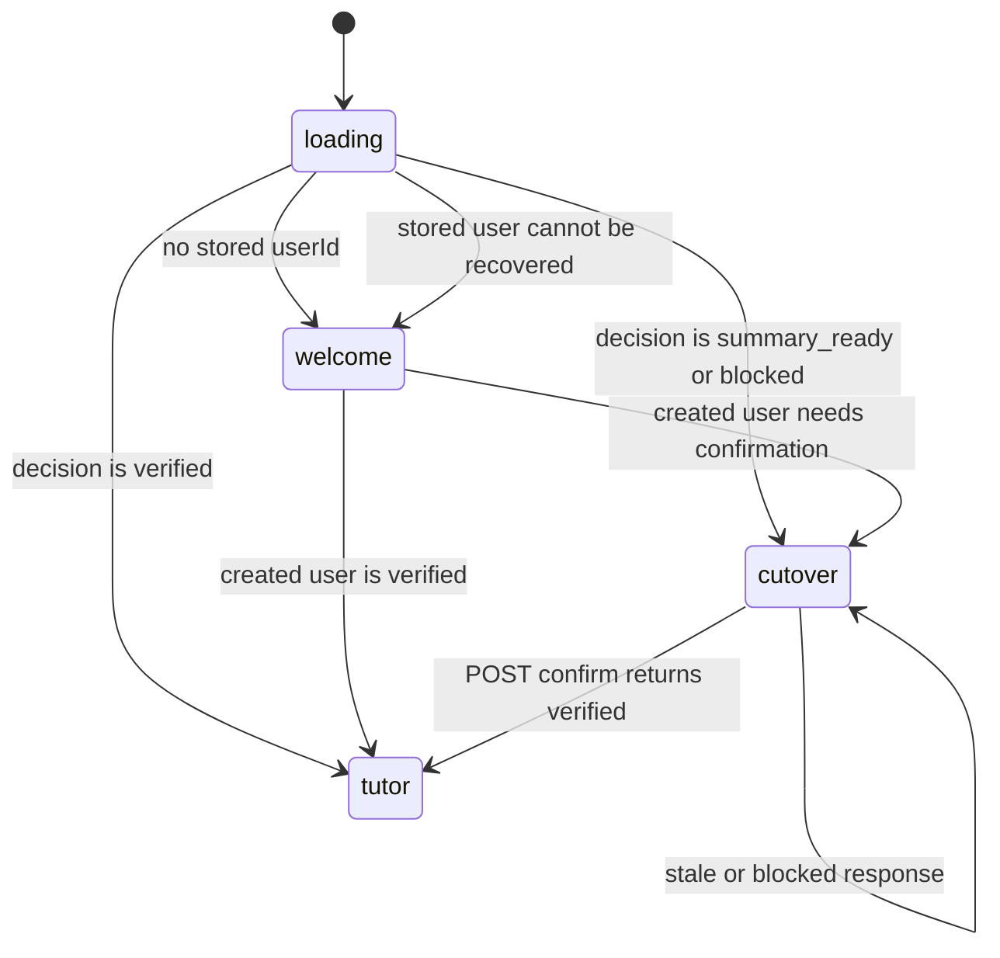

# Aearn Tutor 桌面端交互规格

**状态：** 当前 Desktop 交互契约，2026-08-03。
**适用范围：** `aearn/apps/desktop/src/` 的 React + Tauri UI。
**权威来源：** `App.tsx`、`stores/useAppStore.ts`、`api.ts`、
`pages/HarnessCutoverPage.tsx`、`pages/TutorWorkspacePage.tsx` 与类型/测试。

本规格取代旧 Onboarding、LearningWorkspace、Review、Notes 和 Graph/SSE UI
描述。Desktop 只呈现服务器授予的 Tutor 状态；它不会编排 provider、Graph、
后台队列、切换删除范围或执行器。

## 设计目标

1. **先准入、后工作区。** 任何本地身份恢复都先读取服务器 cutover decision，
   再渲染用户可操作的 Tutor UI。
2. **解释不可逆边界。** 有旧数据时，清理页显示服务器摘要和保留项，明确代码
   回退不会恢复清理的数据。
3. **保持历史连续、普通输入独立。** conversation history、公开 process 和
   run 状态可恢复；每条普通消息创建新的有限 TurnRun，只有服务器明确授权的
   continuation 才能复用等待中的 run。
4. **让学习记录受用户控制。** Activity/inbox、记忆、计划版本和偏好在同一
   工作区中以 learner-safe projection 展示。
5. **不泄露内部细节。** UI 不显示 provider 原始错误、内部 reason、prompt、
   checkpoint、capability schema、执行命令、hidden tests 或密钥。

## 顶层状态机

`AppRoute` 只能是 `loading`、`welcome`、`cutover` 或 `tutor`。不存在可由
客户端直接导航的 legacy route。

## Bootstrap、缓存与服务器权威

### Bootstrap 顺序

1. `useAppStore.bootstrap()` 并行读取 `/health` 和语言课程目录；健康状态只
   用于显示，不构成服务器准入的替代品。
2. 读取本地 bootstrap。若没有 `userId`，进入 `welcome`。
3. 有 `userId` 时，先读取 `GET /api/users/{user_id}`，然后立即写回
   `{ userId, planId: null }`。
4. 读取 `GET /api/harness/cutover?user_id=...`，仅由响应 `state` 决定
   `cutover` 或 `tutor`。
5. 任何恢复失败都会清除本地 bootstrap，回到 `welcome`。UI 不发送旧
   dashboard、resume、plan 或 session 恢复请求。

### 本地存储边界

- 可持久化的身份事实只有本地 `userId`；旧 `planId` 一律归一化为 `null`。
- 切换确认成功后再次写入 `{ userId, planId: null }`，并让工作区重新读取
  目标状态。
- local storage 不能证明 cutover，不能保存切换摘要/nonce，不能恢复被删除的
  legacy 数据，也不能绕过 server gate。

## 页面与组件

| UI 状态 | 主要组件 | 用户可见职责 | 禁止职责 |
| --- | --- | --- | --- |
| `loading` | `LoadingScreen` | 显示本地身份/服务器状态读取进度 | 猜测用户是否已切换或恢复旧页面 |
| `welcome` | `WelcomeScreen` | 收集显示名称并创建本地用户 | 保存模型密钥、provider 或 learning plan |
| `cutover` | `HarnessCutoverPage` | 显示服务器摘要、阻塞原因、保留项和确认动作 | 选择表、计数、checkpoint 线程或删除范围 |
| `tutor` | `TutorWorkspacePage` | 对话、状态、SSE、活动/inbox、memory、plan/preference controls | 运行 Graph、执行 learner code、直接写数据库 |

顶层 `App` 只包含应用菜单、API 健康文本、一个不可覆盖的当前入口标签以及
上述主体。侧栏折叠只能改变布局，不改变 active route 或 server decision。

## 切换页面：`HarnessCutoverPage`

### `summary_ready`

- 显示 `legacy_categories`、`legacy_profile_fields`、可精确归属的 checkpoint
  数，以及保留的 identity/notification 类别。
- “刷新摘要”重新请求服务器；确认前摘要变更会返回 stale 错误，用户必须查看
  新摘要。
- 确认按钮只在复选框选中且请求未 pending 时可用。
- `POST /api/harness/cutover/confirm` 必须带服务器已给出的 version、summary
  version、nonce、hash 和新建的 client action ID。

### blocked / error

- `blocked_target_state` 显示“发现预切换 Tutor 数据”；UI 不提供删除/迁移
  该数据的快捷入口。
- `blocked_checkpoint_scope` 显示“无法安全确认历史运行状态归属”；UI 不提供
  宽泛 checkpoint 清理。
- 其他错误以公开 `error.code` 和可读 `message` 显示，不渲染后端异常细节。

## Tutor 工作区：`TutorWorkspacePage`

### 会话导航、主列与 run 状态

- `App.tsx` 保存当前选择的 conversation ID。左侧显示“新对话”和最多 8 条由
  `last_public_activity_at` 倒序的 recent conversation；仅当服务器声明仍有更多时显示
  “查看全部对话”。完整列表是可键盘操作的轻量面板，采用 cursor 分页，不把所有
  history 塞进侧栏。
- 选择“新对话”只清空本地 timeline/run/composer context 并将 selection 设为 draft；
  **不得**创建 conversation、run、message 或 sidebar item。首个非空提交调用
  `POST /conversations/first-turn`，成功后才选中新 conversation 并刷新 recent list。
- 选择已有 conversation 时，页面取消旧 history request/stream、清空旧本地 timeline，
  从 `GET /conversations/{id}/history` hydrate 最新 40 条倒序 public timeline 后按正序
  渲染；“加载更早记录”使用 server cursor prepend，并保持滚动锚点。仅当 history
  response 声明 active foreground run 时订阅该 run 的 SSE。
- 普通 composer submit 始终调用 selected conversation 的 conversation-input endpoint，
  并创建 fresh finite TurnRun；它不会因为本地存在 run 而调用 run-input。只有 run 是
  `waiting_for_input` 且带 server-provided `continuation_kind` 时才显示 continuation
  affordance，此时才能调用 `/runs/{run_id}/inputs`。
- Composer 最多 16,000 个字符，可用 Ctrl/⌘+Enter 提交；pending 时禁用重复动作。
  timeline 是独立纵向滚动区，Composer 在 desktop view 保持可见，新的 history 条目
  不得把它持续挤出主要可视区。
- timeline 只渲染 server public `message.content` 和 server public process fields。
  新版 process 是紧凑的行内 disclosure：默认折叠，整行/箭头可键盘操作，含可读
  label 与 `aria-expanded`。它只显示 `display_state`、server-calculated duration 和
  allowlisted `steps[].label`；标题为“公开处理过程”。完成后显示“已处理 …”，被替代
  时显示“已根据你的新消息更新本轮处理”。不得使用旧的绿色三栏 dashboard、渐变思考
  面板或从 SSE/raw trace 推断模型思考。
- 旧版 message-only history 正常显示，但不得合成 process 卡片、步骤或 duration。
  run summary 仅显示公开 status 和 stream cursor，绝不显示 provider 诊断或内部 tool
  arguments。

### SSE 交互

`useTutorSSE` 是 transport-only hook：它不重建 conversation history、不推断 terminal
state，也不请求模型。SSE event 只触发当前 selected conversation 的节流 history/control
refresh；history endpoint 是 timeline 的唯一 source of truth。

- endpoint 变更、选择其他 conversation 或组件卸载时必须清理旧 stream；新的 history
  hydrate 不得被旧 stream callback 关闭。
- 首次连接不发送 cursor；重连时只发送最后已消费的数字 `Last-Event-ID`。
- 同一 run 的重复/倒退 ID 被丢弃；保留 512 个已见 ID 防止重复呈现。
- `done` 和 `error` 是 transport 终态；没有 `id` 的 error 不更新 cursor。
- 非终态的 `waiting_for_input` `run_state` 可携带 learner-safe `public_message`；
  Desktop 以服务端 history 刷新后的消息为准，并只在 explicit continuation 可用时
  展示继续确认控制。
- 自动重连最多两次。`SSE_CURSOR_INVALID`、未知事件或不完整帧显示稳定的
  `TUTOR_SSE_PROTOCOL_ERROR` / error 入口，而不是把不可信 payload 渲染成 UI。

### 侧列：学习控制

| 面板 | 数据与动作 | UI 边界 |
| --- | --- | --- |
| `TutorActivityPanel` | activity、inbox、read、dismiss | 背景建议只以 activity/inbox 呈现，不显示为聊天或系统通知 |
| `TutorMemoryPanel` | memory、correct、delete | 显示安全 statement/evidence；校正和删除均为有确认的 API 状态变更 |
| `TutorPlanPreferencesPanel` | plan revision、rollback、memory/proactive preference | 只能回退到直接前驱；只可切换 inferred memory 与暂停主动建议 |

“暂停主动建议”默认显示为可用但未暂停。恢复（`proactive_paused=false`）会恢复该
用户的 `enabled=true` 偏好；它不会绕过 verified receipt、全局 pause、日预算、
冷却、并发或熔断器。

## 责任边界

### Desktop 负责

- 本地身份 bootstrap 与失效缓存清理。
- 请求 JSON/SSE、解析已公开类型、显示 loading/error/retry 状态。
- 生成客户端 idempotency action ID。
- 响应式布局、键盘提交、可访问标签和操作反馈。

### API / Harness 负责

- cutover summary、确认、数据删除/验证、runtime gate 和所有持久化事务。
- 输入 revision、run 预算/lease、Skill/capability/effect validation、provider
  failure mapping、SSE 顺序和 redaction。
- activity/inbox/memory/plan/preference 的用户范围和幂等。
- scheduler、curation、executor 和 provider composition。

### 前端禁止越界

- 不根据本地状态把 `cutover` 改成 `tutor`。
- 不保存、传输或展示 provider key、prompt、reasoning、raw event/trace、
  hidden tests、reference answers、完整 learner code、shell/SQL/path 或 Docker
  信息。
- 不发起 `runner.execute`，不启动 subprocess/worker，不把 proactive activity
  伪装成聊天消息或桌面通知。
- 不重新引入旧 Onboarding/Learning/Review/Notes 页、legacy SSE parser 或
  Graph-specific component。

## 响应式与可访问性验收

- 窄视口下主列与控制列必须可读；Composer 和主要操作不可溢出视口或被侧栏遮挡。
- 所有可操作控件有可读的 label、disabled/loading 状态和 error/status live
  region。
- 键盘可以聚焦并提交 Composer、切换偏好、刷新/确认 cutover、处理 inbox。
- 服务器离线、cutover blocked、SSE 中断和并发 conflict 均显示公开错误并保留
  用户仍可安全操作的部分。

## 相关文档

- [用户流程](./user-flows.md)
- [Tutor Harness Runtime](../architecture/tutor-harness-runtime.md)
- [API 与 SSE 契约](../architecture/api-contract.md)
- [验收计划](../qa/acceptance-test-plan.md)
