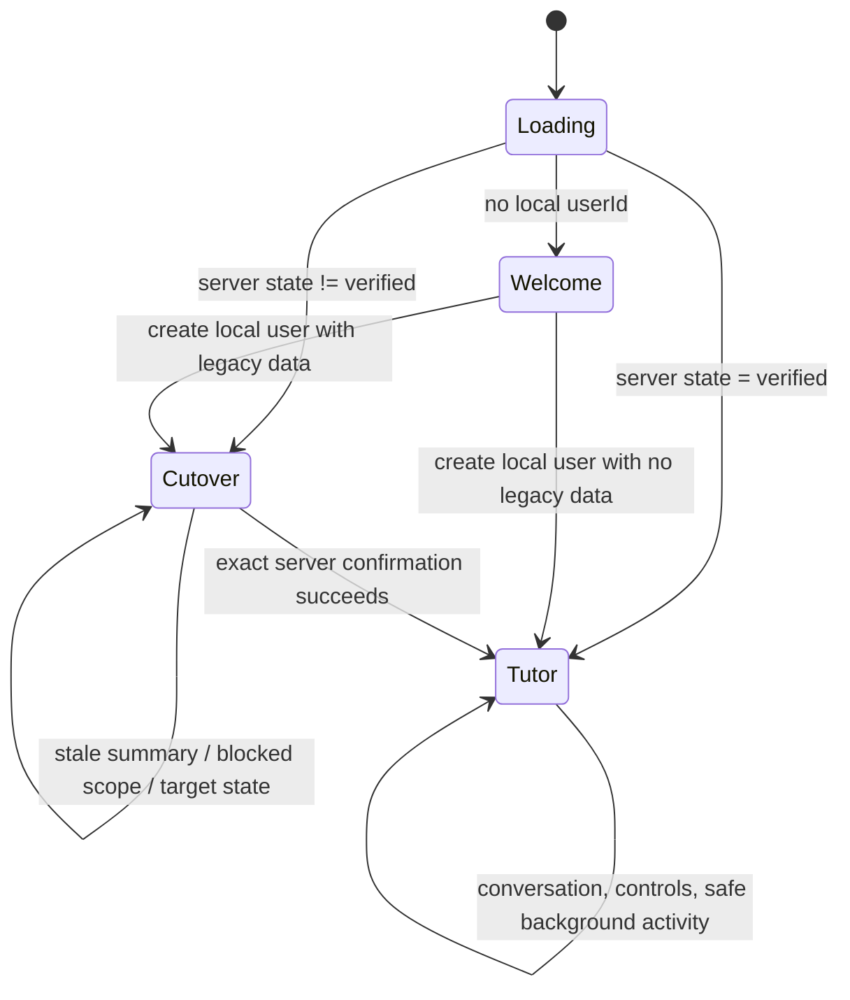

# Aearn Tutor 用户流程规格

**状态：** 当前产品契约，2026-08-27。
**适用范围：** 本地 Aearn Desktop、`/api/harness`、`/api/tutor` 与受控
Tutor Harness。
**权威来源：** 当前路由注册、`aearn/services/api/app/services/tutor/`、
`aearn/apps/desktop/src/`、manifest 驱动的 `aearn/services/api/app/db/schema/` 与对应测试。旧 Graph/SDK 流程仅是
切换清理范围和历史归档，不是可恢复的产品入口。

## 目标与全局规则

Aearn 是一个本地身份起步、服务器负责准入的 Tutor 工作区。用户不会在
Desktop 中选择旧运行时，也不能用本地缓存、旧计划 ID 或普通重置接口绕过
切换。

1. **服务器先于 UI。** `harness_cutovers` 的当前版本 `verified` receipt 是
   Tutor 路由、背景建议与 Desktop 工作区的前置条件。
2. **干净切换而非迁移。** 有旧学习数据的本地身份必须先查看服务器生成的
   摘要并确认。服务器会重新核对、精确清理旧学习范围、验证结果，再写入
   receipt；不会迁移或重建旧计划、会话、Attempt、FSRS、笔记或消息。
3. **新用户直接进入。** 没有旧数据、没有预切换 Tutor 数据且 checkpoint
   归属可证明的用户，服务器会直接写入 `verified` receipt；不显示空的
   清理确认页。
4. **用户可见信息是安全投影。** 对话正文保存在 `tutor_messages`；活动、
   收件箱、SSE、诊断和导出不包含 prompt、provider payload/reasoning、
   隐藏测试、参考答案、完整代码、路径、命令、checkpoint 或密钥。
5. **代码回退不等于数据恢复。** 确认清理之前可回退代码/配置；确认清理之后
   也不能通过回退恢复被刻意删除的旧学习历史。
6. **类型化请求不能替代正式回答。** 当 Turn 需要 planning input、clarification 或 approval 时，
   服务端必须原子写入 Tutor 正式消息与对应 composer/审批 item；时间线按“正式回答 → 请求栏”展示，
   不显示仅有 Think 或仅有请求栏的完成态。

## 流程 1：创建本地学习者并进入 Tutor

### 入口与前置条件

- Desktop 读取本地 bootstrap；没有 `userId` 时显示欢迎页。
- 用户只需提供非空显示名称。模型密钥、全局预算、provider 和能力权限不在
  Desktop 设置中暴露。

### 用户操作与系统动作

1. 用户填写显示名称并点击“进入 Tutor”。
2. Desktop 调用 `POST /api/users`，将新用户 ID 写入本地 bootstrap，并强制
   `planId=null`。
3. Desktop 调用 `GET /api/harness/cutover?user_id=...`。
4. 若服务器返回 `verified`，Desktop 打开空的 Tutor 工作区；若返回
   `summary_ready` 或 blocked 状态，转入受控切换页。

### 成功与失败状态

- 成功页展示“从你的目标开始”、对话输入框、活动/收件箱、记忆、计划版本和
  偏好控制。
- 用户不存在、API 不可达或本地 bootstrap 无法恢复时，Desktop 清除该 bootstrap
  并回到欢迎页；它不会尝试恢复旧 dashboard、resume 或计划页面。

## 流程 2：已有旧学习记录的受控切换

### 入口

拥有旧学习记录的本地身份启动 Desktop，或创建用户后服务器发现旧范围数据。

### 用户可见步骤

1. 切换页显示服务器生成的旧数据类别计数、可精确归属的 checkpoint 数量和
   保留项。
2. 用户勾选“确认后旧学习记录不会因回退代码而恢复”，并点击确认。
3. Desktop 将 `cutover_version`、`summary_version`、`preview_nonce`、
   `summary_hash`、`client_action_id` 和 `confirm=true` 一并提交到
   `POST /api/harness/cutover/confirm`。
4. 成功响应为 `state=verified`；Desktop 再次固定 `planId=null`，清空旧
   内存表单状态，进入 Tutor。

### 服务器安全边界

- 服务器锁定当前用户，重新生成摘要并对比 exact nonce/hash/version。
- 只有可证明归属的 `aearn:learning:<learning_session_id>` checkpoint 会被
  清理；未知 namespace、`NULL` thread ID 或无法证明归属都会阻止切换。
- 任何预切换 `tutor_*` 状态都会变为 `blocked_target_state`，不会被删除或
  “迁移”。删除/验证异常会写入安全的 `verification_failed` receipt，并继续
  锁定两类运行时。
- 本地身份、显示名称、提醒时间段与通知偏好保留。普通
  `POST /api/users/{user_id}/reset-data` 不能成为未确认用户的隐式切换路径。

## 流程 3：交互式 Tutor 对话

### 开始或继续对话

1. 用户在 Composer 输入 1--16,000 字符的可见文本。
2. 若没有会话，Desktop 用幂等 `client_action_id` 调用
   `POST /api/tutor/conversations`；随后调用
   `POST /api/tutor/conversations/{conversation_id}/inputs`。
3. 若当前交互 run 尚未结束，Desktop 改用
   `POST /api/tutor/runs/{run_id}/inputs`。服务器将后续输入按 run-local
   `input_revision` 合并，而不是启动竞争 run。
4. 输入事务先持久化，再由 post-commit dispatcher 领取有限的 Harness loop。
   重复幂等请求返回原先的安全投影，不会重复写入或重新调用 provider。

### 运行、流和恢复

- `GET /api/tutor/runs/{run_id}` 返回权威的 run 状态与 terminal outcome。
- `GET /api/tutor/runs/{run_id}/events` 提供按 `event_sequence` 排序的 SSE
  后缀。Desktop 只把最后一个数字 cursor 作为 `Last-Event-ID` 重连；没有
  cursor 的 error frame 不得作为下一次 cursor。
- 事件可包括 `input_accepted`、`tool_status`、`activity`、`run_state`、
  `done` 和 `error`。流读取绝不触发 provider 调用。
- provider 不可用、策略拒绝、预算耗尽、取消或安全失败都映射为稳定的公开
  terminal 状态/错误码。用户可重试或补充输入；不会回退到 Graph、旧聊天或
  固定回答。

### 用户体验边界

- 对话时间线可以显示用户文本、公开 Tutor 消息、活动状态和可恢复错误。
- run 在安全检查点前会重新读取权威 `input_revision`；过期 effect 记录为
  `stale_rejected`，其 handler 不执行。
- 交互式 policy 有有限的迭代、模型、capability、effect、上下文和 lease
  预算；模型不能通过正文选择 URL、路径、shell、SQL、任意用户或数据库目标。

## 流程 4：活动、收件箱与默认主动建议

### 读取与控制

- Tutor 工作区读取 `GET /api/tutor/activity`、`GET /api/tutor/inbox`，并允许
  对单个 inbox 项执行 read 或 dismiss；动作带幂等标识且严格按用户范围执行。
- `GET/PATCH /api/tutor/preferences` 公开两个用户控制：是否允许保存学习
  推断、以及是否暂停主动建议。它们不公开 provider 设置、全局 scheduler
  预算、镜像或 capability 权限。

### 默认主动建议契约

- 全局默认是 scheduler 开启、非 hard pause、verified cutover eligible、
  每位用户每天至多一条、并发一条；用户 preference 默认 enabled。旧的
  `enabled=false` 且未暂停记录会在 bootstrap 时恢复为 enabled。
- 仍然只有有当前 `verified` receipt 且未暂停、未超预算/冷却/并发/熔断限制的
  用户可进入候选或运行阶段。未验证用户的候选以 `cutover_unverified` 结束，
  不调用 provider。
- signal 只来自已经终态的交互式 run 的 run ID、terminal outcome 和 timestamp
  的稳定 hash；不会读取 learner message、prompt、代码、trace、checkpoint 或
  provider diagnostics。
- 背景 run 的可见结果只能是安全 activity/inbox。它不创建 learner-visible
  chat 消息或桌面通知，也不能执行 `runner.execute`、启动 subprocess、执行
  learner code 或直接写入 `tutor.memory.record`。
- 生产 worker 的扫描为全局 `user_id=None`；测试和维护操作可显式传入用户
  范围，不能借此改变生产队列语义。
- inferred memory 和 curation 默认关闭（inferred memory=false、curation
  daily budget=0、max output tokens=0）；开启其中一个并不放宽主动建议或执行器
  的其他门槛。

## 流程 5：计划版本、记忆与用户校正

- `GET /api/tutor/plans/revisions` 展示不可变计划版本和当前 active pointer。
  用户只可用 `POST /api/tutor/plans/rollback` 回到当前版本记录的直接前驱，
  不能指定任意 revision，也不会修改历史 `learning_plans`。
- `GET /api/tutor/memory` 显示有状态、provenance、evidence、retention 与
  stale 事实的安全记忆项。`PATCH` 校正会追加替代项；`DELETE` 是受控状态转换，
  不是对历史记录的裸改写。
- activity、inbox、memory 与计划投影只记录 learner-safe 数据。用户可查看
  为什么产生一项记录，但不能取得内部 prompt、执行细节或 provider 诊断。

## 已移除的产品流程

下列流程不再是当前 Desktop/API 产品表面：旧 onboarding 计划生成、旧学习
workspace/练习 runner、review/FSRS 页面、notes 页面、dashboard/resume、Graph
状态机和 SDK specialist chat。其历史表可能仍存在于数据库，唯一当前用途是
受控切换的精确清点/删除与已归档证据；它们没有当前路由、worker 或 Desktop
入口。

## 最小验收

- 新用户或已 verified 用户只能进入 Tutor，Desktop 不请求旧 dashboard/resume。
- 有旧数据的用户只能通过服务器摘要和 exact confirmation 切换；stale/blocked
  状态不删除数据。
- 交互输入、run 状态、cursor SSE、终态错误和 activity/inbox 在同一用户范围
  内一致且可重放。
- verified fixture 用户的默认主动建议可写入 activity/inbox；未 verified 用户
  不产生 provider call 或 proactive run。
- 不在任何产品流程、SSE、错误或文档示例中泄露 learner 原文、代码、隐藏测试、
  provider payload 或密钥。

## 相关文档

- [Tutor Harness Runtime](../architecture/tutor-harness-runtime.md)
- [Desktop Interaction Specification](./frontend-interaction-spec.md)
- [HTTP and SSE API Contract](../architecture/api-contract.md)
- [Database Schema](../architecture/database-schema.md)
- [Acceptance Plan](../qa/acceptance-test-plan.md)

## 2026-08-10：LearningTrack 首页与计划制定

> 历史截面：本节记录 2026-08-10 当日状态；完整学习工作区与 Review 接入已由后文 2026-08-12 当前流程取代。

verified 用户进入 `tutor` shell 后默认看到服务端权威的 LearningTrack 首页，而不是空对话。首页固定以三列/两列/单列响应式卡片展示 `GET /api/learning-tracks` 的进度、当前知识点、到期复习数和 `execution_tier`；添加卡始终位于末尾。首页不显示左侧栏、对话历史或手动刷新按钮，Desktop 也不再提供独立 general conversation / 对话历史页面。点击添加卡直接创建或恢复一条持久化 `plan_drafting` session，不经过语言选择页面；语言、基础、目标、时间投入与偏好全部由 Tutor 在规划对话中询问。planning 页面无应用左侧栏、对话 hero 和外层对话卡片。未激活状态只有可用区域中央的圆角 Composer，不显示空状态说明、快捷建议或底部提示；用户发送第一条消息后才进入 Tutor 左侧正文、学习者右侧气泡及底部 Composer 的 GPT 式消息流。信息收集阶段 Composer 聚焦时不改变外壳视觉；进入 planning 页面后，页面右缘立即出现展开/收起按钮并默认弹出四角圆角的紧凑独立浮动窗口。模型尚未通过类型化 capability 生成服务端 `current_draft` 时，窗口只显示一个 emoji，不展示伪造路线；草案生成后在同一窗口原位展示计划路线。窗口与视口右缘保留明显留白，不表现为贴边侧栏，也不挤压对话主列或占满右侧；用户可收起/重开，新 draft 版本会自动展示。普通规划消息通过 conversation input 创建 fresh finite TurnRun。模型只能通过 exact `tutor.learning-plan-draft@1.0.1` 和 `learning.plan.draft` 写入 append-only typed draft；草案生成后底部 Composer 继续用于提出修改，右侧计划窗口是确认当前 version/id/hash 并原子创建 LearningTrack 的唯一入口，不再生成用于确认该草案的 typed approval。既有 conversation 数据与 API 保留用于兼容和规划会话。Lesson、练习 Gate、模型代码审核和 track-scoped ReviewSession 后端 authority 已交付；完整三栏工作区与其中的 Review 中间区域仍由后续工作区 child 交付，尚未接入的按钮必须显示真实未就绪状态。

## 2026-08-11：LessonDocument 与权威来源阅读

> 历史截面：本节记录 Lesson child 完成时的边界；文本选区进入 Tutor 与三栏工作区已由 2026-08-12 当前流程补齐。

verified 用户在 Learning Home 点击“继续学习”时，Desktop 使用服务端
`current_knowledge_key` 进入单页 Lesson 阅读面，不猜测首节点。课程不存在时，页面允许用户显式创建 durable authoring run；准备中、失败、重试和 ready 状态都来自服务器，失败不会用静态模板或无来源内容冒充正式课程。

ready 状态读取一个 track-scoped active assignment、immutable personalized
`LessonDocument` 和自包含 source snapshots。用户点击“开始本课”只把 `available`
安全推进到 `in_progress` 并冻结正文顺序、引用、content hash 与公开 Gate slot；不会写完成、掌握度、解锁或运行事实。来源或生成策略更新只产生 proposed assignment 和 learner-safe impact，用户显式迁移前旧 assignment 继续 active。

课程正文通过注册 block union 渲染，事实块的 inline citation 可定位到来源面板。来源面板展示 provider、trust、版本、章节、抓取/冻结时间、canonical URL 和 bounded excerpt。`exercise_gate` 保留已冻结公开 contract，并由 active assignment 对应的服务端 Gate binding 决定当前状态与可用动作；客户端不按最新文档或本地状态猜测绑定。ReviewSession 后端 authority 已可读取和恢复；完整三栏工作区、Review 中间区域和 Lesson 文本选区进入 Tutor 仍属于后续任务。

## 2026-08-11：练习 Gate、受控执行与模块诊断

ready Lesson 中的 `exercise_gate` 现在读取 active/frozen assignment 下的不可变 binding 和 assignment-scoped Gate state。学习者可按服务端 `allowed_actions` 准备 Gate、请求有界提示、运行或提交；滚动位置、URL、前端缓存和客户端传入的 execution tier 都不能解锁 locked 知识点。`run` 只返回当前 Attempt 的 learner-safe 执行反馈，不写 Gate、掌握度或路线；`submit` 的 terminal result 才能由服务端在受控事务中更新 Gate、掌握度、当前进度与下游可用性。

练习执行明确区分四个层级：`container_verified` 只有在 reviewed immutable image lock 和兼容 executor health 同时满足时才可公开排队；`teaching_local` 只用于 development fixture；`static_only` 不显示 Run，也始终声明未编译、未运行、未测试；`unavailable` 不显示执行依赖动作。执行依赖失败不会回退到 host runner、legacy runner、另一套队列或伪造的成功结果。

每次 `run`、`submit` 或 `diagnostic_submit` 都创建 append-only Attempt。完整提交只进入私有 submission artifact；学习者可见结果只包含 hash、状态、分数、能力分数和安全反馈。请求提示后完成会由服务端记录不同 independence，前端不能自行生成 score、pass、mastery evidence 或 unlock。

“申请跳过”只出现在可跳过模块的入口边界，并打开独立模块诊断。诊断冻结全部核心 capability、题目版本、阈值、cooldown 和 policy；部分通过或失败明确不跳过任何知识点，也不降低既有 proven mastery。全部核心 capability 独立通过后只产生 predecessor-linked proposed plan revision 和影响摘要，仍需学习者显式确认，服务端才激活 successor revision、写入 `diagnostic_skipped` 并重算路线。

## 2026-08-12：模型代码审核学习流程

当 Lesson Gate 需要动态审核题时，学习者先看到 `preparing`，直到服务端发布 verified
candidate；失败时只能重试服务端 authoring，不出现本地 fallback。ready 后，学习者阅读需求
与模型代码，选择“存在 correctness issue / 未发现 correctness issue / 只有改进项 / 不确定”，
并提交零个或多个结构化 finding。学习者可在服务端允许时查看预发布验证摘要；该动作会降低
独立性权重，但不会运行本次提交。

服务端以版本化 rubric 一对一确定性匹配 finding，区分发现、遗漏、严重性、证据、验证方法、
修复建议、重复与误报，再复用现有 Gate/mastery/progress exactly-once 事务。正确代码与“表面
可疑但正确”场景会显著惩罚误报；模型解释只能补充教学反馈，不能修改结果。

## 2026-08-12：间隔复习与 ReviewSession

LearningTrack 首页读取同一服务端 `review_due_count`，其含义是当前 actionable review：普通已到期
schedule，加上需要立即补救的 `critical` schedule。后续工作区左栏只能读取该值和
`GET /api/learning-tracks/{track_id}/reviews`，不能在浏览器比较日期、推断风险或自行阻断路线。
普通到期项不影响继续课程；只有当前节点直接或传递前置知识的 `critical` 项才显示短
Review Gate 和明确补救入口。

学习者开始复习时，服务端冻结最多三道已通过质量门的 immutable ExerciseVersion、active plan
revision、schedule version 与 `AuthoritativeContextSnapshot`。候选池不足时显示可恢复状态并允许
原请求重试，不出现本地题面或低质量 fallback。warmup 可以回答或跳过，但只改变当前 session；
提示会记录 assistance，之后相同正确答案与独立完成获得不同调度结果。

每道正式练习创建一个 append-only `review_submit` Attempt。静态题和模型代码审核可同步评分；
需要执行的题目只按服务端 `execution_tier` 进入现有 executor queue。全部 item terminal 前不能完成
session，也不能改 mastery 或下一次复习时间。finalization 成功后才原子写聚合 rating、掌握度证据、
schedule event 和下一次 `due_at`；重放返回同一结果。resume、历史截断或 summary 暂不可用时继续
读取创建时冻结的权威 context，不从聊天正文重新猜目标、时间或偏好。

## 2026-08-12：最终集成与语言矩阵

verified shell 的当前主路径是 `Learning Home -> plan_drafting -> TrackLearningWorkspace`。正式学习不恢复旧 dashboard、onboarding、general conversation、Graph、独立 Review 或旧 learning session 页面；既有普通 conversation 仅作为服务端兼容历史与受控规划/track-scoped Tutor 会话使用，不能写入旧学习权威状态。

四种核心语言使用同一服务端闭环：

1. 创建独立 LearningTrack 与 active immutable plan revision。
2. 发布带可信来源快照的 standard/personalized LessonDocument，并显式开始 active assignment。
3. 由服务端绑定 Exercise Gate；公开环境缺少 reviewed image lock 时执行依赖动作保持 `unavailable`，本地确定性 fixture 仅标为 `teaching_local`。
4. terminal `submit` 才写 safe feedback、Gate、mastery evidence、node progress 与 review schedule。
5. 到期后创建有限 ReviewSession；warmup/hint/Attempt 不改长期状态，唯一 finalization 才写 review evidence、schedule event 与下一次 due state。

Python、JavaScript、TypeScript、SQL 通过上述完整 PostgreSQL fixture。Java 与 HTML/CSS 只作为扩展 runner/contract 验证，不冒充核心矩阵；Go 与 C# 是依赖本机 toolchain 的 partial `teaching_local` 能力；Rust 公开 `unavailable`，C++ 公开 `static_only`，均不声明已编译或运行。

旧 `learning_*`、user-level Tutor plan、旧 review/notes 和历史 checkpoint 不会静默导入到 LearningTrack。cutover 必须先生成 exact server summary，再由用户确认；检测到任意当前 `tutor_*` user-owned state 时 fail closed，不删除旧数据。reset/delete 使用当前领域的 child-to-root 清理；代码 rollback 不删除已写证据，也不能绕过 cutover receipt。

所有 public API、SSE、history、process、activity/inbox、export 与 release evidence 只保留 learner-safe projection。完整提交、hidden tests、reference answer/private rubric、raw provider body/reasoning、命令、路径、容器和 secret 不进入这些表面。

## 2026-08-18：plan-drafting Runtime 选择

用户和 Desktop 不选择 Runtime，也不会看到 Codex thread/turn/tool 控制面。没有既有 Runtime lineage 的全新 `plan_drafting` conversation 在服务端 exact readiness 通过时使用 `codex_sidecar_v1`；feature off 时使用 Harness，feature on 但 Runtime 不可用时显示现有 Aearn safe error/retry 状态且 first-turn 不留下空 conversation。既有 conversation、Retry 和其他 scope 保留原 Runtime。

Codex 只能读取服务端权威 planning context并追加 typed draft。右侧计划窗口仍是唯一确认入口；确认 transaction、LearningTrack 创建、history/SSE 与 Desktop DTO 均由 Aearn 控制。关闭 admission 只阻止新 Codex conversation，不删除已生成 draft、message、binding 或 receipt。

## 2026-08-23：Gate / Review / migration 驱动的教学恢复

1. 学习者在 Lesson Gate 或 ReviewSession 完成真实受控操作；owner service 先写 terminal result、mastery/schedule/progress。
2. 若当前知识点已有 TeachingSession，服务端以 durable source ID/version admission 至多一个 `domain_event` Turn；重复回调复用同一 run。
3. progress/assignment authority 已变化时，旧 session 进入 authority pause/blocked，successor 继承同一 track conversation并冻结新 authority。
4. Tutor 只执行一个 evidence feedback 或 completion summary 后停顿；完成知识点仍停在 completion shelf，不自动进入下一知识点。
5. 学习者显式选择“进入下一知识点”时，服务端重新验证最新 roadmap、availability 与 expected versions，才推进 track pointer并创建下一 session first unit。
6. reload/reconnect 从 durable session/checkpoint/action shelf恢复；旧 summary、stale event 或 provider unavailable 都不能产生第二条消息、自动 mastery 或自动 next。

## 2026-08-27：超越文档复述的教学单元

1. 新 teaching Turn 只选择 exact `tutor.lesson-teaching@1.1.0`。Tutor 必须把 LessonDocument 当作证据与定位来源，而不是逐段改写；一个单元组合 2--4 个教学 move，例如误区对照、错误检测、预测、推导或微迁移。
2. 需要学习者回答时，Tutor 停在现有 Composer，Action Shelf 不显示伪“继续”。不需要回答且 checkpoint 明确推荐继续时，才显示 Continue。
3. 服务端把最近四个已提交教学单元的安全策略签名带入下一 Turn。重复相同公开消息 hash 或完全相同 focus/moves/response-mode 的 Continue 被拒绝，不写第二条消息或 receipt；真正改变例子、诊断方式、迁移任务或根据学习者反馈调整策略后才能推进。
4. `change_example` 必须真的提供 worked example 或 counterexample。authority pause、session refresh、完成后显式进入下一知识点等原有边界保持不变。
5. reload/reconnect 完全从 durable checkpoint、v2 receipt 与 server-owned shelf 恢复；Desktop 不从消息正文猜测教学策略，也不在本地补空按钮。

## 2026-09-01：显式 Run、结果 Artifact 与 Tutor 评价

1. 学习者只在 source Artifact 的 server `allowed_actions` 含 Run 时提交当前内容。服务端创建 append-only Attempt；pending/running 时 source Artifact 显示权威状态，不产生评价 Turn，也不存在第二 Submit。
2. executor/owner 写入 terminal learner-safe result 后，下一次同请求重放或 scoped Attempt read 幂等完成 projection：passed 直接完成 source Artifact；failure/timeout/cancel/unavailable/invalid 保持 source active；每个 Attempt 追加一个独立非阻塞 result Artifact。
3. result Artifact 展示失败优先、数字位置、其他通过数、非空 stdout/stderr 和 bounded public table。hidden case identity/input/expected、完整 submission、private test/rubric、path/stack/command/container/provider/secret 不进入 API、DOM 或评价上下文。
4. terminal projection 先保存 result authority，但公开 timeline 等待 mainline result-evaluation Turn；Turn 完成时先追加 Tutor Markdown 评价，再追加 exact result Artifact，两项同事务发布。模型只生成教学评价，不能修改 outcome、score、test result、Artifact 或 mastery/progress。模型不可用时，Attempt/result 仍保留，服务端追加固定的安全评价；不会重跑代码。
5. 失败 result 的“返回修改”定位同一 conversation 中 exact source Artifact version并恢复键盘焦点。多个 Run 的 result history 独立保留，source Artifact 的当前状态仍来自最新服务器 snapshot；Desktop 不合并、重算或覆盖历史结果。

### Teaching demonstration flow

The Tutor may select a published demonstration handle but cannot author or alter its code, steps, expected interaction, or duration. Interactive demonstrations complete only after the exact expected Preview event, whose current nonce/generation and continuous sequence originate from the isolated bridge rather than a forged parent message or synthetic click. Static demonstrations complete after uninterrupted accumulated eligible visible time; hiding, backgrounding, or navigating away pauses the clock, and closing before completion resets it. A learner message preempts any automatic continuation. Demonstrations never count as an Attempt or mastery/progress evidence.

### Knowledge check, Hint, remediation, and transfer flow

1. Tutor 只能从当前 TeachingSession 下已发布且 capability-compatible 的 knowledge-check handle 创建结构化工件；用户按题型提交 exact response，或按序显式查看 H1-H3。回看已解锁页不产生新 assistance。
2. 回答后原工件锁定。正确且无 assistance 的回答可以作为 independent evidence；Hint、direct answer、remediation 或错误回答都不能冒充 independent mastery。
3. 概念原题首次错误按 published policy 创建一个语义不同、D(n) 或 D(n-1) 的补救 successor；同知识点不在原题无限重试。补救再次错误或用户直接查看答案时，服务端公开权威解释并选择不同上下文的 transfer check。缺少 exact published successor 时整体 fail closed。
4. terminal response receipt 产生一个 mainline knowledge-check evaluation continuation。provider context 只广告已持久化的 exact remediation/transfer handle；用户消息、branch 与既有 foreground Turn 仍按统一 arbiter 优先，不会产生重复 Tutor Turn。
