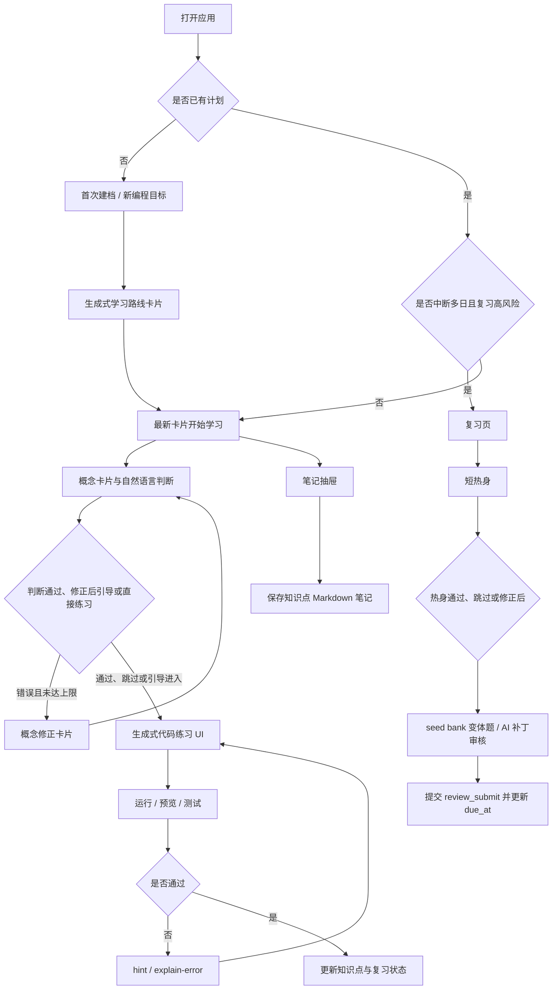

# Aearn 用户流程规格

日期：2026-05-13  
状态：Draft V1.1  
参考原型：`docs/design/learning-agent-claude-desktop-framework.html`

## 目标

本文件把桌面端原型中的用户路径升级为第一版可实施用户流程。它用于约束产品、前端、后端、Agent 状态机和验收用例之间的边界。

当前阶段：第一版核心闭环已经作为稳定基线，后续可以进入 post-MVP / v1.1 增强。增强允许扩展路线生成、模型 provider 和练习 UI 体验，但必须继续遵守第一版基线契约：`PlanDraft` 可确认、latest-card-wins、运行能力边界可见、评分/FSRS 由后端决定、模型失败不泄露 provider 细节。

第一版核心闭环：

```text
建档生成学习路线 -> 进入当前学习 -> 概念卡片与自然语言判断 -> 对话中生成练习 UI -> 编写/运行/预览 -> Agent hint / explain-error -> 记录笔记 -> FSRS 复习
```

## 全局规则

### 页面与导航

| 区域 | 定位 |
|---|---|
| `onboardingScreen` | 首次建档 / 新编程目标 |
| `homeScreen` | 当前学习会话 |
| `reviewScreen` | 独立复习会话 |
| `notesScreen` | Markdown 笔记页 |
| `settingsScreen` | 设置页 |
| `noteDrawer` | 当前知识点笔记抽屉 |
| `composer` | 学习 / 复习输入栏 |
| `sideContext` | 左侧上下文面板 |

### 导航组织

| 导航 | 组织方式 |
|---|---|
| 学习 | 一级标题为学习目标语言，二级标题为当前学习知识点 |
| 复习 | 按后端返回的待复习知识点创建会话，并按遗忘风险排序 |
| 笔记 | 一级标题为学习目标语言，二级标题由笔记创建时所在学习会话标题决定 |
| 设置 | 外观、模型设置、学习偏好、复习、通知设置、记录与隐私、关于与诊断 |

### 关键产品决定

- `Attempt(run)` 和 `Attempt(submit)` 在前端 UI 上不暴露为两个概念，用户只看到“运行 / 预览 / 提交结果”这类自然操作；后端必须继续区分事实类型，用于评分、FSRS 和追溯。
- 第一版基线不保留独立复盘草稿流程，不做 `publishDrawer` 用户路径；只保留“笔记页 + 笔记抽屉”。
- 普通打开应用时默认进入当前学习，并在应用内提示复习。
- 中断多日且复习风险高时，才优先进入复习。
- 代码编辑器、预览和测试结果以生成式 UI 的形式出现在对话中，不作为固定三栏页面。
- Agent 可 hint、解释错因、辅助补全笔记，但用户保留最终代码补全权。

## 流程 1：首次建档 / 新编程目标

### 入口

- 首次打开应用且没有已确认学习计划。
- 用户点击左侧 `新编程目标`。

### 前置条件

- 用户已完成本地初始化。
- API 可用。
- 当前用户可以创建新学习计划。

### 用户操作

1. 用户在建档对话中输入想学的编程语言和完成目标。
2. 用户回答 Agent 关于当前水平、目标用途和必要学习边界的问题；时间预算可稍后补充。
3. 当语言、目标和当前水平已经足够，用户在对话流中查看生成式学习路线卡片。
4. 用户如需调整方向、时间或难度，直接继续输入自然语言，查看新的路线卡片。
5. 用户在最新路线卡片点击 `开始学习`；旧路线卡片保留在历史中，但按钮禁用。

### Agent 自动动作

- 识别用户目标语言、目标任务和学习约束。
- 每轮只追问一个关键缺失信息，让用户明确知道下一步如何回答。
- 信息足够后用一句短提示引出学习路线卡片，不在普通文本回复中展开完整路线。
- 用户继续输入调整需求时，重新生成最新学习路线卡片。
- post-MVP 动态路线生成开启时，可参考权威文档目录和用户目标裁剪模块；关闭或失败时，仍可回退到已审核的课程模板。
- 将“AI 生成代码理解”能力嵌入各练习点，而不是单独作为一条孤立路线。
- 标注主干模块和可选模块。

### 系统后台动作

- 所需槽位齐备后生成并暂存 `plan_draft`，通过 `show_learning_route` 工具事件渲染路线卡片。
- 动态路线生成不得改变 `PlanDraft` 公共结构；生成内容必须通过服务端 schema、中文内容、安全输出、runtime boundary 和主干模块校验。
- `source_attribution` 必须说明路线来自动态文档参考、用户资料、课程模板，或 fallback。
- 时间预算不是首次生成卡片的必填项，后续补充时间会生成新版草稿并在卡片展示新的学习节奏。
- 仅最新卡片可以确认当前暂存草稿；旧卡片的 `开始学习` 禁用。
- 校验主干模块不可跳过。
- 用户确认后创建正式 `LearningPlan`。
- 新建第二个编程目标时创建新的一级学习目标，不覆盖旧计划。

### 依赖 API

| API | 用途 |
|---|---|
| `POST /api/onboarding/messages` | 多轮引导并以 `show_learning_route` 生成或重新生成路线卡片 |
| `POST /api/onboarding/{session_id}/confirm_plan` | 确认当前最新 `plan_draft` 并创建正式学习计划 |
| `GET /api/dashboard` | 创建后刷新工作台入口 |

### 涉及数据对象

- `User`
- `LearningPlan`
- `PlanModule`
- `KnowledgePoint`
- `LanguageCourse`
- `RuntimeProfile`

### 页面状态

- `empty`：首次进入，等待用户输入目标。
- `loading`：生成路线草稿。
- `confirm`：确认计划、跳过模块、重新生成草稿。
- `error`：生成失败、草稿校验失败、API 离线。
- `unsupported notice`：目标语言需要后置沙箱能力时提示边界。

### 失败 / 空状态

- 输入过短时不生成草稿。
- 动态路线生成、权威文档抓取或 LLM 输出校验失败时，允许回退到已审核 `COURSE_TEMPLATES`；没有安全模板或课程 catalog 时返回可恢复错误，不得承诺任意语言可运行。
- 主干模块不可跳过。
- API 离线时允许保留输入，但不可确认计划。
- 生成失败时保留用户原始目标和澄清答案。

### 后置状态

- 创建一个新的活动学习计划。
- 左侧学习导航出现新的一级语言目标。
- 默认进入该计划的当前学习页。

### 验收标准

- 用户能从模糊目标生成可确认学习计划。
- 主干模块不能被跳过。
- 新目标会创建新计划，不覆盖旧计划。
- 目标语言的运行能力边界可见。

## 流程 2：日常进入当前学习

### 入口

- 用户普通打开应用。
- 用户点击左侧学习导航中的知识点。

### 前置条件

- 用户已有活动学习计划。
- 至少存在一个当前可学习知识点。

### 用户操作

1. 用户打开应用。
2. 用户查看当前面包屑和左侧学习路线。
3. 用户进入当前知识点会话。
4. 用户在底部输入栏追问、复述或请求练习。

### Agent 自动动作

- 会话开始时生成 `show_concept_intro`，用简短概念总结、易懂例子和 2-4 个文本选项的判断题引导用户。
- 用户可以用 `A` / `B` 或自然语言回答；后端用模型判断并返回持久化的 `show_concept_check_result`。
- 判断正确后进入 `practice_offer`，简短重述关键关系，并等待用户确认是否开始练习。
- 首次判断错误时进入 `concept_repair`，指出一个误解、给更简单反例和更窄的后续判断；两次失败后不继续盘问，提供另一个例子或引导练习。
- 用户未通过概念判断但明确要求练习时允许生成练习卡片，但卡片说明必须包含“当前学习进度尚未完成”和概念小结。
- 进入练习后，根据用户输入选择 hint、继续练习或解释错因。

### 系统后台动作

- 加载 dashboard。
- 恢复当前学习会话或创建新学习会话；新学习会话生成并持久化 `show_concept_intro` 后进入 `concept_check`，`exercise=null`。
- 持久化 `learning_stage` 和精简 `learning_stage_state`，用于恢复 `concept_check`、`concept_repair`、`practice_offer`、正常练习或跳过概念检查状态。
- 持久化学习页 AI/用户对话与 `metadata.tool_calls` 到 `learning_messages`，用于刷新、恢复和幂等重放同一张概念卡/判断结果卡。
- 概念开场生成失败或校验失败时返回 `CONCEPT_INTRO_GENERATION_FAILED`，不展示破损 fallback 卡片。
- 检查是否有到期复习。
- 普通打开时不强制跳转复习，只在应用内提示。

### 依赖 API

| API | 用途 |
|---|---|
| `GET /api/dashboard` | 获取当前计划、当前知识点、复习数量和恢复入口 |
| `POST /api/learning-sessions/start` | 进入或恢复当前学习会话 |
| `POST /api/learning-sessions/{session_id}/messages` | 概念判断、修正追问、练习确认和生成式 UI 工具调用 |
| `GET /api/learning-sessions/history` | 用户主动查看当前知识点的学习页历史对话 |
| `GET /api/reviews/today` | 判断是否需要提示复习 |

### 涉及数据对象

- `LearningPlan`
- `PlanModule`
- `KnowledgePoint`
- `LearningSession`
- `LearningMessage`
- `ReviewState`

### 页面状态

- `loading`：加载 dashboard。
- `empty`：无活动计划，跳转建档。
- `resume_available`：存在可恢复会话。
- `concept_check`：进入知识点后的默认状态，展示 `show_concept_intro` 并等待自然语言判断。
- `concept_repair`：首次判断错误后的修正状态，展示误解反馈和更窄判断。
- `practice_offer`：概念判断通过后等待用户确认开始练习。
- `practice_support`：练习已正常解锁或提前解锁。
- `review_notice`：有到期或高风险复习，但普通打开不强制跳转。
- `error`：dashboard 或会话加载失败。

### 失败 / 空状态

- 无学习计划时进入首次建档。
- 当前知识点不存在时回退到第一个未完成知识点。
- 后端不可用时展示离线提示，不允许开始新练习。

### 后置状态

- 用户处于当前学习会话。
- 左侧路线高亮当前知识点。
- 若有复习风险，显示复习提示入口。

### 验收标准

- 普通打开应用时 5 秒内能看到当前学习入口。
- 有复习时只提示，不默认抢占当前学习。
- 新会话入口不展示练习卡片或固定练习入口，只展示持久化的 `show_concept_intro`。
- 判断正确后才以 `practice_unlock_reason=concept_check_passed` 正常解锁练习；直接要求练习时必须标记 `concept_check_skipped` 和 `learning_incomplete=true`。
- 概念开场生成失败时前端展示重试或返回路线动作，不展示破损概念卡。
- 默认恢复只恢复精简阶段状态，不自动重放完整历史对话。
- 需要回看时可通过生成式历史卡片查看该知识点所有学习页会话，不包含建档页或复习页对话。

## 流程 3：生成式代码练习

### 入口

- 用户处于 `homeScreen` 当前知识点。
- 学习会话处于 `practice_support`。
- Agent 通过 `show_code_exercise` 生成式 UI 工具调用展示练习。

### 前置条件

- 当前知识点绑定可用练习。
- 当前语言的 `runtime_tier` 已明确。
- API 和 runner service 可用，或可返回 `unsupported`。
- 用户已通过概念判断、选择修正上限后的引导练习，或用户明确要求提前练习且练习卡片包含未完成学习进度说明。

### 用户操作

1. 用户阅读 Agent 的练习说明。
2. 用户在对话中生成的代码编辑区域补全代码。
3. 用户点击生成式 UI 中的运行、预览或测试按钮。
4. 用户查看预览、stdout、测试结果或错误反馈。
5. 用户根据 hint 或错因解释修改代码。
6. 用户再次运行或提交结果。
7. 用户可打开笔记抽屉记录本次理解。

### Agent 自动动作

- 先给 hint，不直接给完整答案。
- 如果用户再次错误并输出练习结果，则解释错因。
- 必要时要求用户用自己的话解释关键代码。
- 根据真实运行和测试结果生成反馈。

### 系统后台动作

- 前端 UI 不显示 `Attempt(run)` 和 `Attempt(submit)` 的内部区别。
- 后端必须保存运行事实、提交事实、代码、输出、测试结果和评分结果。
- 代码修改后旧运行结果标记为 stale。
- 没有运行测试时不允许产生最终评分。

### 依赖 API

| API | 用途 |
|---|---|
| `POST /api/learning-sessions/{session_id}/exercises/{exercise_id}/run` | 运行、预览或测试当前代码 |
| `POST /api/learning-sessions/{session_id}/exercises/{exercise_id}/submit` | 生成最终 `code_completion_result` |
| `POST /api/learning-sessions/{session_id}/exercises/{exercise_id}/hint` | 获取分层提示 |
| `POST /api/learning-sessions/{session_id}/attempts/{attempt_id}/explain-error` | 解释真实错误或失败测试 |
| `POST /api/learning-sessions/{session_id}/attempts/{attempt_id}/check-explanation` | 检查用户解释 |

### 涉及数据对象

- `Exercise`
- `CodeBlank`
- `TestCase`
- `RuntimeProfile`
- `Attempt`
- `code_completion_result`
- `KnowledgePoint`
- `ReviewState`

### 页面状态

- `editing`：用户正在编写代码。
- `running`：运行或预览中。
- `preview`：编辑区域转换为预览区域。
- `test_result`：展示测试结果。
- `error_feedback`：展示运行错误或测试失败解释。
- `stale`：代码已改动，旧结果不可作为当前提交依据。
- `unsupported`：当前运行能力不支持。

### 失败 / 空状态

- runner 超时或不可用时保留代码，并允许重试。
- `compiled_sandbox_later` 不展示真实运行承诺。
- 用户只口头描述代码时，Agent 只能提示用户编写并运行，不能给最终评分。
- 写库失败时不得显示学习完成。

### 后置状态

- 成功提交后写入 `Attempt` 和 `code_completion_result`。
- 学习结果更新当前知识点状态。
- 需要复习时写入或更新 `ReviewState`。
- 学习页 message/run/submit/hint/explain/check 请求都必须携带当前 active `user_id`；如果 `session_id` 不属于该用户，后端返回 `SESSION_NOT_FOUND`，前端不能继续复用旧会话状态。

### 验收标准

- 用户能在对话中完成代码编辑、运行、预览和测试反馈。
- 前端 UI 不暴露 run/submit 内部类型，但后端记录可追溯。
- 测试未运行时不会产生最终评分。
- 测试失败时不会判定为 `passed` 或 `easy`。

## 流程 4：笔记抽屉

### 入口

- 用户点击底部输入栏旁边的笔记按钮。
- 学习或复习会话中均可打开。

### 前置条件

- 当前存在学习会话或复习会话。
- 当前会话能追溯到知识点。

### 用户操作

1. 用户打开笔记抽屉。
2. 用户查看当前知识点标题。
3. 用户手动记录重点、练习尝试、修正方式和错因。
4. 用户可请求 Agent 辅助补全笔记。
5. 用户关闭抽屉。

### Agent 自动动作

- 根据当前会话、代码、测试结果和错因辅助补全笔记。
- 不自动替用户生成完整笔记。
- 不虚构测试结果或完成状态。

### 系统后台动作

- 笔记保存在当前知识点下。
- 关闭抽屉前自动保存，防止内容丢失。
- 显示 `未保存`、`保存中`、`已保存` 或 `保存失败`。

### 依赖 API

| API | 用途 |
|---|---|
| `POST /api/notes` | 创建当前知识点笔记 |
| `PATCH /api/notes/{note_id}` | 保存笔记内容 |
| `GET /api/notes` | 读取知识点笔记 |

### 涉及数据对象

- `Note`
- `LearningSession`
- `KnowledgePoint`
- `Attempt`

### 页面状态

- `empty`：当前知识点还没有笔记。
- `dirty`：用户修改但未保存。
- `autosaving`：系统保存中。
- `saved`：保存成功。
- `error`：保存失败，可重试。

### 失败 / 空状态

- 保存失败时不关闭抽屉或明确提示内容未保存。
- API 离线时允许本地临时保留，但必须标记未同步。
- 切换页面时先尝试保存，失败则提示用户。

### 后置状态

- 当前知识点下存在最新 Markdown 笔记。
- 用户回到原会话时上下文不丢失。

### 验收标准

- 用户可以在不中断练习的情况下记录笔记。
- 关闭抽屉不会丢失内容。
- Agent 只辅助补全，不替代用户笔记。

## 流程 5：复习页

### 入口

- 用户点击左侧 `复习`。
- 中断多日且复习风险高时，系统优先进入复习。
- 普通打开应用时，只提示复习，不强制跳转。

### 前置条件

- 当前用户存在到期或高风险复习项。
- 后端可返回待复习知识点。

### 用户操作

1. 用户进入复习页。
2. 用户查看左侧复习概览。
3. 用户开始当前最高优先级复习项。
4. 用户先完成一句话短热身，或选择跳过热身。
5. 如果热身错误或不明确，用户最多经历一次短修正提示。
6. 用户完成后端选中的复习变体题；如果是 `review_ai_patch`，需要给出结论、证据、知识点风险和下一步动作。
7. 用户运行或提交复习练习。
8. 用户查看反馈。

### Agent 自动动作

- 创建独立复习会话。
- 给出短热身，只唤醒概念，不展开长教学。
- 从持久化 seed bank 中选择同构或迁移变体题。
- 复用学习页的生成式代码编辑器和测试区。
- 根据变体练习或 `review_ai_patch` 的真实提交结果给出反馈。
- 当前项完成后自动进入下一条。

### 系统后台动作

- 按遗忘风险和 `due_at` 排序复习项。
- 今日未到期但即将到期的内容只在左侧面板展示为预告。
- 复习开始时确保存在完整 `review_seed_bank`；如果缺失，则同步 rescue 生成并先持久化完整 seed bank，再选择 seed。
- seed bank 生成或校验失败时返回 `REVIEW_SEED_BANK_GENERATION_FAILED`，不得展示低质量 fallback 题。
- warmup 的正确、错误、不明确和跳过结果只写入复习会话状态，不更新 FSRS。
- 只有变体练习提交成功后才写入 `Attempt(attempt_type=review_submit)`，并更新 `ReviewState` 和下一次 `due_at`。
- 提交失败不得标记完成。
- 复习页 warmup、exercise-result 和 review message 请求都必须携带当前 active `user_id`；跨用户 session mismatch 返回 `SESSION_NOT_FOUND`，不读取或推进其他本地用户的复习状态。

### 依赖 API

| API | 用途 |
|---|---|
| `GET /api/reviews/today` | 获取待复习和预告复习项 |
| `POST /api/reviews/start` | 创建独立复习会话、热身状态和 seed bank 变体题 |
| `POST /api/reviews/{session_id}/warmup-result` | 记录热身答案或跳过，不更新 FSRS |
| `POST /api/reviews/{session_id}/exercise-result` | 提交复习结果并更新 FSRS |

### 涉及数据对象

- `ReviewState`
- `ReviewLog`
- `KnowledgePoint`
- `ReviewSeedBank`
- `Exercise`
- `Attempt`
- `LearningSession`

### 页面状态

- `empty`：无待复习项。
- `queue`：展示待复习列表。
- `warmup`：展示短热身问题。
- `warmup_repair`：热身错误或不明确后的单轮短修正。
- `reviewing`：正在完成当前变体题。
- `submitting`：提交复习结果。
- `completed`：当前项完成并进入下一条。
- `error`：seed bank rescue、变体生成、运行或提交失败。

### 失败 / 空状态

- 无待复习项时展示继续学习入口。
- 复习提交失败时保留当前复习会话。
- seed bank rescue 失败时允许重试，但不展示 fallback 题。
- 后端不可用时不更新 `due_at`。

### 后置状态

- 成功复习后更新 `ReviewState`。
- 当前复习项从队列移除或标记完成。
- 系统自动进入下一条待复习项；如果无下一条，则提示继续学习。

### 验收标准

- 复习页是独立会话。
- 复习排序符合遗忘风险。
- warmup 可以跳过，且任何 warmup 分支都不会更新 FSRS。
- `review_ai_patch` 要求用户提交 verdict、evidence、knowledge point risk 和 next action，弱证据不能得到 `Easy`。
- 完成一条后自动进入下一条。
- 提交失败不会误写完成状态。

## 流程 6：笔记页

### 入口

- 用户点击左侧 `笔记`。
- 用户选择某个语言下的知识点。

### 前置条件

- 用户已有至少一个学习目标。
- 当前语言或知识点下存在笔记，或允许创建空笔记。

### 用户操作

1. 用户打开笔记页。
2. 用户按语言和知识点查看 Markdown 笔记。
3. 用户编辑重点、错因、尝试记录、测试结果和修正方式。
4. 用户保存笔记。

### Agent 自动动作

- 可根据当前知识点和历史会话预测补全内容。
- 不自动从 Attempt 生成完整笔记。
- 不创建独立复盘草稿流程。

### 系统后台动作

- 读取当前知识点下的笔记。
- 保存 Markdown 内容。
- 复习点笔记与对应学习知识点笔记共用同一份内容。

### 依赖 API

| API | 用途 |
|---|---|
| `GET /api/notes` | 查询语言或知识点下的笔记 |
| `POST /api/notes` | 创建笔记 |
| `PATCH /api/notes/{note_id}` | 保存笔记 |

### 涉及数据对象

- `Note`
- `KnowledgePoint`
- `LearningSession`

### 页面状态

- `empty`：当前知识点没有笔记。
- `editing`：用户编辑中。
- `autosaving`：自动保存。
- `saved`：保存成功。
- `error`：保存失败。

### 失败 / 空状态

- 没有笔记时展示空 Markdown 编辑器。
- 保存失败时保留本地编辑内容。
- 选择无效知识点时回退到笔记列表。

### 后置状态

- 当前知识点下的 Markdown 笔记被保存。
- 复习会话和学习会话都能引用同一份笔记。

### 验收标准

- 笔记页是纯 Markdown 编辑器。
- 笔记不自动从 Attempt 生成。
- 复习点和学习点共用同一知识点笔记。

## 流程 7：设置页

### 入口

- 用户点击右上角设置按钮。

### 前置条件

- 应用已完成初始化。

### 用户操作

1. 用户进入设置页。
2. 用户在横向设置分类中切换。
3. 用户修改允许用户配置的选项。
4. 用户保存设置。
5. 用户查看配置摘要或诊断状态。

### Agent 自动动作

- 无主动教学动作。
- 模型设置可影响后续 hint、错因解释和笔记辅助补全。

### 系统后台动作

- 保存用户偏好。
- 不允许用户通过设置页修改后端固定评分规则、Attempt 必填字段或 FSRS 规则。
- 支持用户通过 API 配置模型。
- 记录与隐私页可列出本地用户、刷新数据摘要、导出 learner-safe JSON、reset 当前用户学习数据、delete 本地用户。

### 设置分类

| 分类 | 第一版功能 |
|---|---|
| 外观 | 主题、视觉密度、侧栏、字号或动效 |
| 模型设置 | 用户 API 配置、提示模型、错因解释模型、笔记辅助模型 |
| 学习偏好 | 讲解深度、提示风格、是否鼓励先自己尝试 |
| 复习 | 高风险阈值、普通打开是否只提示、复习优先策略说明 |
| 通知设置 | 学习提醒、复习提醒、桌面通知开关 |
| 记录与隐私 | 展示、导出、清理本地记录；不控制 Attempt 是否写入 |
| 关于与诊断 | 版本、API base URL、后端状态、runner 状态、诊断日志 |

### 依赖 API

| API | 用途 |
|---|---|
| `GET /api/users/{user_id}` | 读取用户偏好 |
| `PATCH /api/users/{user_id}/preferences` | 保存用户偏好 |
| `GET /api/users` | 读取可切换的未删除本地用户 |
| `GET /api/users/{user_id}/data-summary` | 读取 reset/delete 预览和记录摘要 |
| `GET /api/users/{user_id}/export` | 导出 learner-safe 本地用户数据 |
| `POST /api/users/{user_id}/reset-data` | 保留用户画像和偏好，清空 owned learning data |
| `DELETE /api/users/{user_id}` | 删除本地用户并清空 owned learning data |

### 涉及数据对象

- `User`
- `UserPreference`
- `LearningPlan`
- `LearningSession`
- `Attempt`
- `ReviewState`
- `ReviewLog`
- `Note`
- 本地配置

### 页面状态

- `dirty`：存在未保存修改。
- `saving`：保存中。
- `saved`：保存成功。
- `error`：字段级错误或保存失败。
- `diagnostic_error`：后端、runner 或模型连接异常。
- `local_users_loading`：加载本地用户列表。
- `data_summary_loading`：刷新本地数据摘要。
- `exporting`：导出本地用户数据。
- `resetting`：reset 当前用户学习数据。
- `deleting`：delete 当前本地用户。

### 失败 / 空状态

- 模型配置无效时不得保存为可用状态。
- API 离线时允许查看本地设置，但不能确认远端配置。
- 清理记录需要二次确认。
- reset/delete 前必须展示最新 `data-summary`；delete 前应提示先 export。
- export 不得包含 hidden tests、solution references、raw prompts、provider payloads、API keys 或 runner secrets。

### 后置状态

- 用户偏好保存并可重新读取。
- 后端固定规则不受用户偏好破坏。
- reset 后同一 `userId` 保留，`localStorage["aearn.bootstrap"].planId` 清空，用户回到 Onboarding。
- delete 后如果删除的是当前用户，`localStorage["aearn.bootstrap"]` 清空，normal product API 不能再读取该用户。
- 切换本地用户时，route/session/review/notes/dashboard store 先清空，再按新 active `user_id` 重新拉取事实。

### 验收标准

- 普通用户可以配置模型 API。
- 设置页不会暴露会破坏评分、Attempt 或 FSRS 的规则开关。
- 诊断状态能帮助用户判断 API、模型和 runner 是否可用。
- 本地多用户切换不会展示另一个用户的路线、复习、笔记或恢复状态。
- reset/delete/export 都使用 learner-safe 数据边界，并且 destructive action 需要确认。

## 流程 8：恢复中断学习

### 入口

- 用户中断后再次打开应用。
- 用户从左侧学习导航重新进入某个知识点。

### 前置条件

- 用户已有历史学习会话或复习会话。
- 后端存在会话摘要或阶段摘要。

### 用户操作

1. 用户打开应用。
2. 用户查看当前学习入口和复习提示。
3. 如果系统进入上次停留会话，用户直接继续。
4. 如果系统提示高风险复习，用户可进入复习。
5. 用户继续当前学习或复习。

### Agent 自动动作

- 简短回顾上次停留点。
- 不要求用户翻历史记录。
- 根据当前场景给出继续学习或先复习建议。

### 系统后台动作

- 判断用户是否中断多日。
- 判断复习风险是否高。
- 普通打开：默认进入当前学习，并提示复习。
- 中断多日且复习高风险：优先进入复习。
- 每次学习对话保留在学习页历史中；再次进入默认恢复精简阶段状态，不把完整历史自动灌回对话。
- 用户需要回看时，通过学习页历史引用卡片按知识点查看全部学习会话。

### 依赖 API

| API | 用途 |
|---|---|
| `GET /api/dashboard` | 获取当前学习入口、复习风险、恢复状态 |
| `GET /api/learning-sessions/resume` | 获取最近会话摘要和 `next_entry_point` |
| `GET /api/learning-sessions/history` | 用户主动查看当前知识点的学习页历史对话 |
| `GET /api/reviews/today` | 判断复习风险 |

### 涉及数据对象

- `LearningSession`
- `StageSummary`
- `ReviewState`
- `KnowledgePoint`
- `LearningPlan`

### 页面状态

- `normal_resume`：普通恢复，进入当前学习。
- `high_risk_review`：中断多日且复习高风险，优先进入复习。
- `resume_unavailable`：没有可恢复摘要。
- `error`：恢复失败。

### 失败 / 空状态

- 无历史会话时进入当前学习入口。
- 恢复接口失败时仍允许进入当前知识点。
- 复习风险计算失败时不强制跳转复习。

### 后置状态

- 用户进入当前学习或高风险复习。
- 当前会话上下文可继续使用。

### 验收标准

- 普通打开不会被复习强制打断。
- 中断多日且高风险时优先复习。
- 用户无需翻历史记录即可继续。

## 已移除 / 后置流程

### 第一版基线已移除

- 独立复盘草稿流程。
- `publishDrawer` 作为用户主流程。
- `CodeDraftPage` 作为一级页面。
- 面试讲述草稿。

### 后置

- 复杂资料导入。
- 任意多语言运行。
- 未扩展 `Language` 枚举、数据库约束、课程 catalog 和 runtime boundary 前的任意语言公开支持。
- 外部分发和账号登录。
- SQL 学习路径。

## 已同步的文档

本文件升级后，以下文档已按 Draft V1.1 的产品决定完成同步。后续修改这些规则时仍需一起检查：

| 文档 | 已同步的点 |
|---|---|
| `docs/product/frontend-interaction-spec.md` | 移除 `CodeDraftPage` 主流程，调整设置页分类，学习页改为生成式 UI，并补充概念开场/判断卡片 |
| `docs/architecture/api-contract.md` | 将独立 `code-drafts` API 降级为后置能力，保留 Note 辅助补全；补充动态路线生成、fallback 契约和学习页 concept-check 工具合同 |
| `docs/architecture/langgraph-state-machine.md` | 将第一版主流程从 retrospective graph 改为 note assist graph，并补充动态路线生成校验边界和学习页 concept-check 状态 |
| `docs/qa/acceptance-test-plan.md` | 删除独立草稿生成验收，新增笔记抽屉、生成式 UI、动态路线生成和学习页 concept-check 验收 |
| `docs/architecture/database-schema.md` | 将 `code_drafts` 降级为后置能力，第一版基线只保留 Note 持久化，并同步学习页新阶段枚举 |
| `docs/plans/learning-agent-implementation-plan.md` | 将里程碑改为生成式 UI、Attempt 事实记录、笔记辅助补全和 post-MVP 工作队列 |

## Mermaid 总览


