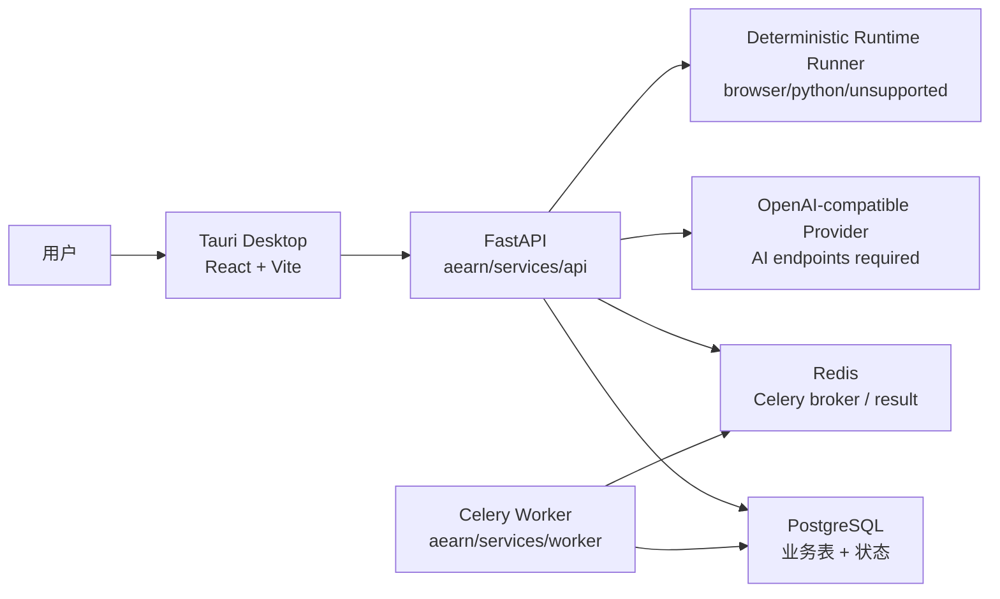

# Aearn 新人接手与学习指南

状态：Living Guide

适用对象：第一次接手本仓库的开发者、代码审查者、学习者或 AI coding agent

定位：本文件是仓库导读和上手路径，不替代 `docs/README.md` 中列出的 source of truth 文档

## 1. 先建立正确心智模型

Aearn 是一个“面向 AI 编程的编程语言学习 Agent MVP”。它不是通用学科教学系统，也不是传统语法背诵工具。它的第一版目标是帮助用户在 AI 编程背景下练习这些能力：

- 看懂 AI 生成或半生成代码。
- 补全关键代码空缺。
- 运行或预览代码效果。
- 根据真实错误和测试反馈定位原因。
- 用自己的解释证明理解。
- 把薄弱知识点进入复习和笔记循环。

第一版最小闭环固定为：

```text
语言选择
  -> 生成 plan_draft
  -> 确认学习计划
  -> 进入当前学习会话
  -> 对话中生成代码练习 UI
  -> 运行/预览
  -> 提交
  -> 保存 Attempt
  -> 更新 ReviewState
  -> 记录笔记
```

必须先记住三个边界：

- 正式运行时目录是 `aearn/`，不要把历史教程目录当作 runtime。
- `docs/` 是产品、架构、API、数据库、验收和实施边界的 source of truth。
- `docs/design/learning-agent-claude-desktop-framework.html` 是受保护的用户设计原型，只能作为视觉和布局参考，不能删除，也不是运行时代码。

## 2. 仓库最重要的 source of truth

第一次接手不要先从代码随便搜。推荐按下面顺序读：

| 顺序 | 文件 | 先读原因 |
|---:|---|---|
| 1 | `docs/README.md` | 确认当前保留的必要文档和被移除的旧文档，不要从废弃草案开始 |
| 2 | `docs/product/user-flows.md` | 理解用户流程、MVP 边界、哪些流程已移除或后置 |
| 3 | `docs/product/frontend-interaction-spec.md` | 理解 desktop 页面、组件、状态、按钮和前端越界限制 |
| 4 | `docs/architecture/api-contract.md` | 理解前后端接口、错误结构、幂等、SSE frame 和核心对象 |
| 5 | `docs/architecture/database-schema.md` | 理解 PostgreSQL 表、关系、约束、seed 与写库时机 |
| 6 | `docs/architecture/langgraph-state-machine.md` | 理解 Agent 节点、条件边、失败分支和写库时机 |
| 7 | `docs/architecture/code-completion-evaluation-spec.md` | 理解 run/submit、评分、硬门槛和 `fsrs_rating` 映射 |
| 8 | `docs/architecture/fsrs-scheduling-spec.md` | 理解 ReviewState、ReviewLog、due review 和 Celery 调度 |
| 9 | `docs/qa/acceptance-test-plan.md` | 理解 P0/P1/P2 验收口径，尤其是不能只看模型回答是否“像样” |
| 10 | `docs/setup/development-environment.md` | 理解本机工具链、环境变量、Docker 服务和模型配置 |
| 11 | `docs/plans/learning-agent-implementation-plan.md` | 理解 M0 到 M6 的实现顺序、审查顺序和发布标准 |

读文档时要区分两类内容：

- 规格类文档定义“应该是什么”。例如 API 契约、数据库 schema、前端交互。
- 当前代码定义“现在真实实现到哪里”。例如 `app/db/bootstrap.py`、`routes/*.py`、`src/api.ts`。

如果二者冲突，开发前应先确认是否是实现偏差、文档过期、还是未来计划尚未落地。不要只凭一个文件下结论。

## 3. 第一天接手建议路线

第一天目标不是马上改功能，而是建立可验证的本机运行链路。

1. 看 Git 状态，确认是否有用户未提交改动。

```powershell
git status --short
```

2. 看文档入口和正式 runtime 目录。

```powershell
Get-Content .\docs\README.md
Get-ChildItem .\aearn
```

3. 启动 PostgreSQL 和 Redis。

```powershell
docker compose -f .\aearn\infra\docker-compose.yml up -d
docker compose -f .\aearn\infra\docker-compose.yml ps
```

4. 安装后端依赖并初始化数据库。

```powershell
uv --directory .\aearn\services\api sync
uv --directory .\aearn\services\api run python -m app.db.bootstrap
```

5. 跑最小后端 smoke。

```powershell
uv --directory .\aearn\services\api run python -m pytest tests/test_health.py tests/test_db_bootstrap.py
```

6. 启动 API。

```powershell
uv --directory .\aearn\services\api run uvicorn app.main:app --host 127.0.0.1 --port 8001 --reload
```

7. 另开终端检查 API。

```powershell
Invoke-RestMethod http://127.0.0.1:8001/health
```

8. 安装前端依赖并跑 desktop build gate。

```powershell
pnpm install --dir .\aearn
pnpm --dir .\aearn desktop:check
```

9. 启动桌面端开发服务。

```powershell
pnpm --dir .\aearn desktop:dev
```

如果只想打开浏览器里的 Vite 页面，不启动 Tauri shell：

```powershell
pnpm --dir .\aearn\apps\desktop dev
```

10. 如需 worker，启动 Celery。

```powershell
uv --directory .\aearn\services\worker sync
uv --directory .\aearn\services\worker run celery -A aearn_worker.worker_app:celery_app worker --loglevel=info
```

当前 `aearn/infra/docker-compose.yml` 只启动 PostgreSQL 和 Redis，不包含 API 或 worker 容器。

## 4. 仓库结构地图

仓库根目录的职责：

| 路径 | 职责 |
|---|---|
| `AGENTS.md` | 本仓库给 AI agent 和开发者的协作规则 |
| `CLAUDE.md` | Claude 侧协作入口 |
| `.trellis/` | Trellis 工作流、spec、task、journal，不是业务 runtime |
| `.agents/skills/` | 本仓库 Trellis skill |
| `.codex/` | Codex 局部配置 |
| `docs/` | 产品、架构、API、数据库、验收、环境和实施计划 |
| `aearn/` | 正式 MVP runtime |
| `scripts/` | 辅助脚本，目前包含 live LLM smoke 脚本 |

`aearn/` 子项目结构：

| 路径 | 职责 |
|---|---|
| `aearn/package.json` | workspace 层脚本，暴露 `desktop:dev`、`desktop:build`、`desktop:check` |
| `aearn/.env.example` | 本地环境变量模板，不含真实 secret |
| `aearn/infra/docker-compose.yml` | 本地 PostgreSQL 和 Redis |
| `aearn/services/api/` | FastAPI API、数据库访问、Agent 边界、运行/评分/复习/笔记逻辑 |
| `aearn/services/worker/` | Celery worker，当前有 health 与 due review 统计任务 |
| `aearn/apps/desktop/` | Tauri 2 + Vite + React + TypeScript 桌面端 |
| `aearn/packages/shared/` | 未来跨 runtime 共享契约，当前仍是 placeholder |

生成物和本地状态不要当作源代码：

- `node_modules/`
- `dist/`
- `.venv/`
- `target/`
- `__pycache__/`
- `.pytest_cache/`
- `.ruff_cache/`
- `.mypy_cache/`
- `*.egg-info`
- `.env` 和 `.env.*`

## 5. 当前产品主流程

### 5.1 Onboarding 与计划生成

用户第一次进入应用时，会选择语言课程并填写目标。后端通过 `POST /api/plans/generate` 生成 `plan_draft`，再通过 `POST /api/plans` 确认成正式学习计划。

关键约束：

- `plan_draft` 生成不应直接写正式 `learning_plans`。
- 确认计划要写入 `learning_plans`、`plan_modules`、`knowledge_points` 和初始 `review_states`。
- Java/C++ 目前只能作为 `compiled_sandbox_later` 占位能力，不承诺完整编译沙箱。

### 5.2 日常进入当前学习

普通打开应用默认进入当前学习，通过 dashboard/resume 判断当前阶段、复习数量、上次停留点和提示信息。

关键约束：

- 普通打开不应强制进入复习。
- 只有中断多日且复习高风险时，才优先引导复习。

### 5.3 生成式代码练习

学习会话通过 `POST /api/learning-sessions/start` 开始。桌面端在对话流中展示生成式练习卡片，用户补全代码后可以 run 或 submit。

关键约束：

- 前端按钮只展示“运行、预览、测试、提交”等用户语言。
- 不要把 `Attempt(run)`、`Attempt(submit)`、`review_submit` 暴露成用户可见概念。
- `run` 写 `Attempt(run)`，但不更新 `ReviewState`。
- `submit` 写 `Attempt(submit)`，并基于评分结果更新学习状态和复习状态。

### 5.4 错因解释与解释检查

运行失败后，用户可以请求 `explain-error`。后端必须走配置好的 OpenAI-compatible 模型；未配置、超时、非法 JSON 或 guardrail 失败时，返回 `MODEL_UNAVAILABLE`，不回退到确定性解释。

关键约束：

- 错因解释必须来自真实 runtime/test/error 事实。
- 不得泄露隐藏测试、参考答案、真实 API key 或 provider 原始错误。
- `generation_source=llm` 表示模型链路成功；失败时使用错误信封里的 `error.code=MODEL_UNAVAILABLE` 判断。

### 5.5 复习闭环

提交结果映射到 `fsrs_rating`，再更新 `review_states`。复习页通过 `GET /api/reviews/today` 拉取到期项，通过 `POST /api/reviews/start` 开始复习，通过 `POST /api/reviews/{session_id}/exercise-result` 写复习提交结果。

关键约束：

- 重试不能重复增加 review count。
- `due_at`、`forget_risk`、`fsrs_rating` 由后端计算，前端只展示。
- 复习变体要围绕同一个知识点和错因，不应变成泛化新课。

### 5.6 笔记页与笔记抽屉

学习和复习中都可以打开当前知识点的笔记抽屉；笔记页可以按语言和知识点组织 Markdown 笔记。

关键约束：

- 学习会话和复习会话引用同一份知识点笔记。
- Agent 只能辅助补全当前 Note，不自动生成完整笔记。
- MVP 不存在独立 `CodeDraftPage`、`publishDrawer` 或复盘草稿发布流。

### 5.7 设置页

设置页允许调整外观、学习偏好、讲解风格、提示风格、通知偏好和诊断信息。

关键约束：

- 不允许通过设置页修改后端评分规则。
- 不允许修改 Attempt 必填事实记录策略。
- 不允许修改 FSRS 固定调度规则。
- 模型 API key 只来自本机 `aearn/.env`，不应在桌面设置页保存真实 key。

## 6. 运行时架构



重要实现事实：

- Desktop API base URL 当前固定在 `aearn/apps/desktop/src/api.ts` 的 `http://127.0.0.1:8001`。
- FastAPI CORS 允许 `http://127.0.0.1:1420`、`http://localhost:1420` 和 `tauri://localhost`。
- 数据库 schema 当前由 `aearn/services/api/app/db/schema.sql` 和 `app.db.bootstrap` 初始化，不是 Alembic migration。
- Docker compose 当前只提供依赖服务，不提供 API/worker 容器。
- LLM 是 AI 驱动接口的必需能力；本地测试通过 fake client 覆盖模型成功路径，未配置或不可用时接口返回 `MODEL_UNAVAILABLE`。

## 7. 后端代码地图

后端目录：`aearn/services/api/`

| 路径 | 职责 |
|---|---|
| `pyproject.toml` | API 服务依赖，包含 FastAPI、LangGraph、OpenAI Agents SDK、psycopg、Redis、Celery、pytest、ruff、mypy |
| `app/main.py` | FastAPI 入口、CORS、路由注册、统一 validation error handler |
| `app/core/config.py` | 从环境变量读取 API、DB、Redis、Celery、LLM 配置 |
| `app/core/errors.py` | 统一错误响应结构 |
| `app/db/connection.py` | psycopg 连接封装 |
| `app/db/schema.sql` | 当前真实数据库 schema |
| `app/db/bootstrap.py` | 应用 schema 并写入 runtime/course seed |
| `app/db/seeds.py` | runtime profiles 与 language courses seed |
| `app/models/*.py` | Pydantic 请求/响应模型和领域数据结构 |
| `app/routes/*.py` | FastAPI 路由层，负责校验、调用 service/repository、映射错误 |
| `app/services/*.py` | 业务逻辑、数据库读写、runner、评分、复习、笔记、LLM 边界 |
| `app/agents/*.py` | OpenAI Agents SDK 相关客户端、prompt guardrails、工具封装 |
| `tests/*.py` | 后端 contract、业务流、SSE、LLM guardrail、worker import 测试 |

### 7.1 路由与 API 分组

| 路由文件 | 前缀 | 主要接口 |
|---|---|---|
| `routes/health.py` | 无前缀 | `GET /health` |
| `routes/users.py` | `/api/users` | 创建用户、读取用户、更新偏好 |
| `routes/courses.py` | `/api/language-courses` | 读取语言课程与 runtime capability |
| `routes/plans.py` | `/api/plans` | 生成 `plan_draft`、确认计划、读取计划 |
| `routes/dashboard.py` | `/api` | `GET /api/dashboard` |
| `routes/learning_sessions.py` | `/api/learning-sessions` | resume、start、messages、run、submit、hint、explain-error、check-explanation |
| `routes/reviews.py` | `/api/reviews` | today、start、exercise-result |
| `routes/notes.py` | `/api/notes` | list、create、patch、agent-draft |

### 7.2 服务层职责

| 文件 | 主要职责 |
|---|---|
| `catalog.py` | 课程目录和 runtime capability 查询 |
| `user_repository.py` | 用户和偏好读写，拒绝修改固定后端规则 |
| `plan_generator.py` | 基于服务端课程模板生成 `plan_draft`，可接受通过校验的 SDK 候选 |
| `plan_repository.py` | 确认计划、写入 plan/module/knowledge point/review state |
| `learning_session_repository.py` | 学习会话、练习上下文、Attempt 写入、会话状态 |
| `learning_conversation.py` | 学习对话服务边界 |
| `runtime_runner.py` | 确定性运行器，处理 `browser_preview`、`python_stdout_test`、`compiled_sandbox_later` |
| `evaluation.py` | submit 评分、hard gates、result、`fsrs_rating`、next action |
| `exercise_guidance.py` | hint、错误解释、解释检查相关指导逻辑 |
| `llm_client.py` | OpenAI-compatible provider client 边界 |
| `llm_explain_error.py` | `explain-error` 的 LLM 调用、结构校验和失败返回边界 |
| `review_scheduler.py` | FSRS-like 调度计算与幂等更新 |
| `review_repository.py` | due review、复习 session、复习提交 |
| `dashboard_repository.py` | dashboard 与 resume 决策 |
| `note_repository.py` | Note CRUD 与 note assist |
| `sse.py` | SSE frame 格式化和递增 event id |

### 7.3 Agent 边界

| 文件 | 职责 |
|---|---|
| `agents/sdk_runtime.py` | OpenAI Agents SDK runtime 封装 |
| `agents/guardrails.py` | 防泄漏、防完整答案、防旧流程回流等 guardrail |
| `agents/tools.py` | 给 Agent 使用的安全、有限上下文工具 |
| `agents/onboarding_plan_agent.py` | Onboarding plan draft 候选生成 |
| `agents/learning_conversation_agent.py` | 学习对话流式回答 |
| `agents/exercise_coach_agent.py` | hint、错因解释、解释检查 |
| `agents/review_coach_agent.py` | 复习变体和复习提示 |
| `agents/note_assist_agent.py` | 笔记辅助补全 |

Agent 代码不能绕过 service/repository 直接随意写库。真正的事实写入仍由后端服务层控制。

### 7.4 数据库表分组

当前 schema 包含这些核心表：

| 分组 | 表 | 作用 |
|---|---|---|
| 用户与配置 | `users` | 本地用户 profile、偏好、提醒设置 |
| Runtime 与课程 | `runtime_profiles`、`language_courses` | 支持语言、运行能力、课程模板 |
| 计划 | `learning_plans`、`plan_modules`、`knowledge_points` | 用户学习计划、模块、知识点 |
| 练习目录 | `exercises`、`code_blanks`、`test_cases` | 练习题、空缺、可见/隐藏测试 |
| 会话与提交 | `learning_sessions`、`attempts` | 学习/复习会话、run/submit/review_submit 事实记录 |
| 复习 | `review_states`、`review_logs` | 当前复习状态和每次更新日志 |
| 笔记 | `notes` | 按知识点绑定的 Markdown 笔记和 agent draft |
| 幂等 | `idempotency_records` | 防重复提交、防重试重复写入 |

理解后端状态机时，优先看 `attempts`、`review_states`、`review_logs` 和 `idempotency_records`。很多关键 bug 都会发生在“请求重试以后是否重复写状态”这个边界上。

## 8. 前端代码地图

前端目录：`aearn/apps/desktop/`

| 路径 | 职责 |
|---|---|
| `package.json` | desktop package 脚本和依赖 |
| `src/main.tsx` | React mount 入口 |
| `src/App.tsx` | app shell/orchestrator，负责全局布局、路由装配和顶层流程衔接 |
| `src/api.ts` | API client、请求错误归一、SSE URL/build helpers、响应 shape 校验 |
| `src/types.ts` | 与 API 和 UI 共享的 TypeScript 类型 |
| `src/appTypes.ts` | app-local UI 状态类型 |
| `src/styles.css` | 当前 desktop 样式主文件 |
| `src/components/` | 共享 UI 组件，例如导航、状态卡、笔记抽屉、消息列表 |
| `src/pages/` | 路由级页面：Onboarding、Learning Workspace、Review、Notes、Settings |
| `src/features/learning/` | 生成式代码练习 workbench、运行反馈、提交摘要、解释检查等 |
| `src/hooks/` | 自定义 hook，例如 auto-save 和 POST SSE stream |
| `src/lib/` | 文案、bootstrap storage、错误文案、学习 helper、type guard |
| `src/stores/` | Zustand store，管理 app、notes、settings 状态 |
| `src-tauri/` | Tauri Rust shell、能力声明、图标、配置 |

### 8.1 页面职责

| 页面 | 文件 | 主要职责 |
|---|---|---|
| Onboarding | `pages/OnboardingPage.tsx` | 选择课程、填写目标、生成草稿、确认计划 |
| Learning Workspace | `pages/LearningWorkspacePage.tsx` | 当前学习、路线、对话、生成式练习、run/submit/hint/explain |
| Review | `pages/ReviewPage.tsx` | due review 列表、复习变体、复习提交、复习指标 |
| Notes | `pages/NotesPage.tsx` | 笔记列表、知识点筛选、Markdown 编辑、保存 |
| Settings | `pages/SettingsPage.tsx` | 外观、学习偏好、模型诊断、通知、隐私、关于 |

### 8.2 前端状态边界

前端可以拥有：

- 表单输入状态。
- 页面路由状态。
- loading/error/disabled/stale 状态。
- 本地草稿和编辑器内容。
- API offline 提示。
- 未保存笔记状态。

前端不应该拥有：

- 最终 score。
- `fsrs_rating`。
- `due_at` 调度。
- Attempt 类型判定。
- ReviewState 更新规则。
- hidden tests。
- 真实 API key。

### 8.3 SSE 注意点

当前后端有 POST 型 SSE，例如：

- `POST /api/learning-sessions/{session_id}/messages`
- `POST /api/learning-sessions/{session_id}/exercises/{exercise_id}/run`
- `POST /api/learning-sessions/{session_id}/exercises/{exercise_id}/submit`
- `POST /api/notes/{note_id}/agent-draft`

浏览器 `EventSource` 不能携带 POST body，所以 desktop 使用 `fetch + ReadableStream` 方式读取流。相关 hook 在 `src/hooks/useSSE.ts`。不要把它改回普通 `EventSource`。

## 9. 本地环境与配置

### 9.1 必备工具

| 工具 | 用途 |
|---|---|
| PowerShell 7 | Windows 下统一执行命令 |
| Git | 版本控制 |
| Docker Desktop | PostgreSQL、Redis |
| Node.js + pnpm | React/Vite/Tauri 前端 |
| Rust stable + Cargo | Tauri shell 编译 |
| Python 3.11/3.12 + uv | FastAPI、Agent、测试 |
| VS Build Tools / WebView2 Runtime | Windows Tauri 依赖 |

检查命令：

```powershell
pwsh --version
git --version
docker --version
docker compose version
node --version
pnpm --version
rustc --version
cargo --version
python --version
uv --version
```

### 9.2 环境变量

本机从模板复制：

```powershell
Copy-Item .\aearn\.env.example .\aearn\.env
```

主要变量：

| 变量 | 作用 |
|---|---|
| `APP_ENV` | 应用环境 |
| `API_HOST` / `API_PORT` | API host 和端口，当前默认 `127.0.0.1:8001` |
| `DATABASE_URL` | PostgreSQL 连接串 |
| `REDIS_URL` | Redis 连接串 |
| `CELERY_BROKER_URL` / `CELERY_RESULT_BACKEND` | Celery broker 和 result backend |
| `LLM_TYPE` | 当前支持 `openai` 或 disabled 类状态 |
| `OPENAI_API_KEY` | OpenAI-compatible provider key，本地 secret，不提交 |
| `OPENAI_BASE_URL` | provider base URL |
| `OPENAI_MODEL` | provider model name |
| `LLM_TIMEOUT_SECONDS` | LLM 超时 |
| `RUNNER_BROWSER_ENABLED` | browser preview runner 开关 |
| `RUNNER_PYTHON_ENABLED` | Python stdout runner 开关 |
| `RUNNER_COMPILED_SANDBOX_ENABLED` | Java/C++ 编译沙箱开关，MVP 默认 false |

不要把真实 `.env`、API key、provider 错误详情或数据库密码提交到 Git。

### 9.3 模型 API

模型是 AI 驱动页面的硬前提。没有模型配置时，错因解释、笔记辅助、学习页/复习页对话和建档槽位提取必须返回 `MODEL_UNAVAILABLE`；本地自动化测试通过 fake client 覆盖成功路径，不依赖真实第三方 API key。真实模型路径主要用于验证：

- OpenAI-compatible client。
- `explain-error`。
- learning conversation streaming。
- note assist。
- onboarding plan candidate。
- review coach。

接模型前先确认 provider 当前真实可用的 model list，不要假设模型名。

## 10. 常用命令

### 10.1 基础服务

```powershell
docker compose -f .\aearn\infra\docker-compose.yml up -d
docker compose -f .\aearn\infra\docker-compose.yml ps
docker compose -f .\aearn\infra\docker-compose.yml down
```

### 10.2 数据库初始化

```powershell
uv --directory .\aearn\services\api run python -m app.db.bootstrap
```

这个命令会读取 `schema.sql`，并写入 `runtime_profiles` 和 `language_courses` seed。它应当可重复执行。

### 10.3 API

```powershell
uv --directory .\aearn\services\api sync
uv --directory .\aearn\services\api run uvicorn app.main:app --host 127.0.0.1 --port 8001 --reload
```

健康检查：

```powershell
Invoke-RestMethod http://127.0.0.1:8001/health
```

### 10.4 Worker

```powershell
uv --directory .\aearn\services\worker sync
uv --directory .\aearn\services\worker run celery -A aearn_worker.worker_app:celery_app worker --loglevel=info
```

当前 worker 注册：

- `health.ping`
- `review.refresh_due_counts`

### 10.5 Desktop

```powershell
pnpm install --dir .\aearn
pnpm --dir .\aearn desktop:check
pnpm --dir .\aearn desktop:dev
```

只启动 Vite：

```powershell
pnpm --dir .\aearn\apps\desktop dev
```

只构建 desktop package：

```powershell
pnpm --dir .\aearn\apps\desktop build
```

### 10.6 后端测试

最小 smoke：

```powershell
uv --directory .\aearn\services\api run python -m pytest tests/test_health.py
```

数据库 bootstrap：

```powershell
uv --directory .\aearn\services\api run python -m pytest tests/test_db_bootstrap.py
```

主业务流：

```powershell
uv --directory .\aearn\services\api run python -m pytest tests/test_onboarding_m2.py tests/test_learning_sessions_m3.py tests/test_reviews_m4.py tests/test_notes_m5.py tests/test_dashboard_resume_m6.py
```

LLM、SSE、worker 边界：

```powershell
uv --directory .\aearn\services\api run python -m pytest tests/test_llm_integration.py tests/test_sse_utils.py tests/test_worker_import.py
```

完整后端测试：

```powershell
uv --directory .\aearn\services\api run python -m pytest
```

这些测试会使用本地 PostgreSQL。含 `bootstrap_database()` 的测试共享同一个本地数据库，不要并行跑 M2/M3/M4/M5/M6 测试批次。

### 10.7 后端静态检查

```powershell
uv --directory .\aearn\services\api run ruff check .
uv --directory .\aearn\services\api run mypy app
```

如果只改文档，通常不需要跑完整应用测试，但至少应该跑：

```powershell
git diff --check
```

## 11. API 快速地图

| 能力 | API |
|---|---|
| 健康检查 | `GET /health` |
| 创建用户 | `POST /api/users` |
| 读取用户 | `GET /api/users/{user_id}` |
| 更新偏好 | `PATCH /api/users/{user_id}/preferences` |
| 课程目录 | `GET /api/language-courses` |
| 生成计划草稿 | `POST /api/plans/generate` |
| 确认计划 | `POST /api/plans` |
| 读取计划 | `GET /api/plans/{plan_id}` |
| dashboard | `GET /api/dashboard` |
| 恢复上下文 | `GET /api/learning-sessions/resume` |
| 开始学习会话 | `POST /api/learning-sessions/start` |
| 学习对话 | `POST /api/learning-sessions/{session_id}/messages` |
| 运行练习 | `POST /api/learning-sessions/{session_id}/exercises/{exercise_id}/run` |
| 提交练习 | `POST /api/learning-sessions/{session_id}/exercises/{exercise_id}/submit` |
| 获取提示 | `POST /api/learning-sessions/{session_id}/exercises/{exercise_id}/hint` |
| 解释错误 | `POST /api/learning-sessions/{session_id}/attempts/{attempt_id}/explain-error` |
| 检查解释 | `POST /api/learning-sessions/{session_id}/attempts/{attempt_id}/check-explanation` |
| 今日复习 | `GET /api/reviews/today` |
| 开始复习 | `POST /api/reviews/start` |
| 复习提交结果 | `POST /api/reviews/{session_id}/exercise-result` |
| 笔记列表 | `GET /api/notes` |
| 创建笔记 | `POST /api/notes` |
| 更新笔记 | `PATCH /api/notes/{note_id}` |
| 笔记辅助补全 | `POST /api/notes/{note_id}/agent-draft` |

统一错误结构见 `docs/architecture/api-contract.md`。路由层应把 Pydantic validation error 归一为 `VALIDATION_ERROR`。

## 12. 测试文件地图

| 测试文件 | 覆盖范围 |
|---|---|
| `test_health.py` | API health |
| `test_db_bootstrap.py` | schema 初始化、seed、核心关系插入 |
| `test_onboarding_m2.py` | 用户、课程、plan_draft、确认计划、幂等 |
| `test_learning_sessions_m3.py` | learning session、messages、SSE、run、submit、hint、explain-error、runtime 边界 |
| `test_reviews_m4.py` | due review、review session、复习提交、scheduler 幂等 |
| `test_notes_m5.py` | Note CRUD、note assist、SSE、guardrail |
| `test_dashboard_resume_m6.py` | dashboard、resume、中断恢复和高风险复习入口 |
| `test_llm_integration.py` | OpenAI-compatible client、Agents SDK stream、guardrails、`MODEL_UNAVAILABLE`/拒绝非法输出 |
| `test_sse_utils.py` | SSE frame 格式和 event id |
| `test_worker_import.py` | worker task 注册 |

改哪个层就至少跑对应测试文件。改跨层功能时，按“API contract -> DB write -> service -> frontend state -> acceptance”的顺序补测。

## 13. 常见开发任务应该看哪里

### 13.1 改 API 字段或新增接口

先看：

- `docs/architecture/api-contract.md`
- `docs/architecture/database-schema.md`
- 相关 `app/models/*.py`
- 相关 `app/routes/*.py`
- 相关 `app/services/*repository.py`
- `aearn/apps/desktop/src/api.ts`
- `aearn/apps/desktop/src/types.ts`

必须确认：

- 成功响应字段。
- 失败错误码。
- 是否需要 `Idempotency-Key`。
- 是否写 `attempts`、`review_states`、`review_logs`。
- 前端是否需要新增 loading/error/stale 状态。

### 13.2 改桌面页面或组件

先看：

- `docs/product/frontend-interaction-spec.md`
- `.trellis/spec/frontend/directory-structure.md`
- `.trellis/spec/frontend/quality-guidelines.md`
- 对应 `src/pages/*`
- 对应 `src/stores/*`
- 对应 `src/api.ts` 函数和 `src/types.ts` 类型

必须确认：

- 不暴露后端内部术语。
- 不在前端计算最终评分、FSRS 或 due date。
- API offline、loading、error、retry、disabled、stale 状态可见。
- `pnpm --dir .\aearn desktop:check` 通过。

### 13.3 改评分或运行器

先看：

- `docs/architecture/code-completion-evaluation-spec.md`
- `docs/architecture/fsrs-scheduling-spec.md`
- `app/services/runtime_runner.py`
- `app/services/evaluation.py`
- `app/services/review_scheduler.py`
- `tests/test_learning_sessions_m3.py`
- `tests/test_reviews_m4.py`

必须确认：

- `runtime_status` 只在允许枚举内。
- `result` 与 `fsrs_rating` 映射合法。
- hard gates 失败时不能返回 `passed` 或 `easy`。
- Java/C++ 仍是 unsupported 或禁用边界。

### 13.4 改 LLM 或 Agent 输出

先看：

- `docs/qa/acceptance-test-plan.md`
- `app/services/llm_client.py`
- `app/agents/guardrails.py`
- 对应 `app/agents/*_agent.py`
- `tests/test_llm_integration.py`

必须确认：

- 输出结构可解析。
- 不泄露隐藏测试、答案、secret 或 provider 详情。
- 模型配置缺失、调用失败、输出非法或 guardrail 阻断时返回 `MODEL_UNAVAILABLE`。
- 默认测试不能依赖真实第三方 API key。

### 13.5 改笔记功能

先看：

- `docs/product/user-flows.md` 的笔记抽屉和笔记页流程。
- `docs/product/frontend-interaction-spec.md` 的 `NoteDrawer` 与 `NotesPage`。
- `app/routes/notes.py`
- `app/services/note_repository.py`
- `app/agents/note_assist_agent.py`
- `src/components/NoteDrawer.tsx`
- `src/pages/NotesPage.tsx`
- `src/stores/useNotesStore.ts`
- `tests/test_notes_m5.py`

必须确认：

- 学习和复习共用同一份知识点笔记。
- 保存失败不丢本地内容。
- Agent 只辅助补全当前 Note，不自动生成完整笔记。

## 14. 重要禁区

这些操作默认不要做：

- 不要重新引入历史教程目录作为正式 runtime。
- 不要删除或替换 `docs/design/learning-agent-claude-desktop-framework.html`。
- 不要在仓库根目录新增 Python 虚拟环境、`requirements.txt` 或散装依赖文件。
- 不要把真实 `.env`、API key、provider key、数据库密码提交。
- 不要把 `docs/design/` 当成运行时代码目录。
- 不要把 Java/C++ 编译沙箱描述成已完成。
- 不要在桌面端展示 `Attempt(run)`、`Attempt(submit)`、`ReviewState`、`due_at` 这类内部术语。
- 不要让设置页修改评分、Attempt 持久化或 FSRS 调度规则。
- 不要在前端计算最终成绩、复习日期或 FSRS rating。
- 不要把 `/health` 正常当作完整业务流可用。
- 不要并行跑共享同一数据库状态的后端集成测试批次。

## 15. 当前实现与早期规划文本的几个差异

接手时尤其要注意这些“容易被旧规划误导”的地方：

| 主题 | 当前真实状态 |
|---|---|
| Compose 路径 | `aearn/infra/docker-compose.yml` |
| Compose 内容 | 只包含 PostgreSQL 和 Redis |
| 数据库初始化 | `uv --directory .\aearn\services\api run python -m app.db.bootstrap` |
| Schema 来源 | `aearn/services/api/app/db/schema.sql` |
| API runtime | `aearn/services/api/app/main.py` |
| Desktop runtime | `aearn/apps/desktop/` |
| Worker runtime | `aearn/services/worker/aearn_worker/worker_app.py` |
| Shared package | `aearn/packages/shared/` 目前仍是 placeholder |
| LLM | AI 驱动页面必需；未配置或不可用时返回 `MODEL_UNAVAILABLE` |
| Java/C++ | 课程可见但 runtime 为 `compiled_sandbox_later`，不提供完整沙箱 |

看到旧文档里的 `migrations/`、Alembic 或更深的 `infra/docker/` 目录时，要先对照当前 checkout，不要直接照旧路径执行。

## 16. 推荐阅读代码顺序

如果你想理解后端：

1. `aearn/services/api/app/main.py`
2. `aearn/services/api/app/routes/health.py`
3. `aearn/services/api/app/db/schema.sql`
4. `aearn/services/api/app/db/bootstrap.py`
5. `aearn/services/api/app/routes/users.py`
6. `aearn/services/api/app/routes/courses.py`
7. `aearn/services/api/app/routes/plans.py`
8. `aearn/services/api/app/services/plan_generator.py`
9. `aearn/services/api/app/services/plan_repository.py`
10. `aearn/services/api/app/routes/learning_sessions.py`
11. `aearn/services/api/app/services/learning_session_repository.py`
12. `aearn/services/api/app/services/runtime_runner.py`
13. `aearn/services/api/app/services/evaluation.py`
14. `aearn/services/api/app/services/review_scheduler.py`
15. `aearn/services/api/app/routes/reviews.py`
16. `aearn/services/api/app/routes/notes.py`
17. `aearn/services/api/app/services/llm_client.py`
18. `aearn/services/api/app/agents/guardrails.py`

如果你想理解前端：

1. `aearn/apps/desktop/src/main.tsx`
2. `aearn/apps/desktop/src/App.tsx`
3. `aearn/apps/desktop/src/types.ts`
4. `aearn/apps/desktop/src/api.ts`
5. `aearn/apps/desktop/src/stores/useAppStore.ts`
6. `aearn/apps/desktop/src/pages/OnboardingPage.tsx`
7. `aearn/apps/desktop/src/pages/LearningWorkspacePage.tsx`
8. `aearn/apps/desktop/src/features/learning/ExerciseWorkbench.tsx`
9. `aearn/apps/desktop/src/hooks/useSSE.ts`
10. `aearn/apps/desktop/src/pages/ReviewPage.tsx`
11. `aearn/apps/desktop/src/components/NoteDrawer.tsx`
12. `aearn/apps/desktop/src/pages/NotesPage.tsx`
13. `aearn/apps/desktop/src/pages/SettingsPage.tsx`
14. `aearn/apps/desktop/src/styles.css`
15. `aearn/apps/desktop/src-tauri/tauri.conf.json`

如果你想理解产品和验收：

1. `docs/product/user-flows.md`
2. `docs/product/frontend-interaction-spec.md`
3. `docs/architecture/api-contract.md`
4. `docs/architecture/database-schema.md`
5. `docs/architecture/code-completion-evaluation-spec.md`
6. `docs/architecture/fsrs-scheduling-spec.md`
7. `docs/qa/acceptance-test-plan.md`
8. `docs/plans/learning-agent-implementation-plan.md`

## 17. 最小手工 smoke 路径

当 API 和 desktop 都已启动后，建议手工走一遍：

1. 打开 desktop 或 Vite 页面。
2. 确认顶部 API 状态在线。
3. 新建用户或进入 onboarding。
4. 选择 JavaScript 或 Python。
5. 输入学习目标。
6. 生成 `plan_draft`。
7. 确认学习计划。
8. 进入当前学习。
9. 开始一个学习会话。
10. 补全一段代码。
11. 点运行或预览。
12. 修改代码后确认旧结果被标记 stale。
13. 点提交。
14. 如果失败，点解释错误。
15. 打开笔记抽屉，写入并保存。
16. 进入复习页，确认 due review 逻辑和空态。
17. 进入设置页，确认没有评分、Attempt、FSRS 固定规则开关。

这条 smoke 的重点不是证明所有边界都通过，而是快速确认：

- API 和 desktop 能连通。
- Onboarding 到学习闭环能走通。
- 运行/提交/解释/笔记不会互相覆盖状态。
- 前端没有暴露后端内部概念。

## 18. 交付前检查清单

每次改动完成前，至少回答这些问题：

- 改动是否发生在 `aearn/` 的正式 runtime 或 `docs/` 的正确 source-of-truth 文件里？
- 是否误改了 `.env`、缓存、构建产物或本地配置？
- 是否对照过对应产品/API/DB/前端/验收文档？
- 是否保持了 `Attempt`、`ReviewState`、`ReviewLog` 的写入边界？
- 是否有幂等或重试场景？
- 前端是否有 loading、error、disabled、retry、stale 状态？
- 是否跑了与改动相关的最小测试？
- 文档是否需要同步回写？

推荐收口命令：

```powershell
git status --short
git diff --check
pnpm --dir .\aearn desktop:check
uv --directory .\aearn\services\api run python -m pytest
```

如果只改文档，可以不跑完整 runtime 测试，但要说明未跑的原因，并至少确认 Markdown 链接路径和 `git diff --check`。
